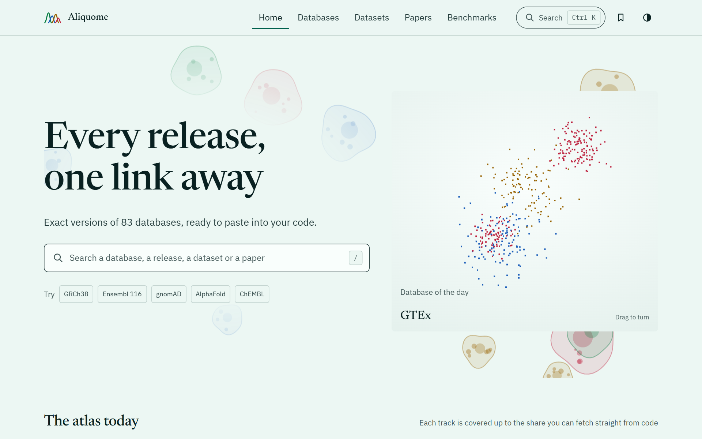
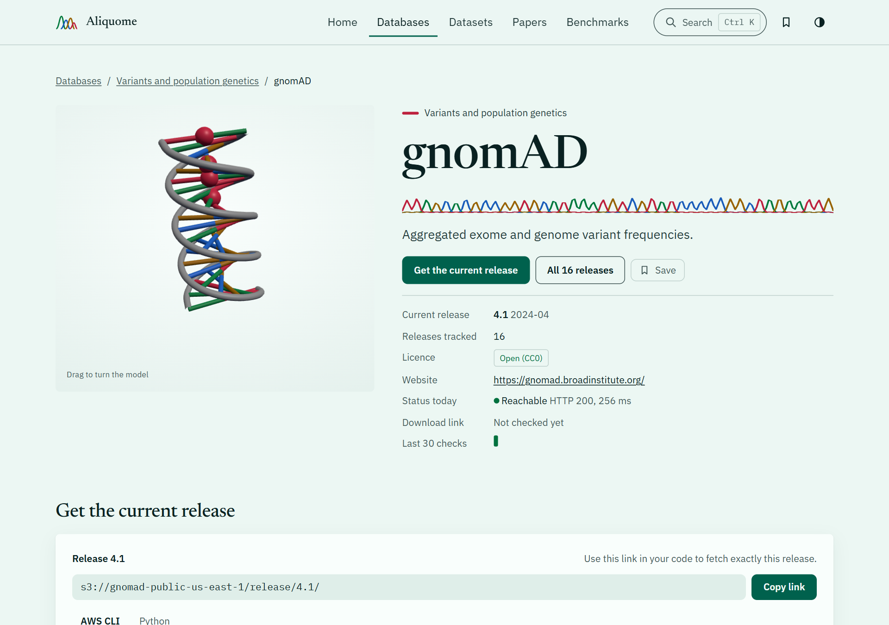
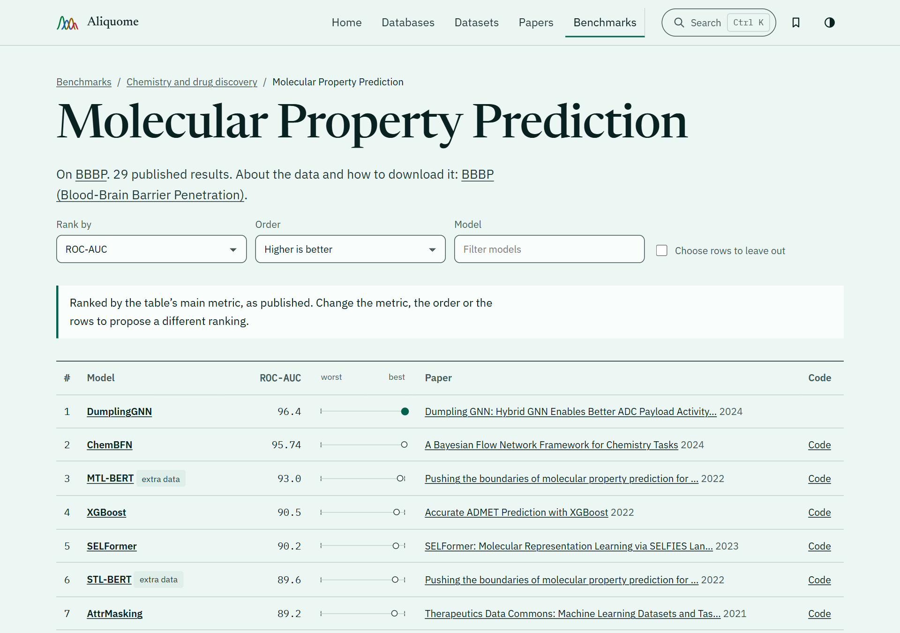
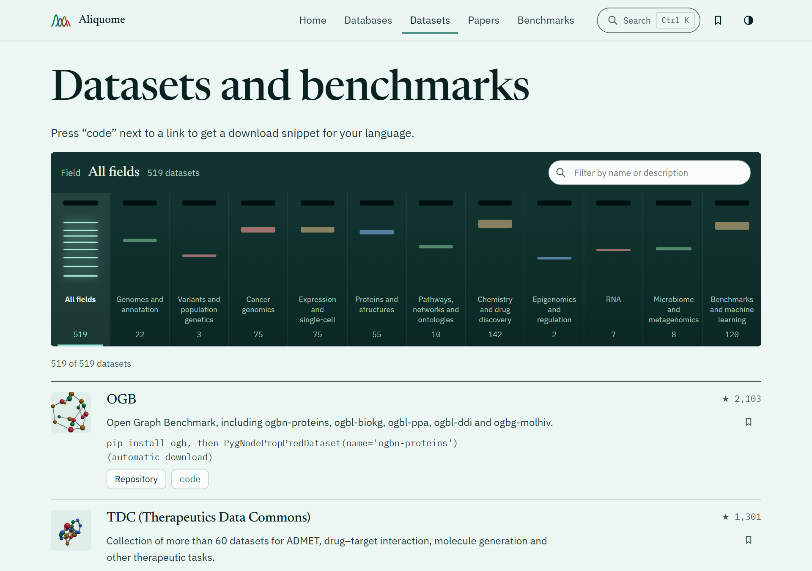
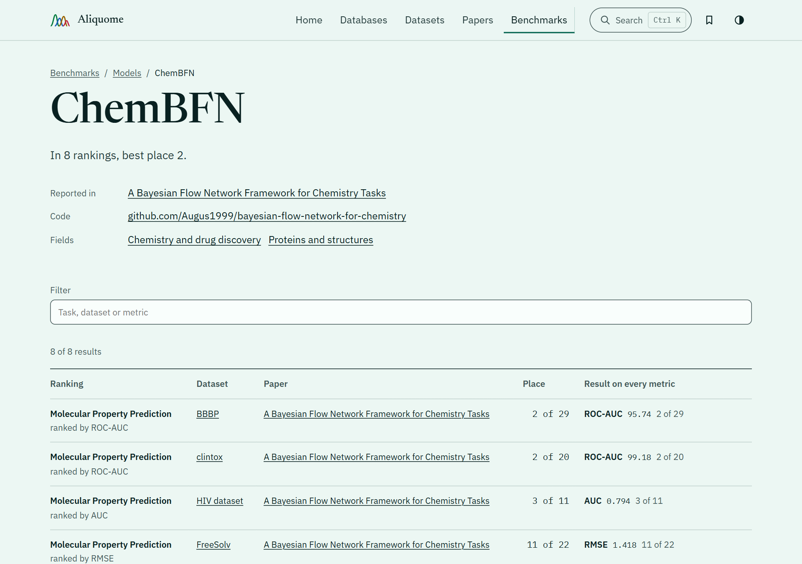

<h1 align="center">Aliquome</h1>

<p align="center"><b>An exact aliquot of every bioinformatics database: the precise release, one link away.</b><br>
Versioned download links, ready-to-run download code, AI-ready datasets, model leaderboards and the newest papers, in one open atlas.</p>

<p align="center">


</p>

<p align="center">
<a href="https://aliquome.github.io"><b>Website</b></a> |
<a href="#why-aliquome"><b>Why Aliquome</b></a> |
<a href="#whats-inside"><b>What's inside</b></a> |
<a href="#use-it-in-your-code"><b>Use it in code</b></a> |
<a href="#run-it-locally"><b>Run locally</b></a> |
<a href="#contribute"><b>Contribute</b></a> |
<a href="#cite"><b>Cite</b></a> |
<a href="#full-catalogue"><b>Full catalogue</b></a> |
<a href="#contact"><b>Contact</b></a>
</p>

---

**Aliquome** (*aliquot* + *-ome*: an exact portion of every dataset) is an open, free catalogue of **bioinformatics databases and datasets with every release version and a direct download link**. Reproducible research needs the exact data: *GRCh38 or T2T-CHM13? Ensembl 113 or 116? gnomAD v3 or v4? UniProt 2026_04?* Aliquome answers that for 83 core resources (reference genomes, variants, cancer genomics, single-cell and expression, protein structures, pathways, drug discovery, epigenomics, RNA and microbiome), and turns each link into ready-to-run download code for **curl, wget, Python, R, `pooch`, AWS CLI and `gcloud`**.

It also gathers **505 machine-learning-ready biology datasets**, **200 benchmark tables with 1,854 published results** to compare models, and the **newest papers from 22 leading bioinformatics and computational biology journals**. A Rust engine rebuilds everything every two days and checks that every source is still online. The site is static, fast and hosted on GitHub Pages at **[aliquome.github.io](https://aliquome.github.io)**.

<p align="center">
<a href="https://aliquome.github.io">
<picture>
  <source media="(prefers-color-scheme: dark)" srcset=".github/images/home-dark.png">
  
</picture>
</a>
</p>

| A database and its releases | A benchmark table you can re-rank |
|---|---|
|  |  |
| **Datasets for AI in biology** | **A model across every table** |
|  |  |

## Why Aliquome

- **Every version, one link away.** 794 releases of 83 databases, 733 of them with a direct, versioned URL you can paste into a pipeline, so your analysis can be rerun years later.
- **Download code for every link.** Files, FTP folders, Zenodo, Figshare, Hugging Face, Kaggle, GEO, Synapse, Dryad, Mendeley Data and GitHub each get the right client command. 75 library loaders (PyTorch Geometric, DeepChem, TDC, OGB, Hugging Face `datasets`, Bioconductor) and official clients for controlled data (UK Biobank, COSMIC, GDC, DepMap).
- **Datasets for AI in biology.** 505 datasets for protein, molecule, single-cell, genomics, histopathology, microscopy and biomedical text tasks; 88% come with download code.
- **Benchmarks you can rank yourself.** 200 results tables (molecular property prediction, protein function, drug–target interaction, retrosynthesis, biomedical NER, nucleus segmentation and more) plus the ProteinGym leaderboards. Re-rank by any metric, open a model or paper to see every ranking it appears in.
- **Community updates, reviewed.** Readers sign in with a one-time email code and suggest a ranking, add a result from their own paper or correct a value; nothing changes until a maintainer approves it.
- **New papers, sorted.** The last 60 days of Bioinformatics, Nucleic Acids Research, Genome Biology, Nature Methods, Nature Biotechnology and more, tagged by field and task, with open abstracts.
- **Reproducible by design.** All catalogue data lives in plain files in `data/`; offline builds are byte-identical, and every build records the SHA-256 of its inputs.
- **Free and open.** No account, no tracking, no server. Code under `MIT OR Apache-2.0`.

## What's inside

| Section | What you get | Size |
|---|---|---|
| **Databases** | Every release with date, status, direct link and download code | 83 databases, 794 releases |
| **Datasets** | Description, licence, paper, repository, loaders and download code | 505 datasets |
| **Benchmarks** | Results tables to filter by task and dataset; model and paper profiles | 200 tables, 951 models, 4 ProteinGym boards |
| **Papers** | New papers from leading journals, and the most cited open-access papers per field | ~1,350 new, 651 top papers |
| **Status** | Reachability of every source and of its current download link | checked every two days |

**Fields:** genomes and annotation · variants and population genetics · cancer genomics · expression and single-cell · proteins and structures · pathways, networks and ontologies · chemistry and drug discovery · epigenomics and regulation · RNA · microbiome and metagenomics · benchmarks and machine learning.

**Some of the databases:** GRCh37, GRCh38, T2T-CHM13, Ensembl, GENCODE, RefSeq, MANE, dbSNP, ClinVar, gnomAD, 1000 Genomes, UK Biobank, GDC/TCGA, COSMIC, DepMap, GTEx, CELLxGENE Census, Human Protein Atlas, UniProt, PDB, AlphaFold DB, Pfam, InterPro, CATH, KEGG, Reactome, Gene Ontology, ChEMBL, PubChem, DrugBank, ENCODE, JASPAR, RNAcentral, Rfam, GTDB and more.

## Use it in your code

Each database page gives a versioned link and code. For example, to fetch one release and record its checksum:

```python
import pooch  # downloads once, caches, and records the SHA-256

path = pooch.retrieve(
    url="https://ftp.ebi.ac.uk/pub/databases/uniprot/current_release/knowledgebase/complete/uniprot_sprot.fasta.gz",
    known_hash=None,
)
print(pooch.file_hash(path))  # keep this next to your results
```

Datasets show the library call that loads them:

```python
from tdc.multi_pred import DTI   # pip install PyTDC
data = DTI(name="DAVIS")
split = data.get_split()
```

The whole catalogue is also plain JSON, so scripts can query it directly:

| File | Contents |
|---|---|
| `site/data/sources.json` | databases, every release, links and loaders |
| `site/data/datasets.json` | datasets, links, licences and loaders |
| `site/data/benchmarks/*.json` | results tables |
| `site/data/latest.json`, `papers.json` | new and most cited papers |

They are served at `https://aliquome.github.io/data/<file>`, for example [sources.json](https://aliquome.github.io/data/sources.json).

## Run it locally

```bash
# build the data (needs Rust); --offline makes no network call
cargo run --release --manifest-path engine/Cargo.toml -- build --offline
# serve the site, then open http://localhost:3000
npx serve site
```

The page loads its data with `fetch`, so open it through a local server, not from disk.

## How it works

```
data/            plain-text catalogue: databases, releases, datasets, fields, journals, loaders, rankings
engine/          Rust program `aliquome`: turns data/ into site/data/*.json, fetches papers and
                 benchmark tables, checks every source (layers: domain, steps, infra)
site/            static website: HTML, CSS and ES modules (domain, core, ui, pages), three.js figures
.github/         build and deploy every two days; ranking approvals; reader suggestions; tests
supabase/        database rules for email sign-in and reader suggestions
tests/           end-to-end test of sign-in, suggestions, review and table updates
```

### Publish your own copy

1. Push to a public repository named `aliquome`, on `main`.
2. **Settings → Pages → Source:** GitHub Actions. **Settings → Actions → Workflow permissions:** read and write.
3. Run **Build and deploy** once from the Actions tab. It then runs every two days.
4. Optional: email sign-in for reader suggestions, see [docs/SUBMISSIONS.md](docs/SUBMISSIONS.md) (about 15 minutes).

## Contribute

- **Add a database:** a `[[source]]` block in `data/sources.toml` and its releases in `data/database_versions.csv`.
- **Add a dataset:** a row in `data/datasets.csv`; a library call in `data/loaders.toml`.
- **Add a benchmark board:** a `[[board]]` block in `data/leaderboards.toml`.
- **Change a ranking or add your paper's results:** use *Suggest a change* on any benchmark table.

No code change is needed for any of these. Open a pull request or an issue.

## Cite

If Aliquome helps your research, please cite it:

```bibtex
@misc{aliquome2026,
  title  = {Aliquome: versioned bioinformatics databases, datasets and benchmarks},
  year   = {2026},
  note   = {Open catalogue with direct release links and download code},
  howpublished = {\url{https://aliquome.github.io}}
}
```

## Contact

Questions, corrections or a database you would like added: write to **[alikianfar0@gmail.com](mailto:alikianfar0@gmail.com)** or [open an issue](https://github.com/aliquome/aliquome.github.io/issues).

## Credits and licence

Code: `MIT OR Apache-2.0` ([LICENSE-MIT](LICENSE-MIT), [LICENSE-APACHE](LICENSE-APACHE)). Aliquome links to data and hosts none of it; each source keeps its own licence, shown on its page.

326 dataset entries (ids starting with `pwc-`) and the 200 results tables are selected from the final Papers with Code archive on Hugging Face, [pwc-archive/datasets](https://huggingface.co/datasets/pwc-archive/datasets) and [pwc-archive/evaluation-tables](https://huggingface.co/datasets/pwc-archive/evaluation-tables) (snapshot of 28 July 2025, CC BY-SA 4.0). Papers come from [Europe PMC](https://europepmc.org); leaderboards from [ProteinGym](https://proteingym.org).

<!-- catalog:start -->
## Full catalogue

Everything on [aliquome.github.io](https://aliquome.github.io/), as plain lists. Updated automatically every two days; last update 2026-11-21.

### Bioinformatics databases and their releases (83 databases, 794 releases)

<details>
<summary><b>Genomes and annotation</b> (11 databases)</summary>

- **[GRCh37 (hg19)](https://aliquome.github.io/db/grch37/)**: Human reference assembly GRCh37 with all patch releases. Releases: GRCh37, GRCh37.p1, GRCh37.p2, GRCh37.p3, GRCh37.p4, GRCh37.p5, GRCh37.p6, GRCh37.p7, GRCh37.p8, GRCh37.p9, GRCh37.p10, GRCh37.p11, GRCh37.p12, GRCh37.p13, hs37d5, NCBI36 / hg18 and earlier.
- **[GRCh38 (hg38)](https://aliquome.github.io/db/grch38/)**: Current human reference assembly with patch releases p1 to p14. Releases: GRCh38, GRCh38.p1, GRCh38.p2, GRCh38.p3, GRCh38.p4, GRCh38.p5, GRCh38.p6, GRCh38.p7, GRCh38.p8, GRCh38.p9, GRCh38.p10, GRCh38.p11, GRCh38.p12, GRCh38.p13, GRCh38.p14.
- **[T2T-CHM13 and HPRC pangenome](https://aliquome.github.io/db/t2t-hprc/)**: Telomere-to-telomere human assembly and the Human Pangenome Reference Consortium releases. Releases: CHM13 draft v0.4–v0.9, CHM13 v1.0, CHM13 v1.1, CHM13 v2.0, HPRC Release 1, HPRC Release 2.
- **[UCSC Genome Browser](https://aliquome.github.io/db/ucsc/)**: Genome builds, tracks and download server for many species. Releases: hg4–hg8, hg10–hg13, hg15–hg18, hg19, hg38, hs1, mm9, mm10, mm39, rn6 / rn7 / rn8, danRer10 / danRer11, dm3 / dm6, ce10 / ce11, sacCer3.
- **[GenBank](https://aliquome.github.io/db/genbank/)**: NIH genetic sequence database, part of INSDC. Releases: 270, 271, 272, 273, 274.0.
- **[RefSeq](https://aliquome.github.io/db/refseq/)**: Curated reference sequences and the NCBI human annotation releases. Releases: 238, 105.20190906 / 105.20201022 / 105.20220307, 109 and 109.20190607–109.20211119, 110, GCF\_000001405.40-RS\_2023\_03, GCF\_000001405.40-RS\_2023\_10, GCF\_000001405.40-RS\_2024\_08, GCF\_000001405.40-RS\_2025\_08, GCF\_000001405.25-RS\_2024\_09, GCF\_009914755.1-RS\_2023\_03 / RS\_2023\_10.
- **[MANE](https://aliquome.github.io/db/mane/)**: Matched Annotation from NCBI and EMBL-EBI: one agreed transcript per human gene. Releases: 0.5–0.95, 1.0, 1.1–1.4, 1.5.
- **[Ensembl](https://aliquome.github.io/db/ensembl/)**: Genome annotation for vertebrates. Release 116 is the last numbered release. Releases: 54, 75, 76, 100, 101, 102, 103, 104, 105, 106, 107, 108, 109, 110, 111, 112, 113, 114, 115, 116, Rapid Release, Ensembl beta / Ensembl Organisms.
- **[Ensembl Genomes](https://aliquome.github.io/db/ensembl-genomes/)**: Ensembl annotation for plants, fungi, bacteria, metazoa and protists. Releases: 1, 2–62, 63.
- **[GENCODE](https://aliquome.github.io/db/gencode/)**: Reference gene annotation for human and mouse. Releases: 1–18, v19, v20, v44 / M33, v45 / M34, v46 / M35, v47 / M36, v48 / M37, v49 / M38, v50 / M39.
- **[Model organism databases](https://aliquome.github.io/db/model-organisms/)**: FlyBase, WormBase, SGD, MGI, ZFIN, RGD, TAIR and related resources. Releases: FlyBase FB2026\_01, FlyBase FB2026\_02, FlyBase FB2026\_03, FlyBase FB2026\_04, WormBase WS298, SGD R64-1-1, SGD R64-2-1, SGD R64-3-1, SGD R64-4-1, PomBase monthly, VEuPathDB.

</details>

<details>
<summary><b>Variants and population genetics</b> (9 databases)</summary>

- **[dbSNP](https://aliquome.github.io/db/dbsnp/)**: Catalogue of short genetic variants, by build. Releases: b151, b152, b153, b154, b155, b156, b157.
- **[ClinVar](https://aliquome.github.io/db/clinvar/)**: Clinical significance of human variants, with weekly and monthly archives. Releases: archive\_1.0, Weekly VCF 2017–2025, Weekly VCF 2026, clinvar\_20261108, Monthly XML 2025-01–2026-11, XML 2026-11.
- **[gnomAD](https://aliquome.github.io/db/gnomad/)**: Aggregated exome and genome variant frequencies. Releases: ExAC r0.3 / r0.3.1, 2.0.1 / 2.0.2, 2.1, 2.1.1, 3.0, 3.0.1, 3.1, 3.1.1, 3.1.2, 3.1.3, 4.0, 4.1, 4.1.1, 4.1.2, lr 0.1, 4.2 / 5.0.
- **[1000 Genomes](https://aliquome.github.io/db/1000genomes/)**: Human variation across populations, from the pilot to the 30x high-coverage data. Releases: Pilot, Phase 1, Phase 3, Phase 3 on GRCh38, 30x NYGC, 30x NYGC phased SNV/INDEL/SV.
- **[CADD](https://aliquome.github.io/db/cadd/)**: Deleteriousness scores for human variants. Releases: 1.0, 1.3, 1.4, 1.5, 1.6, 1.7.
- **[dbNSFP](https://aliquome.github.io/db/dbnsfp/)**: Functional predictions and annotations for non-synonymous variants. Releases: 2.x, 3.x, 4.0–4.9, 5.0 / 5.1 / 5.2.
- **[FinnGen](https://aliquome.github.io/db/finngen/)**: GWAS summary statistics from Finnish biobank data freezes. Releases: R2–R4, R5, R6, R7, R8, R9, R10, R11, R12, R13.
- **[All of Us](https://aliquome.github.io/db/allofus/)**: US cohort data, released as curated data repository versions. Releases: CDR v3 / v4, CDR v5, CDR v6, CDR v7, CDR v8.
- **[UK Biobank](https://aliquome.github.io/db/ukbiobank/)**: Genetic and health data for 500,000 participants. Releases: Genotyping interim 150k, Imputed v3, Exome 50k / 200k / 300k / 470k, WGS 200k interim, WGS 500k.

</details>

<details>
<summary><b>Cancer genomics</b> (4 databases)</summary>

- **[Genomic Data Commons](https://aliquome.github.io/db/gdc/)**: TCGA, TARGET, CPTAC and other cancer programs, by data release. Releases: DR 46.0, DR 45.0, DR 44.0, DR 43.0, DR 42.0, DR 41.0, DR 40.0, DR 39.0, DR 38.0, DR 37.0, DR 36.0, DR 35.0, DR 34.0, DR 33.1, DR 33.0, DR 32.0, DR 31.0, DR 30.0, DR 29.0, DR 28.0, DR 27.0-fix, DR 27.0, DR 26.0, DR 25.0, DR 24.0, DR 23.0, DR 22.0, DR 21.0, DR 20.0, DR 19.1, DR 19.0, DR 18.0, DR 17.1, DR 17.0, DR 16.0, DR 15.0, DR 14.0, DR 13.0, DR 12.0, DR 11.0, DR 10.1, DR 10.0, DR 9.0, DR 8.0, DR 7.0, DR 6.0, DR 5.0, DR 4.0, DR 3.0, DR 2.0, DR 1.0.
- **[COSMIC](https://aliquome.github.io/db/cosmic/)**: Catalogue of somatic mutations in cancer. Releases: v90, v91, v92, v94, v95, v96, v97, v98, v99, v100, v101, v102, v103, v104.
- **[DepMap](https://aliquome.github.io/db/depmap/)**: Cancer dependency map: CRISPR screens and cell line omics, by quarterly release. Releases: 18Q3–21Q4, 22Q1 / 22Q2 / 22Q4, 23Q2 / 23Q4, 24Q2, 24Q4, 25Q2, 25Q3, 26Q1, 26Q3.
- **[ICGC ARGO and ICGC 25K](https://aliquome.github.io/db/icgc/)**: International cancer genome data. The 25K portal was retired in 2024. Releases: ICGC 25K Release 1–28, ARGO DR9.0, ARGO DR10.0.

</details>

<details>
<summary><b>Expression and single-cell</b> (8 databases)</summary>

- **[GTEx](https://aliquome.github.io/db/gtex/)**: Gene expression and eQTLs across human tissues. Releases: v3, v4, v6 / v6p, v7, v8, v10, v11.
- **[ARCHS4](https://aliquome.github.io/db/archs4/)**: Uniformly processed RNA-seq from GEO and SRA. Releases: v1.11, v2.2, v2.3, v2.4, v2.5.
- **[eQTL Catalogue](https://aliquome.github.io/db/eqtl-catalogue/)**: Uniformly processed QTL summary statistics. Releases: r1, r2–r6, r7, r8 pre-release, r8 pre-release, updated, r8.
- **[Human Protein Atlas](https://aliquome.github.io/db/hpa/)**: Protein and RNA expression across human tissues and cells. Releases: v20, v21, v22, v23, v24, v25, v25.1.
- **[Expression Atlas](https://aliquome.github.io/db/expression-atlas/)**: Curated bulk and single-cell expression experiments. Releases: Expression Atlas r42, Expression Atlas r43, SCXA 202103 / 202105 / 202109 / 202110, SCXA 202203 / 202212, SCXA 202303, SCXA 202409, SCXA 202509.
- **[CELLxGENE Census](https://aliquome.github.io/db/cellxgene-census/)**: Tens of millions of single cells, released as dated builds. Releases: 2023-05-15, 2023-07-25, 2023-12-15, 2024-05-20, 2024-07-01, 2025-01-30, 2025-11-04, 2025-11-08, 2025-11-10.
- **[Allen Brain Cell Atlas](https://aliquome.github.io/db/allen-brain/)**: Whole-brain single-cell and spatial atlases, by dated release. Releases: 20230630, 20230830, 20231215, 20240330, 20240831, 20241115, 20241130, 20250131, 20250331, 20250531, 20250930, 20251031, 20260131, 20260228, 20260331, 20260415, 20260711, 20261031, 20261101, 20261130.
- **[Tabula Sapiens](https://aliquome.github.io/db/tabula-sapiens/)**: Human multi-organ single-cell atlas. Releases: v1, v2.

</details>

<details>
<summary><b>Proteins and structures</b> (15 databases)</summary>

- **[UniProt](https://aliquome.github.io/db/uniprot/)**: Protein sequence and function knowledgebase. Releases: release 1.0–15.0, 2010\_01–2020\_01, 2021\_01 / 2021\_02 / 2021\_03, 2021\_04, 2022\_01, 2022\_02, 2022\_03, 2022\_04, 2022\_05, 2023\_01, 2023\_02, 2023\_03, 2023\_04, 2023\_05, 2024\_01, 2024\_02, 2024\_03, 2024\_04, 2024\_05, 2024\_06, 2025\_01, 2025\_02, 2025\_03, 2025\_04, 2026\_01, 2026\_02, 2026\_03, 2026\_04.
- **[Protein Data Bank](https://aliquome.github.io/db/pdb/)**: Experimental 3D structures, with yearly snapshots. Releases: 20050106, 20060103, 20070102, 20070731, 20080107, 20090105, 20090316, 20100104, 20110103, 20110707, 20120102, 20130101, 20140102, 20141203, 20150102, 20160101, 20160302, 20170101, 20170308, 20170710, 20180101, 20180321, 20190101, 20200101, 20200610, 20200722, 20200916, 20210105, 20220103, 20230102, 20240101, 20250101, 20260101, 20260415.
- **[AlphaFold DB](https://aliquome.github.io/db/alphafold/)**: Predicted protein structures, versions v1 to v6. Releases: v1, v2, v3, v4, v5, v6.
- **[ESM Metagenomic Atlas](https://aliquome.github.io/db/esm-atlas/)**: Predicted structures for metagenomic proteins. Releases: v0, v2023\_02.
- **[Pfam](https://aliquome.github.io/db/pfam/)**: Protein families as hidden Markov models. Releases: 1.0, 4.0–4.4, 5.0–5.5, 6.0–6.6, 7.0–7.8, 8.0, 9.0, 10.0–33.0, 33.1, 34.0, 35.0, 36.0 / 37.0, 37.1, 37.2, 37.3, 37.4, 38.0, 38.1 / 38.2, 39.0, Pfam\_SARS-CoV-2 1.0 / 2.0.
- **[InterPro](https://aliquome.github.io/db/interpro/)**: Integrated protein family, domain and site annotation. Releases: 1.0–23.1, 24.0–72.0, 73.0, 74.0, 75.0, 76.0, 78.0, 79.0, 80.0, 81.0, 82.0, 83.0, 84.0 / 85.0, 86.0, 87.0, 88.0, 89.0–97.0, 98.0, 99.0, 100.0, 101.0, 102.0, 103.0, 104.0, 105.0, 106.0, 107.0, 108.0, 109.0, 110.0, 111.0.
- **[CATH](https://aliquome.github.io/db/cath/)**: Hierarchical classification of protein domain structures. Releases: 3.x, v4.0.0, v4.1.0, v4.2.0, v4.3.0, v4.4.0, daily.
- **[SCOPe and SCOP](https://aliquome.github.io/db/scope/)**: Structural classification of proteins. Releases: SCOP 1.75, SCOPe 2.01, SCOPe 2.02, SCOPe 2.03, SCOPe 2.04, SCOPe 2.05, SCOPe 2.06, SCOPe 2.07, SCOPe 2.08.
- **[PROSITE](https://aliquome.github.io/db/prosite/)**: Protein domains, families and functional sites. Releases: 06\_1, 07\_01, 08\_0, 10\_0–17\_0, 19\_0, 19\_19, 19\_29, 2017\_01–2026\_03, 2026\_04.
- **[NCBI CDD](https://aliquome.github.io/db/cdd/)**: Conserved domain database. Releases: 3.20, 3.21, 3.22.
- **[eggNOG](https://aliquome.github.io/db/eggnog/)**: Orthologous groups and functional annotation. Releases: 1.0, 2.0, 3.0, 4.0, 4.1, 4.5, 5.0, emapperdb 4.5.0, 4.5.1, 5.0.0, 5.0.1, 5.0.2, 6.0, novel\_fams 1.0.1.
- **[OrthoDB](https://aliquome.github.io/db/orthodb/)**: Hierarchical catalogue of orthologs. Releases: v10.1, v11, v12.
- **[KOfam](https://aliquome.github.io/db/kofam/)**: HMM profiles for KEGG orthologs. Releases: 2019–2024, 2025-01-01–2025-12-01, 2026-01-01–2026-06-01, 2026-07-02, 2026-08-02, 2026-09-01, current.
- **[MGnify protein database](https://aliquome.github.io/db/mgnify-proteins/)**: Protein sequences predicted from metagenomic assemblies. Releases: 2017\_08, 2017\_11, 2018\_02, 2018\_03, 2018\_04, 2018\_05, 2018\_06, 2018\_09, 2018\_11, 2018\_12, 2019\_05, 2022\_05, 2023\_02, 2024\_04, 2026\_06, 2026\_07.
- **[UniClust30 / UniRef30](https://aliquome.github.io/db/uniref30/)**: Clustered sequence databases in HH-suite format, used for MSAs. Releases: 2016\_03, 2016\_09, 2017\_02, 2017\_04, 2017\_07, 2017\_10, 2018\_08, 2019\_11, 2020\_01, 2020\_02, 2020\_03, 2020\_06, 2021\_03, 2022\_02, 2023\_01, 2023\_02.

</details>

<details>
<summary><b>Pathways, networks and ontologies</b> (11 databases)</summary>

- **[KEGG](https://aliquome.github.io/db/kegg/)**: Pathways, genomes, compounds and orthologs. Releases: 113.0, 114.0, 115.0, 115.1, 116.0, 116.1, 117.0, 118.0, 118.1, 118.2, 119.0, 120.0.
- **[Reactome](https://aliquome.github.io/db/reactome/)**: Curated, peer-reviewed pathway database. Releases: V73, V74, V75, V76, V77, V78, V79, V80, V81, V82, V83, V84, V85, V86, V87, V88, V89, V90, V91, V92, V93, V94, V95, V96, V97, V98.
- **[STRING](https://aliquome.github.io/db/string/)**: Protein-protein association networks. Releases: 3.0, 4.0, 5.1, 6.0, 6.2, 6.3, 7.0, 7.1, 8.0, 8.1, 8.2, 8.3, 9.0, 9.05, 9.1, 10.0a, 10.0, 10.5, 11.0, 11.0b, 11.5, 12.0, 12.5.
- **[BioGRID](https://aliquome.github.io/db/biogrid/)**: Curated protein, genetic and chemical interactions. Releases: 2.0.17, 2.0.x–4.4.x, 4.4.249, 5.0.249–5.0.262, 5.0.263.
- **[Gene Ontology](https://aliquome.github.io/db/go/)**: Ontology and annotations for gene function. Releases: 2004-03-01–2024, 2025-02-06, 2025-03-16, 2025-06-01, 2025-07-22, 2025-10-10, 2026-01-23, 2026-03-25, 2026-05-19, 2026-06-19, 2026-08-05.
- **[Human Phenotype Ontology](https://aliquome.github.io/db/hpo/)**: Standard vocabulary of human phenotypic abnormalities. Releases: v2025-05-06, v2025-08-11, v2025-09-01, v2025-10-22, v2025-11-24, v2026-01-08, v2026-02-16, v2026-06-06, v2026-06-23, v2026-09-01.
- **[MONDO](https://aliquome.github.io/db/mondo/)**: Unified disease ontology. Releases: v2026-02-03, v2026-03-03, v2026-04-07, v2026-05-05, v2026-06-02, v2026-07-06, v2026-08-04, v2026-09-01, v2026-10-06, v2026-11-03.
- **[UMLS](https://aliquome.github.io/db/umls/)**: Unified Medical Language System metathesaurus. Releases: 2002AA–2003AC, 2004AA, 2004AB–2015AB, 2016AA, 2016AB, 2017AA, 2017AB, 2018AA, 2018AB, 2019AA, 2019AB, 2020AA, 2020AB, 2021AA, 2021AB, 2022AA, 2022AB, 2023AA, 2023AB, 2024AA, 2024AB, 2025AA, 2025AB, 2026AA, 2026AB.
- **[MSigDB](https://aliquome.github.io/db/msigdb/)**: Gene set collections for enrichment analysis. Releases: v1.0, v2.x–v7.5.1, 2022.1.Hs / 2022.1.Mm, 2023.1 / 2023.2, 2024.1, 2025.1.Hs, 2026.1.Hs / 2026.1.Mm, 2026.2.
- **[CORUM](https://aliquome.github.io/db/corum/)**: Mammalian protein complexes. Releases: 1.0, 2.0, 3.0, 4.0 / 4.1, 5.0.
- **[Pathway Commons](https://aliquome.github.io/db/pathway-commons/)**: Aggregated pathway and interaction data. Releases: PC1, PC2 v1–v12, PC2 v13, PC2 v14.

</details>

<details>
<summary><b>Chemistry and drug discovery</b> (7 databases)</summary>

- **[ChEMBL](https://aliquome.github.io/db/chembl/)**: Bioactive molecules with drug-like properties. Releases: chembl\_01–chembl\_20, chembl\_21, chembl\_22, chembl\_22\_1, chembl\_23, chembl\_24, chembl\_24\_1, chembl\_25, chembl\_26, chembl\_27, chembl\_28, chembl\_29, chembl\_30, chembl\_31, chembl\_32, chembl\_33, chembl\_34, chembl\_35, chembl\_36, chembl\_37.
- **[Open Targets Platform](https://aliquome.github.io/db/opentargets/)**: Target-disease evidence for drug discovery. Releases: 16.04, 16.08, 16.12, 17.02, 17.04, 17.06, 17.09, 17.12, 18.02, 18.04, 18.06, 18.08, 18.10, 18.12, 19.02, 19.04, 19.06, 19.09, 19.11, 20.02, 20.04, 20.06, 20.09, 20.11, 21.02, 21.04, 21.06, 21.09, 21.11, 22.02, 22.04, 22.06, 22.09, 22.11, 23.02, 23.06, 23.09, 23.12, 24.03, 24.06, 24.09, 25.03, 25.06, 25.09, 25.12, 26.03, 26.06, 26.09.
- **[Open Targets Genetics (retired)](https://aliquome.github.io/db/opentargets-genetics/)**: Variant-to-gene evidence. Stopped at release 22.09. Releases: 190303, 190504, 190505, 20022712, 210608, 21.10.01, 22.02.01, 22.09.
- **[DrugBank](https://aliquome.github.io/db/drugbank/)**: Drug and drug target information. Releases: 5.1.12, 5.1.13, 5.1.14, 5.1.22.
- **[PDBbind](https://aliquome.github.io/db/pdbbind/)**: Binding affinities for biomolecular complexes in the PDB. Releases: v2007–v2019, v2020, v2021, v2024 and later.
- **[HMDB](https://aliquome.github.io/db/hmdb/)**: Human metabolome database. Releases: 1.0, 2.0 / 2.5, 3.0 / 3.6, 4.0, 5.0.
- **[Papyrus](https://aliquome.github.io/db/papyrus/)**: Large-scale curated bioactivity dataset. Releases: 05.4, 05.5 / 05.6 / 05.7.

</details>

<details>
<summary><b>Epigenomics and regulation</b> (4 databases)</summary>

- **[JASPAR](https://aliquome.github.io/db/jaspar/)**: Transcription factor binding profiles. Releases: 2004, 2006, 2008, 2010, 2014, 2016, 2018, 2020, 2022, 2024, 2026.
- **[HOCOMOCO](https://aliquome.github.io/db/hocomoco/)**: Transcription factor binding models for human and mouse. Releases: v9, v10, v11, v12, v13, v14.
- **[ReMap](https://aliquome.github.io/db/remap/)**: Atlas of regulatory regions from ChIP-seq. Releases: ReMap 2018, ReMap 2020, ReMap 2022.
- **[ENCODE cCRE Registry](https://aliquome.github.io/db/encode-ccre/)**: Candidate cis-regulatory elements. Releases: V1, V2, V3, V4.

</details>

<details>
<summary><b>RNA</b> (5 databases)</summary>

- **[RNAcentral](https://aliquome.github.io/db/rnacentral/)**: Non-coding RNA sequences from many databases. Releases: 1–24, 25, 26, 27, 28.
- **[Rfam](https://aliquome.github.io/db/rfam/)**: RNA families. Releases: 12.0–12.3, 13.0, 14.0–14.10, 15.0, 15.1.
- **[miRBase](https://aliquome.github.io/db/mirbase/)**: MicroRNA sequences and annotation. Releases: 1.0, 20, 21, 22, 22.1.
- **[miRTarBase](https://aliquome.github.io/db/mirtarbase/)**: Experimentally validated microRNA-target interactions. Releases: 1.0, 6.0, 7.0, 8.0, 9.0, 10.0.
- **[TargetScan](https://aliquome.github.io/db/targetscan/)**: Predicted microRNA targets. Releases: 6.2, 7.0, 7.1, 7.2, 8.0.

</details>

<details>
<summary><b>Microbiome and metagenomics</b> (6 databases)</summary>

- **[SILVA](https://aliquome.github.io/db/silva/)**: Ribosomal RNA gene database. SSU and LSU have separate release numbers. Releases: 102, 104, 106, 108, 111, 115, 119, 119.1, 123 / 123.1, 128, 132, 138, 138.1, 138.2, 144.
- **[GTDB](https://aliquome.github.io/db/gtdb/)**: Genome-based taxonomy for bacteria and archaea. Releases: R80, R83, R86, R89, R95, R06-RS202, R07-RS207, R08-RS214, R09-RS220, R10-RS226, R11-RS232.
- **[Kraken2 prebuilt indexes](https://aliquome.github.io/db/kraken2/)**: Dated prebuilt Kraken2 databases. Releases: 20200919, 20201202 / 20210127, 20210517, 20220607, 20220908 / 20220926, 20221209, 20230314, 20230407, 20230502 / 20231129 / 20240530, 20230605, 20231009, 20240112, 20240605, 20240904, 20241109, 20241228, 20250402, 20250609, 20250714, 20251007, 20251015, 20260226, 20260626, 20261022.
- **[UNITE](https://aliquome.github.io/db/unite/)**: Fungal ITS sequences for identification. Releases: 7.0, 7.1, 7.2, 8.0, 8.2, 8.3, 9.0, 10.0.
- **[Greengenes and Greengenes2](https://aliquome.github.io/db/greengenes/)**: 16S rRNA reference taxonomy. Releases: Greengenes 13\_5 / 13\_8, Greengenes2 2022.10, Greengenes2 2024.09.
- **[MetaPhlAn / ChocoPhlAn](https://aliquome.github.io/db/metaphlan/)**: Marker gene databases for metagenomic profiling. Releases: mpa\_v20\_m200, mpa\_v30, mpa\_v31, mpa\_vJan21, mpa\_vOct22\_CHOCOPhlAnSGB\_202212, mpa\_vJun23\_CHOCOPhlAnSGB\_202307, mpa\_vJan25\_CHOCOPhlAnSGB\_202503.

</details>

<details>
<summary><b>Benchmarks and machine learning</b> (3 databases)</summary>

- **[ProteinGym](https://aliquome.github.io/db/proteingym/)**: Benchmarks for protein fitness and variant effect prediction. Releases: v0.1, v1.0, v1.1, v1.2, v1.3.
- **[CASP](https://aliquome.github.io/db/casp/)**: Critical Assessment of protein Structure Prediction. Releases: CASP1–CASP15, CASP16, CASP17.
- **[CAFA](https://aliquome.github.io/db/cafa/)**: Critical Assessment of Functional Annotation. Releases: CAFA1, CAFA2, CAFA3, CAFA4, CAFA5, CAFA6.

</details>

### Datasets for machine learning in biology (505)

<details>
<summary><b>Genomes and annotation</b> (22 datasets)</summary>

- **[Genomic Benchmarks](https://aliquome.github.io/datasets/genomic-benchmarks/)**: Collection of genomic sequence classification datasets.
- **[Genomic-FM](https://aliquome.github.io/datasets/genomic-fm/)**: Large dataset for benchmarking genomic foundation models.
- **[AFGR](https://aliquome.github.io/datasets/afgr/)**: African Functional Genomics Resource of genomic and expression data from African populations.
- **[Basenji2 / Enformer / Borzoi](https://aliquome.github.io/datasets/basenji2-enformer-borzoi/)**: Training data for sequence-to-function models predicting genomic tracks.
- **[BEND](https://aliquome.github.io/datasets/bend/)**: DNA language model benchmark with 7 tasks: genes, enhancers, chromatin accessibility, methylation and variant effects.
- **[BIOSCAN-5M](https://aliquome.github.io/datasets/bioscan-5m/)**: As part of an ongoing worldwide effort to comprehend and monitor insect biodiversity, we present the BIOSCAN-5M Insect dataset to the machine learning community.
- **[Cellcycle Funcat](https://aliquome.github.io/datasets/cellcycle-funcat/)**: Hierarchical multi-label classification dataset for functional genomics
- **[DART-Eval](https://aliquome.github.io/datasets/dart-eval/)**: Benchmark for regulatory DNA models across five levels of difficulty.
- **[Derisi Funcat](https://aliquome.github.io/datasets/derisi-funcat/)**: Hierarchical-multilabel classification dataset for functional genomics
- **[Eisen Funcat](https://aliquome.github.io/datasets/eisen-funcat/)**: Hierarchical-multilabel classification dataset for functional genomics
- **[Expr Funcat](https://aliquome.github.io/datasets/expr-funcat/)**: Hierarchical-multilabel classification dataset for functional genomics
- **[Gasch1 Funcat](https://aliquome.github.io/datasets/gasch1-funcat/)**: Hierarchical-multilabel classification dataset for functional genomics
- **[Gasch2 Funcat](https://aliquome.github.io/datasets/gasch2-funcat/)**: Hierarchical-multilabel classification dataset for functional genomics
- **[GenoAdv](https://aliquome.github.io/datasets/genoadv/)**: Genomics Adversarial Attack Sample dataset
- **[gReLU](https://aliquome.github.io/datasets/grelu/)**: Framework and model zoo for DNA sequence models.
- **[GUE / GUE+](https://aliquome.github.io/datasets/gue-gue/)**: Genome Understanding Evaluation from DNABERT-2: 28 datasets across 7 tasks and 4 species.
- **[latent-dna-diffusion](https://aliquome.github.io/datasets/latent-dna-diffusion/)**: Click to add a brief description of the dataset (Markdown and LaTeX enabled).
- **[Multi-species DNA](https://aliquome.github.io/datasets/multi-species-dna/)**: Latent DNA Diffusion Dataset
- **[NCBI Datasets](https://aliquome.github.io/datasets/ncbi-datasets/)**: NCBI Datasets is a valuable resource that simplifies the process of gathering data from various NCBI databases. Whether you’re a researcher, scientist, or…
- **[riboflavin](https://aliquome.github.io/datasets/riboflavin/)**: The dataset contains 71 samples with (normalized) expression data for 4,088 genes. The response variable is the riboflavin production rate in Bacilluss subtilis. It may…
- **[Seq Funcat](https://aliquome.github.io/datasets/seq-funcat/)**: Hierarchical-multilabel classification dataset for functional genomics
- **[Spo Funcat](https://aliquome.github.io/datasets/spo-funcat/)**: Hierarchical-multilabel classification dataset for functional genomics

</details>

<details>
<summary><b>Variants and population genetics</b> (3 datasets)</summary>

- **[DNA mutations](https://aliquome.github.io/datasets/dna-mutations/)**: In bioinformatics, the issue of mutation discovery and type determination remains a significant concern. The problem is divided by the researchers into binary…
- **[QTL](https://aliquome.github.io/datasets/qtl/)**: We present QTL, a real-life DS-NER application in the animal science domain. The entity type to recognize is “trait”, an important task in the construction of…
- **[Summaries of genetic variation](https://aliquome.github.io/datasets/summaries-of-genetic-variation/)**: The dataset represents data generated from a commonly used model in population genetics. It comprises a matrix of 1,000,000 rows and 9 columns, representing parameters…

</details>

<details>
<summary><b>Cancer genomics</b> (75 datasets)</summary>

- **[cBioPortal DataHub](https://aliquome.github.io/datasets/cbioportal-datahub/)**: Hundreds of cancer genomics studies, including TCGA, in cBioPortal format.
- **[BCSS](https://aliquome.github.io/datasets/bcss/)**: Breast Cancer Semantic Segmentation dataset of annotated TCGA histology regions.
- **[BSCCM](https://aliquome.github.io/datasets/bsccm/)**: Berkeley Single Cell Computational Microscopy dataset of multi-contrast white blood cell images.
- **[cancer\_data](https://aliquome.github.io/datasets/cancer-data/)**: Unified downloader for DepMap/CCLE, GTEx and TCGA data.
- **[TCGA BRCA PAM50](https://aliquome.github.io/datasets/tcga-brca-pam50/)**: TCGA breast cancer data with PAM50 subtype analysis.
- **[Oncology trial failures](https://aliquome.github.io/datasets/oncology-trial-failures/)**: About 23,000 terminated or halted oncology clinical trials.
- **[AI-ready multiplex IHC-IF dataset](https://aliquome.github.io/datasets/ai-ready-multiplex-ihc-if-dataset/)**: We introduce a new AI-ready computational pathology dataset containing restained and co-registered digitized images from eight head-and-neck squamous cell carcinoma…
- **[BACH](https://aliquome.github.io/datasets/bach/)**: Breast cancer is the most common invasive cancer in women, affecting more than 10% of women worldwide. Microscopic analysis of a biopsy remains one of the most important…
- **[BCI](https://aliquome.github.io/datasets/bci/)**: The evaluation of human epidermal growth factor receptor 2 (HER2) expression is essential to formulate a precise treatment for breast cancer. The routine evaluation of…
- **[BCNB](https://aliquome.github.io/datasets/bcnb/)**: Breast cancer (BC) has become the greatest threat to women’s health worldwide. Clinically, identification of axillary lymph node (ALN) metastasis and other tumor…
- **[bcTCGA](https://aliquome.github.io/datasets/bctcga/)**: This data set comes from breast cancer tissue samples deposited to The Cancer Genome Atlas (TCGA) project. TCGA contains data on tumour samples were assayed on several…
- **[Bio](https://aliquome.github.io/datasets/bio/)**: This corpus includes annotations of cancer-related PubMed articles, covering 3 full papers (PMID:24651010, PMID:11777939, PMID:15630473) as well as the result sections…
- **[BRACS](https://aliquome.github.io/datasets/bracs/)**: BReAst Carcinoma Subtyping (BRACS) dataset, a large cohort of annotated Hematoxylin & Eosin (H&E)-stained images to facilitate the characterization of breast lesions.…
- **[BreakHis](https://aliquome.github.io/datasets/breakhis/)**: The Breast Cancer Histopathological Image Classification (BreakHis) is composed of 9,109 microscopic images of breast tumor tissue collected from 82 patients using…
- **[CAMELYON16](https://aliquome.github.io/datasets/camelyon16/)**: The dataset consists of 400 whole-slide images (WSIs) of lymph node sections stained with hematoxylin and eosin (H&E), collected from two medical centers in the…
- **[Cell](https://aliquome.github.io/datasets/cell/)**: The CELL benchmark is made of fluorescence microscopy images of cell.
- **[Chaoyang](https://aliquome.github.io/datasets/chaoyang/)**: Chaoyang dataset contains 1111 normal, 842 serrated, 1404 adenocarcinoma, 664 adenoma, and 705 normal, 321 serrated, 840 adenocarcinoma, 273 adenoma samples for training…
- **[CoCaHis](https://aliquome.github.io/datasets/cocahis/)**: Highlights
- **[Colorectal Adenoma](https://aliquome.github.io/datasets/colorectal-adenoma/)**: Colorectal Adenoma contains 177 whole slide images (156 contain adenoma) gathered and labelled by pathologists from the Department of Pathology, The Chinese PLA General…
- **[CoNSeP](https://aliquome.github.io/datasets/consep/)**: The colorectal nuclear segmentation and phenotypes (CoNSeP) dataset consists of 41 H&E stained image tiles, each of size 1,000×1,000 pixels at 40× objective…
- **[CRC100K](https://aliquome.github.io/datasets/crc100k/)**: This is a set of 100,000 non-overlapping image patches from hematoxylin & eosin (H&E) stained histological images of human colorectal cancer (CRC) and normal tissue. All…
- **[CRCDX](https://aliquome.github.io/datasets/crcdx/)**: Histological images of colorectal cancer, derived from the TCGA database
- **[CryoNuSeg](https://aliquome.github.io/datasets/cryonuseg/)**: CryoNuSeg is a fully annotated FS-derived cryosectioned and H&E-stained nuclei instance segmentation dataset. The dataset contains images from 10 human organs that were…
- **[Data on: Cell Signaling and Targeted Drug Therapy of Cancer](https://aliquome.github.io/datasets/data-on-cell-signaling-and-targeted-drug-therapy-of-cancer/)**: The landmark Cancer Genomics Program launched in 2006 has contributed immensely to the awareness of the importance of cancer genomics in our understanding of cancer over…
- **[Dataset for ZAugNet](https://aliquome.github.io/datasets/dataset-for-zaugnet/)**: Dataset used to train ZAugNet, a neural network for Z-slice augmentation, that encompasses a variety of shapes, textures, and microscopy techniques, as described below:…
- **[DiagSet](https://aliquome.github.io/datasets/diagset/)**: DiagSet is a histopathological dataset for prostate cancer detection. The proposed dataset consists of over 2.6 million tissue patches extracted from 430 fully annotated…
- **[DigestPath](https://aliquome.github.io/datasets/digestpath/)**: Introduced by Da et al. in DigestPath: a Benchmark Dataset with Challenge Review for the Pathological Detection and Segmentation of Digestive-System
- **[Fluo-C3DH-A549-SIM](https://aliquome.github.io/datasets/fluo-c3dh-a549-sim/)**: Simulated GFP-actin-stained A549 Lung Cancer cells embedded in a Matrigel matrix
- **[Fluo-N2DH-SIM+](https://aliquome.github.io/datasets/fluo-n2dh-sim/)**: Simulated nuclei of HL60 cells stained with Hoescht
- **[FocusPath](https://aliquome.github.io/datasets/focuspath/)**: FocusPath is a dataset compiled from diverse Whole Slide Image (WSI) scans in different focus (z-) levels. Images are naturally blurred by out-of-focus lens provided…
- **[Fraunhofer Portugal AICOS EDoF Dataset](https://aliquome.github.io/datasets/fraunhofer-portugal-aicos-edof-dataset/)**: The Fraunhofer Portugal AICOS EDoF Dataset was produced within the TAMI project and is composed of images of microscopic fields of view (FOV) of Liquid-based Cervical…
- **[GasHisSDB](https://aliquome.github.io/datasets/gashissdb/)**: Four pathologists from Longhua Hospital Shanghai University of Traditional Chinese Medicine provide 600 images of gastric cancer pathology images at size…
- **[GlaS](https://aliquome.github.io/datasets/glas/)**: The dataset used in this challenge consists of 165 images derived from 16 H&E stained histological sections of stage T3 or T42 colorectal adenocarcinoma. Each section…
- **[H01](https://aliquome.github.io/datasets/h01/)**: The H01 dataset is a 1.4 petabyte rendering of a small sample of human brain tissue, released by a collaboration between the Lichtman Laboratory at Harvard University…
- **[HistGen WSI-Report Dataset](https://aliquome.github.io/datasets/histgen-wsi-report-dataset/)**: This dataset is composed of 7,753 pairs of whole slide images and their corresponding diagnostic reports, extracted from the TCGA platform and refined with large…
- **[HistoArtifacts](https://aliquome.github.io/datasets/histoartifacts/)**: This dataset contains five notable histological artifacts: blur, blood (hemorrhage), air bubbles, folded tissue, and damaged tissue. This dataset is used in the…
- **[Human Protein Atlas](https://aliquome.github.io/datasets/human-protein-atlas/)**: The Human Protein Atlas contains images of histological sections from normal and cancer tissues obtained by immunohistochemistry. Antibodies are labeled with DAB…
- **[ICIAR 2018 Grand Challenge on Breast Cancer Histology Images](https://aliquome.github.io/datasets/iciar-2018-grand-challenge-on-breast-cancer-histology-images/)**: The dataset is composed of Hematoxylin and eosin (H&E) stained breast histology microscopy and whole-slide images. Challenge participants should evaluate the performance…
- **[Immunocto](https://aliquome.github.io/datasets/immunocto/)**: As a first step towards building models that can recognise immune cells in WSIs, we introduce Immunocto, a high-resolution (40 x magnification) massive database of…
- **[JUMP-CP (cpg0016)](https://aliquome.github.io/datasets/jump-cp-cpg0016/)**: Cell Painting images and profiles for about 116,000 compounds and genetic perturbations.
- **[Kumar](https://aliquome.github.io/datasets/kumar/)**: The Kumar dataset contains 30 1,000×1,000 image tiles from seven organs (6 breast, 6 liver, 6 kidney, 6 prostate, 2 bladder, 2 colon and 2 stomach) of The Cancer Genome…
- **[LC25000](https://aliquome.github.io/datasets/lc25000/)**: The LC25000 dataset contains 25,000 color images with 5 classes of 5,000 images each. All images are 768 x 768 pixels in size and are in jpeg file format. The 5 classes…
- **[LeukemiaAttri](https://aliquome.github.io/datasets/leukemiaattri/)**: The LeukemiaAttri dataset is a large-scale, multi-domain collection of microscopy images derived from leukemia patient samples, enriched with detailed morphological…
- **[LKS](https://aliquome.github.io/datasets/lks/)**: LKS is a dataset of 684 Liver-Kidney-Stomach immunofluorescence whole slide images (WSIs) used in the investigation of autoimmune liver disease.
- **[METABRIC](https://aliquome.github.io/datasets/metabric/)**: 
- **[MHIST](https://aliquome.github.io/datasets/mhist/)**: The minimalist histopathology image analysis dataset (MHIST) is a binary classification dataset of 3,152 fixed-size images of colorectal polyps, each with a…
- **[MICCAI'2015 Gland Segmentation Challenge Contest Dataset](https://aliquome.github.io/datasets/miccai-2015-gland-segmentation-challenge-contest-dataset/)**: MICCAI'2015 Gland Segmentation Challenge Contest Dataset Welcome to the challenge on gland segmentation in histology images. This challenge was held in conjuction with…
- **[Microscopy Image Dataset of Pulmonary Vascular Changes](https://aliquome.github.io/datasets/microscopy-image-dataset-of-pulmonary-vascular-changes/)**: Pulmonary hypertension (PH) is a syndrome complex that accompanies a number of diseases of different etiologies, associated with basic mechanisms of structural and…
- **[Microscopy Images of Drosophila Wing](https://aliquome.github.io/datasets/microscopy-images-of-drosophila-wing/)**: Microscopy Images of the Drosophila Wing dataset are divided into two folders, Tumor/ No Tumor. The tumor folder has images of different stages of cancer, including both…
- **[MITOS\_WSI\_CMC](https://aliquome.github.io/datasets/mitos-wsi-cmc/)**: A dataset of 21 WSIs of CMC completely annotated for MF. For this, a pathologist screened all WSIs for potential MF and structures with a similar appearance.
- **[MoNuSAC](https://aliquome.github.io/datasets/monusac/)**: Different types of cells play a vital role in the initiation, development, invasion, metastasis and therapeutic response of tumors of various organs.
- **[MoNuSeg](https://aliquome.github.io/datasets/monuseg/)**: The dataset for this challenge was obtained by carefully annotating tissue images of several patients with tumors of different organs and who were diagnosed at multiple…
- **[MuCeD](https://aliquome.github.io/datasets/muced/)**: MuCeD, a dataset that is carefully curated and validated by expert pathologists from the All India Institute of Medical Science (AIIMS), Delhi, India.
- **[NAFLD pathology and healthy tissue samples](https://aliquome.github.io/datasets/nafld-pathology-and-healthy-tissue-samples/)**: The dataset contains tiles extracted from Whole Slide Images (WSI) of stained tissue samples.
- **[NCT-CRC-HE-100K](https://aliquome.github.io/datasets/nct-crc-he-100k/)**: The NCT-CRC-HE-100K dataset is a set of 100,000 non-overlapping image patches extracted from 86 H$\\&$E stained human cancer tissue slides and normal tissue from the NCT…
- **[NIH3T3](https://aliquome.github.io/datasets/nih3t3/)**: The archive contains original images from NIH3T3 cells stained with Hoechst 33342 as PNG files. It also contains images (as Photoshop and GIMP files) showing…
- **[NSCLC-Radiogenomics](https://aliquome.github.io/datasets/nsclc-radiogenomics/)**: Unique radiogenomic dataset from a Non-Small Cell Lung Cancer (NSCLC) cohort of 211 subjects. The dataset comprises Computed Tomography (CT), Positron Emission…
- **[NuCLS](https://aliquome.github.io/datasets/nucls/)**: The NuCLS dataset contains over 220,000 labeled nuclei from breast cancer images from TCGA. These nuclei were annotated through the collaborative effort of pathologists,…
- **[NucMM](https://aliquome.github.io/datasets/nucmm/)**: NucMM is a dataset for segmenting 3D cell nuclei from microscopy image volumes that pushes the task forward to the sub-cubic millimeter scale. It consists of two fully…
- **[PanCancer Multimodal](https://aliquome.github.io/datasets/pancancer-multimodal/)**: Dataset Card for The Cancer Genome Atlas (TCGA) Multimodal Dataset &lt;!-- Provide a quick summary of the dataset. --&gt;
- **[PanNuke](https://aliquome.github.io/datasets/pannuke/)**: PanNuke is a semi automatically generated nuclei instance segmentation and classification dataset with exhaustive nuclei labels across 19 different tissue types.
- **[PCam](https://aliquome.github.io/datasets/pcam/)**: PatchCamelyon is an image classification dataset. It consists of 327.680 color images (96 x 96px) extracted from histopathologic scans of lymph node sections. Each image…
- **[PCam200](https://aliquome.github.io/datasets/pcam200/)**: PCam200 is a public pathological H&E image dataset from Patch Camelyon in 200 microns by 512 px made in the same manner from Camelyon2016 challenge dataset.
- **[Penson et al.'s dataset derived from the MSK-IMPACT dataset](https://aliquome.github.io/datasets/penson-et-al-s-dataset-derived-from-the-msk-impact-dataset/)**: The dataset is derived from the MSK-IMPACT dataset designed and published by Zehir using the code published by Penson et al.. The derivation process is described in…
- **[PRECOG](https://aliquome.github.io/datasets/precog/)**: The PREdiction of Clinical Outcomes from Genomic profiles (or PRECOG) encompasses 166 cancer expression data sets, including overall survival data for ~18,000 patients…
- **[PTCGA200](https://aliquome.github.io/datasets/ptcga200/)**: PTCGA200 is a public pathological H&E image datasets from Patch TCGA in 200 microns by 512 px.
- **[QUILT-1M](https://aliquome.github.io/datasets/quilt-1m/)**: Recent accelerations in multi-modal applications have been made possible with the plethora of image and text data available online. However, the scarcity of similar data…
- **[SegPANDA200](https://aliquome.github.io/datasets/segpanda200/)**: SegPANDA200 is a public pathological H&E image dataset from segmentation task on PANDA challenge in 200 microns by 512px made in the same manner from PANDA challenge…
- **[SICAPv2](https://aliquome.github.io/datasets/sicapv2/)**: SICAPv2 is a database containing prostate histology whole slide images with both annotations of global Gleason scores and path-level Gleason grades.
- **[Stain Transfer](https://aliquome.github.io/datasets/stain-transfer/)**: The dataset contains 256x256 tiles extracted from Whole Slide Images (WSI) of mouse liver tissue stained with H&E and Masson's Trichrome.
- **[Stain Transfer in Histopathology](https://aliquome.github.io/datasets/stain-transfer-in-histopathology/)**: The dataset contains 256x256 tiles extracted from Whole Slide Images (WSI) of mouse liver tissue stained with H&E and Masson's Trichrome.
- **[TCGA](https://aliquome.github.io/datasets/tcga/)**: 
- **[U2OS](https://aliquome.github.io/datasets/u2os/)**: The archive contains original images from U2OS cells stained with Hoechst 33342 as PNG files. It also contains images (as Photoshop and GIMP files) showing…
- **[UNITOPATHO](https://aliquome.github.io/datasets/unitopatho/)**: Histopathological characterization of colorectal polyps allows to tailor patients' management and follow up with the ultimate aim of avoiding or promptly detecting an…
- **[WDBC](https://aliquome.github.io/datasets/wdbc/)**: Features are computed from a digitized image of a fine needle aspirate (FNA) of a breast mass. They describe characteristics of the cell nuclei present in the image. 569…

</details>

<details>
<summary><b>Expression and single-cell</b> (75 datasets)</summary>

- **[Open Problems in Single-Cell](https://aliquome.github.io/datasets/open-problems-in-single-cell/)**: Benchmark datasets and tasks for single-cell analysis methods.
- **[Tabula Muris](https://aliquome.github.io/datasets/tabula-muris/)**: Single-cell transcriptomic atlas of the mouse across organs (FACS and droplet).
- **[sc-pert](https://aliquome.github.io/datasets/sc-pert/)**: Single-cell perturbation datasets (Norman, Dixit, Frangieh, McFarland and others).
- **[Lung adenocarcinoma single-cell](https://aliquome.github.io/datasets/lung-adenocarcinoma-single-cell/)**: Single-cell RNA-seq data of lung adenocarcinoma.
- **[CELLxGENE Census](https://aliquome.github.io/datasets/cellxgene-census/)**: Tens of millions of human and mouse single cells with harmonized metadata, accessible through an API.
- **[COVID-19 scRNA-seq and immune repertoire](https://aliquome.github.io/datasets/covid-19-scrna-seq-and-immune-repertoire/)**: Curated list of COVID-19 single-cell and immune repertoire datasets.
- **[st\_datasets](https://aliquome.github.io/datasets/st-datasets/)**: Annotated spatial transcriptomics datasets.
- **[TENxVisiumData](https://aliquome.github.io/datasets/tenxvisiumdata/)**: Bioconductor package of 10x Visium spatial transcriptomics datasets.
- **[st-visium-datasets](https://aliquome.github.io/datasets/st-visium-datasets/)**: 10x Visium data packaged as Hugging Face datasets.
- **[ACCT Data Repository](https://aliquome.github.io/datasets/acct-data-repository/)**: This dataset is a collection of fluorescent images from mice in order to test an automatic cell counting tool that we developed. 62 images viewed from 2 or 3 different…
- **[ALFI](https://aliquome.github.io/datasets/alfi/)**: ALFI (Annotations for Label-Free Images) is a dataset of images and annotations for label-free microscopy imaging. It consists of 29 time-lapse image sequences with…
- **[BBBC005](https://aliquome.github.io/datasets/bbbc005/)**: Since robust foreground/background separation and segmentation of cellular objects (i.e.,identification of which pixels below to which objects) strongly depends on image…
- **[BBBC039](https://aliquome.github.io/datasets/bbbc039/)**: This image set is part of a high-throughput chemical screen on U2OS cells, with examples of 200 bioactive compounds. The effect of the treatments was originally imaged…
- **[BBBC041](https://aliquome.github.io/datasets/bbbc041/)**: P. vivax (malaria) infected human blood smears with bounding box annotations. The data consists of two classes of uninfected cells (RBCs and leukocytes) and four classes…
- **[Biase et al](https://aliquome.github.io/datasets/biase-et-al/)**: 
- **[bladderbatch](https://aliquome.github.io/datasets/bladderbatch/)**: Microarray gene expression data on 57 bladder samples from 5 batches.
- **[Blood cell detection dataset](https://aliquome.github.io/datasets/blood-cell-detection-dataset/)**: T(BCD) dataset consisted of a total of 364 blood smear images with annotations. The dataset is labeled three groups: “RBC”, “WBC”, and “Platelets”. There are 364 images…
- **[BPAEC](https://aliquome.github.io/datasets/bpaec/)**: This dataset contains the confocal fluorescence microscopy images of nucleus, actin and mitochondria, where each clear image corresponds to 6 out-of-focus images with…
- **[Brightfield vs Fluorescent Staining Dataset](https://aliquome.github.io/datasets/brightfield-vs-fluorescent-staining-dataset/)**: Differential fluorescent staining is an effective tool widely adopted for the visualization, segmentation and quantification of cells and cellular substructures as a…
- **[CausalBench](https://aliquome.github.io/datasets/causalbench/)**: CausalBench is a comprehensive benchmark suite for evaluating network inference methods on large-scale perturbational single-cell gene expression data.
- **[Cell-200](https://aliquome.github.io/datasets/cell-200/)**: Cell-200 is a a dataset of synthetic fluorescence microscopy images with cell populations generated by SIMCEP. The Cell-200 dataset consists of 200,000 $64\\times 64$…
- **[CHAMMI](https://aliquome.github.io/datasets/chammi/)**: We present a cellular microscopic image dataset for investigating channel-adaptive models. We collected and pre-processed images from three publicly available sources:…
- **[CREMI](https://aliquome.github.io/datasets/cremi/)**: MICCAI Challenge on Circuit Reconstruction from Electron Microscopy Images.
- **[CytoImage Net Dataset](https://aliquome.github.io/datasets/cytoimage-net-dataset/)**: Description: CytoImageNet is an extensive collection of microscopy images, carefully curated to aid in the development of fast and automated methods for analyzing…
- **[CytoImageNet](https://aliquome.github.io/datasets/cytoimagenet/)**: CytoImageNet is a large-scale pretraining dataset of microscopy images (890K, 894 classes). In the paper, CytoImageNet pretraining yielded features competitive to and…
- **[cz-benchmarks](https://aliquome.github.io/datasets/cz-benchmarks/)**: CZI benchmark suite for virtual cell models.
- **[DAPlankton](https://aliquome.github.io/datasets/daplankton/)**: The DAPlankton dataset consists of over 110k expert-labeled plankton images. The data is divided into two subsets: DAPlankton\_LAB and DAPlankton\_SEA.
- **[Datasets for 3D shape reconstruction from 2D microscopy images](https://aliquome.github.io/datasets/datasets-for-3d-shape-reconstruction-from-2d-microscopy-images/)**: Two single cell datsets for 3D shape reconstruction from 2D microscopy images used for our three previous publication’s, together with the respective model predictions.
- **[Deng et al](https://aliquome.github.io/datasets/deng-et-al/)**: 
- **[DIC-C2DH-HeLa](https://aliquome.github.io/datasets/dic-c2dh-hela/)**: HeLa cells on a flat glass Dr. G. van Cappellen. Erasmus Medical Center, Rotterdam, The Netherlands
- **[Drosophila Immunity Time-Course Data](https://aliquome.github.io/datasets/drosophila-immunity-time-course-data/)**: The data used for all results in this paper can be found here. This directory contains:
- **[Electron Microscopy Dataset](https://aliquome.github.io/datasets/electron-microscopy-dataset/)**: The dataset available for download on this webpage represents a 5x5x5µm section taken from the CA1 hippocampus region of the brain, corresponding to a 1065x2048x1536…
- **[Engineered Cardiac Microbundle Time-Lapse Microscopy Image Dataset](https://aliquome.github.io/datasets/engineered-cardiac-microbundle-time-lapse-microscopy-image-dataset/)**: The "Microbundle Time-lapse Dataset" contains 24 experimental time-lapse images of cardiac microbundles using three distinct types of experimental testbed of beating lab…
- **[EVICAN](https://aliquome.github.io/datasets/evican/)**: Deep learning use for quantitative image analysis is exponentially increasing. However, training accurate, widely deployable deep learning algorithms requires a plethora…
- **[FibroTUG platforms: Time-lapse microscopy dataset of engineered cardiac microbundles](https://aliquome.github.io/datasets/fibrotug-platforms-time-lapse-microscopy-dataset-of-engineered-cardiac/)**: This dataset is a "part II" extension of the "Engineered cardiac microbundle time-lapse microscopy image dataset" and contains 808 experimental time-lapse image…
- **[Fluo-C3DL-MDA231](https://aliquome.github.io/datasets/fluo-c3dl-mda231/)**: MDA231 human breast carcinoma cells infected with a pMSCV vector including the GFP sequence, embedded in a collagen matrix
- **[Fluo-N2DH-GOWT1](https://aliquome.github.io/datasets/fluo-n2dh-gowt1/)**: GFP-GOWT1 mouse stem cells
- **[Fluo-N2DL-HeLa](https://aliquome.github.io/datasets/fluo-n2dl-hela/)**: HeLa cells stably expressing H2b-GFP
- **[Fluo-N3DL-TRIC](https://aliquome.github.io/datasets/fluo-n3dl-tric/)**: Developing Tribolium Castaneum embryo (3D cartographic projection)
- **[fluocells](https://aliquome.github.io/datasets/fluocells/)**: By releasing this dataset, we aim at providing a new testbed for computer vision techniques using Deep Learning. The main peculiarity is the shift from the domain of…
- **[FMD](https://aliquome.github.io/datasets/fmd/)**: The Fluorescence Microscopy Denoising (FMD) dataset is dedicated to Poisson-Gaussian denoising. The dataset consists of 12,000 real fluorescence microscopy images…
- **[Full-Spectral Autofluorescence Lifetime Microscopic Images](https://aliquome.github.io/datasets/full-spectral-autofluorescence-lifetime-microscopic-images/)**: The dataset contains full-spectral autofluorescence lifetime microscopic images (FS-FLIM) acquired on unstained ex-vivo human lung tissue, where 100 4D hypercubes of…
- **[GenoTEX](https://aliquome.github.io/datasets/genotex/)**: GenoTEX (Genomics Data Automatic Exploration Benchmark) is a benchmark dataset for the automated analysis of gene expression data to identify disease-associated genes…
- **[HuTu 80](https://aliquome.github.io/datasets/hutu-80/)**: The image set contains 180 high-resolution color microscopic images of human duodenum adenocarcinoma HuTu 80 cell populations obtained in an in vitro scratch assay (for…
- **[IDRCell-100k](https://aliquome.github.io/datasets/idrcell-100k/)**: We introduce the IDRCell100K image dataset, a collection of biological images, purposefully curated from the extensive and varied Image Data Resource platform.
- **[Immobilized fluorescently stained zebrafish through the eXtended Field of view Light Field Microscope 2D-3D dataset](https://aliquome.github.io/datasets/immobilized-fluorescently-stained-zebrafish-through-the-extended-field/)**: This dataset comprises three immobilized fluorescently stained zebrafish imaged through the eXtended Field of view Light Field Microscope (XLFM, also known as Fourier…
- **[L1000](https://aliquome.github.io/datasets/l1000/)**: The L1000 dataset consists of ~1,400,000 gene-expression profiles on the responses of ~50 human cell lines to one of ~20,000 compounds across a range of concentrations.…
- **[LED Array Microscopy Frog Blood Dataset](https://aliquome.github.io/datasets/led-array-microscopy-frog-blood-dataset/)**: Images collected on an LED array microscope (also known as a Fourier ptychographic microscope) on 172 fields-of-view of frog blood smears.
- **[Leishmania parasite dataset](https://aliquome.github.io/datasets/leishmania-parasite-dataset/)**: This dataset includes sharp-blur pairs of Leishmania image, which is a protozoan parasite microscopy image dataset of Leishmania, obtained from the preserved slides…
- **[M5-Malaria Dataset](https://aliquome.github.io/datasets/m5-malaria-dataset/)**: In this project, we tried to make malaria detection easily possible at a low cost. We present M5-malaria Dataset which is the first-ever dataset that is across…
- **[Malaria Dataset](https://aliquome.github.io/datasets/malaria-dataset/)**: The dataset contains a total of 27,558 cell images with equal instances of parasitized and uninfected cells.
- **[Marine Microalgae Detection in Microscopy Images](https://aliquome.github.io/datasets/marine-microalgae-detection-in-microscopy-images/)**: Marine Microalgae Detection in Microscopy Images dataset contains a total number of images in the dataset is 937 and all the objects in these images were annotated. The…
- **[MiSCS](https://aliquome.github.io/datasets/miscs/)**: Microscopy images of shrub cross sections for instance segmentation of tree rings.
- **[NeuB1](https://aliquome.github.io/datasets/neub1/)**: NeuB1 is a microscopic neuronal image dataset for retinal vessel segmentation, which contains 112 images of size 512 x 152. The train/test split is 37/75. Image
- **[neuronIO](https://aliquome.github.io/datasets/neuronio/)**: Single cortical neurons as deep artificial neural networks This dataset contains training and testing subsets of the input/output relationship of a single cortical layer…
- **[NIH 3T3 microtubule cell dataset](https://aliquome.github.io/datasets/nih-3t3-microtubule-cell-dataset/)**: The data consists of 21 images of microtubules in PFA-fixed NIH 3T3 mouse embryonic fibroblasts (DSMZ: ACC59) labeled with a mouse anti-alpha-tubulin monoclonal IgG1…
- **[Parasitic Egg Detection and Classification in Microscopic Images](https://aliquome.github.io/datasets/parasitic-egg-detection-and-classification-in-microscopic-images/)**: Parasitic infections have been recognized as one of the most significant causes of illnesses by WHO. Most infected persons shed cysts or eggs in their living…
- **[PhC-C2DH-U373](https://aliquome.github.io/datasets/phc-c2dh-u373/)**: Glioblastoma-astrocytoma U373 cells on a polyacrylamide substrate
- **[Pollen et al](https://aliquome.github.io/datasets/pollen-et-al/)**: TPM values together with cell type annotations that were obtained from Alex Pollen on 15/10/15
- **[RxRx1](https://aliquome.github.io/datasets/rxrx1/)**: RxRx1 is a biological dataset designed specifically for the systematic study of batch effect correction methods. The dataset consists of 125,510 high-resolution…
- **[scGPT corpus](https://aliquome.github.io/datasets/scgpt-corpus/)**: Pretraining corpus of about 33 million cells from CELLxGENE used for scGPT.
- **[SR-CACO-2](https://aliquome.github.io/datasets/sr-caco-2/)**: Confocal fluorescence microscopy is one of the most accessible and widely used imaging techniques for the study of biological processes at the cellular and subcellular…
- **[ssTEM](https://aliquome.github.io/datasets/sstem/)**: We provide two image stacks where each contains 20 sections from serial section Transmission Electron Microscopy (ssTEM) of the Drosophila melanogaster third instar…
- **[Stained mice brain blood vessels. Confocal-LFM](https://aliquome.github.io/datasets/stained-mice-brain-blood-vessels-confocal-lfm/)**: 3D confocal stacks with corresponding 2D Light-field microscope images
- **[Strain gauge platforms: Time-lapse microscopy dataset of engineered cardiac microbundles](https://aliquome.github.io/datasets/strain-gauge-platforms-time-lapse-microscopy-dataset-of-engineered-car/)**: This dataset is a "part I" extension of the "Engineered cardiac microbundle time-lapse microscopy image dataset" and contains 732 experimental time-lapse image sequences…
- **[Supporting data for "Multi-Stage Malaria Parasites Recognition by Deep Learning"](https://aliquome.github.io/datasets/supporting-data-for-multi-stage-malaria-parasites-recognition-by-deep-/)**: Malaria, a mosquito-borne infectious disease affecting humans and other animals, is widespread in the tropical and subtropical regions. Microscopy is the most common…
- **[Tabula Sapiens](https://aliquome.github.io/datasets/tabula-sapiens/)**: Human single-cell atlas.
- **[TCB-DS](https://aliquome.github.io/datasets/tcb-ds/)**: The TCB-DS dataset is a specialized collection of microscopic images focusing on the automatic recognition of cyanobacteria genera.
- **[Treutlein et al](https://aliquome.github.io/datasets/treutlein-et-al/)**: 
- **[TXL-PBC dataset](https://aliquome.github.io/datasets/txl-pbc-dataset/)**: The TXL-PBC Dataset is a comprehensive collection of re-annotated and integrated cell images from multiple cell datasets. The main objective of this study is to perform…
- **[TYC Dataset](https://aliquome.github.io/datasets/tyc-dataset/)**: We introduce the trapped yeast cell (TYC) dataset, a novel dataset for understanding instance-level semantics and motions of cells in microstructures. We release $105$…
- **[WHOI-Plankton](https://aliquome.github.io/datasets/whoi-plankton/)**: WHOI-Plankton is a collection of annotated plankton images. It contains &gt; 3.5 million images of microscopic marine plankton, organized according to category labels…
- **[Yan et al](https://aliquome.github.io/datasets/yan-et-al/)**: 
- **[YIM Dataset](https://aliquome.github.io/datasets/yim-dataset/)**: An instance segmentation dataset of yeast cells in microstructures. The dataset includes 493 densely annotated microscopy images. For more information see the paper "An…
- **[ZooScanNet](https://aliquome.github.io/datasets/zooscannet/)**: Plankton was sampled with various nets, from bottom or 500m depth to the surface, in many oceans of the world. Samples were imaged with a ZooScan.

</details>

<details>
<summary><b>Proteins and structures</b> (55 datasets)</summary>

- **[TAPE](https://aliquome.github.io/datasets/tape/)**: Protein representation-learning benchmark with five tasks: Pfam, secondary structure, remote homology, fluorescence and stability.
- **[ProteinGym](https://aliquome.github.io/datasets/proteingym/)**: Benchmark of deep mutational scanning (DMS) assays for predicting the fitness effects of protein variants; latest release v1.3.
- **[SidechainNet](https://aliquome.github.io/datasets/sidechainnet/)**: All-atom protein structures, including side chains, extending ProteinNet for machine learning.
- **[FoldBench](https://aliquome.github.io/datasets/foldbench/)**: Low-homology benchmark for structure prediction of proteins, nucleic acids and ligands.
- **[PINDER](https://aliquome.github.io/datasets/pinder/)**: Protein INteraction Dataset and Evaluation Resource for protein–protein docking and complex prediction.
- **[FLIP](https://aliquome.github.io/datasets/flip/)**: Benchmark of protein fitness landscapes with curated train/test splits for fitness prediction.
- **[PIPR / seq\_ppi](https://aliquome.github.io/datasets/pipr-seq-ppi/)**: Sequence-based protein–protein interaction datasets.
- **[ProteinShake](https://aliquome.github.io/datasets/proteinshake/)**: Ready-to-use protein structure datasets and tasks for machine learning.
- **[PPIRef](https://aliquome.github.io/datasets/ppiref/)**: Dataset of 3D protein–protein interactions.
- **[CPSea](https://aliquome.github.io/datasets/cpsea/)**: Cyclic peptide–protein complexes derived from the AlphaFold Database (AFDB).
- **[DIPS-Plus](https://aliquome.github.io/datasets/dips-plus/)**: Interacting protein structures for predicting protein interfaces.
- **[Prop3D](https://aliquome.github.io/datasets/prop3d/)**: 3D protein structures paired with biophysical properties for structure-based learning.
- **[CBH21 Protein Solubility](https://aliquome.github.io/datasets/cbh21-protein-solubility/)**: Protein solubility dataset from the CBH21 challenge.
- **[PS4](https://aliquome.github.io/datasets/ps4/)**: Largest open dataset for predicting protein secondary structure from single sequences.
- **[CB513](https://aliquome.github.io/datasets/cb513/)**: Classic benchmark set for protein secondary-structure prediction.
- **[ProteinConformers](https://aliquome.github.io/datasets/proteinconformers/)**: Benchmark of protein conformational landscapes for evaluating ensemble generation.
- **[OPI](https://aliquome.github.io/datasets/opi/)**: Open Protein Instructions: an instruction-tuning dataset for protein-focused large language models.
- **[MHC peptides](https://aliquome.github.io/datasets/mhc-peptides/)**: About 86,000 peptides with measured MHC binding affinities.
- **[MPLID](https://aliquome.github.io/datasets/mplid/)**: Dataset of membrane protein–lipid interactions.
- **[AADB2021](https://aliquome.github.io/datasets/aadb2021/)**: We present a data set from a first-principles study of amino-methylated and acetylated (capped) dipeptides of the 20 proteinogenic amino acids – including alternative…
- **[AADB2021Ontology](https://aliquome.github.io/datasets/aadb2021ontology/)**: This onotology is populated with the data from AADB2021 ( Details can be found in the related article on arXiv.org:
- **[approved\_drug\_target](https://aliquome.github.io/datasets/approved-drug-target/)**: This dataset provides a curated collection of approved drug Simplified Molecular Input Line Entry System (SMILES) strings and their associated protein sequences.
- **[AsEP](https://aliquome.github.io/datasets/asep/)**: AsEP is a protein structure dataset that includes 1723 filtered antibody-antigen complexes from abYbank/AbDb.
- **[ATOM3D](https://aliquome.github.io/datasets/atom3d/)**: ATOM3D is a unified collection of datasets concerning the three-dimensional structure of biomolecules, including proteins, small molecules, and nucleic acids.
- **[ATUE](https://aliquome.github.io/datasets/atue/)**: ATUE is an antibody study benchmark with four real-world supervised tasks covering therapeutic antibody engineering, B cell analysis, and antibody discovery.
- **[BACE (β-secretase enzyme)](https://aliquome.github.io/datasets/bace-secretase-enzyme/)**: The BACE dataset focuses on inhibitors of human beta-secretase 1 (BACE-1). It includes both quantitative (IC50 values) and qualitative (binary labels) binding results.
- **[BioGRID](https://aliquome.github.io/datasets/biogrid/)**: BioGRID is a biomedical interaction repository with data compiled through comprehensive curation efforts. The current index is version 4.2.192 and searches 75,868…
- **[CASP13 MQA](https://aliquome.github.io/datasets/casp13-mqa/)**: CASP13 MQA is a dataset that contains predicted models for CASP13 targets and their scores.
- **[CATH 4.2](https://aliquome.github.io/datasets/cath-4-2/)**: The CATH (Class, Architecture, Topology, Homology) \[65\] database is a comprehensive resource for protein structure classification that hierarchical group proteins based…
- **[CATH 4.3](https://aliquome.github.io/datasets/cath-4-3/)**: The CATH (Class, Architecture, Topology, Homology) \[65\] database is a comprehensive resource for protein structure classification that hierarchical group proteins based…
- **[CREMP](https://aliquome.github.io/datasets/cremp/)**: CREMP is a resource generated for the rapid development and evaluation of machine learning models for macrocyclic peptides. CREMP contains 36,198 unique macrocyclical…
- **[cryoPPP](https://aliquome.github.io/datasets/cryoppp/)**: The CryoPPP dataset consists of 34 ground truth data and metadata for 335 EMPIAR IDs. The ground truth data is comprised of a variety of 9893 Micrographs (~300 cryo-EM…
- **[DPPIN](https://aliquome.github.io/datasets/dppin/)**: DPPIN is a collection of dynamic networks, which consists of twelve generated dynamic protein-protein interaction networks of yeast cells, stored in twelve folders.
- **[Ecoli](https://aliquome.github.io/datasets/ecoli/)**: The Ecoli dataset is a dataset for protein localization. It contains 336 E.coli proteins split into 8 different classes.
- **[ENZYMES](https://aliquome.github.io/datasets/enzymes/)**: ENZYMES is a dataset of 600 protein tertiary structures obtained from the BRENDA enzyme database. The ENZYMES dataset contains 6 enzymes.
- **[FLIP -- AAV, Designed vs mutant](https://aliquome.github.io/datasets/flip-aav-designed-vs-mutant/)**: FLIP includes several benchmark datasets that contain a variety of protein sequences, each with a real-valued label indicating its "fitness" (how well the protein…
- **[MegaScale](https://aliquome.github.io/datasets/megascale/)**: Results of a high-throughput biological assay measuring the stability of proteins From the paper "Here we present cDNA display proteolysis, a method for measuring…
- **[MIPE](https://aliquome.github.io/datasets/mipe/)**: Datasets. From the publicly accessible Structural Antibody Database (SAbDab), we collected a total of 7571 antibodyantigen complexes, with the sequence data in FASTA…
- **[Mol-Instructions](https://aliquome.github.io/datasets/mol-instructions/)**: Instruction dataset spanning molecules, proteins and biomolecular text for training language models.
- **[Paragraph Expanded](https://aliquome.github.io/datasets/paragraph-expanded/)**: To take advantage of the ever-increasing amount of structural data now available, we also trained Paragraph on a larger dataset.
- **[PECAN](https://aliquome.github.io/datasets/pecan/)**: The PECAN dataset provides structural data for antibody-antigen interactions, specifically curated for paratope and epitope binding site prediction.
- **[PEER](https://aliquome.github.io/datasets/peer/)**: Protein understanding benchmark with 17 tasks covering function, localization, structure, PPI and protein–ligand interaction.
- **[PETA-Protein](https://aliquome.github.io/datasets/peta-protein/)**: PETA: Evaluating the Impact of Protein Transfer Learning with Sub-word Tokenization on Downstream Applications
- **[PPI](https://aliquome.github.io/datasets/ppi/)**: Protein roles—in terms of their cellular functions from gene ontology—in various protein-protein interaction (PPI) graphs, with each graph corresponding to a different…
- **[Protein structures Ingraham](https://aliquome.github.io/datasets/protein-structures-ingraham/)**: A data set introduced for training on the protein design task.
- **[ProteinKG25](https://aliquome.github.io/datasets/proteinkg25/)**: ProteinKG25 is a large-scale KG dataset with aligned descriptions and protein sequences respectively to GO terms and proteins entities.
- **[ProteinNet](https://aliquome.github.io/datasets/proteinnet/)**: Standardized protein structure dataset with splits based on CASP7 to CASP12.
- **[PROTEINS](https://aliquome.github.io/datasets/proteins/)**: PROTEINS is a dataset of proteins that are classified as enzymes or non-enzymes. Nodes represent the amino acids and two nodes are connected by an edge if they are less…
- **[Sachs](https://aliquome.github.io/datasets/sachs/)**: Sachs dataset measures the expression level of different proteins and phospholipids in human cells. It includes the simultaneous measurements of 11 phosphorylated…
- **[STRING](https://aliquome.github.io/datasets/string/)**: STRING is a collection of protein-protein interaction (PPI) networks.
- **[TCR-CMV](https://aliquome.github.io/datasets/tcr-cmv/)**: Adaptive Biotechnologies' dataset of sequenced T cell repertoires labelled by patient age, HLA type, and CMV serostatus
- **[TCR-pMHC](https://aliquome.github.io/datasets/tcr-pmhc/)**: 10x Genomics dataset of sequenced TCRs barcoded by a panel of pMHCs (arranged on a dextramer)
- **[TLFM dataset](https://aliquome.github.io/datasets/tlfm-dataset/)**: TLFM dataset structured in sequences of at least nine timesteps. The dataset includes 9696 images of both brightfield and green fluorescent protein channels at a…
- **[Uniref90](https://aliquome.github.io/datasets/uniref90/)**: UniRef90 is generated by clustering UniRef100 seed sequences.
- **[Yeast](https://aliquome.github.io/datasets/yeast/)**: Yeast dataset consists of a protein-protein interaction network. Interaction detection methods have led to the discovery of thousands of interactions between proteins,…

</details>

<details>
<summary><b>Pathways, networks and ontologies</b> (10 datasets)</summary>

- **[OGB](https://aliquome.github.io/datasets/ogb/)**: Open Graph Benchmark, including ogbn-proteins, ogbl-biokg, ogbl-ppa, ogbl-ddi and ogbg-molhiv.
- **[PrimeKG](https://aliquome.github.io/datasets/primekg/)**: Precision medicine knowledge graph linking diseases, drugs, genes and phenotypes.
- **[DRKG](https://aliquome.github.io/datasets/drkg/)**: Drug repurposing knowledge graph of genes, compounds, diseases and their relations.
- **[Hetionet](https://aliquome.github.io/datasets/hetionet/)**: Heterogeneous biomedical network with 47,000 nodes and 2.2 million edges.
- **[BioNEV](https://aliquome.github.io/datasets/bionev/)**: Biomedical networks for benchmarking graph embedding methods.
- **[CROssBAR](https://aliquome.github.io/datasets/crossbar/)**: Integrated biomedical knowledge graph built from multiple databases.
- **[Decagon](https://aliquome.github.io/datasets/decagon/)**: Bio-decagon is a dataset for polypharmacy side effect identification problem framed as a multirelational link prediction problem in a two-layer multimodal graph/network…
- **[GO21](https://aliquome.github.io/datasets/go21/)**: GO21 is a biomedical knowledge graph that models genes, proteins, drugs, and the hierarchy of the biological processes they participate in. It consists of 806,136…
- **[PKG sample](https://aliquome.github.io/datasets/pkg-sample/)**: A random sample from Pubmed Knowledge Graph.
- **[SIB bioinformatics SPARQL queries](https://aliquome.github.io/datasets/sib-bioinformatics-sparql-queries/)**: A large collection of human-written natural language questions and their corresponding SPARQL queries over federated bioinformatics knowledge graphs (KGs) collected for…

</details>

<details>
<summary><b>Chemistry and drug discovery</b> (128 datasets)</summary>

- **[TDC (Therapeutics Data Commons)](https://aliquome.github.io/datasets/tdc-therapeutics-data-commons/)**: Collection of more than 60 datasets for ADMET, drug–target interaction, molecule generation and other therapeutic tasks.
- **[DeepPurpose datasets](https://aliquome.github.io/datasets/deeppurpose-datasets/)**: Drug–target interaction datasets including DAVIS, KIBA, BindingDB and antiviral data.
- **[PLINDER](https://aliquome.github.io/datasets/plinder/)**: Large curated dataset of protein–ligand interactions with leakage-aware splits for training and evaluation.
- **[Protein-Ligand Benchmark (OpenFF)](https://aliquome.github.io/datasets/protein-ligand-benchmark-openff/)**: Curated benchmark of protein–ligand systems for free-energy calculations.
- **[FS-Mol](https://aliquome.github.io/datasets/fs-mol/)**: Few-shot learning benchmark for molecular property prediction.
- **[Runs N' Poses](https://aliquome.github.io/datasets/runs-n-poses/)**: Benchmark for protein–ligand co-folding methods.
- **[HiQBind](https://aliquome.github.io/datasets/hiqbind/)**: High-quality protein–ligand complexes with binding affinities.
- **[BigBind / BayesBind](https://aliquome.github.io/datasets/bigbind-bayesbind/)**: Large protein–ligand activity dataset (BigBind) with a companion virtual-screening benchmark (BayesBind).
- **[PROTAC degradation](https://aliquome.github.io/datasets/protac-degradation/)**: Targeted protein degradation data for predicting PROTAC activity.
- **[SIU](https://aliquome.github.io/datasets/siu/)**: About one million structural small molecule–protein interactions.
- **[PLUMB](https://aliquome.github.io/datasets/plumb/)**: Benchmark for force fields and binding free-energy calculations.
- **[ADORE](https://aliquome.github.io/datasets/adore/)**: ADORE is a benchmark dataset for machine learning for ecotixicology, covering acute aquatic toxicity in three relevant taxonomic groups (fish, crustaceans, and algae).
- **[AIDS](https://aliquome.github.io/datasets/aids/)**: AIDS is a graph dataset. It consists of 2000 graphs representing molecular compounds which are constructed from the AIDS Antiviral Screen Database of Active Compounds.…
- **[AIDS Antiviral Screen](https://aliquome.github.io/datasets/aids-antiviral-screen/)**: The AIDS Antiviral Screen dataset is a dataset of screens checking tens of thousands of compounds for evidence of anti-HIV activity. The available screen results are…
- **[Alex-MP-20 / Alexandria](https://aliquome.github.io/datasets/alex-mp-20-alexandria/)**: Inorganic crystal structures computed with DFT for materials generation.
- **[AlphaFold DB](https://aliquome.github.io/datasets/alphafold-db/)**: Predicted protein structures from AlphaFold.
- **[ApisTox](https://aliquome.github.io/datasets/apistox/)**: ApisTox contains molecules in SMILES format for predicting pesticides toxicity to honey bees.
- **[ATC-GRAPH](https://aliquome.github.io/datasets/atc-graph/)**: ATC-GRAPH is the most extensive ATC benchmark dataset. All drugs in the benchmarks are linked to their Mol files instead of the SMILES sequences utilized in earlier…
- **[ATC-SMILES](https://aliquome.github.io/datasets/atc-smiles/)**: The benchmark ATC-SMILES is built for ATC classification. ATC-SMILES consists of 4545 compounds/drugs and their SMILES sequences. The benchmark is with the maximum…
- **[B-XAIC](https://aliquome.github.io/datasets/b-xaic/)**: B-XAIC consists of 50K small molecules represented as graphs and includes 7 graph classification tasks, each with ground truth labels and corresponding explanations.
- **[BBBP (Blood-Brain Barrier Penetration)](https://aliquome.github.io/datasets/bbbp-blood-brain-barrier-penetration/)**: The BBBP dataset comes from a study focused on modeling and predicting the permeability of the blood-brain barrier. The BBBP dataset contains binary labels indicating…
- **[Binding MOAD](https://aliquome.github.io/datasets/binding-moad/)**: High-quality protein–ligand complexes with binding data.
- **[BindingDB](https://aliquome.github.io/datasets/bindingdb/)**: Measured binding affinities between proteins and small molecules.
- **[CASF-2016](https://aliquome.github.io/datasets/casf-2016/)**: Benchmark for evaluating scoring functions on protein–ligand complexes.
- **[CATH](https://aliquome.github.io/datasets/cath/)**: Hierarchical classification of protein domain structures.
- **[ChEBI-20](https://aliquome.github.io/datasets/chebi-20/)**: Dataset contains 33,010 molecule-description pairs split into 80\\%/10\\%/10\\% train/val/test splits. The goal of the task is to retrieve the relevant molecule for a…
- **[ChEBI-20 / L+M-24](https://aliquome.github.io/datasets/chebi-20-l-m-24/)**: Paired molecules and text descriptions for molecule–language translation.
- **[ChEMBL](https://aliquome.github.io/datasets/chembl/)**: Manually curated bioactivity data for drug-like molecules, widely used to train generative and property models.
- **[clintox](https://aliquome.github.io/datasets/clintox/)**: The ClinTox dataset compares drugs approved by the FDA and drugs that have failed clinical trials for toxicity reasons. The dataset includes two classification tasks for…
- **[CrossDocked2020](https://aliquome.github.io/datasets/crossdocked2020/)**: Docked protein–ligand poses used to train and evaluate structure-based molecule generation.
- **[DAVIS](https://aliquome.github.io/datasets/davis/)**: Kinase inhibitor binding affinities for drug–target interaction prediction.
- **[DAVIS-DTA](https://aliquome.github.io/datasets/davis-dta/)**: Dataset Description: The interaction of 72 kinase inhibitors with 442 kinases covering &gt;80% of the human catalytic protein kinome.
- **[DEKOIS 2.0](https://aliquome.github.io/datasets/dekois-2-0/)**: Benchmark sets of actives and decoys for evaluating docking.
- **[DOCKSTRING](https://aliquome.github.io/datasets/dockstring/)**: Docking-score benchmark for molecular property prediction and optimization.
- **[Drug Combination Extraction Dataset](https://aliquome.github.io/datasets/drug-combination-extraction-dataset/)**: This dataset consists of 1634 biomedical abstracts, expert-annotated for the purpose of extracting information about the efficacy of drug combinations from the scientific…
- **[DrugBank](https://aliquome.github.io/datasets/drugbank/)**: Drug and drug–target database with chemical, pharmacological and target data.
- **[DrugComb](https://aliquome.github.io/datasets/drugcomb/)**: DrugComb is an open-access, community-driven data portal where the results of drug combination screening studies for a large variety of cancer cell lines are…
- **[DUD-E](https://aliquome.github.io/datasets/dud-e/)**: Directory of useful decoys for benchmarking virtual screening.
- **[Enamine REAL](https://aliquome.github.io/datasets/enamine-real/)**: Make-on-demand chemical space for virtual screening.
- **[EquiBind data](https://aliquome.github.io/datasets/equibind-data/)**: The protein-ligand complexes of PDBBind v2020 preprocessed as described in the paper "EquiBind: Geometric Deep Learning for Drug Binding Structure Prediction" with…
- **[ESOL (Estimated SOLubility)](https://aliquome.github.io/datasets/esol-estimated-solubility/)**: ESOL is a water solubility prediction dataset consisting of 1128 samples.
- **[ExCAPE-DB](https://aliquome.github.io/datasets/excape-db/)**: Integrated large-scale chemogenomics dataset for bioactivity modelling.
- **[FreeSolv (Free Solvation)](https://aliquome.github.io/datasets/freesolv-free-solvation/)**: The FreeSolv database offers a curated collection of experimental and calculated hydration-free energies for small molecules in water. It includes both experimental…
- **[GDB-11/13/17/20](https://aliquome.github.io/datasets/gdb-11-13-17-20/)**: Enumerated chemical universe databases of small organic molecules.
- **[GDSC](https://aliquome.github.io/datasets/gdsc/)**: Drug sensitivity of cancer cell lines.
- **[GEOM](https://aliquome.github.io/datasets/geom/)**: 3D conformer ensembles for drug-like molecules (GEOM-Drugs) and small molecules (GEOM-QM9).
- **[GEOM-DRUGS](https://aliquome.github.io/datasets/geom-drugs/)**: GEOM-DRUGS is a dataset of 430,000 large organic molecules of up to 180 atoms from Axelrod and Gómez-Bombarelli, Nature Scientific Data, 2022.
- **[GuacaMol](https://aliquome.github.io/datasets/guacamol/)**: Molecular design benchmark with about 1.6 million SMILES from ChEMBL 24 with 25 tasks.
- **[hERG](https://aliquome.github.io/datasets/herg/)**: HERG is a large-scale biophysics federated molecular dataset related to cardiac toxicity. It consists of 10,572 compounds, with an average of 29.39 nodes and 94.09 edges…
- **[HIV (Human Immunodeficiency Virus)](https://aliquome.github.io/datasets/hiv-human-immunodeficiency-virus/)**: The HIV dataset was introduced by the Drug Therapeutics Program (DTP) AIDS Antiviral Screen, which tested the ability to inhibit HIV replication for over 40,000…
- **[HT Docking](https://aliquome.github.io/datasets/ht-docking/)**: HT Docking is a dataset consisting of 200 million 3D complex structures and 2D structure scores across a consistent set of 13 million \`\`in-stock'' molecules over 15…
- **[ImDrug](https://aliquome.github.io/datasets/imdrug/)**: ImDrug is a comprehensive benchmark with an open-source Python library which consists of 4 imbalance settings, 11 AI-ready datasets, 54 learning tasks and 16 baseline…
- **[IZA zeolite](https://aliquome.github.io/datasets/iza-zeolite/)**: Database of zeolite framework structures.
- **[KIBA](https://aliquome.github.io/datasets/kiba/)**: Kinase inhibitor bioactivity scores for drug–target interaction prediction.
- **[L+M-24](https://aliquome.github.io/datasets/l-m-24/)**: Language-molecule models have emerged as an exciting direction for molecular discovery and understanding. However, training these models is challenging due to the…
- **[Large-Scale Chemical Language Representations Capture Molecular Structure and Properties](https://aliquome.github.io/datasets/large-scale-chemical-language-representations-capture-molecular-struct/)**: Got "pubchem\_smiles\_canonical.zip" from
- **[LIDDI](https://aliquome.github.io/datasets/liddi/)**: LInked Drug-Drug Interactions (LIDDI) is a public nanopublication-based RDF dataset with trusty URIs that encompasses some of the most cited prediction methods and…
- **[LigBoundConf 2.0](https://aliquome.github.io/datasets/ligboundconf-2-0/)**: LigBoundConf is a set of high-quality drug-like bound ligand structures in the Protein Data Bank (PDB). The original set contains three sets of structures: "raw”…
- **[LINCS L1000](https://aliquome.github.io/datasets/lincs-l1000/)**: Gene expression signatures of cells under chemical and genetic perturbations.
- **[Lipophilicity (logd74)](https://aliquome.github.io/datasets/lipophilicity-logd74/)**: The lipophilicity database refers to a collection of information related to the lipophilic properties of various molecules. Lipophilicity, also known as hydrophobicity,…
- **[MARCEL](https://aliquome.github.io/datasets/marcel/)**: Benchmark for learning from conformer ensembles (Drugs-75K, Kraken, BDE, EE).
- **[MassSpecGym](https://aliquome.github.io/datasets/massspecgym/)**: MassSpecGym provides three challenges for benchmarking the discovery and identification of new molecules from MS/MS spectra:
- **[Materials Project / MP-20](https://aliquome.github.io/datasets/materials-project-mp-20/)**: Inorganic crystal structures; MP-20 is a standard benchmark for crystal generation.
- **[MolData](https://aliquome.github.io/datasets/moldata/)**: Molecular benchmark of 1,255 bioassay tasks.
- **[Molecular dynamics trajectories of pYEEI:SH2 recognition, unbiased, at all-atom resolution.](https://aliquome.github.io/datasets/molecular-dynamics-trajectories-of-pyeei-sh2-recognition-unbiased-at-a/)**: Click to add a brief description of the dataset (Markdown and LaTeX enabled).
- **[Molecule3D](https://aliquome.github.io/datasets/molecule3d/)**: Molecule3D is a new benchmark that includes a dataset with precise ground-state geometries of approximately 4 million molecules derived from density functional theory…
- **[Molecule3D / Drugs-75K](https://aliquome.github.io/datasets/molecule3d-drugs-75k/)**: Large sets of molecular 3D geometries for geometry prediction and generation.
- **[MoleculeCLA](https://aliquome.github.io/datasets/moleculecla/)**: We present MoleculeCLA: a large-scale dataset consisting of approximately 140,000 small molecules derived from computational ligand-target binding analysis, providing…
- **[MolGrapher-Synthetic-300K](https://aliquome.github.io/datasets/molgrapher-synthetic-300k/)**: The set is created using molecule SMILES retrieved from the database PubChem. Images are then generated from SMILES using the molecule drawing library RDKit. The…
- **[MolOpt](https://aliquome.github.io/datasets/molopt/)**: Open-source benchmark for Practical Molecular Optimization (PMO), to facilitate the transparent and reproducible evaluation of algorithmic advances in molecular…
- **[MolParser-7M](https://aliquome.github.io/datasets/molparser-7m/)**: A large scale OCSR dataset, proposed in paper “MolParser: End-to-end Visual Recognition of Molecule Structures in the Wild“ MolParser-7M contains nearly 8 million paired…
- **[MOSES](https://aliquome.github.io/datasets/moses/)**: Molecule generation benchmark with about 1.9 million SMILES from ZINC.
- **[Multi-Labelled SMILES Odors dataset](https://aliquome.github.io/datasets/multi-labelled-smiles-odors-dataset/)**: This dataset is a multi-labelled SMILES odor dataset with 138 odor descriptors. This dataset was created for replicating the paper: A principal odor map unifies diverse…
- **[Multimodal-spectroscopic-dataset](https://aliquome.github.io/datasets/multimodal-spectroscopic-dataset/)**: Spectroscopic techniques are essential tools for determining the structure of molecules. Different spectroscopic techniques, such as Nuclear magnetic resonance (NMR),…
- **[MUTAG](https://aliquome.github.io/datasets/mutag/)**: In particular, MUTAG is a collection of nitroaromatic compounds and the goal is to predict their mutagenicity on Salmonella typhimurium.
- **[Mutagenicity](https://aliquome.github.io/datasets/mutagenicity/)**: Mutagenicity is a chemical compound dataset of drugs, which can be categorized into two classes: mutagen and non-mutagen.
- **[MUV](https://aliquome.github.io/datasets/muv/)**: The Maximum Unbiased Validation (MUV) dataset is a benchmark dataset selected from PubChem BioAssay. It was created by applying a refined nearest-neighbor analysis. The…
- **[NCI1](https://aliquome.github.io/datasets/nci1/)**: The NCI1 dataset comes from the cheminformatics domain, where each input graph is used as representation of a chemical compound: each vertex stands for an atom of the…
- **[NIST / MassBank / GNPS](https://aliquome.github.io/datasets/nist-massbank-gnps/)**: Mass spectral libraries for metabolite and small-molecule identification.
- **[NSIDES](https://aliquome.github.io/datasets/nsides/)**: Drug side effects and drug-drug interactions were mined from publicly available data. Offsides is a database of drug side-effects that were found, but are not listed on…
- **[OAS](https://aliquome.github.io/datasets/oas/)**: Observed Antibody Space: large collection of antibody repertoire sequences.
- **[OpenREACT-CHON-EFH](https://aliquome.github.io/datasets/openreact-chon-efh/)**: RTP Dataset (Reactant–Transition State–Product Dataset) The RTP dataset forms the core training and evaluation set and consists of 35,087 molecular geometries sampled…
- **[Papyrus](https://aliquome.github.io/datasets/papyrus/)**: About 60 million curated bioactivity data points for drug discovery modelling.
- **[PaRoutes](https://aliquome.github.io/datasets/paroutes/)**: We introduce a framework for benchmarking multi-step retrosynthesis methods, i.e. route predictions, called PaRoutes. The framework consists of two sets of 10 000…
- **[PCBA](https://aliquome.github.io/datasets/pcba/)**: PubChem BioAssay subset of 128 assays for multitask activity prediction.
- **[PCQM4Mv2-LSC](https://aliquome.github.io/datasets/pcqm4mv2-lsc/)**: PCQM4Mv2 is a quantum chemistry dataset originally curated under the PubChemQC project. Based on the PubChemQC, we define a meaningful ML task of predicting…
- **[PDBbind](https://aliquome.github.io/datasets/pdbbind/)**: Experimental binding affinities for protein–ligand complexes in the PDB.
- **[PepBDB](https://aliquome.github.io/datasets/pepbdb/)**: Database of peptide–protein complex structures.
- **[Perov-5](https://aliquome.github.io/datasets/perov-5/)**: Perovskite crystal structures used as a crystal-generation benchmark.
- **[Photoswitch](https://aliquome.github.io/datasets/photoswitch/)**: A benchmark for molecular machine learning where improvements in model performance can be immediately observed in the throughput of promising molecules synthesized in…
- **[PMO / mol\_opt](https://aliquome.github.io/datasets/pmo-mol-opt/)**: Practical molecular optimization benchmark with 23 oracle tasks.
- **[Polaris](https://aliquome.github.io/datasets/polaris/)**: Benchmarking platform for drug discovery datasets, including the ASAP Antiviral 2025 challenge.
- **[PoseBusters](https://aliquome.github.io/datasets/posebusters/)**: Benchmark for checking the physical validity of predicted protein–ligand poses (V1: 428, V2: 308 complexes).
- **[PoseBusters Benchmark](https://aliquome.github.io/datasets/posebusters-benchmark/)**: These are the protein-ligand complexes of the PoseBusters Benchmark set as described in the paper "PoseBusters: AI-based docking methods fail to generate physically…
- **[PoseCheck](https://aliquome.github.io/datasets/posecheck/)**: Tool and benchmark for evaluating generated protein–ligand poses.
- **[PseudoMD-1M](https://aliquome.github.io/datasets/pseudomd-1m/)**: Pre-training dataset used in paper "From Artificially Real to Real: Leveraging Pseudo Data from Large Language Models for Low-Resource Molecule Discovery" (AAAI 2024)
- **[PTC](https://aliquome.github.io/datasets/ptc/)**: PTC is a collection of 344 chemical compounds represented as graphs which report the carcinogenicity for rats. There are 19 node labels for each node.
- **[PubChem](https://aliquome.github.io/datasets/pubchem/)**: Public repository of chemical structures and bioassay results.
- **[PubChem: Antagonist of Human D 1 Dopamine Receptor: qHTS](https://aliquome.github.io/datasets/pubchem-antagonist-of-human-d-1-dopamine-receptor-qhts/)**: He goal of this project is to use high throughput screening approaches to identify and develop novel, highly selective small molecule allosteric modulators of the D1 DAR…
- **[PubChem18](https://aliquome.github.io/datasets/pubchem18/)**: A.2.1 AN OPEN, LARGE-SCALE DATASET FOR ZERO-SHOT DRUG DISCOVERY DERIVED FROM PUBCHEM We constructed a large public dataset extracted from PubChem (Kim et al., 2019;…
- **[PubChemQC](https://aliquome.github.io/datasets/pubchemqc/)**: Quantum chemistry calculations on PubChem molecules.
- **[QM7](https://aliquome.github.io/datasets/qm7/)**: QM7 dataset is a subset of the GDB-13 database. GDB-13 contains nearly 1 billion stable and synthetically accessible organic molecules. In the QM7 subset, only molecules…
- **[QM8](https://aliquome.github.io/datasets/qm8/)**: QM8 dataset is a collection of molecular data used for studying quantum mechanical calculations of electronic spectra and excited state energy of small molecules. The…
- **[QM9](https://aliquome.github.io/datasets/qm9/)**: Quantum-chemical properties of about 134,000 small organic molecules.
- **[QMugs](https://aliquome.github.io/datasets/qmugs/)**: Quantum-mechanical properties of drug-like molecules.
- **[QTautobase](https://aliquome.github.io/datasets/qtautobase/)**: Equilibrium structures of the tautobase(reference) optimized at the level of theory of popular quantum chemical databases (QM9,PC9 and ANI-E). The structures were…
- **[RAbD / IgFold](https://aliquome.github.io/datasets/rabd-igfold/)**: Antibody design benchmark (RAbD) and antibody structure prediction resources (IgFold).
- **[RCSB PDB](https://aliquome.github.io/datasets/rcsb-pdb/)**: Experimentally determined 3D structures of biological macromolecules.
- **[SAbDab](https://aliquome.github.io/datasets/sabdab/)**: Structural antibody database of antibody structures from the PDB.
- **[SIDER](https://aliquome.github.io/datasets/sider/)**: SIDER contains information on marketed medicines and their recorded adverse drug reactions. The information is extracted from public documents and package inserts.
- **[sim-combi](https://aliquome.github.io/datasets/sim-combi/)**: Data simulator for polypharmacies / drug combinations TL;DR python create\_dataset.py \[--config path/to/config.json --seed your\_seed\]
- **[SKEMPI 2.0](https://aliquome.github.io/datasets/skempi-2-0/)**: Binding free-energy changes upon mutation in protein–protein complexes.
- **[SolProp](https://aliquome.github.io/datasets/solprop/)**: The SolProp dataset is a valuable resource for predicting the solubility limits of organic solutes in various solvents and at different temperatures. It estimates the…
- **[SureChEMBL](https://aliquome.github.io/datasets/surechembl/)**: Chemical structures extracted from patent documents.
- **[Tartarus](https://aliquome.github.io/datasets/tartarus/)**: Benchmark for inverse design of molecules and materials.
- **[TDC](https://aliquome.github.io/datasets/tdc/)**: Therapeutics Data Commons datasets and benchmarks for drug discovery.
- **[TOMG-Bench](https://aliquome.github.io/datasets/tomg-bench/)**: In this paper, we propose Text-based Open Molecule Generation Benchmark (TOMG-Bench), the first benchmark to evaluate the open-domain molecule generation capability of…
- **[Tox21](https://aliquome.github.io/datasets/tox21/)**: Toxicity measurements for compounds across 12 assays.
- **[ToxCast (Toxicity Forecaster)](https://aliquome.github.io/datasets/toxcast-toxicity-forecaster/)**: ToxCast is an initiative by the U.S. Environmental Protection Agency (EPA) aimed at predicting the potential toxicity of various chemical compounds. It involves…
- **[Toxicity](https://aliquome.github.io/datasets/toxicity/)**: Classification dataset of 171 molecules according to its toxicity from the UCI Machine Learning Repository.
- **[UniProt / Swiss-Prot](https://aliquome.github.io/datasets/uniprot-swiss-prot/)**: Reviewed protein sequences and functional annotation.
- **[USPTO](https://aliquome.github.io/datasets/uspto/)**: Chemical reactions extracted from US patents for reaction prediction and retrosynthesis.
- **[USPTO-190](https://aliquome.github.io/datasets/uspto-190/)**: A chemical synthesis route dataset constructed from the USPTO reaction dataset (1976-Sep2016) and a list of commercially available building blocks from eMolecules…
- **[USPTO-30K](https://aliquome.github.io/datasets/uspto-30k/)**: We introduce USPTO-30K, a large-scale benchmark dataset of annotated molecule images, which overcomes these limitations. It is created using the pairs of images and…
- **[USPTO-50k](https://aliquome.github.io/datasets/uspto-50k/)**: Subset and preprocessed version of Chemical reactions from US patents (1976-Sep2016) by Daniel Lowe. It includes 50K randomly selected reactions that was later…
- **[Vis-CheBI20](https://aliquome.github.io/datasets/vis-chebi20/)**: Molecules represent tokens of the language of chemistry, which underlies not only chemistry itself, but also scientific fields that use chemical information such as…
- **[ZINC](https://aliquome.github.io/datasets/zinc/)**: Commercially available compounds for virtual screening; ZINC250k is the common generative-model training set.
- **[ZINC22](https://aliquome.github.io/datasets/zinc22/)**: Multi-billion-scale library of make-on-demand compounds for virtual screening.

</details>

<details>
<summary><b>Epigenomics and regulation</b> (2 datasets)</summary>

- **[GUE](https://aliquome.github.io/datasets/gue/)**: A collection of $28$ datasets across $7$ tasks constructed for genome language model evaluation. Contains seven tasks: promoter prediction.
- **[Multi-omics mRNA, miRNA, and DNA Methylation Dataset](https://aliquome.github.io/datasets/multi-omics-mrna-mirna-and-dna-methylation-dataset/)**: The dataset contains multi-omics data, incuding mRNA, miRNA, and DNA methylation. The dataset comprises 8,464 samples involving 2,794 omics features and covers 31 cancer…

</details>

<details>
<summary><b>RNA</b> (7 datasets)</summary>

- **[ncRNA-deep](https://aliquome.github.io/datasets/ncrna-deep/)**: Classification datasets for non-coding RNAs.
- **[siRNA data grabber](https://aliquome.github.io/datasets/sirna-data-grabber/)**: More than 18,000 siRNA knockdown efficacy records from 10 sources.
- **[lncRNA homologs](https://aliquome.github.io/datasets/lncrna-homologs/)**: Dataset of lncRNA homologs across species.
- **[Genome-wide miRNA detection](https://aliquome.github.io/datasets/genome-wide-mirna-detection/)**: We've made available several genome-wide datasets, which can be used for training microRNA (miRNA) classifiers. The hairpin sequences available are from the genomes of:…
- **[RNA-Puzzles](https://aliquome.github.io/datasets/rna-puzzles/)**: RNA-Puzzles is a collective experiment for blind RNA structure prediction. The sequence of a solved RNA structure is confidentially communicated to participating…
- **[RNADesign](https://aliquome.github.io/datasets/rnadesign/)**: An environment for RNA design given structure constraints with structures from different datasets to choose from.
- **[siRNA Endosomal Escape](https://aliquome.github.io/datasets/sirna-endosomal-escape/)**: Click to add a brief description of the dataset (Markdown and LaTeX enabled).

</details>

<details>
<summary><b>Microbiome and metagenomics</b> (8 datasets)</summary>

- **[GRUMP](https://aliquome.github.io/datasets/grump/)**: Global rRNA universal metabarcoding of plankton across ocean samples.
- **[AGAR](https://aliquome.github.io/datasets/agar/)**: The Annotated Germs for Automated Recognition (AGAR) dataset is an image database of microbial colonies cultured on an agar plate. It contains 18000 photos of five…
- **[Artificial fluorescent bacteria dataset](https://aliquome.github.io/datasets/artificial-fluorescent-bacteria-dataset/)**: These images consist of a series of bacteria of the type Bacillus Subtilis that are suspended and captured by a digital microscope. The fluorescent bacteria dataset can…
- **[BB-norm-habitat](https://aliquome.github.io/datasets/bb-norm-habitat/)**: In the BB-norm modality of this task, participant systems had to normalize textual entity mentions according to the OntoBiotope ontology for habitats. See BB-dataset for…
- **[BB-norm-phenotype](https://aliquome.github.io/datasets/bb-norm-phenotype/)**: In the BB-norm modality of this task, participant systems had to normalize textual entity mentions according to the OntoBiotope ontology for phenotypes. See BB-dataset…
- **[BPCIS](https://aliquome.github.io/datasets/bpcis/)**: BPCIS is collection of 364 bacterial phase contrast images and corresponding label matrices for instance segmentation. Labels were made according to fluorescence…
- **[Full16S sewage](https://aliquome.github.io/datasets/full16s-sewage/)**: Full-length 16S rRNA sequences from wastewater with ASV counts and taxonomy.
- **[Real Bacteria Dataset](https://aliquome.github.io/datasets/real-bacteria-dataset/)**: A genomics dataset for OOD detection that allows other researchers to benchmark progress on this important problem.

</details>

<details>
<summary><b>Benchmarks and machine learning</b> (120 datasets)</summary>

- **[IMCS-21](https://aliquome.github.io/datasets/imcs-21/)**: Benchmark for automated medical consultation dialogue.
- **[BioCoder](https://aliquome.github.io/datasets/biocoder/)**: Benchmark for bioinformatics code generation.
- **[bioTaskBench](https://aliquome.github.io/datasets/biotaskbench/)**: Benchmark of bioinformatics tasks for evaluating AI agents.
- **[1D, 2D and 3D SBDD benchmark (Beyond Affinity)](https://aliquome.github.io/datasets/1d-2d-and-3d-sbdd-benchmark-beyond-affinity/)**: Benchmark comparing 1D, 2D and 3D structure-based drug design methods beyond binding affinity.
- **[Adverse Drug Events (ADE) Corpus](https://aliquome.github.io/datasets/adverse-drug-events-ade-corpus/)**: Development of a benchmark corpus to support the automatic extraction of drug-related adverse effects from medical case reports.
- **[Antibody Watch](https://aliquome.github.io/datasets/antibody-watch/)**: Antibody Watch is a dataset of text snippets extracted from over 2000 PubMed articles with annotations denoting specificity of antibodies.
- **[ASAP Discovery × Polaris Antiviral 2025](https://aliquome.github.io/datasets/asap-discovery-polaris-antiviral-2025/)**: Antiviral challenge data for ADMET, potency and ligand pose prediction.
- **[ATLAS MD](https://aliquome.github.io/datasets/atlas-md/)**: Molecular dynamics of about 1,390 protein chains, 3 × 100 ns each.
- **[BB](https://aliquome.github.io/datasets/bb/)**: The Bacteria Biotope (BB) Task is part of the BioNLP Open Shared Tasks and meets the BioNLP-OST standards of quality, originality and data formats. Manually annotated…
- **[BC2GM](https://aliquome.github.io/datasets/bc2gm/)**: Created by Smith et al. at 2008, the BioCreative II Gene Mention Recognition (BC2GM) Dataset contains data where participants are asked to identify a gene mention in a…
- **[BC4CHEMD](https://aliquome.github.io/datasets/bc4chemd/)**: Introduced by Krallinger et al. in The CHEMDNER corpus of chemicals and drugs and its annotation principles
- **[BC5CDR](https://aliquome.github.io/datasets/bc5cdr/)**: BC5CDR corpus consists of 1500 PubMed articles with 4409 annotated chemicals, 5818 diseases and 3116 chemical-disease interactions.
- **[BC7 NLM-Chem](https://aliquome.github.io/datasets/bc7-nlm-chem/)**: Full-text chemical identification and indexing in PubMed articles.
- **[BELKA](https://aliquome.github.io/datasets/belka/)**: Leash Bio DNA-encoded library dataset of about 133 million molecules for binding prediction.
- **[Bento](https://aliquome.github.io/datasets/bento/)**: Benchmark for protein–ligand docking.
- **[BigBio](https://aliquome.github.io/datasets/bigbio/)**: More than 126 biomedical NLP datasets with unified schemas.
- **[BioASQ](https://aliquome.github.io/datasets/bioasq/)**: BioASQ is a question answering dataset. Instances in the BioASQ dataset are composed of a question (Q), human-annotated answers (A), and the relevant contexts (C) (also…
- **[BioLAMA](https://aliquome.github.io/datasets/biolama/)**: BioLAMA is a benchmark comprised of 49K biomedical factual knowledge triples for probing biomedical Language Models. It is used to assess the capabilities of Language…
- **[BioLeaflets](https://aliquome.github.io/datasets/bioleaflets/)**: BioLeaflets is a biomedical dataset for Data2Text generation. It is a corpus of 1,336 package leaflets of medicines authorised in Europe, which were obtained by scraping…
- **[BioLiP2](https://aliquome.github.io/datasets/biolip2/)**: Weekly-updated database of biologically relevant ligand–protein binding sites.
- **[BIOMRC](https://aliquome.github.io/datasets/biomrc/)**: A large-scale cloze-style biomedical MRC dataset. Care was taken to reduce noise, compared to the previous BIOREAD dataset of Pappas et al. (2018).
- **[BioNLI](https://aliquome.github.io/datasets/bionli/)**: BioNLI is a dataset in biomedical natural language inference. This dataset contains abstracts from biomedical literature and mechanistic premises generated with nine…
- **[BioProBench](https://aliquome.github.io/datasets/bioprobench/)**: Benchmark for understanding and reasoning over laboratory protocols.
- **[BioRED](https://aliquome.github.io/datasets/biored/)**: BioRED is a first-of-its-kind biomedical relation extraction dataset with multiple entity types (e.g. gene/protein, disease, chemical) and relation pairs (e.g.…
- **[BIOSSES](https://aliquome.github.io/datasets/biosses/)**: The BIOSSES data set comprises total 100 sentence pairs all of which were selected from the "TAC2 Biomedical Summarization Track Training Data Set" .
- **[BixBench](https://aliquome.github.io/datasets/bixbench/)**: More than 50 analysis scenarios and about 300 questions for evaluating bioinformatics AI agents.
- **[BLUE](https://aliquome.github.io/datasets/blue/)**: The BLUE benchmark consists of five different biomedicine text-mining tasks with ten corpora. These tasks cover a diverse range of text genres (biomedical literature and…
- **[BLURB](https://aliquome.github.io/datasets/blurb/)**: BLURB is a collection of resources for biomedical natural language processing. In general domains such as newswire and the Web, comprehensive benchmarks and leaderboards…
- **[CAFA](https://aliquome.github.io/datasets/cafa/)**: Critical assessment of protein function prediction using GO terms.
- **[CAGI](https://aliquome.github.io/datasets/cagi/)**: Critical Assessment of Genome Interpretation challenges (CAGI1 to CAGI7).
- **[CAMELYON16/17](https://aliquome.github.io/datasets/camelyon16-17/)**: Whole-slide images of lymph node metastases for detection and staging.
- **[CAMEO](https://aliquome.github.io/datasets/cameo/)**: Continuous weekly blind assessment of 3D structure, quality estimation and ligand prediction.
- **[CASP](https://aliquome.github.io/datasets/casp/)**: Biennial blind assessment of protein structure prediction methods.
- **[CDR](https://aliquome.github.io/datasets/cdr/)**: The BioCreative V CDR task corpus is manually annotated for chemicals, diseases and chemical-induced disease (CID) relations. It contains the titles and abstracts of…
- **[Chem-FINESE](https://aliquome.github.io/datasets/chem-finese/)**: The dataset contains two few-shot chemical fine-grained entity extraction datasets, based on human-annotated ChemNER+ and CHEMET. For each dataset, we randomly sample a…
- **[ChemProt](https://aliquome.github.io/datasets/chemprot/)**: ChemProt consists of 1,820 PubMed abstracts with chemical-protein interactions annotated by domain experts and was used in the BioCreative VI text mining…
- **[COMETA](https://aliquome.github.io/datasets/cometa/)**: Consists of 20k English biomedical entity mentions from Reddit expert-annotated with links to SNOMED CT, a widely-used medical knowledge graph.
- **[CoNECo](https://aliquome.github.io/datasets/coneco/)**: Complex Named Entity Corpus (CoNECo) is an annotated corpus for NER and NEN of protein-containing complexes. CoNECo comprises 1,621 documents with 2,052 entities, 1,976…
- **[ConGen dataset](https://aliquome.github.io/datasets/congen-dataset/)**: Dataset for multi-constraint molecule generation.
- **[CoWeSe](https://aliquome.github.io/datasets/cowese/)**: CoWeSe is a Spanish biomedical corpus consisting of 4.5GB (about 750M tokens) of clean plain text. CoWeSe is the result of a massive crawler on 3000 Spanish domains…
- **[Dataset: Relationship extraction for knowledge graph creation from biomedical literature (Gene-Disease relationships)](https://aliquome.github.io/datasets/dataset-relationship-extraction-for-knowledge-graph-creation-from-biom/)**: This is the dataset used for classifying Gene-Disease relationship types from sentences. The dataset consists of 3 files:
- **[DDI](https://aliquome.github.io/datasets/ddi/)**: The DDIExtraction 2013 task relies on the DDI corpus which contains MedLine abstracts on drug-drug interactions as well as documents describing drug-drug interactions…
- **[DeepSEA / Sei](https://aliquome.github.io/datasets/deepsea-sei/)**: Chromatin-profile prediction data: 919 features in DeepSEA and 21,907 in Sei.
- **[DREAM Challenges](https://aliquome.github.io/datasets/dream-challenges/)**: Crowdsourced biomedical challenges, e.g. Random Promoter DREAM 2022 with about 6.7 million promoters.
- **[DrugProt](https://aliquome.github.io/datasets/drugprot/)**: DrugProt corpus, where domain experts have exhaustively labeled:(a) all chemical and gene mentions, and (b) all binary relationships between them corresponding to a…
- **[DUD-E and DEKOIS 2.0](https://aliquome.github.io/datasets/dud-e-and-dekois-2-0/)**: Virtual screening benchmarks with actives and decoys: DUD-E (102 targets) and DEKOIS 2.0 (81 targets).
- **[Durian](https://aliquome.github.io/datasets/durian/)**: Benchmark for structure-based 3D molecule generation.
- **[eLife](https://aliquome.github.io/datasets/elife/)**: This dataset contains 4,828 full biomedical articles paired with non-technical lay summaries derived from the eLife scientific journal.
- **[EU-ADR](https://aliquome.github.io/datasets/eu-adr/)**: The EU-ADR corpus is a biomedical relation extraction dataset that contains 100 abstracts, with relations between drug, disorder, and targets.
- **[Evidence Inference 2.0](https://aliquome.github.io/datasets/evidence-inference-2-0/)**: The dataset consists of biomedical articles describing randomized control trials (RCTs) that compare multiple treatments. Each of these articles will have multiple…
- **[GAD](https://aliquome.github.io/datasets/gad/)**: GAD, or Gene Associations Database, is a corpus of gene-disease associations curated from genetic association studies.
- **[GDA](https://aliquome.github.io/datasets/gda/)**: The gene-disease associations corpus contains 30,192 titles and abstracts from PubMed articles that have been automatically labelled for genes, diseases and gene-disease…
- **[GDB-13s](https://aliquome.github.io/datasets/gdb-13s/)**: Chemical space of fragments derived from bioactive molecules.
- **[GDB-20](https://aliquome.github.io/datasets/gdb-20/)**: Trillion-scale database of drug-like molecules.
- **[Genecorpus-30M](https://aliquome.github.io/datasets/genecorpus-30m/)**: Pretraining corpus of about 30 million single-cell transcriptomes used for Geneformer.
- **[GENIA](https://aliquome.github.io/datasets/genia/)**: The GENIA corpus is the primary collection of biomedical literature compiled and annotated within the scope of the GENIA project. The corpus was created to support the…
- **[Genomics Long-Range Benchmark (LRB)](https://aliquome.github.io/datasets/genomics-long-range-benchmark-lrb/)**: Genomics benchmark with input sequences of up to about 100 kb.
- **[HOC](https://aliquome.github.io/datasets/hoc/)**: The Hallmarks of Cancer (\*HOC) corpus consists of 1852 PubMed publication abstracts manually annotated by experts according to the Hallmarks of Cancer taxonomy. The…
- **[JNLPBA](https://aliquome.github.io/datasets/jnlpba/)**: JNLPBA is a biomedical dataset that comes from the GENIA version 3.02 corpus (Kim et al., 2003). It was created with a controlled search on MEDLINE. From this search…
- **[Kaggle biology competitions](https://aliquome.github.io/datasets/kaggle-biology-competitions/)**: Biology competitions such as Stanford RNA 3D Folding Part 2 (2026), Ribonanza, Novozymes enzyme stability, Open Problems, CZII cryo-ET, HuBMAP and HPA.
- **[LAB-Bench](https://aliquome.github.io/datasets/lab-bench/)**: About 2,400 multiple-choice questions for evaluating biology research agents.
- **[LABBench2](https://aliquome.github.io/datasets/labbench2/)**: 1,892 tasks in 11 categories for evaluating AI on biology research.
- **[LINNAEUS](https://aliquome.github.io/datasets/linnaeus/)**: LINNAEUS is a general-purpose dictionary matching software, capable of processing multiple types of document formats in the biomedical domain (MEDLINE, PMC, BMC, OTMI,…
- **[LIT-PCBA](https://aliquome.github.io/datasets/lit-pcba/)**: Virtual screening benchmark of 15 targets from PubChem; data leakage has been reported.
- **[LIVECell](https://aliquome.github.io/datasets/livecell/)**: Label-free cell segmentation dataset with about 1.6 million annotated cells.
- **[mdCATH](https://aliquome.github.io/datasets/mdcath/)**: Molecular dynamics of 5,398 CATH domains at 5 temperatures with 5 replicas each (about 3 TB).
- **[MedHop](https://aliquome.github.io/datasets/medhop/)**: With the same format as WikiHop, the MedHop dataset is based on research paper abstracts from PubMed, and the queries are about interactions between pairs of drugs. The…
- **[MedMentions](https://aliquome.github.io/datasets/medmentions/)**: MedMentions is a new manually annotated resource for the recognition of biomedical concepts. What distinguishes MedMentions from other annotated biomedical corpora is…
- **[MedQA](https://aliquome.github.io/datasets/medqa/)**: USMLE-style medical exam questions for question answering.
- **[MeSHup](https://aliquome.github.io/datasets/meshup/)**: Contains 1,342,667 full text articles in English, together with the associated MeSH labels and metadata, authors, and publication venues that are collected from the…
- **[MoleculeNet](https://aliquome.github.io/datasets/moleculenet/)**: Molecular property benchmark: QM7/8/9, ESOL, FreeSolv, Lipophilicity, PCBA, HIV, BACE, BBBP, Tox21, ToxCast, SIDER and ClinTox.
- **[MolGenBench](https://aliquome.github.io/datasets/molgenbench/)**: Benchmark for structure-based drug design, from de novo design to lead optimization.
- **[MoNuSeg and PanNuke](https://aliquome.github.io/datasets/monuseg-and-pannuke/)**: Nuclear segmentation datasets; PanNuke has 7,904 patches from 19 tissues.
- **[MS^2](https://aliquome.github.io/datasets/ms-2/)**: MS^2 (Multi-Document Summarization of Medical Studies) is a dataset of over 470k documents and 20k summaries derived from the scientific literature.
- **[Multi-target compounds dataset](https://aliquome.github.io/datasets/multi-target-compounds-dataset/)**: Dataset of compounds for multi-target molecular design with REINVENT.
- **[NCBI Disease](https://aliquome.github.io/datasets/ncbi-disease/)**: The NCBI Disease corpus consists of 793 PubMed abstracts, which are separated into training (593), development (100) and test (100) subsets. The NCBI Disease corpus is…
- **[NEREL-BIO](https://aliquome.github.io/datasets/nerel-bio/)**: NEREL-BIO is an annotation scheme and corpus of PubMed abstracts in Russian and English. It contains annotations for 700+ Russian and 100+ English abstracts. All English…
- **[Nucleotide Transformer downstream tasks (revised)](https://aliquome.github.io/datasets/nucleotide-transformer-downstream-tasks-revised/)**: 18 genomics tasks with about 532,000 rows; the revised version is recommended over the original.
- **[OpenADMET ExpansionRx Blind Challenge](https://aliquome.github.io/datasets/openadmet-expansionrx-blind-challenge/)**: Blind ADMET challenge with more than 7,000 molecules and 9 endpoints.
- **[PanCan-RE](https://aliquome.github.io/datasets/pancan-re/)**: Corpus of biomedical relations for pancreatic cancer.
- **[PANDA](https://aliquome.github.io/datasets/panda/)**: About 11,000 prostate whole-slide images for Gleason grading.
- **[PDBbind / CASF-2016](https://aliquome.github.io/datasets/pdbbind-casf-2016/)**: Protein–ligand binding affinity data; CASF-2016 core set of 285 complexes for scoring-function evaluation.
- **[PGR](https://aliquome.github.io/datasets/pgr/)**: Phenotype-Gene Relations (PGR) is a corpus that consists of 1712 abstracts, 5676 human phenotype annotations, 13835 gene annotations, and 4283 relations.
- **[Phee](https://aliquome.github.io/datasets/phee/)**: Phee is a dataset for pharmacovigilance comprising over 5000 annotated events from medical case reports and biomedical literature. It is designed for biomedical event…
- **[PLABA](https://aliquome.github.io/datasets/plaba/)**: Plain Language Adaptation of Biomedical Abstracts (PLABA) is a dataset designed for automatic adaptation that is both document- and sentence-aligned. The dataset…
- **[PLOS](https://aliquome.github.io/datasets/plos/)**: This dataset contains 27,525 full biomedical articles paired with non-technical lay summaries derived from various journals published by the Public Library of Science…
- **[Polymer inverse design benchmark](https://aliquome.github.io/datasets/polymer-inverse-design-benchmark/)**: Benchmark of generative models for polymer inverse design.
- **[PQAref](https://aliquome.github.io/datasets/pqaref/)**: The PQAref dataset is a dataset for fine-tuning large language models for referenced question-answering in biomedical domain.
- **[ProNCI](https://aliquome.github.io/datasets/pronci/)**: ProNCI consists of 22.5K proper noun compounds along with their free-form semantic interpretations. ProNCI is 60 times larger than prior noun compound datasets and also…
- **[Protein-Instructions-OOD](https://aliquome.github.io/datasets/protein-instructions-ood/)**: OOD split of the Mol-Instructions Dataset about Protein Annotation.
- **[PubChemQA](https://aliquome.github.io/datasets/pubchemqa/)**: PubChemQA consists of molecules and their corresponding textual descriptions from PubChem. It contains a single type of question, i.e., please describe the molecule. We…
- **[PubMed Paper Reading Dataset](https://aliquome.github.io/datasets/pubmed-paper-reading-dataset/)**: This dataset gathers 14,857 entities, 133 relations, and entities corresponding tokenized text from PubMed. It contains 875,698 training pairs, 109,462 development…
- **[PubMed PICO Element Detection Dataset](https://aliquome.github.io/datasets/pubmed-pico-element-detection-dataset/)**: PICO is a framework to formulate a well-defined focused clinical question. This framework identifies the sentences in a given medical text that belong to the four…
- **[PubMed RCT](https://aliquome.github.io/datasets/pubmed-rct/)**: PubMed 200k RCT is new dataset based on PubMed for sequential sentence classification. The dataset consists of approximately 200,000 abstracts of randomized controlled…
- **[PubMed Term, Abstract, Conclusion, Title Dataset](https://aliquome.github.io/datasets/pubmed-term-abstract-conclusion-title-dataset/)**: This dataset gathers three types of pairs: Title-to-Abstract (Training: 22,811/Development: 2095/Test: 2095), Abstract-to-Conclusion and Future work (Training:…
- **[PubMedCite](https://aliquome.github.io/datasets/pubmedcite/)**: PubMedCite is a domain-specific dataset with about 192K biomedical scientific papers and a large citation graph preserving 917K citation relationships between them.
- **[PubMedQA, BLURB and BioASQ](https://aliquome.github.io/datasets/pubmedqa-blurb-and-bioasq/)**: Biomedical question answering and language understanding benchmarks.
- **[PyMolGen](https://aliquome.github.io/datasets/pymolgen/)**: Database of generated compounds.
- **[RediscMol](https://aliquome.github.io/datasets/rediscmol/)**: Benchmark testing whether generative models rediscover known active molecules.
- **[Replogle 2022 (State-Replogle-Filtered)](https://aliquome.github.io/datasets/replogle-2022-state-replogle-filtered/)**: Genome-scale CRISPRi Perturb-seq data in K562 and RPE1 cells.
- **[RxRx1 / RxRx2 / RxRx3 / RxRx3-core](https://aliquome.github.io/datasets/rxrx1-rxrx2-rxrx3-rxrx3-core/)**: Recursion cellular imaging datasets of genetic and chemical perturbations.
- **[SAbDab and OAS](https://aliquome.github.io/datasets/sabdab-and-oas/)**: Structural antibody database (SAbDab) and Observed Antibody Space repertoire sequences (OAS).
- **[SBDD benchmark 2024 (Do 3D Methods Really Dominate?)](https://aliquome.github.io/datasets/sbdd-benchmark-2024-do-3d-methods-really-dominate/)**: Benchmark testing whether 3D methods outperform simpler approaches in structure-based drug design.
- **[scPerturb](https://aliquome.github.io/datasets/scperturb/)**: 44 harmonized single-cell perturbation datasets in h5ad format.
- **[ScrambleBench](https://aliquome.github.io/datasets/scramblebench/)**: Control benchmark for structure-based design using scrambled binding pockets.
- **[smina docking benchmark](https://aliquome.github.io/datasets/smina-docking-benchmark/)**: Docking-based benchmark for molecule generation using smina.
- **[SoMeSci](https://aliquome.github.io/datasets/somesci/)**: Knowledge about software used in scientific investigations is important for several reasons, for instance, to enable an understanding of provenance and methods involved…
- **[SourceData-NLP](https://aliquome.github.io/datasets/sourcedata-nlp/)**: Introduction: The scientific publishing landscape is expanding rapidly, creating challenges for researchers to stay up-to-date with the evolution of the literature.
- **[Species-800](https://aliquome.github.io/datasets/species-800/)**: Species-800 is a corpus for species entities, which is based on manually annotated abstracts. It comprises 800 PubMed abstracts that contain identified organism mentions.
- **[SuMe](https://aliquome.github.io/datasets/sume/)**: Can language models read biomedical texts and explain the biomedical mechanisms discussed? In this work we introduce a biomedical mechanism summarization task.
- **[Tahoe-100M](https://aliquome.github.io/datasets/tahoe-100m/)**: More than 100 million single cells across 50 cell lines and about 1,100 drug perturbations.
- **[The BioScope Corpus](https://aliquome.github.io/datasets/the-bioscope-corpus/)**: It is a freely available resource for research on handling negation and uncertainty in biomedical texts . The corpus consists of three parts, namely medical free…
- **[The EMBO SourceData-NLP dataset](https://aliquome.github.io/datasets/the-embo-sourcedata-nlp-dataset/)**: We present the SourceData-NLP dataset produced through the routine curation of papers during the publication process. A unique feature of this dataset is its emphasis on…
- **[The QUAERO French Medical Corpus](https://aliquome.github.io/datasets/the-quaero-french-medical-corpus/)**: A vast amount of information in the biomedical domain is available as natural language free text. An increasing number of documents in the field are written in languages…
- **[TREC-COVID](https://aliquome.github.io/datasets/trec-covid/)**: TREC-COVID is a community evaluation designed to build a test collection that captures the information needs of biomedical researchers using the scientific literature…
- **[UMLS](https://aliquome.github.io/datasets/umls/)**: The Unified Medical Language System (UMLS) is a comprehensive resource that integrates and disseminates essential terminology, classification standards, and coding…
- **[UniProtQA](https://aliquome.github.io/datasets/uniprotqa/)**: UniProtQA consists of proteins and textual queries about their functions and properties. The dataset is constructed from UniProt, and consists 4 types of questions with…
- **[Virtual Cell Challenge](https://aliquome.github.io/datasets/virtual-cell-challenge/)**: Arc Institute challenge: 2025 used H1 hESC Perturb-seq (about 300,000 cells); 2026 is zero-shot across 6 cell lines with no training data.
- **[WMT 2016 Biomedical](https://aliquome.github.io/datasets/wmt-2016-biomedical/)**: The Biomedical Translation Shared Task was first introduced at the First Conference of Machine Translation. The task aims to evaluate systems for the translation of…
- **[XL-BEL](https://aliquome.github.io/datasets/xl-bel/)**: XL-BEL is a benchmark for cross-lingual biomedical entity linking (XL-BEL). The benchmark spans 10 typologically diverse languages.

</details>

### Benchmark tables and leaderboards (200)

<details>
<summary><b>Genomes and annotation</b> (8 tables)</summary>

- [Hierarchical Multi-label Classification on Cellcycle Funcat](https://aliquome.github.io/benchmarks/hierarchical-multi-label-classification-cellcycle-funcat/): 2 results, ranked by AU(PRC)
- [Hierarchical Multi-label Classification on Derisi Funcat](https://aliquome.github.io/benchmarks/hierarchical-multi-label-classification-derisi-funcat/): 2 results, ranked by AU(PRC)
- [Hierarchical Multi-label Classification on Eisen Funcat](https://aliquome.github.io/benchmarks/hierarchical-multi-label-classification-eisen-funcat/): 2 results, ranked by AU(PRC)
- [Hierarchical Multi-label Classification on Expr Funcat](https://aliquome.github.io/benchmarks/hierarchical-multi-label-classification-expr-funcat/): 2 results, ranked by AU(PRC)
- [Hierarchical Multi-label Classification on Gasch1 Funcat](https://aliquome.github.io/benchmarks/hierarchical-multi-label-classification-gasch1-funcat/): 2 results, ranked by AU(PRC)
- [Hierarchical Multi-label Classification on Gasch2 Funcat](https://aliquome.github.io/benchmarks/hierarchical-multi-label-classification-gasch2-funcat/): 2 results, ranked by AU(PRC)
- [Hierarchical Multi-label Classification on Seq Funcat](https://aliquome.github.io/benchmarks/hierarchical-multi-label-classification-seq-funcat/): 2 results, ranked by AU(PRC)
- [Hierarchical Multi-label Classification on Spo Funcat](https://aliquome.github.io/benchmarks/hierarchical-multi-label-classification-spo-funcat/): 2 results, ranked by AU(PRC)

</details>

<details>
<summary><b>Cancer genomics</b> (18 tables)</summary>

- [Artifact Detection on HistoArtifacts](https://aliquome.github.io/benchmarks/artifact-detection-histoartifacts/): 5 results, ranked by MCC
- [Breast Cancer Detection on BreakHis](https://aliquome.github.io/benchmarks/breast-cancer-detection-breakhis/): 2 results, ranked by 1:1 Accuracy
- [Breast Cancer Histology Image Classification on BreakHis](https://aliquome.github.io/benchmarks/breast-cancer-histology-image-classification-breakhis/): 5 results, ranked by Accuracy (%)
- [Breast Tumour Classification on PCam](https://aliquome.github.io/benchmarks/breast-tumour-classification-pcam/): 16 results, ranked by AUC
- [Cell Segmentation on Fluo-N2DH-SIM+](https://aliquome.github.io/benchmarks/cell-segmentation-fluo-n2dh-sim/): 2 results, ranked by SEG (~Mean IoU)
- [Classification on MHIST](https://aliquome.github.io/benchmarks/classification-mhist/): 9 results, ranked by Accuracy
- [Colorectal Gland Segmentation: on CRAG](https://aliquome.github.io/benchmarks/colorectal-gland-segmentation-crag/): 15 results, ranked by Dice
- [Image Classification on BreakHis](https://aliquome.github.io/benchmarks/image-classification-breakhis/): 3 results, ranked by Average Test Accuracy over all magnifications
- [Image Classification on GasHisSDB](https://aliquome.github.io/benchmarks/image-classification-gashissdb/): 8 results, ranked by Accuracy
- [Image-to-Image Translation on BCI](https://aliquome.github.io/benchmarks/image-to-image-translation-bci/): 4 results, ranked by Average PSNR
- [Medical Image Classification on NCT-CRC-HE-100K](https://aliquome.github.io/benchmarks/medical-image-classification-nct-crc-he-100k/): 7 results, ranked by Accuracy (%)
- [Medical Image Segmentation on GlaS](https://aliquome.github.io/benchmarks/medical-image-segmentation-glas/): 10 results, ranked by F1
- [Medical Image Segmentation on MoNuSeg](https://aliquome.github.io/benchmarks/medical-image-segmentation-monuseg/): 15 results, ranked by F1
- [Multi-tissue Nucleus Segmentation on CoNSeP](https://aliquome.github.io/benchmarks/multi-tissue-nucleus-segmentation-consep/): 4 results, ranked by Dice
- [Multi-tissue Nucleus Segmentation on Kumar](https://aliquome.github.io/benchmarks/multi-tissue-nucleus-segmentation-kumar/): 18 results, ranked by Dice
- [Multiple Instance Learning on CAMELYON16](https://aliquome.github.io/benchmarks/multiple-instance-learning-camelyon16/): 14 results, ranked by AUC
- [Multiple Instance Learning on TCGA](https://aliquome.github.io/benchmarks/multiple-instance-learning-tcga/): 8 results, ranked by ACC
- [Panoptic Segmentation on PanNuke](https://aliquome.github.io/benchmarks/panoptic-segmentation-pannuke/): 4 results, ranked by PQ

</details>

<details>
<summary><b>Expression and single-cell</b> (9 tables)</summary>

- [Cell Detection on Fluo-N2DH-GOWT1](https://aliquome.github.io/benchmarks/cell-detection-fluo-n2dh-gowt1/): 2 results, ranked by DET
- [Cell Detection on Fluo-N2DL-HeLa](https://aliquome.github.io/benchmarks/cell-detection-fluo-n2dl-hela/): 2 results, ranked by DET
- [Cell Detection on PhC-C2DH-U373](https://aliquome.github.io/benchmarks/cell-detection-phc-c2dh-u373/): 2 results, ranked by DET
- [Cell Segmentation on DIC-C2DH-HeLa](https://aliquome.github.io/benchmarks/cell-segmentation-dic-c2dh-hela/): 2 results, ranked by SEG (~Mean IoU)
- [Cell Segmentation on EVICAN](https://aliquome.github.io/benchmarks/cell-segmentation-evican/): 2 results, ranked by mask AP
- [Cell Segmentation on Fluo-N2DH-GOWT1](https://aliquome.github.io/benchmarks/cell-segmentation-fluo-n2dh-gowt1/): 2 results, ranked by SEG (~Mean IoU)
- [Cell Segmentation on Fluo-N2DL-HeLa](https://aliquome.github.io/benchmarks/cell-segmentation-fluo-n2dl-hela/): 3 results, ranked by SEG (~Mean IoU)
- [Image Classification on Malaria Dataset](https://aliquome.github.io/benchmarks/image-classification-malaria-dataset/): 3 results, ranked by Acc. (test)
- [Image Segmentation on HuTu 80](https://aliquome.github.io/benchmarks/image-segmentation-hutu-80/): 2 results, ranked by Dice

</details>

<details>
<summary><b>Proteins and structures</b> (26 tables)</summary>

- [Antibody-antigen binding prediction on Antibody sequences against Sars-Cov-2 and Omicron BA.1](https://aliquome.github.io/benchmarks/antibody-antigen-binding-prediction-antibody-sequences-against-sars-cov-2-and-omicron-ba-1/): 3 results, ranked by Accuracy (5-fold)
- [Antibody-antigen binding prediction on MIPE](https://aliquome.github.io/benchmarks/antibody-antigen-binding-prediction-mipe/): 7 results, ranked by AUC-PR
- [Antibody-antigen binding prediction on Paragraph Expanded](https://aliquome.github.io/benchmarks/antibody-antigen-binding-prediction-paragraph-expanded/): 2 results, ranked by AUC-PR
- [Antibody-antigen binding prediction on PECAN](https://aliquome.github.io/benchmarks/antibody-antigen-binding-prediction-pecan/): 5 results, ranked by AUC-PR
- [Drug Discovery on BACE](https://aliquome.github.io/benchmarks/drug-discovery-bace/): 6 results, ranked by AUC
- [Graph Classification on BACE](https://aliquome.github.io/benchmarks/graph-classification-bace/): 2 results, ranked by ROC-AUC
- [Graph Classification on ENZYMES](https://aliquome.github.io/benchmarks/graph-classification-enzymes/): 54 results, ranked by Accuracy
- [Graph Classification on PROTEINS](https://aliquome.github.io/benchmarks/graph-classification-proteins/): 103 results, ranked by Accuracy
- [Link Property Prediction on ogbl-ppa](https://aliquome.github.io/benchmarks/link-property-prediction-ogbl-ppa/): 26 results, ranked by Test Hits@100
- [Molecular Property Prediction on BACE](https://aliquome.github.io/benchmarks/molecular-property-prediction-bace/): 20 results, ranked by ROC-AUC
- [Node Classification on PPI](https://aliquome.github.io/benchmarks/node-classification-ppi/): 24 results, ranked by F1
- [Node Property Prediction on ogbn-proteins](https://aliquome.github.io/benchmarks/node-property-prediction-ogbn-proteins/): 26 results, ranked by Test ROC-AUC
- [Protein Design on CATH 4.2](https://aliquome.github.io/benchmarks/protein-design-cath-4-2/): 8 results, ranked by Perplexity
- [Protein Design on CATH 4.3](https://aliquome.github.io/benchmarks/protein-design-cath-4-3/): 2 results, ranked by Perplexity
- [Protein Function Prediction on CASPSimSeq](https://aliquome.github.io/benchmarks/protein-function-prediction-caspsimseq/): 5 results, ranked by ROUGE-L
- [Protein Function Prediction on PaenSeq](https://aliquome.github.io/benchmarks/protein-function-prediction-paenseq/): 5 results, ranked by ROUGE-L
- [Protein Function Prediction on UniProtSeq](https://aliquome.github.io/benchmarks/protein-function-prediction-uniprotseq/): 5 results, ranked by ROUGE-L
- [Protein Secondary Structure Prediction on CASP12](https://aliquome.github.io/benchmarks/protein-secondary-structure-prediction-casp12/): 4 results, ranked by Q3
- [Protein Secondary Structure Prediction on CB513](https://aliquome.github.io/benchmarks/protein-secondary-structure-prediction-cb513/): 10 results, ranked by Q8
- [Protein Secondary Structure Prediction on PS4](https://aliquome.github.io/benchmarks/protein-secondary-structure-prediction-ps4/): 2 results, ranked by Q8
- [Protein Secondary Structure Prediction on TS115](https://aliquome.github.io/benchmarks/protein-secondary-structure-prediction-ts115/): 4 results, ranked by Q3
- [Protein Structure Prediction on CASPSeq](https://aliquome.github.io/benchmarks/protein-structure-prediction-caspseq/): 5 results, ranked by Validation perplexity
- [Protein Structure Prediction on CASPSimSeq](https://aliquome.github.io/benchmarks/protein-structure-prediction-caspsimseq/): 5 results, ranked by Validation perplexity
- [Protein Structure Prediction on PaenSeq](https://aliquome.github.io/benchmarks/protein-structure-prediction-paenseq/): 5 results, ranked by Validation perplexity
- [Protein Structure Prediction on UniProtSeq](https://aliquome.github.io/benchmarks/protein-structure-prediction-uniprotseq/): 5 results, ranked by Validation perplexity
- [Protein-Ligand Affinity Prediction on CSAR-HiQ](https://aliquome.github.io/benchmarks/protein-ligand-affinity-prediction-csar-hiq/): 3 results, ranked by RMSE

</details>

<details>
<summary><b>Pathways, networks and ontologies</b> (1 tables)</summary>

- [Link Prediction on Decagon](https://aliquome.github.io/benchmarks/link-prediction-decagon/): 2 results, ranked by AUROC

</details>

<details>
<summary><b>Chemistry and drug discovery</b> (93 tables)</summary>

- [3D Geometry Prediction on Molecule3D test](https://aliquome.github.io/benchmarks/3d-geometry-prediction-molecule3d-test/): 2 results, ranked by MAE
- [3D Geometry Prediction on Molecule3D val](https://aliquome.github.io/benchmarks/3d-geometry-prediction-molecule3d-val/): 2 results, ranked by MAE
- [Blind Docking on PDBbind](https://aliquome.github.io/benchmarks/blind-docking-pdbbind/): 4 results, ranked by Top-1 RMSD (%&lt;2)
- [Blind Docking on PDBBind](https://aliquome.github.io/benchmarks/blind-docking-pdbbind-2/): 14 results, ranked by Top-1 RMSD (%&lt;2)
- [Cross-Modal Retrieval on ChEBI-20](https://aliquome.github.io/benchmarks/cross-modal-retrieval-chebi-20/): 9 results, ranked by Hits@1
- [De novo molecule generation from MS/MS spectrum on MassSpecGym](https://aliquome.github.io/benchmarks/de-novo-molecule-generation-from-ms-ms-spectrum-massspecgym/): 3 results, ranked by Top-1 Accuracy
- [De novo molecule generation from MS/MS spectrum (bonus chemical formulae) on MassSpecGym](https://aliquome.github.io/benchmarks/de-novo-molecule-generation-from-ms-ms-spectrum-bonus-chemical-formulae-massspecgym/): 9 results, ranked by Top-1 Accuracy
- [Description-guided molecule generation on TOMG-Bench](https://aliquome.github.io/benchmarks/description-guided-molecule-generation-tomg-bench/): 25 results, ranked by wAcc
- [Drug ATC Classification on ATC-GRAPH](https://aliquome.github.io/benchmarks/drug-atc-classification-atc-graph/): 2 results, ranked by Absolute False
- [Drug ATC Classification on ATC-SMILES](https://aliquome.github.io/benchmarks/drug-atc-classification-atc-smiles/): 2 results, ranked by Absolute False
- [Drug Discovery on BBBP](https://aliquome.github.io/benchmarks/drug-discovery-bbbp/): 4 results, ranked by AUC
- [Drug Discovery on BindingDB](https://aliquome.github.io/benchmarks/drug-discovery-bindingdb/): 4 results, ranked by AUC
- [Drug Discovery on BindingDB IC50](https://aliquome.github.io/benchmarks/drug-discovery-bindingdb-ic50/): 2 results, ranked by Pearson Correlation
- [Drug Discovery on clintox](https://aliquome.github.io/benchmarks/drug-discovery-clintox/): 4 results, ranked by AUC
- [Drug Discovery on DAVIS-DTA](https://aliquome.github.io/benchmarks/drug-discovery-davis-dta/): 4 results, ranked by CI
- [Drug Discovery on HIV dataset](https://aliquome.github.io/benchmarks/drug-discovery-hiv-dataset/): 5 results, ranked by AUC
- [Drug Discovery on KIBA](https://aliquome.github.io/benchmarks/drug-discovery-kiba/): 4 results, ranked by CI
- [Drug Discovery on LIT-PCBA(ALDH1)](https://aliquome.github.io/benchmarks/drug-discovery-lit-pcba-aldh1/): 4 results, ranked by AUC
- [Drug Discovery on LIT-PCBA(ESR1\_ant)](https://aliquome.github.io/benchmarks/drug-discovery-lit-pcba-esr1-ant/): 3 results, ranked by AUC
- [Drug Discovery on LIT-PCBA(KAT2A)](https://aliquome.github.io/benchmarks/drug-discovery-lit-pcba-kat2a/): 4 results, ranked by AUC
- [Drug Discovery on LIT-PCBA(MAPK1)](https://aliquome.github.io/benchmarks/drug-discovery-lit-pcba-mapk1/): 4 results, ranked by AUC
- [Drug Discovery on MUV](https://aliquome.github.io/benchmarks/drug-discovery-muv/): 5 results, ranked by AUC
- [Drug Discovery on PCBA](https://aliquome.github.io/benchmarks/drug-discovery-pcba/): 2 results, ranked by AUC
- [Drug Discovery on QM9](https://aliquome.github.io/benchmarks/drug-discovery-qm9/): 11 results, ranked by Error ratio
- [Drug Discovery on SIDER](https://aliquome.github.io/benchmarks/drug-discovery-sider/): 4 results, ranked by AUC
- [Drug Discovery on Tox21](https://aliquome.github.io/benchmarks/drug-discovery-tox21/): 11 results, ranked by AUC
- [Drug Discovery on ToxCast](https://aliquome.github.io/benchmarks/drug-discovery-toxcast/): 5 results, ranked by AUC
- [Drug–drug Interaction Extraction on DDI extraction 2013 corpus](https://aliquome.github.io/benchmarks/drug-drug-interaction-extraction-ddi-extraction-2013-corpus/): 10 results, ranked by F1
- [Drug–drug Interaction Extraction on Drug Combination Extraction Dataset](https://aliquome.github.io/benchmarks/drug-drug-interaction-extraction-drug-combination-extraction-dataset/): 2 results, ranked by Exact Match F1 ("Any Combination")
- [Drug–drug Interaction Extraction on DrugBank](https://aliquome.github.io/benchmarks/drug-drug-interaction-extraction-drugbank/): 3 results, ranked by AUROC
- [Formation Energy on QM9](https://aliquome.github.io/benchmarks/formation-energy-qm9/): 18 results, ranked by MAE
- [Forward reaction prediction on Mol-Instruction](https://aliquome.github.io/benchmarks/forward-reaction-prediction-mol-instruction/): 2 results, ranked by Exact
- [Graph Classification on AIDS](https://aliquome.github.io/benchmarks/graph-classification-aids/): 2 results, ranked by Accuracy
- [Graph Classification on BBBP](https://aliquome.github.io/benchmarks/graph-classification-bbbp/): 3 results, ranked by ROC-AUC
- [Graph Classification on clintox](https://aliquome.github.io/benchmarks/graph-classification-clintox/): 2 results, ranked by ROC-AUC
- [Graph Classification on HIV](https://aliquome.github.io/benchmarks/graph-classification-hiv/): 3 results, ranked by ROC-AUC
- [Graph Classification on MUTAG](https://aliquome.github.io/benchmarks/graph-classification-mutag/): 74 results, ranked by Accuracy
- [Graph Classification on Mutagenicity](https://aliquome.github.io/benchmarks/graph-classification-mutagenicity/): 5 results, ranked by Accuracy
- [Graph Classification on MUV](https://aliquome.github.io/benchmarks/graph-classification-muv/): 2 results, ranked by ROC-AUC
- [Graph Classification on NCI1](https://aliquome.github.io/benchmarks/graph-classification-nci1/): 69 results, ranked by Accuracy
- [Graph Classification on PTC](https://aliquome.github.io/benchmarks/graph-classification-ptc/): 37 results, ranked by Accuracy
- [Graph Classification on SIDER](https://aliquome.github.io/benchmarks/graph-classification-sider/): 2 results, ranked by ROC-AUC
- [Graph Classification on Tox21](https://aliquome.github.io/benchmarks/graph-classification-tox21/): 3 results, ranked by ROC-AUC
- [Graph Classification on ToxCast](https://aliquome.github.io/benchmarks/graph-classification-toxcast/): 3 results, ranked by ROC-AUC
- [Graph Property Prediction on ogbg-molhiv](https://aliquome.github.io/benchmarks/graph-property-prediction-ogbg-molhiv/): 43 results, ranked by Test ROC-AUC
- [Graph Property Prediction on ogbg-molpcba](https://aliquome.github.io/benchmarks/graph-property-prediction-ogbg-molpcba/): 36 results, ranked by Test AP
- [Graph Property Prediction on QM9](https://aliquome.github.io/benchmarks/graph-property-prediction-qm9/): 10 results, ranked by Standardized MAE
- [Graph Ranking on ogbg-molesol](https://aliquome.github.io/benchmarks/graph-ranking-ogbg-molesol/): 4 results, ranked by Kendall's Tau
- [Graph Ranking on ogbg-molfreesolv](https://aliquome.github.io/benchmarks/graph-ranking-ogbg-molfreesolv/): 4 results, ranked by Kendall's Tau
- [Graph Ranking on ogbg-mollipo](https://aliquome.github.io/benchmarks/graph-ranking-ogbg-mollipo/): 4 results, ranked by Kendall's Tau
- [Graph Ranking on ZINC](https://aliquome.github.io/benchmarks/graph-ranking-zinc/): 4 results, ranked by Kendall's Tau
- [Graph Regression on Lipophilicity](https://aliquome.github.io/benchmarks/graph-regression-lipophilicity/): 23 results, ranked by RMSE
- [Graph Regression on PCQM4M-LSC](https://aliquome.github.io/benchmarks/graph-regression-pcqm4m-lsc/): 11 results, ranked by Test MAE
- [Graph Regression on PCQM4Mv2-LSC](https://aliquome.github.io/benchmarks/graph-regression-pcqm4mv2-lsc/): 20 results, ranked by Validation MAE
- [Graph Regression on Tox21](https://aliquome.github.io/benchmarks/graph-regression-tox21/): 3 results, ranked by AUC@80%Train
- [Graph Regression on ZINC](https://aliquome.github.io/benchmarks/graph-regression-zinc/): 27 results, ranked by MAE
- [Link Prediction on PCQM-Contact](https://aliquome.github.io/benchmarks/link-prediction-pcqm-contact/): 18 results, ranked by Hits@1
- [Link Property Prediction on ogbl-biokg](https://aliquome.github.io/benchmarks/link-property-prediction-ogbl-biokg/): 16 results, ranked by Test MRR
- [Link Property Prediction on ogbl-ddi](https://aliquome.github.io/benchmarks/link-property-prediction-ogbl-ddi/): 31 results, ranked by Test Hits@20
- [Molecular Property Prediction on BBBP](https://aliquome.github.io/benchmarks/molecular-property-prediction-bbbp/): 29 results, ranked by ROC-AUC
- [Molecular Property Prediction on Clearance](https://aliquome.github.io/benchmarks/molecular-property-prediction-clearance/): 2 results, ranked by RMSE
- [Molecular Property Prediction on clintox](https://aliquome.github.io/benchmarks/molecular-property-prediction-clintox/): 20 results, ranked by ROC-AUC
- [Molecular Property Prediction on ESOL](https://aliquome.github.io/benchmarks/molecular-property-prediction-esol/): 20 results, ranked by RMSE
- [Molecular Property Prediction on FreeSolv](https://aliquome.github.io/benchmarks/molecular-property-prediction-freesolv/): 22 results, ranked by RMSE
- [Molecular Property Prediction on HIV](https://aliquome.github.io/benchmarks/molecular-property-prediction-hiv/): 4 results, ranked by ROC-AUC
- [Molecular Property Prediction on HIV dataset](https://aliquome.github.io/benchmarks/molecular-property-prediction-hiv-dataset/): 11 results, ranked by AUC
- [Molecular Property Prediction on Lipophilicity](https://aliquome.github.io/benchmarks/molecular-property-prediction-lipophilicity/): 13 results, ranked by RMSE
- [Molecular Property Prediction on MoleculeNet](https://aliquome.github.io/benchmarks/molecular-property-prediction-moleculenet/): 5 results, ranked by AUC
- [Molecular Property Prediction on MUV](https://aliquome.github.io/benchmarks/molecular-property-prediction-muv/): 5 results, ranked by ROC-AUC
- [Molecular Property Prediction on PCBA](https://aliquome.github.io/benchmarks/molecular-property-prediction-pcba/): 2 results, ranked by ROC-AUC
- [Molecular Property Prediction on QM7](https://aliquome.github.io/benchmarks/molecular-property-prediction-qm7/): 8 results, ranked by MAE
- [Molecular Property Prediction on QM8](https://aliquome.github.io/benchmarks/molecular-property-prediction-qm8/): 8 results, ranked by MAE
- [Molecular Property Prediction on QM9](https://aliquome.github.io/benchmarks/molecular-property-prediction-qm9/): 8 results, ranked by MAE
- [Molecular Property Prediction on SIDER](https://aliquome.github.io/benchmarks/molecular-property-prediction-sider/): 19 results, ranked by ROC-AUC
- [Molecular Property Prediction on Tox21](https://aliquome.github.io/benchmarks/molecular-property-prediction-tox21/): 20 results, ranked by ROC-AUC
- [Molecular Property Prediction on ToxCast](https://aliquome.github.io/benchmarks/molecular-property-prediction-toxcast/): 8 results, ranked by ROC-AUC
- [Molecule Captioning on ChEBI-20](https://aliquome.github.io/benchmarks/molecule-captioning-chebi-20/): 33 results, ranked by BLEU-2
- [Molecule Captioning on L+M-24](https://aliquome.github.io/benchmarks/molecule-captioning-l-m-24/): 6 results, ranked by BLEU-2
- [Molecule retrieval from MS/MS spectrum on MassSpecGym](https://aliquome.github.io/benchmarks/molecule-retrieval-from-ms-ms-spectrum-massspecgym/): 8 results, ranked by Hit rate @ 1
- [Molecule retrieval from MS/MS spectrum (bonus chemical formulae) on MassSpecGym](https://aliquome.github.io/benchmarks/molecule-retrieval-from-ms-ms-spectrum-bonus-chemical-formulae-massspecgym/): 8 results, ranked by Hit rate @ 1
- [MS/MS spectrum simulation on MassSpecGym](https://aliquome.github.io/benchmarks/ms-ms-spectrum-simulation-massspecgym/): 4 results, ranked by Cosine Similarity
- [MS/MS spectrum simulation (bonus chemical formulae) on MassSpecGym](https://aliquome.github.io/benchmarks/ms-ms-spectrum-simulation-bonus-chemical-formulae-massspecgym/): 4 results, ranked by Hit Rate @ 1
- [Multi-step retrosynthesis on USPTO-190](https://aliquome.github.io/benchmarks/multi-step-retrosynthesis-uspto-190/): 5 results, ranked by Success Rate (100 model calls)
- [Multi-Task Learning on QM9](https://aliquome.github.io/benchmarks/multi-task-learning-qm9/): 5 results, ranked by ∆m%
- [NMR J-coupling on QM9](https://aliquome.github.io/benchmarks/nmr-j-coupling-qm9/): 2 results, ranked by avg. log MAE
- [Node Classification on MUTAG](https://aliquome.github.io/benchmarks/node-classification-mutag/): 6 results, ranked by Accuracy
- [Prediction on QM9](https://aliquome.github.io/benchmarks/prediction-qm9/): 4 results, ranked by Edit Distance
- [Protein-Ligand Affinity Prediction on PDBbind](https://aliquome.github.io/benchmarks/protein-ligand-affinity-prediction-pdbbind/): 7 results, ranked by RMSE
- [Retrosynthesis on Mol-Instruction](https://aliquome.github.io/benchmarks/retrosynthesis-mol-instruction/): 2 results, ranked by Exact
- [Single-step retrosynthesis on USPTO-50k](https://aliquome.github.io/benchmarks/single-step-retrosynthesis-uspto-50k/): 35 results, ranked by Top-1 accuracy
- [TDC ADMET Benchmarking Group on tdcommons](https://aliquome.github.io/benchmarks/tdc-admet-benchmarking-group-tdcommons/): 12 results, ranked by TDC.Caco2\_Wang
- [Unconditional Molecule Generation on GEOM-DRUGS](https://aliquome.github.io/benchmarks/unconditional-molecule-generation-geom-drugs/): 5 results, ranked by PoseBusters Validity
- [Unconditional Molecule Generation on QM9](https://aliquome.github.io/benchmarks/unconditional-molecule-generation-qm9/): 4 results, ranked by Validity

</details>

<details>
<summary><b>Epigenomics and regulation</b> (1 tables)</summary>

- [Cancer Classification on Multi-omics mRNA, miRNA, and DNA Methylation Dataset](https://aliquome.github.io/benchmarks/cancer-classification-multi-omics-mrna-mirna-and-dna-methylation-dataset/): 2 results, ranked by 1:1 Accuracy

</details>

<details>
<summary><b>Benchmarks and machine learning</b> (44 tables)</summary>

- [AMR Parsing on Bio](https://aliquome.github.io/benchmarks/amr-parsing-bio/): 5 results, ranked by Smatch
- [Binary Relation Extraction on BioRED](https://aliquome.github.io/benchmarks/binary-relation-extraction-biored/): 2 results, ranked by F1
- [Biomedical Information Retrieval on BioASQ (BEIR)](https://aliquome.github.io/benchmarks/biomedical-information-retrieval-bioasq-beir/): 6 results, ranked by nDCG@10
- [Biomedical Information Retrieval on NFCorpus (BEIR)](https://aliquome.github.io/benchmarks/biomedical-information-retrieval-nfcorpus-beir/): 7 results, ranked by nDCG@10
- [Biomedical Information Retrieval on TREC-COVID (BEIR)](https://aliquome.github.io/benchmarks/biomedical-information-retrieval-trec-covid-beir/): 6 results, ranked by nDCG@10
- [Cell Segmentation on LIVECell](https://aliquome.github.io/benchmarks/cell-segmentation-livecell/): 3 results, ranked by mask AP
- [Chemical Indexing on BC7 NLM-Chem](https://aliquome.github.io/benchmarks/chemical-indexing-bc7-nlm-chem/): 2 results, ranked by F1-score (strict)
- [Document Classification on HOC](https://aliquome.github.io/benchmarks/document-classification-hoc/): 5 results, ranked by F1
- [Entity Linking on BC7 NLM-Chem](https://aliquome.github.io/benchmarks/entity-linking-bc7-nlm-chem/): 2 results, ranked by F1-score (strict)
- [Entity Linking on MedMentions](https://aliquome.github.io/benchmarks/entity-linking-medmentions/): 3 results, ranked by Accuracy
- [Event Extraction on GENIA](https://aliquome.github.io/benchmarks/event-extraction-genia/): 2 results, ranked by F1
- [Graph Regression on PGR](https://aliquome.github.io/benchmarks/graph-regression-pgr/): 9 results, ranked by R2
- [Link Prediction on UMLS](https://aliquome.github.io/benchmarks/link-prediction-umls/): 10 results, ranked by Hits@10
- [Medical Relation Extraction on DDI extraction 2013 corpus](https://aliquome.github.io/benchmarks/medical-relation-extraction-ddi-extraction-2013-corpus/): 2 results, ranked by F1
- [Named Entity Recognition (NER) on BC2GM](https://aliquome.github.io/benchmarks/named-entity-recognition-ner-bc2gm/): 13 results, ranked by F1
- [Named Entity Recognition (NER) on BC4CHEMD](https://aliquome.github.io/benchmarks/named-entity-recognition-ner-bc4chemd/): 7 results, ranked by F1
- [Named Entity Recognition (NER) on BC5CDR](https://aliquome.github.io/benchmarks/named-entity-recognition-ner-bc5cdr/): 16 results, ranked by F1
- [Named Entity Recognition (NER) on BC7 NLM-Chem](https://aliquome.github.io/benchmarks/named-entity-recognition-ner-bc7-nlm-chem/): 2 results, ranked by F1-score (strict)
- [Named Entity Recognition (NER) on BioRED](https://aliquome.github.io/benchmarks/named-entity-recognition-ner-biored/): 3 results, ranked by F1
- [Named Entity Recognition (NER) on GENIA](https://aliquome.github.io/benchmarks/named-entity-recognition-ner-genia/): 14 results, ranked by F1
- [Named Entity Recognition (NER) on JNLPBA](https://aliquome.github.io/benchmarks/named-entity-recognition-ner-jnlpba/): 17 results, ranked by F1
- [Named Entity Recognition (NER) on LINNAEUS](https://aliquome.github.io/benchmarks/named-entity-recognition-ner-linnaeus/): 6 results, ranked by F1
- [Named Entity Recognition (NER) on NCBI-disease](https://aliquome.github.io/benchmarks/named-entity-recognition-ner-ncbi-disease/): 26 results, ranked by F1
- [Named Entity Recognition (NER) on Species-800](https://aliquome.github.io/benchmarks/named-entity-recognition-ner-species-800/): 4 results, ranked by F1
- [Named Entity Recognition (NER) on Species800](https://aliquome.github.io/benchmarks/named-entity-recognition-ner-species800/): 2 results, ranked by F1
- [Nested Named Entity Recognition on GENIA](https://aliquome.github.io/benchmarks/nested-named-entity-recognition-genia/): 26 results, ranked by F1
- [PICO on EBM PICO](https://aliquome.github.io/benchmarks/pico-ebm-pico/): 3 results, ranked by Macro F1 word level
- [Question Answering on BioASQ](https://aliquome.github.io/benchmarks/question-answering-bioasq/): 7 results, ranked by Accuracy
- [Question Answering on BLURB](https://aliquome.github.io/benchmarks/question-answering-blurb/): 4 results, ranked by Accuracy
- [Question Answering on PubChemQA](https://aliquome.github.io/benchmarks/question-answering-pubchemqa/): 2 results, ranked by BLEU-2
- [Question Answering on UniProtQA](https://aliquome.github.io/benchmarks/question-answering-uniprotqa/): 2 results, ranked by BLEU-2
- [Relation Extraction on Adverse Drug Events (ADE) Corpus](https://aliquome.github.io/benchmarks/relation-extraction-adverse-drug-events-ade-corpus/): 15 results, ranked by RE+ Macro F1
- [Relation Extraction on BioRED](https://aliquome.github.io/benchmarks/relation-extraction-biored/): 2 results, ranked by F1
- [Relation Extraction on CDR](https://aliquome.github.io/benchmarks/relation-extraction-cdr/): 10 results, ranked by F1
- [Relation Extraction on ChemProt](https://aliquome.github.io/benchmarks/relation-extraction-chemprot/): 13 results, ranked by F1
- [Relation Extraction on Dataset: Relationship extraction for knowledge graph creation from biomedical literature (Gene-Disease relationships)](https://aliquome.github.io/benchmarks/relation-extraction-dataset-relationship-extraction-for-knowledge-graph-creation-from-biom/): 2 results, ranked by F1
- [Relation Extraction on DDI](https://aliquome.github.io/benchmarks/relation-extraction-ddi/): 3 results, ranked by F1
- [Relation Extraction on GAD](https://aliquome.github.io/benchmarks/relation-extraction-gad/): 3 results, ranked by F1
- [Relation Extraction on GDA](https://aliquome.github.io/benchmarks/relation-extraction-gda/): 9 results, ranked by F1
- [Semantic Similarity on BIOSSES](https://aliquome.github.io/benchmarks/semantic-similarity-biosses/): 3 results, ranked by Pearson Correlation
- [Sentence Embeddings For Biomedical Texts on BIOSSES](https://aliquome.github.io/benchmarks/sentence-embeddings-for-biomedical-texts-biosses/): 14 results, ranked by Pearson Correlation
- [Sentence Embeddings For Biomedical Texts on MedSTS](https://aliquome.github.io/benchmarks/sentence-embeddings-for-biomedical-texts-medsts/): 4 results, ranked by Pearson Correlation
- [Text Classification on BLURB](https://aliquome.github.io/benchmarks/text-classification-blurb/): 3 results, ranked by F1
- [Text-based de novo Molecule Generation on ChEBI-20](https://aliquome.github.io/benchmarks/text-based-de-novo-molecule-generation-chebi-20/): 20 results, ranked by BLEU

</details>

### Most cited open-access papers by field (651)

<details>
<summary><b>Genomes and annotation</b> (60 papers)</summary>

- [Fast and accurate short read alignment with Burrows-Wheeler transform](https://doi.org/10.1093/bioinformatics/btp324). Li H et al. *Bioinformatics (Oxford, England)*, 2009.
- [RSEM: accurate transcript quantification from RNA-Seq data with or without a reference genome](https://doi.org/10.1186/1471-2105-12-323). Li B et al. *BMC bioinformatics*, 2011.
- [Full-length transcriptome assembly from RNA-Seq data without a reference genome](https://doi.org/10.1038/nbt.1883). Grabherr MG et al. *Nature biotechnology*, 2011.
- [Fast and accurate long-read alignment with Burrows-Wheeler transform](https://doi.org/10.1093/bioinformatics/btp698). Li H et al. *Bioinformatics (Oxford, England)*, 2010.
- [Pilon: an integrated tool for comprehensive microbial variant detection and genome assembly improvement](https://doi.org/10.1371/journal.pone.0112963). Walker BJ et al. *PloS one*, 2014.
- [NCBI prokaryotic genome annotation pipeline](https://doi.org/10.1093/nar/gkw569). Tatusova T et al. *Nucleic acids research*, 2016.
- [GENCODE: the reference human genome annotation for The ENCODE Project](https://doi.org/10.1101/gr.135350.111). Harrow J et al. *Genome research*, 2012.
- [KAAS: an automatic genome annotation and pathway reconstruction server](https://doi.org/10.1093/nar/gkm321). Moriya Y et al. *Nucleic acids research*, 2007.
- [Fast and accurate de novo genome assembly from long uncorrected reads](https://doi.org/10.1101/gr.214270.116). Vaser R et al. *Genome research*, 2017.
- [MitoHiFi: a python pipeline for mitochondrial genome assembly from PacBio high fidelity reads](https://doi.org/10.1186/s12859-023-05385-y). Uliano-Silva M et al. *BMC bioinformatics*, 2023.
- [BRAKER2: automatic eukaryotic genome annotation with GeneMark-EP+ and AUGUSTUS supported by a protein database](https://doi.org/10.1093/nargab/lqaa108). Brůna T et al. *NAR genomics and bioinformatics*, 2021.
- [Improvement of the Oryza sativa Nipponbare reference genome using next generation sequence and optical map data](https://doi.org/10.1186/1939-8433-6-4). Kawahara Y et al. *Rice (New York, N.Y.)*, 2013.
- [The subsystems approach to genome annotation and its use in the project to annotate 1000 genomes](https://doi.org/10.1093/nar/gki866). Overbeek R et al. *Nucleic acids research*, 2005.
- [Versatile genome assembly evaluation with QUAST-LG](https://doi.org/10.1093/bioinformatics/bty266). Mikheenko A et al. *Bioinformatics (Oxford, England)*, 2018.
- [A draft human pangenome reference](https://doi.org/10.1038/s41586-023-05896-x). Liao WW et al. *Nature*, 2023.
- [DFAST: a flexible prokaryotic genome annotation pipeline for faster genome publication](https://doi.org/10.1093/bioinformatics/btx713). Tanizawa Y et al. *Bioinformatics (Oxford, England)*, 2018.
- [The TIGR Rice Genome Annotation Resource: improvements and new features](https://doi.org/10.1093/nar/gkl976). Ouyang S et al. *Nucleic acids research*, 2007.
- [Improved maize reference genome with single-molecule technologies](https://doi.org/10.1038/nature22971). Jiao Y et al. *Nature*, 2017.
- [NCBI Reference Sequences (RefSeq): current status, new features and genome annotation policy](https://doi.org/10.1093/nar/gkr1079). Pruitt KD et al. *Nucleic acids research*, 2012.
- [A whole-genome assembly of the domestic cow, Bos taurus](https://doi.org/10.1186/gb-2009-10-4-r42). Zimin AV et al. *Genome biology*, 2009.
- [MitoZ: a toolkit for animal mitochondrial genome assembly, annotation and visualization](https://doi.org/10.1093/nar/gkz173). Meng G et al. *Nucleic acids research*, 2019.
- [A reference genome for common bean and genome-wide analysis of dual domestications](https://doi.org/10.1038/ng.3008). Schmutz J et al. *Nature genetics*, 2014.
- [RefSeq: an update on prokaryotic genome annotation and curation](https://doi.org/10.1093/nar/gkx1068). Haft DH et al. *Nucleic acids research*, 2018.
- [BRAKER3: Fully automated genome annotation using RNA-seq and protein evidence with GeneMark-ETP, AUGUSTUS, and TSEBRA](https://doi.org/10.1101/gr.278090.123). Gabriel L et al. *Genome research*, 2024.
- [Assessing genome assembly quality using the LTR Assembly Index (LAI)](https://doi.org/10.1093/nar/gky730). Ou S et al. *Nucleic acids research*, 2018.
- [Oxford Nanopore MinION Sequencing and Genome Assembly](https://doi.org/10.1016/j.gpb.2016.05.004). Lu H et al. *Genomics, proteomics & bioinformatics*, 2016.
- [Improved reference genome of Aedes aegypti informs arbovirus vector control](https://doi.org/10.1038/s41586-018-0692-z). Matthews BJ et al. *Nature*, 2018.
- [De novo assembly of the cattle reference genome with single-molecule sequencing](https://doi.org/10.1093/gigascience/giaa021). Rosen BD et al. *GigaScience*, 2020.
- [Assemblathon 2: evaluating de novo methods of genome assembly in three vertebrate species](https://doi.org/10.1186/2047-217x-2-10). Bradnam KR et al. *GigaScience*, 2013.
- [Optical maps refine the bread wheat Triticum aestivum cv. Chinese Spring genome assembly](https://doi.org/10.1111/tpj.15289). Zhu T et al. *The Plant journal : for cell and molecular biology*, 2021.
- [CoverM: read alignment statistics for metagenomics](https://doi.org/10.1093/bioinformatics/btaf147). Aroney STN et al. *Bioinformatics (Oxford, England)*, 2025.
- [A pangenome reference of wild and cultivated rice](https://doi.org/10.1038/s41586-025-08883-6). Guo D et al. *Nature*, 2025.
- [Protein structure-informed bacteriophage genome annotation with Phold](https://doi.org/10.1093/nar/gkaf1448). Bouras G et al. *Nucleic acids research*, 2026.
- [A telomere-to-telomere genome assembly coupled with multi-omic data provides insights into the evolution of hexaploid bread wheat](https://doi.org/10.1038/s41588-025-02137-x). Liu S et al. *Nature genetics*, 2025.
- [Verkko2 integrates proximity-ligation data with long-read De Bruijn graphs for efficient telomere-to-telomere genome assembly, phasing, and scaffolding](https://doi.org/10.1101/gr.280383.124). Antipov D et al. *Genome research*, 2025.
- [Domesticated cannabinoid synthases amid a wild mosaic cannabis pangenome](https://doi.org/10.1038/s41586-025-09065-0). Lynch RC et al. *Nature*, 2025.
- [The rice genome annotation project: an updated database for mining the rice genome](https://doi.org/10.1093/nar/gkae1061). Hamilton JP et al. *Nucleic acids research*, 2025.
- [Leveraging a phased pangenome for haplotype design of hybrid potato](https://doi.org/10.1038/s41586-024-08476-9). Cheng L et al. *Nature*, 2025.
- [Combining DNA and protein alignments to improve genome annotation with LiftOn](https://doi.org/10.1101/gr.279620.124). Chao KH et al. *Genome research*, 2025.
- [The reference genome of the human diploid cell line RPE-1](https://doi.org/10.1038/s41467-025-62428-z). Volpe E et al. *Nature communications*, 2025.
- [Movi: A fast and cache-efficient full-text pangenome index](https://doi.org/10.1016/j.isci.2024.111464). Zakeri M et al. *iScience*, 2024.
- [Pangenome analysis reveals structural variation associated with seed size and weight traits in peanut](https://doi.org/10.1038/s41588-025-02170-w). Zhao K et al. *Nature genetics*, 2025.
- [Comprehensive genome annotation of the model ciliate Tetrahymena thermophila by in-depth epigenetic and transcriptomic profiling](https://doi.org/10.1093/nar/gkae1177). Ye F et al. *Nucleic acids research*, 2025.
- [Bakta Web - rapid and standardized genome annotation on scalable infrastructures](https://doi.org/10.1093/nar/gkaf335). Beyvers S et al. *Nucleic acids research*, 2025.
- [Chromosome-scale genome assembly reveals how repeat elements shape non-coding RNA landscapes active during newt limb regeneration](https://doi.org/10.1016/j.xgen.2025.100761). Brown T et al. *Cell genomics*, 2025.
- [Pangenome mining of the Streptomyces genus redefines species' biosynthetic potential](https://doi.org/10.1186/s13059-024-03471-9). Mohite OS et al. *Genome biology*, 2025.
- [The Marchantia polymorpha pangenome reveals ancient mechanisms of plant adaptation to the environment](https://doi.org/10.1038/s41588-024-02071-4). Beaulieu C et al. *Nature genetics*, 2025.
- [A Graph-based Goat Pangenome Reveals Structural Variations Involved in Domestication and Adaptation](https://doi.org/10.1093/molbev/msae251). Bian P et al. *Molecular biology and evolution*, 2024.
- [PneumoBrowse 2: an integrated visual platform for curated genome annotation and multiomics data analysis of Streptococcus pneumoniae](https://doi.org/10.1093/nar/gkae923). Janssen AB et al. *Nucleic acids research*, 2025.
- [Long-read sequencing and genome assembly of natural history collection samples and challenging specimens](https://doi.org/10.1186/s13059-025-03487-9). Bein B et al. *Genome biology*, 2025.
- [MarpolBase: genome database for Marchantia polymorpha featuring high quality reference genome sequences](https://doi.org/10.1093/pcp/pcaf159). Tanizawa Y et al. *Plant & cell physiology*, 2026.
- [CGC1, a new reference genome for Caenorhabditis elegans](https://doi.org/10.1101/gr.280274.124). Ichikawa K et al. *Genome research*, 2025.
- [Pangenome analysis reveals yield- and fiber-related diversity and interspecific gene flow in Gossypium barbadense L](https://doi.org/10.1038/s41467-025-60254-x). Meng Q et al. *Nature communications*, 2025.
- [Pangenome and genome variation analyses of pigs unveil genomic facets for their adaptation and agronomic characteristics](https://doi.org/10.1002/imt2.257). Li D et al. *iMeta*, 2024.
- [A haplotype-resolved pangenome of the barley wild relative Hordeum bulbosum](https://doi.org/10.1038/s41586-025-09270-x). Feng JW et al. *Nature*, 2025.
- [Lake Malawi cichlid pangenome graph reveals extensive structural variation driven by transposable elements](https://doi.org/10.1101/gr.279674.124). Quah FX et al. *Genome research*, 2025.
- [Decomposition of the pangenome matrix reveals a structure in gene distribution in the Escherichia coli species](https://doi.org/10.1128/msphere.00532-24). Chauhan SM et al. *mSphere*, 2025.
- [Taurine pangenome uncovers a segmental duplication upstream of KIT associated with depigmentation in white-headed cattle](https://doi.org/10.1101/gr.279064.124). Milia S et al. *Genome research*, 2025.
- [A pangenome and pantranscriptome of hexaploid oat](https://doi.org/10.1038/s41586-025-09676-7). Avni R et al. *Nature*, 2026.
- [The Mycobacterium tuberculosis complex pangenome is small and shaped by sub-lineage-specific regions of difference](https://doi.org/10.7554/elife.97870). Behruznia M et al. *eLife*, 2025.

</details>

<details>
<summary><b>Variants and population genetics</b> (60 papers)</summary>

- [A global reference for human genetic variation](https://doi.org/10.1038/nature15393). 1000 Genomes Project Consortium et al. *Nature*, 2015.
- [Analysis of protein-coding genetic variation in 60,706 humans](https://doi.org/10.1038/nature19057). Lek M et al. *Nature*, 2016.
- [The Ensembl Variant Effect Predictor](https://doi.org/10.1186/s13059-016-0974-4). McLaren W et al. *Genome biology*, 2016.
- [An integrated map of genetic variation from 1,092 human genomes](https://doi.org/10.1038/nature11632). 1000 Genomes Project Consortium et al. *Nature*, 2012.
- [A flexible and accurate genotype imputation method for the next generation of genome-wide association studies](https://doi.org/10.1371/journal.pgen.1000529). Howie BN et al. *PLoS genetics*, 2009.
- [The NHGRI-EBI GWAS Catalog of published genome-wide association studies, targeted arrays and summary statistics 2019](https://doi.org/10.1093/nar/gky1120). Buniello A et al. *Nucleic acids research*, 2019.
- [Open-access bacterial population genomics: BIGSdb software, the PubMLST.org website and their applications](https://doi.org/10.12688/wellcomeopenres.14826.1). Jolley KA et al. *Wellcome open research*, 2018.
- [Genetic variation in PNPLA3 confers susceptibility to nonalcoholic fatty liver disease](https://doi.org/10.1038/ng.257). Romeo S et al. *Nature genetics*, 2008.
- [Partitioning heritability by functional annotation using genome-wide association summary statistics](https://doi.org/10.1038/ng.3404). Finucane HK et al. *Nature genetics*, 2015.
- [Genome-wide association analyses identify 44 risk variants and refine the genetic architecture of major depression](https://doi.org/10.1038/s41588-018-0090-3). Wray NR et al. *Nature genetics*, 2018.
- [LocusZoom: regional visualization of genome-wide association scan results](https://doi.org/10.1093/bioinformatics/btq419). Pruim RJ et al. *Bioinformatics (Oxford, England)*, 2010.
- [Genome-wide association study identifies variants at CLU and PICALM associated with Alzheimer's disease](https://doi.org/10.1038/ng.440). Harold D et al. *Nature genetics*, 2009.
- [A comprehensive 1,000 Genomes-based genome-wide association meta-analysis of coronary artery disease](https://doi.org/10.1038/ng.3396). Nikpay M et al. *Nature genetics*, 2015.
- [The new NHGRI-EBI Catalog of published genome-wide association studies (GWAS Catalog)](https://doi.org/10.1093/nar/gkw1133). MacArthur J et al. *Nucleic acids research*, 2017.
- [Genome-wide association study reveals genetic risk underlying Parkinson's disease](https://doi.org/10.1038/ng.487). Simón-Sánchez J et al. *Nature genetics*, 2009.
- [Large-scale meta-analysis of genome-wide association data identifies six new risk loci for Parkinson's disease](https://doi.org/10.1038/ng.3043). Nalls MA et al. *Nature genetics*, 2014.
- [Genetic variation in IL28B and spontaneous clearance of hepatitis C virus](https://doi.org/10.1038/nature08463). Thomas DL et al. *Nature*, 2009.
- [Genome-wide association study of more than 40,000 bipolar disorder cases provides new insights into the underlying biology](https://doi.org/10.1038/s41588-021-00857-4). Mullins N et al. *Nature genetics*, 2021.
- [A large genome-wide association study of age-related macular degeneration highlights contributions of rare and common variants](https://doi.org/10.1038/ng.3448). Fritsche LG et al. *Nature genetics*, 2016.
- [Genome-wide association study and meta-analysis find that over 40 loci affect risk of type 1 diabetes](https://doi.org/10.1038/ng.381). Barrett JC et al. *Nature genetics*, 2009.
- [Genome-wide association study identifies 30 loci associated with bipolar disorder](https://doi.org/10.1038/s41588-019-0397-8). Stahl EA et al. *Nature genetics*, 2019.
- [Genome-wide association study of 107 phenotypes in Arabidopsis thaliana inbred lines](https://doi.org/10.1038/nature08800). Atwell S et al. *Nature*, 2010.
- [Genome-wide association scan shows genetic variants in the FTO gene are associated with obesity-related traits](https://doi.org/10.1371/journal.pgen.0030115). Scuteri A et al. *PLoS genetics*, 2007.
- [Genome-wide association analysis identifies 13 new risk loci for schizophrenia](https://doi.org/10.1038/ng.2742). Ripke S et al. *Nature genetics*, 2013.
- [Population genomics of domestic and wild yeasts](https://doi.org/10.1038/nature07743). Liti G et al. *Nature*, 2009.
- [Genome-wide association study implicates immune activation of multiple integrin genes in inflammatory bowel disease](https://doi.org/10.1038/ng.3760). de Lange KM et al. *Nature genetics*, 2017.
- [Meta-analysis of genome-wide association studies for body fat distribution in 694 649 individuals of European ancestry](https://doi.org/10.1093/hmg/ddy327). Pulit SL et al. *Human molecular genetics*, 2019.
- [Multiplexed droplet single-cell RNA-sequencing using natural genetic variation](https://doi.org/10.1038/nbt.4042). Kang HM et al. *Nature biotechnology*, 2018.
- [Iterative Usage of Fixed and Random Effect Models for Powerful and Efficient Genome-Wide Association Studies](https://doi.org/10.1371/journal.pgen.1005767). Liu X et al. *PLoS genetics*, 2016.
- [Multi-trait analysis of genome-wide association summary statistics using MTAG](https://doi.org/10.1038/s41588-017-0009-4). Turley P et al. *Nature genetics*, 2018.
- [Advancing regulatory variant effect prediction with AlphaGenome](https://doi.org/10.1038/s41586-025-10014-0). Avsec Ž et al. *Nature*, 2026.
- [Complex genetic variation in nearly complete human genomes](https://doi.org/10.1038/s41586-025-09140-6). Logsdon GA et al. *Nature*, 2025.
- [Genome-wide association analysis provides insights into the molecular etiology of dilated cardiomyopathy](https://doi.org/10.1038/s41588-024-01952-y). Zheng SL et al. *Nature genetics*, 2024.
- [Large-scale genome-wide association analyses identify novel genetic loci and mechanisms in hypertrophic cardiomyopathy](https://doi.org/10.1038/s41588-025-02087-4). Tadros R et al. *Nature genetics*, 2025.
- [Genome-wide association study reveals mechanisms underlying dilated cardiomyopathy and myocardial resilience](https://doi.org/10.1038/s41588-024-01975-5). Jurgens SJ et al. *Nature genetics*, 2024.
- [Genome-wide association study meta-analysis provides insights into the etiology of heart failure and its subtypes](https://doi.org/10.1038/s41588-024-02064-3). Henry A et al. *Nature genetics*, 2025.
- [Genome-wide association study of major anxiety disorders in 122,341 European-ancestry cases identifies 58 loci and highlights GABAergic signaling](https://doi.org/10.1038/s41588-025-02485-8). Strom NI et al. *Nature genetics*, 2026.
- [Variant effect predictor correlation with functional assays is reflective of clinical classification performance](https://doi.org/10.1186/s13059-025-03575-w). Livesey BJ et al. *Genome biology*, 2025.
- [Critical assessment of missense variant effect predictors on disease-relevant variant data](https://doi.org/10.1007/s00439-025-02732-2). Rastogi R et al. *Human genetics*, 2025.
- [Genetic variation at transcription factor binding sites largely explains phenotypic heritability in maize](https://doi.org/10.1038/s41588-025-02246-7). Engelhorn J et al. *Nature genetics*, 2025.
- [Genome-wide association study of long COVID](https://doi.org/10.1038/s41588-025-02100-w). Lammi V et al. *Nature genetics*, 2025.
- [Advances in Whole Genome Sequencing: Methods, Tools, and Applications in Population Genomics](https://doi.org/10.3390/ijms26010372). Lu Y et al. *International journal of molecular sciences*, 2025.
- [Multiancestry brain pQTL fine-mapping and integration with genome-wide association studies of 21 neurologic and psychiatric conditions](https://doi.org/10.1038/s41588-025-02291-2). Wingo AP et al. *Nature genetics*, 2025.
- [Germline genetic variation impacts clonal hematopoiesis landscape and progression to malignancy](https://doi.org/10.1038/s41588-025-02250-x). Liu J et al. *Nature genetics*, 2025.
- [Adjusting for principal components can induce collider bias in genome-wide association studies](https://doi.org/10.1371/journal.pgen.1011242). Grinde KE et al. *PLoS genetics*, 2024.
- [Consensus meta-analysis of genome-wide association studies for Alzheimer's disease and related dementias](https://doi.org/10.1038/s41588-026-02583-1). EADB et al. *Nature genetics*, 2026.
- [Leveraging protein structural information to improve variant effect prediction](https://doi.org/10.1016/j.sbi.2025.103023). Gerasimavicius L et al. *Current opinion in structural biology*, 2025.
- [Genome-wide association studies in a large Korean cohort identify quantitative trait loci for 36 traits and illuminate their genetic architectures](https://doi.org/10.1038/s41467-025-59950-5). Jee YH et al. *Nature communications*, 2025.
- [Genome-wide association study reveals multiple loci for nociception and opioid consumption behaviors associated with heroin vulnerability in outbred rats](https://doi.org/10.1038/s41380-025-02922-4). Kuhn BN et al. *Molecular psychiatry*, 2025.
- [Sex-stratified genome-wide association meta-analysis of major depressive disorder](https://doi.org/10.1038/s41467-025-63236-1). Thomas JT et al. *Nature communications*, 2025.
- [Guidelines for releasing a variant effect predictor](https://doi.org/10.1186/s13059-025-03572-z). Livesey BJ et al. *Genome biology*, 2025.
- [Secure and federated genome-wide association studies for biobank-scale datasets](https://doi.org/10.1038/s41588-025-02109-1). Cho H et al. *Nature genetics*, 2025.
- [A genome-wide association study of mass spectrometry proteomics using a nanoparticle enrichment platform](https://doi.org/10.1038/s41588-025-02413-w). Suhre K et al. *Nature genetics*, 2025.
- [Assessing variant effect predictors and disease mechanisms in intrinsically disordered proteins](https://doi.org/10.1371/journal.pcbi.1013400). Fawzy M et al. *PLoS computational biology*, 2025.
- [Genome-wide association study unravels mechanisms of brain glymphatic activity](https://doi.org/10.1038/s41467-024-55706-9). Huang SY et al. *Nature communications*, 2025.
- [Brain change trajectories in healthy adults correlate with Alzheimer's related genetic variation and memory decline across life](https://doi.org/10.1038/s41467-024-53548-z). Roe JM et al. *Nature communications*, 2024.
- [A missense variant effect map for the human tumor-suppressor protein CHK2](https://doi.org/10.1016/j.ajhg.2024.10.013). Gebbia M et al. *American journal of human genetics*, 2024.
- [ClairS-TO: a deep-learning method for long-read tumor-only somatic small variant calling](https://doi.org/10.1038/s41467-025-64547-z). Chen L et al. *Nature communications*, 2025.
- [Comparative Population Genomics Unveils Congruent Secondary Suture Zone in Southwest Pacific Hydrothermal Vents](https://doi.org/10.1093/molbev/msaf024). Tran Lu Y A et al. *Molecular biology and evolution*, 2025.
- [SEAD reference panel with 22,134 haplotypes boosts rare variant imputation and genome-wide association analysis in Asian populations](https://doi.org/10.1038/s41467-024-55147-4). Yang MY et al. *Nature communications*, 2024.

</details>

<details>
<summary><b>Cancer genomics</b> (60 papers)</summary>

- [An Integrated TCGA Pan-Cancer Clinical Data Resource to Drive High-Quality Survival Outcome Analytics](https://doi.org/10.1016/j.cell.2018.02.052). Liu J et al. *Cell*, 2018.
- [The Cancer Genome Atlas (TCGA): an immeasurable source of knowledge](https://doi.org/10.5114/wo.2014.47136). Tomczak K et al. *Contemporary oncology (Poznan, Poland)*, 2015.
- [Pan-cancer analysis of whole genomes](https://doi.org/10.1038/s41586-020-1969-6). ICGC/TCGA Pan-Cancer Analysis of Whole Genomes Consortium. *Nature*, 2020.
- [International network of cancer genome projects](https://doi.org/10.1038/nature08987). International Cancer Genome Consortium et al. *Nature*, 2010.
- [Predicting the functional impact of protein mutations: application to cancer genomics](https://doi.org/10.1093/nar/gkr407). Reva B et al. *Nucleic acids research*, 2011.
- [Pan-cancer patterns of somatic copy number alteration](https://doi.org/10.1038/ng.2760). Zack TI et al. *Nature genetics*, 2013.
- [The somatic mutation profiles of 2,433 breast cancers refines their genomic and transcriptomic landscapes](https://doi.org/10.1038/ncomms11479). Pereira B et al. *Nature communications*, 2016.
- [Somatic mutations altering EZH2 (Tyr641) in follicular and diffuse large B-cell lymphomas of germinal-center origin](https://doi.org/10.1038/ng.518). Morin RD et al. *Nature genetics*, 2010.
- [Systematic pan-cancer analysis of tumour purity](https://doi.org/10.1038/ncomms9971). Aran D et al. *Nature communications*, 2015.
- [Pan-cancer whole-genome analyses of metastatic solid tumours](https://doi.org/10.1038/s41586-019-1689-y). Priestley P et al. *Nature*, 2019.
- [Genomic and Molecular Landscape of DNA Damage Repair Deficiency across The Cancer Genome Atlas](https://doi.org/10.1016/j.celrep.2018.03.076). Knijnenburg TA et al. *Cell reports*, 2018.
- [Advancing The Cancer Genome Atlas glioma MRI collections with expert segmentation labels and radiomic features](https://doi.org/10.1038/sdata.2017.117). Bakas S et al. *Scientific data*, 2017.
- [A small-cell lung cancer genome with complex signatures of tobacco exposure](https://doi.org/10.1038/nature08629). Pleasance ED et al. *Nature*, 2010.
- [Pan-cancer genome and transcriptome analyses of 1,699 paediatric leukaemias and solid tumours](https://doi.org/10.1038/nature25795). Ma X et al. *Nature*, 2018.
- [Single-cell profiling of tumor heterogeneity and the microenvironment in advanced non-small cell lung cancer](https://doi.org/10.1038/s41467-021-22801-0). Wu F et al. *Nature communications*, 2021.
- [RNA-Seq of Tumor-Educated Platelets Enables Blood-Based Pan-Cancer, Multiclass, and Molecular Pathway Cancer Diagnostics](https://doi.org/10.1016/j.ccell.2015.09.018). Best MG et al. *Cancer cell*, 2015.
- [Pan-cancer network analysis identifies combinations of rare somatic mutations across pathways and protein complexes](https://doi.org/10.1038/ng.3168). Leiserson MD et al. *Nature genetics*, 2015.
- [A pan-cancer blueprint of the heterogeneous tumor microenvironment revealed by single-cell profiling](https://doi.org/10.1038/s41422-020-0355-0). Qian J et al. *Cell research*, 2020.
- [Assessment of tumor heterogeneity: an emerging imaging tool for clinical practice?](https://doi.org/10.1007/s13244-012-0196-6) Davnall F et al. *Insights into imaging*, 2012.
- [The Cancer Genome Atlas Comprehensive Molecular Characterization of Renal Cell Carcinoma](https://doi.org/10.1016/j.celrep.2018.03.075). Ricketts CJ et al. *Cell reports*, 2018.
- [Intra-tumor heterogeneity from a cancer stem cell perspective](https://doi.org/10.1186/s12943-017-0600-4). Prasetyanti PR et al. *Molecular cancer*, 2017.
- [Inference of patient-specific pathway activities from multi-dimensional cancer genomics data using PARADIGM](https://doi.org/10.1093/bioinformatics/btq182). Vaske CJ et al. *Bioinformatics (Oxford, England)*, 2010.
- [A pan-cancer proteomic perspective on The Cancer Genome Atlas](https://doi.org/10.1038/ncomms4887). Akbani R et al. *Nature communications*, 2014.
- [Anti-DNA antibodies from autoimmune mice arise by clonal expansion and somatic mutation](https://doi.org/10.1084/jem.171.1.265). Shlomchik M et al. *The Journal of experimental medicine*, 1990.
- [Characterizing genetic intra-tumor heterogeneity across 2,658 human cancer genomes](https://doi.org/10.1016/j.cell.2021.03.009). Dentro SC et al. *Cell*, 2021.
- [Pan-cancer single-cell analysis reveals the heterogeneity and plasticity of cancer-associated fibroblasts in the tumor microenvironment](https://doi.org/10.1038/s41467-022-34395-2). Luo H et al. *Nature communications*, 2022.
- [Emerging insights of tumor heterogeneity and drug resistance mechanisms in lung cancer targeted therapy](https://doi.org/10.1186/s13045-019-0818-2). Lim ZF et al. *Journal of hematology & oncology*, 2019.
- [International Cancer Genome Consortium Data Portal--a one-stop shop for cancer genomics data](https://doi.org/10.1093/database/bar026). Zhang J et al. *Database : the journal of biological databases and curation*, 2011.
- [Pan-cancer landscape of homologous recombination deficiency](https://doi.org/10.1038/s41467-020-19406-4). Nguyen L et al. *Nature communications*, 2020.
- [Analysis of somatic mutation in five B cell subsets of human tonsil](https://doi.org/10.1084/jem.180.1.329). Pascual V et al. *The Journal of experimental medicine*, 1994.
- [iMLGAM: Integrated Machine Learning and Genetic Algorithm-driven Multiomics analysis for pan-cancer immunotherapy response prediction](https://doi.org/10.1002/imt2.70011). Ye B et al. *iMeta*, 2025.
- [Single-cell multi-omics in cancer immunotherapy: from tumor heterogeneity to personalized precision treatment](https://doi.org/10.1186/s12943-025-02426-3). Le J et al. *Molecular cancer*, 2025.
- [The somatic mutation landscape of normal gastric epithelium](https://doi.org/10.1038/s41586-025-08708-6). Coorens THH et al. *Nature*, 2025.
- [Somatic mutation and selection at population scale](https://doi.org/10.1038/s41586-025-09584-w). Lawson ARJ et al. *Nature*, 2025.
- [Decoding pan-cancer treatment outcomes using multimodal real-world data and explainable artificial intelligence](https://doi.org/10.1038/s43018-024-00891-1). Keyl J et al. *Nature cancer*, 2025.
- [The Role of PLIN3 in Prognosis and Tumor-Associated Macrophage Infiltration: A Pan-Cancer Analysis](https://doi.org/10.2147/jir.s509245). Yang S et al. *Journal of inflammation research*, 2025.
- [Glioblastoma Stem Cells at the Nexus of Tumor Heterogeneity, Immune Evasion, and Therapeutic Resistance](https://doi.org/10.3390/cells14080562). Tang J et al. *Cells*, 2025.
- [Multimodal single cell-resolved spatial proteomics reveal pancreatic tumor heterogeneity](https://doi.org/10.1038/s41467-024-54438-0). Xu Y et al. *Nature communications*, 2024.
- [scCancerExplorer: a comprehensive database for interactively exploring single-cell multi-omics data of human pan-cancer](https://doi.org/10.1093/nar/gkae1100). Huang C et al. *Nucleic acids research*, 2025.
- [Spatiotemporal analyses of the pan-cancer single-cell landscape reveal widespread profibrotic ecotypes associated with tumor immunity](https://doi.org/10.1038/s43018-025-01039-5). Han Y et al. *Nature cancer*, 2025.
- [Mucin-1: a promising pan-cancer therapeutic target](https://doi.org/10.1038/s41698-025-01016-2). Grewal US et al. *NPJ precision oncology*, 2025.
- [Pan-cancer genetic profiles of mitotic DNA integrity checkpoint protein kinases](https://doi.org/10.3233/cbm-240119). Rasteh AM et al. *Cancer biomarkers : section A of Disease markers*, 2024.
- [Single-cell and spatial transcriptome analyses reveal tumor heterogeneity and immune remodeling involved in pituitary neuroendocrine tumor progression](https://doi.org/10.1038/s41467-025-60028-5). Su W et al. *Nature communications*, 2025.
- [Tissue mechanics in tumor heterogeneity and aggression](https://doi.org/10.1016/j.trecan.2025.04.004). Finger AM et al. *Trends in cancer*, 2025.
- [Decoding multiple myeloma: single-cell insights into tumor heterogeneity, immune dynamics, and disease progression](https://doi.org/10.3389/fimmu.2025.1584350). Zhao Z et al. *Frontiers in immunology*, 2025.
- [Evaluating Tumour Mutational Burden as a Key Biomarker in Personalized Cancer Immunotherapy: A Pan-Cancer Systematic Review](https://doi.org/10.3390/cancers17030480). Zgura A et al. *Cancers*, 2025.
- [Pan-cancer clinical and molecular landscape of MTAP deletion in nationwide and international comprehensive genomic data](https://doi.org/10.1016/j.esmoop.2025.104535). Ikushima H et al. *ESMO open*, 2025.
- [Spatial and Temporal Tumor Heterogeneity in Gastric Cancer: Discordance of Predictive Biomarkers](https://doi.org/10.5230/jgc.2025.25.e3). Lee HS. *Journal of gastric cancer*, 2025.
- [Pan-cancer drivers of metastasis](https://doi.org/10.1186/s12943-024-02182-w). Lusby R et al. *Molecular cancer*, 2025.
- [Electrochemical Biosensors for Cancer Diagnosis: Multitarget Analysis to Present Molecular Characteristics of Tumor Heterogeneity](https://doi.org/10.1021/jacsau.4c00989). Cao Y et al. *JACS Au*, 2024.
- [Comprehensive pan-cancer analysis reveals NTN1 as an immune infiltrate risk factor and its potential prognostic value in SKCM](https://doi.org/10.1038/s41598-025-85444-x). Luan F et al. *Scientific reports*, 2025.
- [Pan-cancer analysis shapes the understanding of cancer biology and medicine](https://doi.org/10.1002/cac2.70008). Cen X et al. *Cancer communications (London, England)*, 2025.
- [Artificial Intelligence in cancer epigenomics: a review on advances in pan-cancer detection and precision medicine](https://doi.org/10.1186/s13072-025-00595-5). Sahoo K et al. *Epigenetics & chromatin*, 2025.
- [Deciphering the role of ELAVL1: Insights from pan-cancer multiomics analyses with emphasis on nasopharyngeal carcinoma](https://doi.org/10.1515/jtim-2025-0009). Xie J et al. *Journal of translational internal medicine*, 2025.
- [Pan-cancer multi-omic model of LINE-1 activity reveals locus heterogeneity of retrotransposition efficiency](https://doi.org/10.1038/s41467-025-57271-1). Solovyov A et al. *Nature communications*, 2025.
- [Guidelines for the testing and reporting of cytogenetic results for risk stratification of multiple myeloma: a report of the Cancer Genomics Consortium Plasma Cell Neoplasm Working Group](https://doi.org/10.1038/s41408-025-01286-w). Lu X et al. *Blood cancer journal*, 2025.
- [Deep learning-driven survival prediction in pan-cancer studies by integrating multimodal histology-genomic data](https://doi.org/10.1093/bib/bbaf121). Hu Y et al. *Briefings in bioinformatics*, 2025.
- [Microsatellite instability-high status as a pan-cancer biomarker for immunotherapy efficacy](https://doi.org/10.1007/s00262-025-03980-x). Landre T et al. *Cancer immunology, immunotherapy : CII*, 2025.
- [Machine learning analysis reveals tumor heterogeneity and stromal-immune niches in breast cancer](https://doi.org/10.1038/s41746-025-01967-7). Kuang J et al. *NPJ digital medicine*, 2025.
- [Spatial transcriptomics in breast cancer: providing insight into tumor heterogeneity and promoting individualized therapy](https://doi.org/10.3389/fimmu.2024.1499301). An J et al. *Frontiers in immunology*, 2024.

</details>

<details>
<summary><b>Expression and single-cell</b> (60 papers)</summary>

- [Moderated estimation of fold change and dispersion for RNA-seq data with DESeq2](https://doi.org/10.1186/s13059-014-0550-8). Love MI et al. *Genome biology*, 2014.
- [RSEM: accurate transcript quantification from RNA-Seq data with or without a reference genome](https://doi.org/10.1186/1471-2105-12-323). Li B et al. *BMC bioinformatics*, 2011.
- [Full-length transcriptome assembly from RNA-Seq data without a reference genome](https://doi.org/10.1038/nbt.1883). Grabherr MG et al. *Nature biotechnology*, 2011.
- [Integrated analysis of multimodal single-cell data](https://doi.org/10.1016/j.cell.2021.04.048). Hao Y et al. *Cell*, 2021.
- [GSVA: gene set variation analysis for microarray and RNA-seq data](https://doi.org/10.1186/1471-2105-14-7). Hänzelmann S et al. *BMC bioinformatics*, 2013.
- [Transcript assembly and quantification by RNA-Seq reveals unannotated transcripts and isoform switching during cell differentiation](https://doi.org/10.1038/nbt.1621). Trapnell C et al. *Nature biotechnology*, 2010.
- [Fast, sensitive and accurate integration of single-cell data with Harmony](https://doi.org/10.1038/s41592-019-0619-0). Korsunsky I et al. *Nature methods*, 2019.
- [TopHat: discovering splice junctions with RNA-Seq](https://doi.org/10.1093/bioinformatics/btp120). Trapnell C et al. *Bioinformatics (Oxford, England)*, 2009.
- [SCANPY: large-scale single-cell gene expression data analysis](https://doi.org/10.1186/s13059-017-1382-0). Wolf FA et al. *Genome biology*, 2018.
- [Spatial reconstruction of single-cell gene expression data](https://doi.org/10.1038/nbt.3192). Satija R et al. *Nature biotechnology*, 2015.
- [A scaling normalization method for differential expression analysis of RNA-seq data](https://doi.org/10.1186/gb-2010-11-3-r25). Robinson MD et al. *Genome biology*, 2010.
- [SCENIC: single-cell regulatory network inference and clustering](https://doi.org/10.1038/nmeth.4463). Aibar S et al. *Nature methods*, 2017.
- [voom: Precision weights unlock linear model analysis tools for RNA-seq read counts](https://doi.org/10.1186/gb-2014-15-2-r29). Law CW et al. *Genome biology*, 2014.
- [Gene ontology analysis for RNA-seq: accounting for selection bias](https://doi.org/10.1186/gb-2010-11-2-r14). Young MD et al. *Genome biology*, 2010.
- [Reference-based analysis of lung single-cell sequencing reveals a transitional profibrotic macrophage](https://doi.org/10.1038/s41590-018-0276-y). Aran D et al. *Nature immunology*, 2019.
- [Reversed graph embedding resolves complex single-cell trajectories](https://doi.org/10.1038/nmeth.4402). Qiu X et al. *Nature methods*, 2017.
- [Differential expression analysis of multifactor RNA-Seq experiments with respect to biological variation](https://doi.org/10.1093/nar/gks042). McCarthy DJ et al. *Nucleic acids research*, 2012.
- [The single-cell transcriptional landscape of mammalian organogenesis](https://doi.org/10.1038/s41586-019-0969-x). Cao J et al. *Nature*, 2019.
- [Normalization and variance stabilization of single-cell RNA-seq data using regularized negative binomial regression](https://doi.org/10.1186/s13059-019-1874-1). Hafemeister C et al. *Genome biology*, 2019.
- [Differential analyses for RNA-seq: transcript-level estimates improve gene-level inferences](https://doi.org/10.12688/f1000research.7563.2). Soneson C et al. *F1000Research*, 2015.
- [MAST: a flexible statistical framework for assessing transcriptional changes and characterizing heterogeneity in single-cell RNA sequencing data](https://doi.org/10.1186/s13059-015-0844-5). Finak G et al. *Genome biology*, 2015.
- [Slingshot: cell lineage and pseudotime inference for single-cell transcriptomics](https://doi.org/10.1186/s12864-018-4772-0). Street K et al. *BMC genomics*, 2018.
- [Deep generative modeling for single-cell transcriptomics](https://doi.org/10.1038/s41592-018-0229-2). Lopez R et al. *Nature methods*, 2018.
- [Single-cell chromatin accessibility reveals principles of regulatory variation](https://doi.org/10.1038/nature14590). Buenrostro JD et al. *Nature*, 2015.
- [Current best practices in single-cell RNA-seq analysis: a tutorial](https://doi.org/10.15252/msb.20188746). Luecken MD et al. *Molecular systems biology*, 2019.
- [Transcriptome assembly from long-read RNA-seq alignments with StringTie2](https://doi.org/10.1186/s13059-019-1910-1). Kovaka S et al. *Genome biology*, 2019.
- [chromVAR: inferring transcription-factor-associated accessibility from single-cell epigenomic data](https://doi.org/10.1038/nmeth.4401). Schep AN et al. *Nature methods*, 2017.
- [Scater: pre-processing, quality control, normalization and visualization of single-cell RNA-seq data in R](https://doi.org/10.1093/bioinformatics/btw777). McCarthy DJ et al. *Bioinformatics (Oxford, England)*, 2017.
- [Resolving the fibrotic niche of human liver cirrhosis at single-cell level](https://doi.org/10.1038/s41586-019-1631-3). Ramachandran P et al. *Nature*, 2019.
- [A single-cell type transcriptomics map of human tissues](https://doi.org/10.1126/sciadv.abh2169). Karlsson M et al. *Science advances*, 2021.
- [CZ CELLxGENE Discover: a single-cell data platform for scalable exploration, analysis and modeling of aggregated data](https://doi.org/10.1093/nar/gkae1142). CZI Cell Science Program et al. *Nucleic acids research*, 2025.
- [Predicting RNA-seq coverage from DNA sequence as a unifying model of gene regulation](https://doi.org/10.1038/s41588-024-02053-6). Linder J et al. *Nature genetics*, 2025.
- [Spatial transcriptomics identifies molecular niche dysregulation associated with distal lung remodeling in pulmonary fibrosis](https://doi.org/10.1038/s41588-025-02080-x). Vannan A et al. *Nature genetics*, 2025.
- [Nicheformer: a foundation model for single-cell and spatial omics](https://doi.org/10.1038/s41592-025-02814-z). Tejada-Lapuerta A et al. *Nature methods*, 2025.
- [Challenging the Astral mass analyzer to quantify up to 5,300 proteins per single cell at unseen accuracy to uncover cellular heterogeneity](https://doi.org/10.1038/s41592-024-02559-1). Bubis JA et al. *Nature methods*, 2025.
- [Improved reconstruction of single-cell developmental potential with CytoTRACE 2](https://doi.org/10.1038/s41592-025-02857-2). Kang M et al. *Nature methods*, 2025.
- [Spatial transcriptomics of healthy and fibrotic human liver at single-cell resolution](https://doi.org/10.1038/s41467-024-55325-4). Watson BR et al. *Nature communications*, 2025.
- [Simultaneous CRISPR screening and spatial transcriptomics reveal intracellular, intercellular, and functional transcriptional circuits](https://doi.org/10.1016/j.cell.2025.02.012). Binan L et al. *Cell*, 2025.
- [Enhanced sensitivity and scalability with a Chip-Tip workflow enables deep single-cell proteomics](https://doi.org/10.1038/s41592-024-02558-2). Ye Z et al. *Nature methods*, 2025.
- [Zero-shot evaluation reveals limitations of single-cell foundation models](https://doi.org/10.1186/s13059-025-03574-x). Kedzierska KZ et al. *Genome biology*, 2025.
- [Integrating single-cell RNA and T cell/B cell receptor sequencing with mass cytometry reveals dynamic trajectories of human peripheral immune cells from birth to old age](https://doi.org/10.1038/s41590-024-02059-6). Wang Y et al. *Nature immunology*, 2025.
- [A visual-omics foundation model to bridge histopathology with spatial transcriptomics](https://doi.org/10.1038/s41592-025-02707-1). Chen W et al. *Nature methods*, 2025.
- [Systematic benchmarking of high-throughput subcellular spatial transcriptomics platforms across human tumors](https://doi.org/10.1038/s41467-025-64292-3). Ren P et al. *Nature communications*, 2025.
- [Spatial transcriptomics reveals human cortical layer and area specification](https://doi.org/10.1038/s41586-025-09010-1). Qian X et al. *Nature*, 2025.
- [Deciphering the longitudinal trajectories of glioblastoma ecosystems by integrative single-cell genomics](https://doi.org/10.1038/s41588-025-02168-4). Spitzer A et al. *Nature genetics*, 2025.
- [Single-cell Transcriptional Atlas of Human Hematopoiesis Reveals Genetic and Hierarchy-Based Determinants of Aberrant AML Differentiation](https://doi.org/10.1158/2643-3230.bcd-24-0342). Zeng AGX et al. *Blood cancer discovery*, 2025.
- [Single-cell and spatial transcriptomic analyses revealing tumor microenvironment remodeling after neoadjuvant chemoimmunotherapy in non-small cell lung cancer](https://doi.org/10.1186/s12943-025-02287-w). Cui X et al. *Molecular cancer*, 2025.
- [Advancements in single-cell RNA sequencing and spatial transcriptomics: transforming biomedical research](https://doi.org/10.3389/abp.2025.13922). Molla Desta G et al. *Acta biochimica Polonica*, 2025.
- [Systematic benchmarking of imaging spatial transcriptomics platforms in FFPE tissues](https://doi.org/10.1038/s41467-025-64990-y). Wang H et al. *Nature communications*, 2025.
- [A practical guide for choosing an optimal spatial transcriptomics technology from seven major commercially available options](https://doi.org/10.1186/s12864-025-11235-3). Lim HJ et al. *BMC genomics*, 2025.
- [Single cell and spatial analysis of immune-hot and immune-cold tumours identifies fibroblast subtypes associated with distinct immunological niches and positive immunotherapy response](https://doi.org/10.1186/s12943-024-02191-9). Jenkins BH et al. *Molecular cancer*, 2025.
- [Unveiling the cell-type-specific landscape of cellular senescence through single-cell transcriptomics using SenePy](https://doi.org/10.1038/s41467-025-57047-7). Sanborn MA et al. *Nature communications*, 2025.
- [Single-cell transcriptomics reveal how root tissues adapt to soil stress](https://doi.org/10.1038/s41586-025-08941-z). Zhu M et al. *Nature*, 2025.
- [Spatial transcriptomics reveals substantial heterogeneity in triple-negative breast cancer with potential clinical implications](https://doi.org/10.1038/s41467-024-54145-w). Wang X et al. *Nature communications*, 2024.
- [Single-cell multiregion epigenomic rewiring in Alzheimer's disease progression and cognitive resilience](https://doi.org/10.1016/j.cell.2025.06.031). Liu Z et al. *Cell*, 2025.
- [A single-cell and spatial genomics atlas of human skin fibroblasts reveals shared disease-related fibroblast subtypes across tissues](https://doi.org/10.1038/s41590-025-02267-8). Steele L et al. *Nature immunology*, 2025.
- [Single-cell multi-omics in cancer immunotherapy: from tumor heterogeneity to personalized precision treatment](https://doi.org/10.1186/s12943-025-02426-3). Le J et al. *Molecular cancer*, 2025.
- [Single-cell transcriptomic analysis reveals gut microbiota-immunotherapy synergy through modulating tumor microenvironment](https://doi.org/10.1038/s41392-025-02226-7). Cao M et al. *Signal transduction and targeted therapy*, 2025.
- [Single-cell immune aging clocks reveal inter-individual heterogeneity during infection and vaccination](https://doi.org/10.1038/s43587-025-00819-z). Li W et al. *Nature aging*, 2025.
- [A single-cell, spatial transcriptomic atlas of the Arabidopsis life cycle](https://doi.org/10.1038/s41477-025-02072-z). Lee TA et al. *Nature plants*, 2025.

</details>

<details>
<summary><b>Proteins and structures</b> (60 papers)</summary>

- [Highly accurate protein structure prediction with AlphaFold](https://doi.org/10.1038/s41586-021-03819-2). Jumper J et al. *Nature*, 2021.
- [AlphaFold Protein Structure Database: massively expanding the structural coverage of protein-sequence space with high-accuracy models](https://doi.org/10.1093/nar/gkab1061). Varadi M et al. *Nucleic acids research*, 2022.
- [TM-align: a protein structure alignment algorithm based on the TM-score](https://doi.org/10.1093/nar/gki524). Zhang Y et al. *Nucleic acids research*, 2005.
- [Fast and accurate protein structure search with Foldseek](https://doi.org/10.1038/s41587-023-01773-0). van Kempen M et al. *Nature biotechnology*, 2024.
- [Highly accurate protein structure prediction for the human proteome](https://doi.org/10.1038/s41586-021-03828-1). Tunyasuvunakool K et al. *Nature*, 2021.
- [De novo design of protein structure and function with RFdiffusion](https://doi.org/10.1038/s41586-023-06415-8). Watson JL et al. *Nature*, 2023.
- [AlphaFold Protein Structure Database in 2024: providing structure coverage for over 214 million protein sequences](https://doi.org/10.1093/nar/gkad1011). Varadi M et al. *Nucleic acids research*, 2024.
- [I-TASSER server: new development for protein structure and function predictions](https://doi.org/10.1093/nar/gkv342). Yang J et al. *Nucleic acids research*, 2015.
- [Toward the estimation of the absolute quality of individual protein structure models](https://doi.org/10.1093/bioinformatics/btq662). Benkert P et al. *Bioinformatics (Oxford, England)*, 2011.
- [GalaxyRefine: Protein structure refinement driven by side-chain repacking](https://doi.org/10.1093/nar/gkt458). Heo L et al. *Nucleic acids research*, 2013.
- [Searching protein structure databases with DaliLite v.3](https://doi.org/10.1093/bioinformatics/btn507). Holm L et al. *Bioinformatics (Oxford, England)*, 2008.
- [Protein structure analysis of mutations causing inheritable diseases. An e-Science approach with life scientist friendly interfaces](https://doi.org/10.1186/1471-2105-11-548). Venselaar H et al. *BMC bioinformatics*, 2010.
- [A large-scale evaluation of computational protein function prediction](https://doi.org/10.1038/nmeth.2340). Radivojac P et al. *Nature methods*, 2013.
- [SCRATCH: a protein structure and structural feature prediction server](https://doi.org/10.1093/nar/gki396). Cheng J et al. *Nucleic acids research*, 2005.
- [GalaxyWEB server for protein structure prediction and refinement](https://doi.org/10.1093/nar/gks493). Ko J et al. *Nucleic acids research*, 2012.
- [Structure-based protein function prediction using graph convolutional networks](https://doi.org/10.1038/s41467-021-23303-9). Gligorijević V et al. *Nature communications*, 2021.
- [ProtGPT2 is a deep unsupervised language model for protein design](https://doi.org/10.1038/s41467-022-32007-7). Ferruz N et al. *Nature communications*, 2022.
- [LOMETS: a local meta-threading-server for protein structure prediction](https://doi.org/10.1093/nar/gkm251). Wu S et al. *Nucleic acids research*, 2007.
- [Protein structure prediction servers at University College London](https://doi.org/10.1093/nar/gki410). Bryson K et al. *Nucleic acids research*, 2005.
- [COFACTOR: improved protein function prediction by combining structure, sequence and protein-protein interaction information](https://doi.org/10.1093/nar/gkx366). Zhang C et al. *Nucleic acids research*, 2017.
- [Genome-wide prediction of disease variant effects with a deep protein language model](https://doi.org/10.1038/s41588-023-01465-0). Brandes N et al. *Nature genetics*, 2023.
- [RaptorX-Property: a web server for protein structure property prediction](https://doi.org/10.1093/nar/gkw306). Wang S et al. *Nucleic acids research*, 2016.
- [P2Rank: machine learning based tool for rapid and accurate prediction of ligand binding sites from protein structure](https://doi.org/10.1186/s13321-018-0285-8). Krivák R et al. *Journal of cheminformatics*, 2018.
- [RACK1, A multifaceted scaffolding protein: Structure and function](https://doi.org/10.1186/1478-811x-9-22). Adams DR et al. *Cell communication and signaling : CCS*, 2011.
- [The CAFA challenge reports improved protein function prediction and new functional annotations for hundreds of genes through experimental screens](https://doi.org/10.1186/s13059-019-1835-8). Zhou N et al. *Genome biology*, 2019.
- [DeepGOPlus: improved protein function prediction from sequence](https://doi.org/10.1093/bioinformatics/btz595). Kulmanov M et al. *Bioinformatics (Oxford, England)*, 2020.
- [RosettaRemodel: a generalized framework for flexible backbone protein design](https://doi.org/10.1371/journal.pone.0024109). Huang PS et al. *PloS one*, 2011.
- [Solvent accessible surface area approximations for rapid and accurate protein structure prediction](https://doi.org/10.1007/s00894-009-0454-9). Durham E et al. *Journal of molecular modeling*, 2009.
- [3Drefine: an interactive web server for efficient protein structure refinement](https://doi.org/10.1093/nar/gkw336). Bhattacharya D et al. *Nucleic acids research*, 2016.
- [Simple and efficient site-directed mutagenesis using two single-primer reactions in parallel to generate mutants for protein structure-function studies](https://doi.org/10.1186/1472-6750-9-61). Edelheit O et al. *BMC biotechnology*, 2009.
- [Phyre2.2: A Community Resource for Template-based Protein Structure Prediction](https://doi.org/10.1016/j.jmb.2025.168960). Powell HR et al. *Journal of molecular biology*, 2025.
- [Deep-learning-based single-domain and multidomain protein structure prediction with D-I-TASSER](https://doi.org/10.1038/s41587-025-02654-4). Zheng W et al. *Nature biotechnology*, 2026.
- [Protein structure-informed bacteriophage genome annotation with Phold](https://doi.org/10.1093/nar/gkaf1448). Bouras G et al. *Nucleic acids research*, 2026.
- [AlphaDesign: a de novo protein design framework based on AlphaFold](https://doi.org/10.1038/s44320-025-00119-z). Jendrusch MA et al. *Molecular systems biology*, 2025.
- [AlphaFold Protein Structure Database 2025: a redesigned interface and updated structural coverage](https://doi.org/10.1093/nar/gkaf1226). Bertoni D et al. *Nucleic acids research*, 2026.
- [Evaluating the advancements in protein language models for encoding strategies in protein function prediction: a comprehensive review](https://doi.org/10.3389/fbioe.2025.1506508). Chen JY et al. *Frontiers in bioengineering and biotechnology*, 2025.
- [A protein language model for exploring viral fitness landscapes](https://doi.org/10.1038/s41467-025-59422-w). Ito J et al. *Nature communications*, 2025.
- [S-PLM: Structure-Aware Protein Language Model via Contrastive Learning Between Sequence and Structure](https://doi.org/10.1002/advs.202404212). Wang D et al. *Advanced science (Weinheim, Baden-Wurttemberg, Germany)*, 2025.
- [Sparse autoencoders uncover biologically interpretable features in protein language model representations](https://doi.org/10.1073/pnas.2506316122). Gujral O et al. *Proceedings of the National Academy of Sciences of the United States of America*, 2025.
- [PTM-Mamba: a PTM-aware protein language model with bidirectional gated Mamba blocks](https://doi.org/10.1038/s41592-025-02656-9). Peng FZ et al. *Nature methods*, 2025.
- [Protein structure prediction via deep learning: an in-depth review](https://doi.org/10.3389/fphar.2025.1498662). Meng Y et al. *Frontiers in pharmacology*, 2025.
- [Evolution-guided protein design of IscB for persistent epigenome editing in vivo](https://doi.org/10.1038/s41587-025-02655-3). Kannan S et al. *Nature biotechnology*, 2026.
- [ProteinsPlus: a publicly available resource for protein structure mining](https://doi.org/10.1093/nar/gkaf377). Ehrt C et al. *Nucleic acids research*, 2025.
- [Harnessing protein language model for structure-based discovery of highly efficient and robust PET hydrolases](https://doi.org/10.1038/s41467-025-61599-z). Wu B et al. *Nature communications*, 2025.
- [Optimizing enzyme thermostability by combining multiple mutations using protein language model](https://doi.org/10.1002/mlf2.12151). Bian J et al. *mLife*, 2024.
- [Aggregating residue-level protein language model embeddings with optimal transport](https://doi.org/10.1093/bioadv/vbaf060). NaderiAlizadeh N et al. *Bioinformatics advances*, 2025.
- [Emerging frontiers in protein structure prediction following the AlphaFold revolution](https://doi.org/10.1098/rsif.2024.0886). Rennie ML et al. *Journal of the Royal Society, Interface*, 2025.
- [Viro3D: a comprehensive database of virus protein structure predictions](https://doi.org/10.1038/s44320-025-00147-9). Litvin U et al. *Molecular systems biology*, 2025.
- [DeepAllo: allosteric site prediction using protein language model (pLM) with multitask learning](https://doi.org/10.1093/bioinformatics/btaf294). Khokhar M et al. *Bioinformatics (Oxford, England)*, 2025.
- [Differential Enzymatic Hydrolysis: A Study on Its Impact on Soy Protein Structure, Function, and Soy Milk Powder Properties](https://doi.org/10.3390/foods14050906). Li Q et al. *Foods (Basel, Switzerland)*, 2025.
- [Distance-AF improves predicted protein structure models by AlphaFold2 with user-specified distance constraints](https://doi.org/10.1038/s42003-025-08783-5). Zhang Y et al. *Communications biology*, 2025.
- [Applying computational protein design to therapeutic antibody discovery - current state and perspectives](https://doi.org/10.3389/fimmu.2025.1571371). Bielska W et al. *Frontiers in immunology*, 2025.
- [ProT-VAE: Protein Transformer Variational AutoEncoder for functional protein design](https://doi.org/10.1073/pnas.2408737122). Sevgen E et al. *Proceedings of the National Academy of Sciences of the United States of America*, 2025.
- [Discovery and protein language model-guided design of hyperactive transposases](https://doi.org/10.1038/s41587-025-02816-4). Ivančić D et al. *Nature biotechnology*, 2026.
- [Rational design of 19F NMR labelling sites to probe protein structure and interactions](https://doi.org/10.1038/s41467-025-59105-6). Streit JO et al. *Nature communications*, 2025.
- [Evaluating zero-shot prediction of monomeric protein design success by AlphaFold, ESMFold, and ProteinMPNN](https://doi.org/10.1002/pro.70453). Garcia M et al. *Protein science : a publication of the Protein Society*, 2026.
- [AI-assisted protein design to rapidly convert antibody sequences to intrabodies targeting diverse peptides and histone modifications](https://doi.org/10.1126/sciadv.adx8352). Galindo G et al. *Science advances*, 2026.
- [Locality-aware pooling enhances protein language model performance across varied applications](https://doi.org/10.1093/bioinformatics/btaf178). Hoang M et al. *Bioinformatics (Oxford, England)*, 2025.
- [MTPrompt-PTM: A Multi-Task Method for Post-Translational Modification Prediction Using Prompt Tuning on a Structure-Aware Protein Language Model](https://doi.org/10.3390/biom15060843). Han Y et al. *Biomolecules*, 2025.
- [Artificial intelligence driven protein design and sustainable nanomedicine for advanced theranostics](https://doi.org/10.1016/j.bioactmat.2026.01.036). Esmaeilpour D et al. *Bioactive materials*, 2026.

</details>

<details>
<summary><b>Pathways, networks and ontologies</b> (60 papers)</summary>

- [Enrichr: a comprehensive gene set enrichment analysis web server 2016 update](https://doi.org/10.1093/nar/gkw377). Kuleshov MV et al. *Nucleic acids research*, 2016.
- [STRING v10: protein-protein interaction networks, integrated over the tree of life](https://doi.org/10.1093/nar/gku1003). Szklarczyk D et al. *Nucleic acids research*, 2015.
- [REVIGO summarizes and visualizes long lists of gene ontology terms](https://doi.org/10.1371/journal.pone.0021800). Supek F et al. *PloS one*, 2011.
- [Gene ontology analysis for RNA-seq: accounting for selection bias](https://doi.org/10.1186/gb-2010-11-2-r14). Young MD et al. *Genome biology*, 2010.
- [ClueGO: a Cytoscape plug-in to decipher functionally grouped gene ontology and pathway annotation networks](https://doi.org/10.1093/bioinformatics/btp101). Bindea G et al. *Bioinformatics (Oxford, England)*, 2009.
- [Causal analysis approaches in Ingenuity Pathway Analysis](https://doi.org/10.1093/bioinformatics/btt703). Krämer A et al. *Bioinformatics (Oxford, England)*, 2014.
- [The Gene Ontology Resource: 20 years and still GOing strong](https://doi.org/10.1093/nar/gky1055). The Gene Ontology Consortium. *Nucleic acids research*, 2019.
- [STRING v9.1: protein-protein interaction networks, with increased coverage and integration](https://doi.org/10.1093/nar/gks1094). Franceschini A et al. *Nucleic acids research*, 2013.
- [The Gene Ontology resource: enriching a GOld mine](https://doi.org/10.1093/nar/gkaa1113). Gene Ontology Consortium. *Nucleic acids research*, 2021.
- [The Gene Ontology knowledgebase in 2023](https://doi.org/10.1093/genetics/iyad031). Gene Ontology Consortium et al. *Genetics*, 2023.
- [Gene Ontology Consortium: going forward](https://doi.org/10.1093/nar/gku1179). Gene Ontology Consortium. *Nucleic acids research*, 2015.
- [Enrichment map: a network-based method for gene-set enrichment visualization and interpretation](https://doi.org/10.1371/journal.pone.0013984). Merico D et al. *PloS one*, 2010.
- [PANTHER version 11: expanded annotation data from Gene Ontology and Reactome pathways, and data analysis tool enhancements](https://doi.org/10.1093/nar/gkw1138). Mi H et al. *Nucleic acids research*, 2017.
- [Expansion of the Gene Ontology knowledgebase and resources](https://doi.org/10.1093/nar/gkw1108). The Gene Ontology Consortium. *Nucleic acids research*, 2017.
- [iDEP: an integrated web application for differential expression and pathway analysis of RNA-Seq data](https://doi.org/10.1186/s12859-018-2486-6). Ge SX et al. *BMC bioinformatics*, 2018.
- [Ten years of pathway analysis: current approaches and outstanding challenges](https://doi.org/10.1371/journal.pcbi.1002375). Khatri P et al. *PLoS computational biology*, 2012.
- [GAGE: generally applicable gene set enrichment for pathway analysis](https://doi.org/10.1186/1471-2105-10-161). Luo W et al. *BMC bioinformatics*, 2009.
- [GOATOOLS: A Python library for Gene Ontology analyses](https://doi.org/10.1038/s41598-018-28948-z). Klopfenstein DV et al. *Scientific reports*, 2018.
- [GSEApy: a comprehensive package for performing gene set enrichment analysis in Python](https://doi.org/10.1093/bioinformatics/btac757). Fang Z et al. *Bioinformatics (Oxford, England)*, 2023.
- [WebGestalt 2017: a more comprehensive, powerful, flexible and interactive gene set enrichment analysis toolkit](https://doi.org/10.1093/nar/gkx356). Wang J et al. *Nucleic acids research*, 2017.
- [The Gene Ontology (GO) project in 2006](https://doi.org/10.1093/nar/gkj021). Gene Ontology Consortium. *Nucleic acids research*, 2006.
- [QuickGO: a web-based tool for Gene Ontology searching](https://doi.org/10.1093/bioinformatics/btp536). Binns D et al. *Bioinformatics (Oxford, England)*, 2009.
- [Reactome pathway analysis: a high-performance in-memory approach](https://doi.org/10.1186/s12859-017-1559-2). Fabregat A et al. *BMC bioinformatics*, 2017.
- [Phylogenetic-based propagation of functional annotations within the Gene Ontology consortium](https://doi.org/10.1093/bib/bbr042). Gaudet P et al. *Briefings in bioinformatics*, 2011.
- [MAPPFinder: using Gene Ontology and GenMAPP to create a global gene-expression profile from microarray data](https://doi.org/10.1186/gb-2003-4-1-r7). Doniger SW et al. *Genome biology*, 2003.
- [FlyBase: enhancing Drosophila Gene Ontology annotations](https://doi.org/10.1093/nar/gkn788). Tweedie S et al. *Nucleic acids research*, 2009.
- [PAGE: parametric analysis of gene set enrichment](https://doi.org/10.1186/1471-2105-6-144). Kim SY et al. *BMC bioinformatics*, 2005.
- [The GOA database: gene Ontology annotation updates for 2015](https://doi.org/10.1093/nar/gku1113). Huntley RP et al. *Nucleic acids research*, 2015.
- [Protein-protein interaction detection: methods and analysis](https://doi.org/10.1155/2014/147648). Rao VS et al. *International journal of proteomics*, 2014.
- [PANTHER version 7: improved phylogenetic trees, orthologs and collaboration with the Gene Ontology Consortium](https://doi.org/10.1093/nar/gkp1019). Mi H et al. *Nucleic acids research*, 2010.
- [The Gene Ontology knowledgebase in 2026](https://doi.org/10.1093/nar/gkaf1292). Gene Ontology Consortium. *Nucleic acids research*, 2026.
- [New insights into protein-protein interaction modulators in drug discovery and therapeutic advance](https://doi.org/10.1038/s41392-024-02036-3). Nada H et al. *Signal transduction and targeted therapy*, 2024.
- [Detecting emergencies in patient portal messages using large language models and knowledge graph-based retrieval-augmented generation](https://doi.org/10.1093/jamia/ocaf059). Liu S et al. *Journal of the American Medical Informatics Association : JAMIA*, 2025.
- [Recent progress and future challenges in structure-based protein-protein interaction prediction](https://doi.org/10.1016/j.ymthe.2025.04.003). Yuan R et al. *Molecular therapy : the journal of the American Society of Gene Therapy*, 2025.
- [Petagraph: A large-scale unifying knowledge graph framework for integrating biomolecular and biomedical data](https://doi.org/10.1038/s41597-024-04070-w). Stear BJ et al. *Scientific data*, 2024.
- [Large Language Model-Driven Knowledge Graph Construction in Sepsis Care Using Multicenter Clinical Databases: Development and Usability Study](https://doi.org/10.2196/65537). Yang H et al. *Journal of medical Internet research*, 2025.
- [Knowledge graph-based thought: a knowledge graph-enhanced LLM framework for pan-cancer question answering](https://doi.org/10.1093/gigascience/giae082). Feng Y et al. *GigaScience*, 2025.
- [Disruption of the sorcin‒PAX5 protein‒protein interaction induces ferroptosis by promoting the FBXL12-mediated ubiquitination of ALDH1A1 in pancreatic cancer](https://doi.org/10.1186/s13045-025-01680-8). Ding Y et al. *Journal of hematology & oncology*, 2025.
- [An R package for survival-based gene set enrichment analysis](https://doi.org/10.7717/peerj.19489). Deng X et al. *PeerJ*, 2025.
- [Recent advances in deep learning for protein-protein interaction: a review](https://doi.org/10.1186/s13040-025-00457-6). Cui J et al. *BioData mining*, 2025.
- [Structure-Based Approaches for Protein-Protein Interaction Prediction Using Machine Learning and Deep Learning](https://doi.org/10.3390/biom15010141). Kiouri DP et al. *Biomolecules*, 2025.
- [SpatialPPIv2: Enhancing protein-protein interaction prediction through graph neural networks with protein language models](https://doi.org/10.1016/j.csbj.2025.01.022). Hu W et al. *Computational and structural biotechnology journal*, 2025.
- [Applied machine learning in intelligent systems: knowledge graph-enhanced ophthalmic contrastive learning with "clinical profile" prompts](https://doi.org/10.3389/frai.2025.1527010). Han Wang M et al. *Frontiers in artificial intelligence*, 2025.
- [Construction, Deployment, and Usage of the Human Reference Atlas Knowledge Graph](https://doi.org/10.1038/s41597-025-05183-6). Bueckle A et al. *Scientific data*, 2025.
- [Development of a breast cancer invasion score to predict tumor aggressiveness and prognosis via PI3K/AKT/mTOR pathway analysis](https://doi.org/10.1038/s41420-025-02422-y). Li X et al. *Cell death discovery*, 2025.
- [Deep representation learning of protein-protein interaction networks for enhanced pattern discovery](https://doi.org/10.1126/sciadv.adq4324). Yan R et al. *Science advances*, 2024.
- [Dual gene set enrichment analysis (dualGSEA); an R function that enables more robust biological discovery and pre-clinical model alignment from transcriptomics data](https://doi.org/10.1038/s41598-024-80534-8). Bull C et al. *Scientific reports*, 2024.
- [Exploring shared therapeutic targets for Alzheimer's disease and glioblastoma using network pharmacology and protein-protein interaction approach](https://doi.org/10.3389/fchem.2025.1549186). Pradeep S et al. *Frontiers in chemistry*, 2025.
- [Fragment-Based Drug Discovery of Novel High-affinity, Selective, and Anti-inflammatory Inhibitors of the Keap1-Nrf2 Protein-Protein Interaction](https://doi.org/10.1002/anie.202508121). Lin C et al. *Angewandte Chemie (International ed. in English)*, 2025.
- [PlantConnectome: A knowledge graph database encompassing &gt;71,000 plant articles](https://doi.org/10.1093/plcell/koaf169). Lim SC et al. *The Plant cell*, 2025.
- [A novel approach for target deconvolution from phenotype-based screening using knowledge graph](https://doi.org/10.1038/s41598-025-86166-w). Wang X et al. *Scientific reports*, 2025.
- [NMR-based metabolomics combined with metabolic pathway analysis reveals metabolic heterogeneity of colorectal cancer tissue at different anatomical locations and stages](https://doi.org/10.1002/ijc.35273). Cai R et al. *International journal of cancer*, 2025.
- [DiCE: differential centrality-ensemble analysis based on gene expression profiles and protein-protein interaction network](https://doi.org/10.1093/nar/gkaf609). Pashaei E et al. *Nucleic acids research*, 2025.
- [An Automatic and End-to-End System for Rare Disease Knowledge Graph Construction Based on Ontology-Enhanced Large Language Models: Development Study](https://doi.org/10.2196/60665). Cao L et al. *JMIR medical informatics*, 2024.
- [Transforming oncology clinical trial matching through neuro-symbolic, multi-agent AI and an oncology-specific knowledge graph: a prospective evaluation in 3804 patients](https://doi.org/10.1016/j.esmorw.2026.100706). Loaiza-Bonilla A et al. *ESMO real world data and digital oncology*, 2026.
- [A paired sequence language model for protein-protein interaction modeling](https://doi.org/10.1038/s41467-026-70457-5). Liu J et al. *Nature communications*, 2026.
- [PubMed knowledge graph 2.0: Connecting papers, patents, and clinical trials in biomedical science](https://doi.org/10.1038/s41597-025-05343-8). Xu J et al. *Scientific data*, 2025.
- [Genetics of catatonia: a systematic review of case reports and a gene pathway analysis](https://doi.org/10.1192/j.eurpsy.2025.2458). Moyal M et al. *European psychiatry : the journal of the Association of European Psychiatrists*, 2025.
- [Emergence of power law distributions in protein-protein interaction networks through study bias](https://doi.org/10.7554/elife.99951). Blumenthal DB et al. *eLife*, 2024.
- [Pathway Analysis Interpretation in the Multi-Omic Era](https://doi.org/10.3390/biotech14030058). Ryan V WG et al. *Biotech (Basel (Switzerland))*, 2025.

</details>

<details>
<summary><b>Chemistry and drug discovery</b> (60 papers)</summary>

- [Natural products in drug discovery: advances and opportunities](https://doi.org/10.1038/s41573-020-00114-z). Atanasov AG et al. *Nature reviews. Drug discovery*, 2021.
- [TCMSP: a database of systems pharmacology for drug discovery from herbal medicines](https://doi.org/10.1186/1758-2946-6-13). Ru J et al. *Journal of cheminformatics*, 2014.
- [ChEMBL: a large-scale bioactivity database for drug discovery](https://doi.org/10.1093/nar/gkr777). Gaulton A et al. *Nucleic acids research*, 2012.
- [DrugBank: a comprehensive resource for in silico drug discovery and exploration](https://doi.org/10.1093/nar/gkj067). Wishart DS et al. *Nucleic acids research*, 2006.
- [Genetics of rheumatoid arthritis contributes to biology and drug discovery](https://doi.org/10.1038/nature12873). Okada Y et al. *Nature*, 2014.
- [Molecular Docking: Shifting Paradigms in Drug Discovery](https://doi.org/10.3390/ijms20184331). Pinzi L et al. *International journal of molecular sciences*, 2019.
- [Molecular docking and structure-based drug design strategies](https://doi.org/10.3390/molecules200713384). Ferreira LG et al. *Molecules (Basel, Switzerland)*, 2015.
- [Coronaviruses - drug discovery and therapeutic options](https://doi.org/10.1038/nrd.2015.37). Zumla A et al. *Nature reviews. Drug discovery*, 2016.
- [Three-Dimensional in Vitro Cell Culture Models in Drug Discovery and Drug Repositioning](https://doi.org/10.3389/fphar.2018.00006). Langhans SA. *Frontiers in pharmacology*, 2018.
- [The ChEMBL Database in 2023: a drug discovery platform spanning multiple bioactivity data types and time periods](https://doi.org/10.1093/nar/gkad1004). Zdrazil B et al. *Nucleic acids research*, 2024.
- [DeepDTA: deep drug-target binding affinity prediction](https://doi.org/10.1093/bioinformatics/bty593). Öztürk H et al. *Bioinformatics (Oxford, England)*, 2018.
- [A historical overview of natural products in drug discovery](https://doi.org/10.3390/metabo2020303). Dias DA et al. *Metabolites*, 2012.
- [Kinase drug discovery 20 years after imatinib: progress and future directions](https://doi.org/10.1038/s41573-021-00195-4). Cohen P et al. *Nature reviews. Drug discovery*, 2021.
- [Molecular dynamics simulations and drug discovery](https://doi.org/10.1186/1741-7007-9-71). Durrant JD et al. *BMC biology*, 2011.
- [Deubiquitylating enzymes and drug discovery: emerging opportunities](https://doi.org/10.1038/nrd.2017.152). Harrigan JA et al. *Nature reviews. Drug discovery*, 2018.
- [Generating Focused Molecule Libraries for Drug Discovery with Recurrent Neural Networks](https://doi.org/10.1021/acscentsci.7b00512). Segler MHS et al. *ACS central science*, 2018.
- [Anti-obesity drug discovery: advances and challenges](https://doi.org/10.1038/s41573-021-00337-8). Müller TD et al. *Nature reviews. Drug discovery*, 2022.
- [Artificial intelligence in drug discovery and development](https://doi.org/10.1016/j.drudis.2020.10.010). Paul D et al. *Drug discovery today*, 2021.
- [Androgen receptor: structure, role in prostate cancer and drug discovery](https://doi.org/10.1038/aps.2014.18). Tan MH et al. *Acta pharmacologica Sinica*, 2015.
- [Artificial intelligence to deep learning: machine intelligence approach for drug discovery](https://doi.org/10.1007/s11030-021-10217-3). Gupta R et al. *Molecular diversity*, 2021.
- [Natural Products for Drug Discovery in the 21st Century: Innovations for Novel Drug Discovery](https://doi.org/10.3390/ijms19061578). Thomford NE et al. *International journal of molecular sciences*, 2018.
- [Advances in covalent drug discovery](https://doi.org/10.1038/s41573-022-00542-z). Boike L et al. *Nature reviews. Drug discovery*, 2022.
- [The value of plants used in traditional medicine for drug discovery](https://doi.org/10.1289/ehp.01109s169). Fabricant DS et al. *Environmental health perspectives*, 2001.
- [Structure-based virtual screening for drug discovery: principles, applications and recent advances](https://doi.org/10.2174/1568026614666140929124445). Lionta E et al. *Current topics in medicinal chemistry*, 2014.
- [An 18-kDa translocator protein (TSPO) polymorphism explains differences in binding affinity of the PET radioligand PBR28](https://doi.org/10.1038/jcbfm.2011.147). Owen DR et al. *Journal of cerebral blood flow and metabolism : official journal of the International Society of Cerebral Blood Flow and Metabolism*, 2012.
- [The role of ubiquitination in tumorigenesis and targeted drug discovery](https://doi.org/10.1038/s41392-020-0107-0). Deng L et al. *Signal transduction and targeted therapy*, 2020.
- [Ribavirin, Remdesivir, Sofosbuvir, Galidesivir, and Tenofovir against SARS-CoV-2 RNA dependent RNA polymerase (RdRp): A molecular docking study](https://doi.org/10.1016/j.lfs.2020.117592). Elfiky AA. *Life sciences*, 2020.
- [Molecular docking as a tool for the discovery of molecular targets of nutraceuticals in diseases management](https://doi.org/10.1038/s41598-023-40160-2). Agu PC et al. *Scientific reports*, 2023.
- [Three-Dimensional Cell Cultures in Drug Discovery and Development](https://doi.org/10.1177/1087057117696795). Fang Y et al. *SLAS discovery : advancing life sciences R & D*, 2017.
- [Structural basis of SARS-CoV-2 3CLpro and anti-COVID-19 drug discovery from medicinal plants](https://doi.org/10.1016/j.jpha.2020.03.009). Tahir Ul Qamar M et al. *Journal of pharmaceutical analysis*, 2020.
- [Open Targets Platform: facilitating therapeutic hypotheses building in drug discovery](https://doi.org/10.1093/nar/gkae1128). Buniello A et al. *Nucleic acids research*, 2025.
- [New insights into protein-protein interaction modulators in drug discovery and therapeutic advance](https://doi.org/10.1038/s41392-024-02036-3). Nada H et al. *Signal transduction and targeted therapy*, 2024.
- [AI-Driven Drug Discovery: A Comprehensive Review](https://doi.org/10.1021/acsomega.5c00549). Ferreira FJN et al. *ACS omega*, 2025.
- [Integrating artificial intelligence in drug discovery and early drug development: a transformative approach](https://doi.org/10.1186/s40364-025-00758-2). Ocana A et al. *Biomarker research*, 2025.
- [GNINA 1.3: the next increment in molecular docking with deep learning](https://doi.org/10.1186/s13321-025-00973-x). McNutt AT et al. *Journal of cheminformatics*, 2025.
- [Artificial Intelligence in Natural Product Drug Discovery: Current Applications and Future Perspectives](https://doi.org/10.1021/acs.jmedchem.4c01257). Gangwal A et al. *Journal of medicinal chemistry*, 2025.
- [Protein kinases in neurodegenerative diseases: current understandings and implications for drug discovery](https://doi.org/10.1038/s41392-025-02179-x). Wu X et al. *Signal transduction and targeted therapy*, 2025.
- [Network-based multi-omics integrative analysis methods in drug discovery: a systematic review](https://doi.org/10.1186/s13040-025-00442-z). Jiang W et al. *BioData mining*, 2025.
- [The future of pharmaceuticals: Artificial intelligence in drug discovery and development](https://doi.org/10.1016/j.jpha.2025.101248). Fu C et al. *Journal of pharmaceutical analysis*, 2025.
- [Alzheimer's disease patient brain extracts induce multiple pathologies in novel vascularized neuroimmune organoids for disease modeling and drug discovery](https://doi.org/10.1038/s41380-025-03041-w). Ji Y et al. *Molecular psychiatry*, 2025.
- [Computational toxicology in drug discovery: applications of artificial intelligence in ADMET and toxicity prediction](https://doi.org/10.1093/bib/bbaf533). Zhang J et al. *Briefings in bioinformatics*, 2025.
- [Advancing Covalent Ligand and Drug Discovery beyond Cysteine](https://doi.org/10.1021/acs.chemrev.5c00001). Kim G et al. *Chemical reviews*, 2025.
- [Decoding the limits of deep learning in molecular docking for drug discovery](https://doi.org/10.1039/d5sc05395a). Li Y et al. *Chemical science*, 2025.
- [Plant and marine-derived natural products: sustainable pathways for future drug discovery and therapeutic development](https://doi.org/10.3389/fphar.2024.1497668). Ahmad M et al. *Frontiers in pharmacology*, 2024.
- [Artificial Intelligence in Clinical Medicine: Challenges Across Diagnostic Imaging, Clinical Decision Support, Surgery, Pathology, and Drug Discovery](https://doi.org/10.3390/clinpract15090169). Ogut E. *Clinics and practice*, 2025.
- [Resolving data bias improves generalization in binding affinity prediction](https://doi.org/10.1038/s42256-025-01124-5). Graber D et al. *Nature machine intelligence*, 2025.
- [The role and application of bioinformatics techniques and tools in drug discovery](https://doi.org/10.3389/fphar.2025.1547131). Zhang S et al. *Frontiers in pharmacology*, 2025.
- [Recent advances in AI-based toxicity prediction for drug discovery](https://doi.org/10.3389/fchem.2025.1632046). Lee H et al. *Frontiers in chemistry*, 2025.
- [Analysis of toxicity and mechanisms of DEHP in prostate cancer with network toxicology and molecular docking strategy](https://doi.org/10.1097/js9.0000000000001857). Yin Z et al. *International journal of surgery (London, England)*, 2025.
- [UMAP-based clustering split for rigorous evaluation of AI models for virtual screening on cancer cell lines](https://doi.org/10.1186/s13321-025-01039-8). Guo Q et al. *Journal of cheminformatics*, 2025.
- [Drug discovery and mechanism prediction with explainable graph neural networks](https://doi.org/10.1038/s41598-024-83090-3). Wang C et al. *Scientific reports*, 2025.
- [AI-Integrated QSAR Modeling for Enhanced Drug Discovery: From Classical Approaches to Deep Learning and Structural Insight](https://doi.org/10.3390/ijms26199384). Koirala M et al. *International journal of molecular sciences*, 2025.
- [Machine Learning for Multi-Target Drug Discovery: Challenges and Opportunities in Systems Pharmacology](https://doi.org/10.3390/pharmaceutics17091186). Bi X et al. *Pharmaceutics*, 2025.
- [From Lab to Clinic: How Artificial Intelligence (AI) Is Reshaping Drug Discovery Timelines and Industry Outcomes](https://doi.org/10.3390/ph18070981). Dermawan D et al. *Pharmaceuticals (Basel, Switzerland)*, 2025.
- [Next-Gen Therapeutics: Pioneering Drug Discovery with iPSCs, Genomics, AI, and Clinical Trials in a Dish](https://doi.org/10.1146/annurev-pharmtox-022724-095035). Yildirim Z et al. *Annual review of pharmacology and toxicology*, 2025.
- [AI-Driven Polypharmacology in Small-Molecule Drug Discovery](https://doi.org/10.3390/ijms26146996). Abdelsayed M. *International journal of molecular sciences*, 2025.
- [Maturation of human cardiac organoids enables complex disease modeling and drug discovery](https://doi.org/10.1038/s44161-025-00669-3). Pocock MW et al. *Nature cardiovascular research*, 2025.
- [A deep generative model for deciphering cellular dynamics and in silico drug discovery in complex diseases](https://doi.org/10.1038/s41551-025-01423-7). Zheng Y et al. *Nature biomedical engineering*, 2025.
- [Large language models for drug discovery and development](https://doi.org/10.1016/j.patter.2025.101346). Zheng Y et al. *Patterns (New York, N.Y.)*, 2025.
- [Leveraging machine learning models in evaluating ADMET properties for drug discovery and development](https://doi.org/10.5599/admet.2772). Venkataraman M et al. *ADMET & DMPK*, 2025.

</details>

<details>
<summary><b>Epigenomics and regulation</b> (60 papers)</summary>

- [DNA methylation age of human tissues and cell types](https://doi.org/10.1186/gb-2013-14-10-r115). Horvath S. *Genome biology*, 2013.
- [DNA methylation arrays as surrogate measures of cell mixture distribution](https://doi.org/10.1186/1471-2105-13-86). Houseman EA et al. *BMC bioinformatics*, 2012.
- [DNA methylation-based classification of central nervous system tumours](https://doi.org/10.1038/nature26000). Capper D et al. *Nature*, 2018.
- [DNA methylation GrimAge strongly predicts lifespan and healthspan](https://doi.org/10.18632/aging.101684). Lu AT et al. *Aging*, 2019.
- [Single-cell chromatin accessibility reveals principles of regulatory variation](https://doi.org/10.1038/nature14590). Buenrostro JD et al. *Nature*, 2015.
- [methylKit: a comprehensive R package for the analysis of genome-wide DNA methylation profiles](https://doi.org/10.1186/gb-2012-13-10-r87). Akalin A et al. *Genome biology*, 2012.
- [JASPAR 2022: the 9th release of the open-access database of transcription factor binding profiles](https://doi.org/10.1093/nar/gkab1113). Castro-Mondragon JA et al. *Nucleic acids research*, 2022.
- [JASPAR 2020: update of the open-access database of transcription factor binding profiles](https://doi.org/10.1093/nar/gkz1001). Fornes O et al. *Nucleic acids research*, 2020.
- [ArchR is a scalable software package for integrative single-cell chromatin accessibility analysis](https://doi.org/10.1038/s41588-021-00790-6). Granja JM et al. *Nature genetics*, 2021.
- [Epigenome editing by a CRISPR-Cas9-based acetyltransferase activates genes from promoters and enhancers](https://doi.org/10.1038/nbt.3199). Hilton IB et al. *Nature biotechnology*, 2015.
- [A beta-mixture quantile normalization method for correcting probe design bias in Illumina Infinium 450 k DNA methylation data](https://doi.org/10.1093/bioinformatics/bts680). Teschendorff AE et al. *Bioinformatics (Oxford, England)*, 2013.
- [Conserved role of intragenic DNA methylation in regulating alternative promoters](https://doi.org/10.1038/nature09165). Maunakea AK et al. *Nature*, 2010.
- [Activity-by-contact model of enhancer-promoter regulation from thousands of CRISPR perturbations](https://doi.org/10.1038/s41588-019-0538-0). Fulco CP et al. *Nature genetics*, 2019.
- [JASPAR 2024: 20th anniversary of the open-access database of transcription factor binding profiles](https://doi.org/10.1093/nar/gkad1059). Rauluseviciute I et al. *Nucleic acids research*, 2024.
- [Critical evaluation of the Illumina MethylationEPIC BeadChip microarray for whole-genome DNA methylation profiling](https://doi.org/10.1186/s13059-016-1066-1). Pidsley R et al. *Genome biology*, 2016.
- [PANTHER version 16: a revised family classification, tree-based classification tool, enhancer regions and extensive API](https://doi.org/10.1093/nar/gkaa1106). Mi H et al. *Nucleic acids research*, 2021.
- [Direct detection of DNA methylation during single-molecule, real-time sequencing](https://doi.org/10.1038/nmeth.1459). Flusberg BA et al. *Nature methods*, 2010.
- [Charting a dynamic DNA methylation landscape of the human genome](https://doi.org/10.1038/nature12433). Ziller MJ et al. *Nature*, 2013.
- [Lineage-specific and single-cell chromatin accessibility charts human hematopoiesis and leukemia evolution](https://doi.org/10.1038/ng.3646). Corces MR et al. *Nature genetics*, 2016.
- [JASPAR 2018: update of the open-access database of transcription factor binding profiles and its web framework](https://doi.org/10.1093/nar/gkx1126). Khan A et al. *Nucleic acids research*, 2018.
- [VISTA Enhancer Browser--a database of tissue-specific human enhancers](https://doi.org/10.1093/nar/gkl822). Visel A et al. *Nucleic acids research*, 2007.
- [DunedinPACE, a DNA methylation biomarker of the pace of aging](https://doi.org/10.7554/elife.73420). Belsky DW et al. *eLife*, 2022.
- [DNA methylation age of blood predicts all-cause mortality in later life](https://doi.org/10.1186/s13059-015-0584-6). Marioni RE et al. *Genome biology*, 2015.
- [DNA methylation profiling of human chromosomes 6, 20 and 22](https://doi.org/10.1038/ng1909). Eckhardt F et al. *Nature genetics*, 2006.
- [DNA methylation-based measures of biological age: meta-analysis predicting time to death](https://doi.org/10.18632/aging.101020). Chen BH et al. *Aging*, 2016.
- [Reduced representation bisulfite sequencing for comparative high-resolution DNA methylation analysis](https://doi.org/10.1093/nar/gki901). Meissner A et al. *Nucleic acids research*, 2005.
- [Three-dimensional Epigenome Statistical Model: Genome-wide Chromatin Looping Prediction](https://doi.org/10.1038/s41598-018-23276-8). Al Bkhetan Z et al. *Scientific reports*, 2018.
- [Highly specific epigenome editing by CRISPR-Cas9 repressors for silencing of distal regulatory elements](https://doi.org/10.1038/nmeth.3630). Thakore PI et al. *Nature methods*, 2015.
- [Differential DNA methylation in purified human blood cells: implications for cell lineage and studies on disease susceptibility](https://doi.org/10.1371/journal.pone.0041361). Reinius LE et al. *PloS one*, 2012.
- [Accounting for cellular heterogeneity is critical in epigenome-wide association studies](https://doi.org/10.1186/gb-2014-15-2-r31). Jaffe AE et al. *Genome biology*, 2014.
- [Individual and additive effects of vitamin D, omega-3 and exercise on DNA methylation clocks of biological aging in older adults from the DO-HEALTH trial](https://doi.org/10.1038/s43587-024-00793-y). Bischoff-Ferrari HA et al. *Nature aging*, 2025.
- [JASPAR 2026: expansion of transcription factor binding profiles and integration of deep learning models](https://doi.org/10.1093/nar/gkaf1209). Ovek Baydar D et al. *Nucleic acids research*, 2026.
- [Chromatin accessibility: biological functions, molecular mechanisms and therapeutic application](https://doi.org/10.1038/s41392-024-02030-9). Chen Y et al. *Signal transduction and targeted therapy*, 2024.
- [VISTA Enhancer browser: an updated database of tissue-specific developmental enhancers](https://doi.org/10.1093/nar/gkae940). Kosicki M et al. *Nucleic acids research*, 2025.
- [Enhancer AAV toolbox for accessing and perturbing striatal cell types and circuits](https://doi.org/10.1016/j.neuron.2025.04.035). Hunker AC et al. *Neuron*, 2025.
- [Lactate accumulation induces H4K12la to activate super-enhancer-driven RAD23A expression and promote niraparib resistance in ovarian cancer](https://doi.org/10.1186/s12943-025-02295-w). Lu B et al. *Molecular cancer*, 2025.
- [How do lifestyle and environmental factors influence the sperm epigenome? Effects on sperm fertilising ability, embryo development, and offspring health](https://doi.org/10.1186/s13148-025-01815-1). Akhatova A et al. *Clinical epigenetics*, 2025.
- [Relationship between physical activity and DNA methylation-predicted epigenetic clocks](https://doi.org/10.1038/s41514-025-00217-0). You Y et al. *npj aging*, 2025.
- [An encyclopedia of human enhancer-gene regulatory interactions](https://doi.org/10.1038/s41586-026-10781-4). Gschwind AR et al. *Nature*, 2026.
- [Multiome Perturb-seq unlocks scalable discovery of integrated perturbation effects on the transcriptome and epigenome](https://doi.org/10.1016/j.cels.2024.12.002). Metzner E et al. *Cell systems*, 2025.
- [Alleviation of liver fibrosis by inhibiting a non-canonical ATF4-regulated enhancer program in hepatic stellate cells](https://doi.org/10.1038/s41467-024-55738-1). Yang LX et al. *Nature communications*, 2025.
- [Genetic variation at transcription factor binding sites largely explains phenotypic heritability in maize](https://doi.org/10.1038/s41588-025-02246-7). Engelhorn J et al. *Nature genetics*, 2025.
- [Transcription processes compete with loop extrusion to homogenize promoter and enhancer dynamics](https://doi.org/10.1126/sciadv.adq0987). Platania A et al. *Science advances*, 2024.
- [Range extender mediates long-distance enhancer activity](https://doi.org/10.1038/s41586-025-09221-6). Bower G et al. *Nature*, 2025.
- [DNA methylation influences human centromere positioning and function](https://doi.org/10.1038/s41588-025-02324-w). Salinas-Luypaert C et al. *Nature genetics*, 2025.
- [Methyl-GP: accurate generic DNA methylation prediction based on a language model and representation learning](https://doi.org/10.1093/nar/gkaf223). Xie H et al. *Nucleic acids research*, 2025.
- [Enhancer reprogramming: critical roles in cancer and promising therapeutic strategies](https://doi.org/10.1038/s41420-025-02366-3). Yang J et al. *Cell death discovery*, 2025.
- [Nucleosome fibre topology guides transcription factor binding to enhancers](https://doi.org/10.1038/s41586-024-08333-9). O'Dwyer MR et al. *Nature*, 2025.
- [Enhancer transcription profiling reveals an enhancer RNA-driven ferroptosis and new therapeutic opportunities in prostate cancer](https://doi.org/10.1038/s41392-025-02170-6). Ma S et al. *Signal transduction and targeted therapy*, 2025.
- [Impact of disease-associated chromatin accessibility QTLs across immune cell types and contexts](https://doi.org/10.1016/j.xgen.2025.101061). Mu Z et al. *Cell genomics*, 2026.
- [The DNA methylation landscape of primary triple-negative breast cancer](https://doi.org/10.1038/s41467-025-58158-x). Aine M et al. *Nature communications*, 2025.
- [Mutation of SMARCA4 Induces Cancer Cell-Intrinsic Defects in the Enhancer Landscape and Resistance to Immunotherapy](https://doi.org/10.1158/0008-5472.can-24-2054). Wang Y et al. *Cancer research*, 2025.
- [From concept to clinic: a roadmap for DNA methylation biomarkers in liquid biopsies](https://doi.org/10.1038/s41388-025-03624-5). Pharo H et al. *Oncogene*, 2025.
- [Response of spatially defined microglia states with distinct chromatin accessibility in a mouse model of Alzheimer's disease](https://doi.org/10.1038/s41593-025-02006-0). Ardura-Fabregat A et al. *Nature neuroscience*, 2025.
- [DNA methylation in breast cancer: early detection and biomarker discovery through current and emerging approaches](https://doi.org/10.1186/s12967-025-06495-2). Hum M et al. *Journal of translational medicine*, 2025.
- [Long-range enhancer-controlled genes are hypersensitive to regulatory factor perturbations](https://doi.org/10.1016/j.xgen.2025.100778). Tjalsma SJD et al. *Cell genomics*, 2025.
- [Fluctuating DNA methylation tracks cancer evolution at clinical scale](https://doi.org/10.1038/s41586-025-09374-4). Gabbutt C et al. *Nature*, 2025.
- [Recent advances on gene-related DNA methylation in cancer diagnosis, prognosis, and treatment: a clinical perspective](https://doi.org/10.1186/s13148-025-01884-2). Lavoro A et al. *Clinical epigenetics*, 2025.
- [Epigenome-wide association studies identify novel DNA methylation sites associated with PTSD: a meta-analysis of 23 military and civilian cohorts](https://doi.org/10.1186/s13073-024-01417-1). Katrinli S et al. *Genome medicine*, 2024.
- [CTCF depletion decouples enhancer-mediated gene activation from chromatin hub formation](https://doi.org/10.1038/s41594-025-01555-z). Karpinska MA et al. *Nature structural & molecular biology*, 2025.

</details>

<details>
<summary><b>RNA</b> (60 papers)</summary>

- [Predicting effective microRNA target sites in mammalian mRNAs](https://doi.org/10.7554/elife.05005). Agarwal V et al. *eLife*, 2015.
- [Long non-coding RNA HOTAIR reprograms chromatin state to promote cancer metastasis](https://doi.org/10.1038/nature08975). Gupta RA et al. *Nature*, 2010.
- [Overview of MicroRNA Biogenesis, Mechanisms of Actions, and Circulation](https://doi.org/10.3389/fendo.2018.00402). O'Brien J et al. *Frontiers in endocrinology*, 2018.
- [miRBase: from microRNA sequences to function](https://doi.org/10.1093/nar/gky1141). Kozomara A et al. *Nucleic acids research*, 2019.
- [miRBase: microRNA sequences, targets and gene nomenclature](https://doi.org/10.1093/nar/gkj112). Griffiths-Jones S et al. *Nucleic acids research*, 2006.
- [miRBase: tools for microRNA genomics](https://doi.org/10.1093/nar/gkm952). Griffiths-Jones S et al. *Nucleic acids research*, 2008.
- [Human MicroRNA targets](https://doi.org/10.1371/journal.pbio.0020363). John B et al. *PLoS biology*, 2004.
- [MicroRNA targets in Drosophila](https://doi.org/10.1186/gb-2003-5-1-r1). Enright AJ et al. *Genome biology*, 2003.
- [miRBase: integrating microRNA annotation and deep-sequencing data](https://doi.org/10.1093/nar/gkq1027). Kozomara A et al. *Nucleic acids research*, 2011.
- [miRDeep2 accurately identifies known and hundreds of novel microRNA genes in seven animal clades](https://doi.org/10.1093/nar/gkr688). Friedländer MR et al. *Nucleic acids research*, 2012.
- [miRDB: an online database for prediction of functional microRNA targets](https://doi.org/10.1093/nar/gkz757). Chen Y et al. *Nucleic acids research*, 2020.
- [Principles of microRNA-target recognition](https://doi.org/10.1371/journal.pbio.0030085). Brennecke J et al. *PLoS biology*, 2005.
- [Exosome and exosomal microRNA: trafficking, sorting, and function](https://doi.org/10.1016/j.gpb.2015.02.001). Zhang J et al. *Genomics, proteomics & bioinformatics*, 2015.
- [RNAhybrid: microRNA target prediction easy, fast and flexible](https://doi.org/10.1093/nar/gkl243). Krüger J et al. *Nucleic acids research*, 2006.
- [Characterization of extracellular circulating microRNA](https://doi.org/10.1093/nar/gkr254). Turchinovich A et al. *Nucleic acids research*, 2011.
- [The hallmarks of cancer: a long non-coding RNA point of view](https://doi.org/10.4161/rna.20481). Gutschner T et al. *RNA biology*, 2012.
- [MODOMICS: a database of RNA modification pathways. 2017 update](https://doi.org/10.1093/nar/gkx1030). Boccaletto P et al. *Nucleic acids research*, 2018.
- [miRWalk: An online resource for prediction of microRNA binding sites](https://doi.org/10.1371/journal.pone.0206239). Sticht C et al. *PloS one*, 2018.
- [Unidirectional transfer of microRNA-loaded exosomes from T cells to antigen-presenting cells](https://doi.org/10.1038/ncomms1285). Mittelbrunn M et al. *Nature communications*, 2011.
- [Argonaute HITS-CLIP decodes microRNA-mRNA interaction maps](https://doi.org/10.1038/nature08170). Chi SW et al. *Nature*, 2009.
- [miRDB: an online resource for microRNA target prediction and functional annotations](https://doi.org/10.1093/nar/gku1104). Wong N et al. *Nucleic acids research*, 2015.
- [DIANA-miRPath v3.0: deciphering microRNA function with experimental support](https://doi.org/10.1093/nar/gkv403). Vlachos IS et al. *Nucleic acids research*, 2015.
- [MicroRNA: Biogenesis, Function and Role in Cancer](https://doi.org/10.2174/138920210793175895). Macfarlane LA et al. *Current genomics*, 2010.
- [miRTarBase update 2018: a resource for experimentally validated microRNA-target interactions](https://doi.org/10.1093/nar/gkx1067). Chou CH et al. *Nucleic acids research*, 2018.
- [Comprehensive modeling of microRNA targets predicts functional non-conserved and non-canonical sites](https://doi.org/10.1186/gb-2010-11-8-r90). Betel D et al. *Genome biology*, 2010.
- [The functional role of long non-coding RNA in human carcinomas](https://doi.org/10.1186/1476-4598-10-38). Gibb EA et al. *Molecular cancer*, 2011.
- [MicroRNA dysregulation in cancer: diagnostics, monitoring and therapeutics. A comprehensive review](https://doi.org/10.1002/emmm.201100209). Iorio MV et al. *EMBO molecular medicine*, 2012.
- [miRTarBase 2020: updates to the experimentally validated microRNA-target interaction database](https://doi.org/10.1093/nar/gkz896). Huang HY et al. *Nucleic acids research*, 2020.
- [miRecords: an integrated resource for microRNA-target interactions](https://doi.org/10.1093/nar/gkn851). Xiao F et al. *Nucleic acids research*, 2009.
- [The microRNA miR-34a inhibits prostate cancer stem cells and metastasis by directly repressing CD44](https://doi.org/10.1038/nm.2284). Liu C et al. *Nature medicine*, 2011.
- [miRTarBase 2025: updates to the collection of experimentally validated microRNA-target interactions](https://doi.org/10.1093/nar/gkae1072). Cui S et al. *Nucleic acids research*, 2025.
- [MicroRNA in cancer therapy: breakthroughs and challenges in early clinical applications](https://doi.org/10.1186/s13046-025-03391-x). Di Martino MT et al. *Journal of experimental & clinical cancer research : CR*, 2025.
- [miRNATissueAtlas 2025: an update to the uniformly processed and annotated human and mouse non-coding RNA tissue atlas](https://doi.org/10.1093/nar/gkae1036). Rishik S et al. *Nucleic acids research*, 2025.
- [MirGeneDB 3.0: improved taxonomic sampling, uniform nomenclature of novel conserved microRNA families and updated covariance models](https://doi.org/10.1093/nar/gkae1094). Clarke AW et al. *Nucleic acids research*, 2025.
- [Uncalled4 improves nanopore DNA and RNA modification detection via fast and accurate signal alignment](https://doi.org/10.1038/s41592-025-02631-4). Kovaka S et al. *Nature methods*, 2025.
- [Aberrant splicing in Huntington's disease accompanies disrupted TDP-43 activity and altered m6A RNA modification](https://doi.org/10.1038/s41593-024-01850-w). Nguyen TB et al. *Nature neuroscience*, 2025.
- [Construction of exosome non-coding RNA feature for non-invasive, early detection of gastric cancer patients by machine learning: a multi-cohort study](https://doi.org/10.1136/gutjnl-2024-333522). Cai ZR et al. *Gut*, 2025.
- [NSUN2-mediated m5C modification drives alternative splicing reprogramming and promotes multidrug resistance in anaplastic thyroid cancer through the NSUN2/SRSF6/UAP1 signaling axis](https://doi.org/10.7150/thno.104713). Hou X et al. *Theranostics*, 2025.
- [Electrochemical Biosensors for the Detection of Exosomal microRNA Biomarkers for Early Diagnosis of Neurodegenerative Diseases](https://doi.org/10.1021/acs.analchem.4c02619). Yu J et al. *Analytical chemistry*, 2025.
- [Targeting Redox Signaling Through Exosomal MicroRNA: Insights into Tumor Microenvironment and Precision Oncology](https://doi.org/10.3390/antiox14050501). Park MN et al. *Antioxidants (Basel, Switzerland)*, 2025.
- [Reducing off-target expression of mRNA therapeutics and vaccines in the liver with microRNA binding sites](https://doi.org/10.1016/j.omtm.2024.101402). Parrett BJ et al. *Molecular therapy. Methods & clinical development*, 2025.
- [MicroRNA-Enriched Plant-Derived Exosomes Alleviate Colitis by Modulating Systemic Immunity, Metabolic Homeostasis, and Gut Microbiota](https://doi.org/10.1002/advs.202505921). Shi R et al. *Advanced science (Weinheim, Baden-Wurttemberg, Germany)*, 2025.
- [Chromosome-scale genome assembly reveals how repeat elements shape non-coding RNA landscapes active during newt limb regeneration](https://doi.org/10.1016/j.xgen.2025.100761). Brown T et al. *Cell genomics*, 2025.
- [Alternative splicing across the C. elegans nervous system](https://doi.org/10.1038/s41467-025-58293-5). Weinreb A et al. *Nature communications*, 2025.
- [The emerging roles of aberrant alternative splicing in glioma](https://doi.org/10.1038/s41420-025-02323-0). Ben Mrid R et al. *Cell death discovery*, 2025.
- [Review of microRNA detection workflows from liquid biopsy for disease diagnostics](https://doi.org/10.1017/erm.2025.2). Naranbat D et al. *Expert reviews in molecular medicine*, 2025.
- [The Staphylococcus aureus non-coding RNA IsrR regulates TCA cycle activity and virulence](https://doi.org/10.1093/nar/gkae1243). Rios-Delgado G et al. *Nucleic acids research*, 2025.
- [Translation suppresses exogenous target RNA-mediated microRNA decay](https://doi.org/10.1038/s41467-025-60374-4). Li T et al. *Nature communications*, 2025.
- [RNA structure modulates Cas13 activity and enables mismatch detection](https://doi.org/10.1038/s41587-025-02868-6). Larsen BB et al. *Nature biotechnology*, 2026.
- [Alternative Splicing in Tumorigenesis and Cancer Therapy](https://doi.org/10.3390/biom15060789). Chen H et al. *Biomolecules*, 2025.
- [HPV E6/E7-Induced Acetylation of a Peptide Encoded by a Long Non-Coding RNA Inhibits Ferroptosis to Promote the Malignancy of Cervical Cancer](https://doi.org/10.1002/advs.202414018). Qi X et al. *Advanced science (Weinheim, Baden-Wurttemberg, Germany)*, 2025.
- [MicroRNA Nobel Prize: Timely Recognition and High Anticipation of Future Products-A Prospective Analysis](https://doi.org/10.3390/ijms252312883). Niazi SK et al. *International journal of molecular sciences*, 2024.
- [SNORA37/CMTR1/ELAVL1 feedback loop drives gastric cancer progression via facilitating CD44 alternative splicing](https://doi.org/10.1186/s13046-025-03278-x). Bao B et al. *Journal of experimental & clinical cancer research : CR*, 2025.
- [A comparative evaluation of computational models for RNA modification detection using nanopore sequencing with RNA004 chemistry](https://doi.org/10.1093/bib/bbaf404). Zou Y et al. *Briefings in bioinformatics*, 2025.
- [ModiDeC: a multi-RNA modification classifier for direct nanopore sequencing](https://doi.org/10.1093/nar/gkaf673). Alagna N et al. *Nucleic acids research*, 2025.
- [The mutation rate of SARS-CoV-2 is highly variable between sites and is influenced by sequence context, genomic region, and RNA structure](https://doi.org/10.1093/nar/gkaf503). Haddox HK et al. *Nucleic acids research*, 2025.
- [hnRNPC Functions with HuR to Regulate Alternative Splicing in an m6A-Dependent Manner and is Essential for Meiosis](https://doi.org/10.1002/advs.202412196). Xiong X et al. *Advanced science (Weinheim, Baden-Wurttemberg, Germany)*, 2025.
- [Single cell and spatial alternative splicing analysis with Nanopore long read sequencing](https://doi.org/10.1038/s41467-025-60902-2). Fu Y et al. *Nature communications*, 2025.
- [Training data diversity enhances the basecalling of novel RNA modification-induced nanopore sequencing readouts](https://doi.org/10.1038/s41467-025-55974-z). Wang Z et al. *Nature communications*, 2025.
- [Alternative splicing landscape of the neural transcriptome in a cytoplasmic-predominant Pten expression murine model of autism-like Behavior](https://doi.org/10.1038/s41398-020-01068-x). Thacker S et al. *Translational psychiatry*, 2020.

</details>

<details>
<summary><b>Microbiome and metagenomics</b> (60 papers)</summary>

- [phyloseq: an R package for reproducible interactive analysis and graphics of microbiome census data](https://doi.org/10.1371/journal.pone.0061217). McMurdie PJ et al. *PloS one*, 2013.
- [Structure, function and diversity of the healthy human microbiome](https://doi.org/10.1038/nature11234). Human Microbiome Project Consortium. *Nature*, 2012.
- [Diet rapidly and reproducibly alters the human gut microbiome](https://doi.org/10.1038/nature12820). David LA et al. *Nature*, 2014.
- [VSEARCH: a versatile open source tool for metagenomics](https://doi.org/10.7717/peerj.2584). Rognes T et al. *PeerJ*, 2016.
- [Predictive functional profiling of microbial communities using 16S rRNA marker gene sequences](https://doi.org/10.1038/nbt.2676). Langille MG et al. *Nature biotechnology*, 2013.
- [Human gut microbiome viewed across age and geography](https://doi.org/10.1038/nature11053). Yatsunenko T et al. *Nature*, 2012.
- [A core gut microbiome in obese and lean twins](https://doi.org/10.1038/nature07540). Turnbaugh PJ et al. *Nature*, 2009.
- [Introducing EzBioCloud: a taxonomically united database of 16S rRNA gene sequences and whole-genome assemblies](https://doi.org/10.1099/ijsem.0.001755). Yoon SH et al. *International journal of systematic and evolutionary microbiology*, 2017.
- [Reagent and laboratory contamination can critically impact sequence-based microbiome analyses](https://doi.org/10.1186/s12915-014-0087-z). Salter SJ et al. *BMC biology*, 2014.
- [Simple statistical identification and removal of contaminant sequences in marker-gene and metagenomics data](https://doi.org/10.1186/s40168-018-0605-2). Davis NM et al. *Microbiome*, 2018.
- [The metagenomics RAST server - a public resource for the automatic phylogenetic and functional analysis of metagenomes](https://doi.org/10.1186/1471-2105-9-386). Meyer F et al. *BMC bioinformatics*, 2008.
- [Microbiome Datasets Are Compositional: And This Is Not Optional](https://doi.org/10.3389/fmicb.2017.02224). Gloor GB et al. *Frontiers in microbiology*, 2017.
- [Dysfunction of the intestinal microbiome in inflammatory bowel disease and treatment](https://doi.org/10.1186/gb-2012-13-9-r79). Morgan XC et al. *Genome biology*, 2012.
- [Minimum information about a single amplified genome (MISAG) and a metagenome-assembled genome (MIMAG) of bacteria and archaea](https://doi.org/10.1038/nbt.3893). Bowers RM et al. *Nature biotechnology*, 2017.
- [Waste not, want not: why rarefying microbiome data is inadmissible](https://doi.org/10.1371/journal.pcbi.1003531). McMurdie PJ et al. *PLoS computational biology*, 2014.
- [Bracken: estimating species abundance in metagenomics data](https://doi.org/10.7717/peerj-cs.104). Lu J et al. *PeerJ. Computer science*, 2017.
- [Current understanding of the human microbiome](https://doi.org/10.1038/nm.4517). Gilbert JA et al. *Nature medicine*, 2018.
- [A framework for human microbiome research](https://doi.org/10.1038/nature11209). Human Microbiome Project Consortium. *Nature*, 2012.
- [Influence of diet on the gut microbiome and implications for human health](https://doi.org/10.1186/s12967-017-1175-y). Singh RK et al. *Journal of translational medicine*, 2017.
- [Gut microbiome and health: mechanistic insights](https://doi.org/10.1136/gutjnl-2021-326789). de Vos WM et al. *Gut*, 2022.
- [The pervasive effects of an antibiotic on the human gut microbiota, as revealed by deep 16S rRNA sequencing](https://doi.org/10.1371/journal.pbio.0060280). Dethlefsen L et al. *PLoS biology*, 2008.
- [Gut microbiome alterations in Alzheimer's disease](https://doi.org/10.1038/s41598-017-13601-y). Vogt NM et al. *Scientific reports*, 2017.
- [Gut microbiome structure and metabolic activity in inflammatory bowel disease](https://doi.org/10.1038/s41564-018-0306-4). Franzosa EA et al. *Nature microbiology*, 2019.
- [Temporal development of the gut microbiome in early childhood from the TEDDY study](https://doi.org/10.1038/s41586-018-0617-x). Stewart CJ et al. *Nature*, 2018.
- [Precision microbiome reconstitution restores bile acid mediated resistance to Clostridium difficile](https://doi.org/10.1038/nature13828). Buffie CG et al. *Nature*, 2015.
- [Fast and sensitive taxonomic classification for metagenomics with Kaiju](https://doi.org/10.1038/ncomms11257). Menzel P et al. *Nature communications*, 2016.
- [Evaluation of 16S rRNA gene sequencing for species and strain-level microbiome analysis](https://doi.org/10.1038/s41467-019-13036-1). Johnson JS et al. *Nature communications*, 2019.
- [CheckV assesses the quality and completeness of metagenome-assembled viral genomes](https://doi.org/10.1038/s41587-020-00774-7). Nayfach S et al. *Nature biotechnology*, 2021.
- [Reducing the effects of PCR amplification and sequencing artifacts on 16S rRNA-based studies](https://doi.org/10.1371/journal.pone.0027310). Schloss PD et al. *PloS one*, 2011.
- [Improved Bacterial 16S rRNA Gene (V4 and V4-5) and Fungal Internal Transcribed Spacer Marker Gene Primers for Microbial Community Surveys](https://doi.org/10.1128/msystems.00009-15). Walters W et al. *mSystems*, 2016.
- [CoverM: read alignment statistics for metagenomics](https://doi.org/10.1093/bioinformatics/btaf147). Aroney STN et al. *Bioinformatics (Oxford, England)*, 2025.
- [Gut physiology and environment explain variations in human gut microbiome composition and metabolism](https://doi.org/10.1038/s41564-024-01856-x). Procházková N et al. *Nature microbiology*, 2024.
- [Gut microbiome signatures of vegan, vegetarian and omnivore diets and associated health outcomes across 21,561 individuals](https://doi.org/10.1038/s41564-024-01870-z). Fackelmann G et al. *Nature microbiology*, 2025.
- [The Detrimental Impact of Ultra-Processed Foods on the Human Gut Microbiome and Gut Barrier](https://doi.org/10.3390/nu17050859). Rondinella D et al. *Nutrients*, 2025.
- [Plant exudates-driven microbiome recruitment and assembly facilitates plant health management](https://doi.org/10.1093/femsre/fuaf008). Yang CX et al. *FEMS microbiology reviews*, 2025.
- [Interplay between gut microbiome, host genetic and epigenetic modifications in MASLD and MASLD-related hepatocellular carcinoma](https://doi.org/10.1136/gutjnl-2024-332398). Ha S et al. *Gut*, 2024.
- [Metabolic dysfunction-associated steatotic liver disease and the gut microbiome: pathogenic insights and therapeutic innovations](https://doi.org/10.1172/jci186423). Schnabl B et al. *The Journal of clinical investigation*, 2025.
- [A Review of the Influence of Prebiotics, Probiotics, Synbiotics, and Postbiotics on the Human Gut Microbiome and Intestinal Integrity](https://doi.org/10.3390/jcm14113673). Smolinska S et al. *Journal of clinical medicine*, 2025.
- [Understanding dysbiosis and resilience in the human gut microbiome: biomarkers, interventions, and challenges](https://doi.org/10.3389/fmicb.2025.1559521). Safarchi A et al. *Frontiers in microbiology*, 2025.
- [Microplastics and human health: unveiling the gut microbiome disruption and chronic disease risks](https://doi.org/10.3389/fcimb.2024.1492759). Bora SS et al. *Frontiers in cellular and infection microbiology*, 2024.
- [The microbiome in cancer](https://doi.org/10.1002/imt2.70070). Lin A et al. *iMeta*, 2025.
- [Expanding the human gut microbiome atlas of Africa](https://doi.org/10.1038/s41586-024-08485-8). Maghini DG et al. *Nature*, 2025.
- [The gut microbiome and cancer response to immune checkpoint inhibitors](https://doi.org/10.1172/jci184321). Gazzaniga FS et al. *The Journal of clinical investigation*, 2025.
- [Probiotics in Poultry: Unlocking Productivity Through Microbiome Modulation and Gut Health](https://doi.org/10.3390/microorganisms13020257). Naeem M et al. *Microorganisms*, 2025.
- [Advancing Gut Microbiome Research: The Shift from Metagenomics to Multi-Omics and Future Perspectives](https://doi.org/10.4014/jmb.2412.12001). Yang SY et al. *Journal of microbiology and biotechnology*, 2025.
- [Ecological dynamics of Enterobacteriaceae in the human gut microbiome across global populations](https://doi.org/10.1038/s41564-024-01912-6). Yin Q et al. *Nature microbiology*, 2025.
- [Microbiome-centered therapies for the management of metabolic dysfunction-associated steatotic liver disease](https://doi.org/10.3350/cmh.2024.0811). Saeed H et al. *Clinical and molecular hepatology*, 2025.
- [Early life gut microbiome and its impact on childhood health and chronic conditions](https://doi.org/10.1080/19490976.2025.2463567). Nunez H et al. *Gut microbes*, 2025.
- [Microbiome Gut-Brain-Axis: Impact on Brain Development and Mental Health](https://doi.org/10.1007/s12035-025-04846-0). Ramadan YN et al. *Molecular neurobiology*, 2025.
- [Metabolic modelling reveals the aging-associated decline of host-microbiome metabolic interactions in mice](https://doi.org/10.1038/s41564-025-01959-z). Best L et al. *Nature microbiology*, 2025.
- [Machine learning-based meta-analysis reveals gut microbiome alterations associated with Parkinson's disease](https://doi.org/10.1038/s41467-025-56829-3). Romano S et al. *Nature communications*, 2025.
- [Rhizosphere microbiome regulation: Unlocking the potential for plant growth](https://doi.org/10.1016/j.crmicr.2024.100322). Luo C et al. *Current research in microbial sciences*, 2025.
- [Microbiome-metabolome dynamics associated with impaired glucose control and responses to lifestyle changes](https://doi.org/10.1038/s41591-025-03642-6). Wu H et al. *Nature medicine*, 2025.
- [Seed-borne bacteria drive wheat rhizosphere microbiome assembly via niche partitioning and facilitation](https://doi.org/10.1038/s41564-025-01973-1). Garrido-Sanz D et al. *Nature microbiology*, 2025.
- [Microbiome and Postbiotics in Skin Health](https://doi.org/10.3390/biomedicines13040791). Prajapati SK et al. *Biomedicines*, 2025.
- [The Oral-Gut Microbiome-Brain Axis in Cognition](https://doi.org/10.3390/microorganisms13040814). Adil NA et al. *Microorganisms*, 2025.
- [The regulatory framework for microbiome-based therapies: insights into European regulatory developments](https://doi.org/10.1038/s41522-025-00683-0). Rodriguez J et al. *NPJ biofilms and microbiomes*, 2025.
- [The estrobolome: Estrogen-metabolizing pathways of the gut microbiome and their relation to breast cancer](https://doi.org/10.1002/ijc.35427). Larnder AH et al. *International journal of cancer*, 2025.
- [Impact of a High-Fat Diet on the Gut Microbiome: A Comprehensive Study of Microbial and Metabolite Shifts During Obesity](https://doi.org/10.3390/cells14060463). Mamun MAA et al. *Cells*, 2025.
- [Nutrigenomics meets multi-omics: integrating genetic, metabolic, and microbiome data for personalized nutrition strategies](https://doi.org/10.1186/s12263-025-00790-9). Nourazarain A et al. *Genes & nutrition*, 2025.

</details>

<details>
<summary><b>Benchmarks and machine learning</b> (51 papers)</summary>

- [A benchmark of batch-effect correction methods for single-cell RNA sequencing data](https://doi.org/10.1186/s13059-019-1850-9). Tran HTN et al. *Genome biology*, 2020.
- [SKEMPI 2.0: an updated benchmark of changes in protein-protein binding energy, kinetics and thermodynamics upon mutation](https://doi.org/10.1093/bioinformatics/bty635). Jankauskaite J et al. *Bioinformatics (Oxford, England)*, 2019.
- [MedMNIST v2 - A large-scale lightweight benchmark for 2D and 3D biomedical image classification](https://doi.org/10.1038/s41597-022-01721-8). Yang J et al. *Scientific data*, 2023.
- [Antibody-protein interactions: benchmark datasets and prediction tools evaluation](https://doi.org/10.1186/1472-6807-7-64). Ponomarenko JV et al. *BMC structural biology*, 2007.
- [CSAR benchmark exercise of 2010: selection of the protein-ligand complexes](https://doi.org/10.1021/ci200082t). Dunbar JB et al. *Journal of chemical information and modeling*, 2011.
- [Structural protein-ligand interaction fingerprints (SPLIF) for structure-based virtual screening: method and benchmark study](https://doi.org/10.1021/ci500319f). Da C et al. *Journal of chemical information and modeling*, 2014.
- [OXBench: a benchmark for evaluation of protein multiple sequence alignment accuracy](https://doi.org/10.1186/1471-2105-4-47). Raghava GP et al. *BMC bioinformatics*, 2003.
- [Prediction of Protein Mutational Free Energy: Benchmark and Sampling Improvements Increase Classification Accuracy](https://doi.org/10.3389/fbioe.2020.558247). Frenz B et al. *Frontiers in bioengineering and biotechnology*, 2020.
- [A comprehensive benchmark of kernel methods to extract protein-protein interactions from literature](https://doi.org/10.1371/journal.pcbi.1000837). Tikk D et al. *PLoS computational biology*, 2010.
- [A benchmark study of simulation methods for single-cell RNA sequencing data](https://doi.org/10.1038/s41467-021-27130-w). Cao Y et al. *Nature communications*, 2021.
- [An extensive benchmark study on biomedical text generation and mining with ChatGPT](https://doi.org/10.1093/bioinformatics/btad557). Chen Q et al. *Bioinformatics (Oxford, England)*, 2023.
- [A protein-DNA docking benchmark](https://doi.org/10.1093/nar/gkn386). van Dijk M et al. *Nucleic acids research*, 2008.
- [Benchmark and Parameter Sensitivity Analysis of Single-Cell RNA Sequencing Clustering Methods](https://doi.org/10.3389/fgene.2019.01253). Krzak M et al. *Frontiers in genetics*, 2019.
- [A complete diploid human genome benchmark for personalized genomics](https://doi.org/10.1016/j.cell.2026.06.016). Hansen NF et al. *Cell*, 2026.
- [Host cell protein profiling of commercial therapeutic protein drugs as a benchmark for monoclonal antibody-based therapeutic protein development](https://doi.org/10.1080/19420862.2021.1955811). Molden R et al. *mAbs*, 2021.
- [Impact of Genomics Platform and Statistical Filtering on Transcriptional Benchmark Doses (BMD) and Multiple Approaches for Selection of Chemical Point of Departure (PoD)](https://doi.org/10.1371/journal.pone.0136764). Webster AF et al. *PloS one*, 2015.
- [Benchmark Evaluation of Protein-Protein Interaction Prediction Algorithms](https://doi.org/10.3390/molecules27010041). Dunham B et al. *Molecules (Basel, Switzerland)*, 2021.
- [Development of NanoLuc-targeting protein degraders and a universal reporter system to benchmark tag-targeted degradation platforms](https://doi.org/10.1038/s41467-022-29670-1). Grohmann C et al. *Nature communications*, 2022.
- [3DProtDTA: a deep learning model for drug-target affinity prediction based on residue-level protein graphs](https://doi.org/10.1039/d3ra00281k). Voitsitskyi T et al. *RSC advances*, 2023.
- [BioPreDyn-bench: a suite of benchmark problems for dynamic modelling in systems biology](https://doi.org/10.1186/s12918-015-0144-4). Villaverde AF et al. *BMC systems biology*, 2015.
- [CryptoBench: cryptic protein-ligand binding sites dataset and benchmark](https://doi.org/10.1093/bioinformatics/btae745). Škrhák V et al. *Bioinformatics (Oxford, England)*, 2024.
- [A large-scale benchmark for network inference from single-cell perturbation data](https://doi.org/10.1038/s42003-025-07764-y). Chevalley M et al. *Communications biology*, 2025.
- [The challenges of designing a benchmark strategy for bioinformatics pipelines in the identification of antimicrobial resistance determinants using next generation sequencing technologies](https://doi.org/10.12688/f1000research.14509.2). Angers-Loustau A et al. *F1000Research*, 2018.
- [A Protein Classification Benchmark collection for machine learning](https://doi.org/10.1093/nar/gkl812). Sonego P et al. *Nucleic acids research*, 2007.
- [A study and benchmark of DNcon: a method for protein residue-residue contact prediction using deep networks](https://doi.org/10.1186/1471-2105-14-s14-s12). Eickholt J et al. *BMC bioinformatics*, 2013.
- [A publicly available benchmark for biomedical dataset retrieval: the reference standard for the 2016 bioCADDIE dataset retrieval challenge](https://doi.org/10.1093/database/bax061). Cohen T et al. *Database : the journal of biological databases and curation*, 2017.
- [A systematic benchmark of machine learning methods for protein-RNA interaction prediction](https://doi.org/10.1093/bib/bbad307). Horlacher M et al. *Briefings in bioinformatics*, 2023.
- [ProteinGLUE multi-task benchmark suite for self-supervised protein modeling](https://doi.org/10.1038/s41598-022-19608-4). Capel H et al. *Scientific reports*, 2022.
- [A new protein linear motif benchmark for multiple sequence alignment software](https://doi.org/10.1186/1471-2105-9-213). Perrodou E et al. *BMC bioinformatics*, 2008.
- [A large-scale benchmark study of tools for the classification of protein-coding and non-coding RNAs](https://doi.org/10.1093/nar/gkac1092). Singh D et al. *Nucleic acids research*, 2022.
- [Results of the Protein Engineering Tournament: An Open Science Benchmark for Protein Modeling and Design](https://doi.org/10.1002/prot.70008). Armer C et al. *Proteins*, 2025.
- [DeepProtein: deep learning library and benchmark for protein sequence learning](https://doi.org/10.1093/bioinformatics/btaf165). Xie J et al. *Bioinformatics (Oxford, England)*, 2025.
- [Systematic benchmark of single-cell hashtag demultiplexing approaches reveals robust performance of a clustering-based method](https://doi.org/10.1093/bfgp/elae039). Sayed M et al. *Briefings in functional genomics*, 2025.
- [ImmUQBench: a benchmark on uncertainty quantification of protein immunogenicity prediction](https://doi.org/10.1093/oxfimm/iqag003). Qayyum ABA et al. *Oxford open immunology*, 2026.
- [A comprehensive benchmark of single-cell Hi-C embedding tools](https://doi.org/10.1038/s41467-025-64186-4). Plummer D et al. *Nature communications*, 2025.
- [Benchmark for Quantitative Global and Redox Proteomics Analysis by Combining Protein-Aggregation Capture and Data Independent Acquisition](https://doi.org/10.1021/acs.analchem.5c03294). Martinez-Val A et al. *Analytical chemistry*, 2025.
- [Benchmark of chromatin-protein interaction methods in haploid round spermatids](https://doi.org/10.3389/fcell.2025.1572405). Wang R et al. *Frontiers in cell and developmental biology*, 2025.
- [A deconvolution framework that uses single-cell sequencing plus a small benchmark data set for accurate analysis of cell type ratios in complex tissue samples](https://doi.org/10.1101/gr.278822.123). Guo S et al. *Genome research*, 2025.
- [A systematic benchmark of bioinformatics methods for single-cell and spatial RNA-seq nanopore long reads data](https://doi.org/10.1093/nargab/lqag070). Hamraoui A et al. *NAR genomics and bioinformatics*, 2026.
- [The LiPP Benchmark Set for Modeling Lipid-Protein Complexes: Comparison of Co-Folding and Docking Methods](https://doi.org/10.1021/acs.jcim.6c01457). Yang LY et al. *Journal of chemical information and modeling*, 2026.
- [DARKIN: a zero-shot benchmark for phosphosite-dark kinase association using protein language models](https://doi.org/10.1093/bioinformatics/btaf480). Sunar EA et al. *Bioinformatics (Oxford, England)*, 2025.
- [REACH: a reproducible benchmark for inter-lineage rare malignant cell detection in single-cell RNA sequencing](https://doi.org/10.3389/fbinf.2026.1878538). Satya Jaswanth MV et al. *Frontiers in bioinformatics*, 2026.
- [Deep Learning for Protein Secondary-Structure Segmentation in Intermediate-Resolution Cryo-EM Maps: A Resolution-Stratified Benchmark Dataset and Controlled Evaluation](https://doi.org/10.1021/acsomega.6c06887). Pial MER et al. *ACS omega*, 2026.
- [Protein Titration Benchmark of CHARMM36, Amber99sb-ildn, Amber14sb, OPLS-AA/M, and Martini 2 Force Fields for Constant pH Molecular Dynamics in GROMACS](https://doi.org/10.1021/acs.jctc.6c00678). Aho N. *Journal of chemical theory and computation*, 2026.
- [Do papers tell the whole story? A benchmark and framework for uncovering hidden implementation gaps in bioinformatics](https://doi.org/10.1093/bib/bbag509). Xu T et al. *Briefings in bioinformatics*, 2026.
- [A FAIR gold-standard benchmark for geographic entity recognition in cancer genomics literature for biomedical NLP](https://doi.org/10.1093/bioadv/vbag225). Kann MG et al. *Bioinformatics advances*, 2026.
- [MetaMP Ecosystem for Unified, Auditable, and Benchmark-Ready Data for Reliable Membrane Protein Annotation](https://doi.org/10.34133/csbj.0165). Awotoro E et al. *Computational and structural biotechnology journal*, 2026.
- [A unified framework and benchmark for generalizable biomedical knowledge extraction and applications with large language models](https://doi.org/10.1016/j.xcrm.2026.102975). Lan W et al. *Cell reports. Medicine*, 2026.
- [Protein language model embeddings improve HIV drug resistance prediction: a comprehensive benchmark with attention-based interpretability](https://doi.org/10.1093/bioinformatics/btag260). Farquhar H. *Bioinformatics (Oxford, England)*, 2026.
- [From SNPs to pathways: a genome-wide benchmark of annotation discrepancies and their impact on protein- and pathway-level inference](https://doi.org/10.1186/s12864-026-12824-6). Queme B et al. *BMC genomics*, 2026.
- [Triboelectric Separation for Protein Enrichment of Wheat Flour Compared with Gluten-Starch Mixtures as a Benchmark](https://doi.org/10.3390/foods13244075). Ozcelik M et al. *Foods (Basel, Switzerland)*, 2024.

</details>

### New bioinformatics and computational biology papers (1,450 since 2026-09-22)

The 600 newest, from 2026-10-28 to 2026-11-21; all 1,450 are in [PAPERS.md](PAPERS.md). From Bioinformatics, Nucleic Acids Res, Genome Biol, Nat Methods, Nat Biotechnol, Brief Bioinform, PLoS Comput Biol, Genome Res, Nat Genet, Cell Syst, Cell Genom, Nat Comput Sci, Genome Med, Mol Syst Biol, Gigascience, NAR Genom Bioinform, Bioinform Adv, BMC Bioinformatics, Nature (computational papers only), Science (computational papers only), Cell (computational papers only), Nat Commun (computational papers only).

<details>
<summary><b>Genomes and annotation</b> (25 papers)</summary>

- [ABAQS: A comprehensive scoring method for assessing genome annotation quality](https://doi.org/10.1093/bioinformatics/btag832). Liu R et al. *Bioinformatics (Oxford, England)*, 2026.
- [Evaluating long-read RNA sequencing for Mendelian disorder diagnosis](https://doi.org/10.1186/s13073-026-01830-8). Hou H et al. *Genome medicine*, 2026.
- [High-quality pig pan-genome resources illuminate centromere evolution and enhance genotype-phenotype mapping](https://doi.org/10.1038/s41588-026-02829-y). Feng Y et al. *Nature genetics*, 2026.
- [QPD: a comprehensive database integrating global quarantine regulations with biological, molecular, and spatial resources](https://doi.org/10.1093/nar/gkag1112). Zhao C et al. *Nucleic acids research*, 2026.
- [Analyzing epigenetic modifications at sample-specific CpG loci in long-read data using a likelihood-based framework in bsseq](https://doi.org/10.1093/bioinformatics/btag821). Hansen SB et al. *Bioinformatics (Oxford, England)*, 2026.
- [Decomposition of the S. aureus pangenome reveals evolving genetic repertoire associated with adaptation and virulence](https://doi.org/10.1371/journal.pcbi.1014910). Chauhan SM et al. *PLoS computational biology*, 2026.
- [The Vizitig pangenome and pantranscriptome explorer](https://doi.org/10.1101/gr.281948.126). Degardins B et al. *Genome research*, 2026.
- [IsoAPA: a multi-species long-read RNA-seq atlas of isoform-resolved alternative polyadenylation](https://doi.org/10.1093/nar/gkag1137). Zhang J et al. *Nucleic acids research*, 2026.
- [Leveraging human pangenome for improved somatic variant detection](https://doi.org/10.1016/j.xgen.2026.101419). Fu Q et al. *Cell genomics*, 2026.
- [The UCSC Genome Browser database: 2027 update](https://doi.org/10.1093/nar/gkag1115). Speir ML et al. *Nucleic acids research*, 2026.
- [Fast and accurate resolution of ecDNA sequence using Cycle-Extractor](https://doi.org/10.1101/gr.282262.126). Faizrahnemoon M et al. *Genome research*, 2026.
- [Progress and disparities in fungal genomics in the long-read era](https://doi.org/10.1038/s41588-026-02790-w). Kroll E et al. *Nature genetics*, 2026.
- [Multi-platform framework for mapping somatic retrotransposition in human tissues](https://doi.org/10.1016/j.xgen.2026.101418). Wang S et al. *Cell genomics*, 2026.
- [Pangenome and transcriptomics reveal the genomic basis associated with interspecific variation of sexually dimorphic nuptial spines in moustache toads](https://doi.org/10.1101/gr.282034.126). Li J et al. *Genome research*, 2026.
- [SwinePan for pig graph-based pangenome and multiomics data mining](https://doi.org/10.1101/gr.281750.125). Lin M et al. *Genome research*, 2026.
- [Nanopore sequencing identifies high-frequency somatic structural variations in laryngeal squamous cell carcinoma genomes](https://doi.org/10.1101/gr.281046.125). Liu X et al. *Genome research*, 2026.
- [EGTool: an evolutionary genome topology tool for multiscale comparative genomics](https://doi.org/10.1093/bioadv/vbag330). Sarigol F et al. *Bioinformatics advances*, 2026.
- [Rethinking long-read haplotype phasing evaluation with Phasing F1-score](https://doi.org/10.1093/bib/bbag634). Wu R et al. *Briefings in bioinformatics*, 2026.
- [IsoPrism predicts isoform usage from short-read transcriptomes through structure-guided competitive allocation](https://doi.org/10.1093/bib/bbag621). Yan P et al. *Briefings in bioinformatics*, 2026.
- [GBZ-base and GAF-base: indexed pangenome file formats](https://doi.org/10.1093/bioinformatics/btag796). Sirén J et al. *Bioinformatics (Oxford, England)*, 2026.
- [SomatiX: accurate and efficient somatic SNV detection from matched tumor-normal long-read DNA sequencing](https://doi.org/10.1093/bioinformatics/btag792). Liu Z. *Bioinformatics (Oxford, England)*, 2026.
- [LRP2: a proteogenomics pipeline for long-read informed protein isoform analysis and discovery](https://doi.org/10.1093/bioinformatics/btag790). Schertzer MD et al. *Bioinformatics (Oxford, England)*, 2026.
- [Author Correction: Long-read sequencing reveals pre-meiotic gene conversion in sperm](https://doi.org/10.1038/s41586-026-11290-0). Schweiger R et al. *Nature*, 2026.
- [Taxonova: Deep learning enables fast and confidence-aware microbiome species-level amplicon classification](https://doi.org/10.1371/journal.pcbi.1014912). Kakabra K et al. *PLoS computational biology*, 2026.
- [BacMap 3.0: a comprehensive knowledgebase of annotated bacterial genomes](https://doi.org/10.1093/nar/gkag1049). Kruger R et al. *Nucleic acids research*, 2026.

</details>

<details>
<summary><b>Variants and population genetics</b> (26 papers)</summary>

- [Optimizing phenotype scale improves genetic analyses in large-scale biobanks](https://doi.org/10.1038/s41588-026-02826-1). Huang Z et al. *Nature genetics*, 2026.
- [Regularized ensemble polygenic risk prediction with GWAS summary statistics](https://doi.org/10.1038/s41588-026-02844-z). Zhao Z et al. *Nature genetics*, 2026.
- [A statistical framework to identify gene-gene interactions underlying multiple dichotomous phenotypes from genotype data](https://doi.org/10.1371/journal.pcbi.1014962). Wang S et al. *PLoS computational biology*, 2026.
- [Integrated QTL mapping and CRISPR screening in pooled iPSC-derived microglia reveals genetic drivers of neurodegenerative risk](https://doi.org/10.1038/s41588-026-02843-0). Perez-Alcantara M et al. *Nature genetics*, 2026.
- [Machine learning-based proteomics analysis identified 23 protein biomarkers for enhanced risk prediction of myocardial infarction in Chinese and Europeans](https://doi.org/10.1093/gigascience/giag102). Wright N et al. *GigaScience*, 2026.
- [Evo2VED: a database of DNA large language model-derived scores for variant interpretation](https://doi.org/10.1093/nar/gkag1076). Zhu R et al. *Nucleic acids research*, 2026.
- [A genome-wide association study and genetic risk score for age at diabetes diagnosis support beta-cell dysfunction in young-onset diabetes in Chinese](https://doi.org/10.1186/s13073-026-01760-5). Fan B et al. *Genome medicine*, 2026.
- [Genome-wide association study meta-analysis identifies susceptibility loci informing Ewing sarcoma etiology and potential mechanisms of risk](https://doi.org/10.1016/j.xgen.2026.101422). Hubbard AK et al. *Cell genomics*, 2026.
- [Ultrafast alignment-free detection of viral genome variation with bronko](https://doi.org/10.1101/gr.282104.126). Doughty RD et al. *Genome research*, 2026.
- [scGWAS-DB: an integrated database bridging GWAS to tissue-resolved single-cell contexts](https://doi.org/10.1093/nar/gkag1128). Zhu X et al. *Nucleic acids research*, 2026.
- [A multi-tissue atlas of genetic regulatory effects in sheep](https://doi.org/10.1038/s41588-026-02825-2). Gong M et al. *Nature genetics*, 2026.
- [Robust fine-mapping in the presence of linkage disequilibrium mismatch](https://doi.org/10.1038/s41588-026-02780-y). Zhang W et al. *Nature genetics*, 2026.
- [A framework for genome-wide characterization of DNA methylation and variant effect prediction](https://doi.org/10.1038/s41588-026-02807-4). Mao W et al. *Nature genetics*, 2026.
- [Identity-by-descent captures shared environmental factors at biobank scale](https://doi.org/10.1101/gr.282338.126). Marsico F et al. *Genome research*, 2026.
- [mV2G: a multiomic atlas for tissue-specific variant-to-gene prioritization](https://doi.org/10.1093/nar/gkag1089). Zhang DY et al. *Nucleic acids research*, 2026.
- [Transformer models in genomics: from sequence analysis to population genetics and biodiversity](https://doi.org/10.1093/bib/bbag628). Farooq I et al. *Briefings in bioinformatics*, 2026.
- [Inferring causal networks for genomic trios with high-dimensional confounding variables](https://doi.org/10.1093/bib/bbag611). Kvamme JM et al. *Briefings in bioinformatics*, 2026.
- [MetabDB: an integrated resource for human metabolic measures, disease associations, and genetic evidence](https://doi.org/10.1093/nar/gkag1086). Huang D et al. *Nucleic acids research*, 2026.
- [MetaDome 2027: a comprehensively updated resource for aggregating missense variant evidence across homologous human protein domains](https://doi.org/10.1093/nar/gkag1102). Wiel L et al. *Nucleic acids research*, 2026.
- [A haplotype reference panel constructed from 490,319 UK Biobank genomes improves genotype imputation for global populations](https://doi.org/10.1038/s41588-026-02819-0). Wienbrandt L et al. *Nature genetics*, 2026.
- [PoolParty: streamlined design of DNA sequence libraries in Python](https://doi.org/10.1186/s12859-026-06696-6). Liu Z et al. *BMC bioinformatics*, 2026.
- [PrEditR: a protein-centric platform for CRISPR-mediated base editor sgRNA design](https://doi.org/10.1093/bioadv/vbag323). Vásquez-Castro F et al. *Bioinformatics advances*, 2026.
- [ESMRank: learning-to-rank prediction of missense variant effects from deep mutational scanning data](https://doi.org/10.1038/s44320-026-00252-3). Arnese R et al. *Molecular systems biology*, 2026.
- [MitImpact 4: a genome-wide resource for the interpretation of coding and non-coding mitochondrial DNA variants](https://doi.org/10.1093/nar/gkag1070). Giovannetti A et al. *Nucleic acids research*, 2026.
- [scMRdb: a comprehensive resource for cell-type-resolved Mendelian randomization of complex traits](https://doi.org/10.1093/nar/gkag1063). Pan S et al. *Nucleic acids research*, 2026.
- [Genetic variants shape single-cell chromatin accessibility and disease risk](https://doi.org/10.1038/s41586-026-11173-4). Xue A et al. *Nature*, 2026.

</details>

<details>
<summary><b>Cancer genomics</b> (38 papers)</summary>

- [CIViC 2026: expanding cancer variant curation with AI, genome-wide biomarkers, and genomic regions](https://doi.org/10.1093/nar/gkag1156). Danos AM et al. *Nucleic acids research*, 2026.
- [DriverDBv5: a multi-omics integration database for cancer driver gene research](https://doi.org/10.1093/nar/gkag1173). Lai YL et al. *Nucleic acids research*, 2026.
- [Conservation of the tumour microenvironment across organs and species](https://doi.org/10.1038/s41586-026-11270-4). Januszyk M et al. *Nature*, 2026.
- [Radiopharmaceutical therapy for metastatic prostate cancer: Insights from mechanistic modeling and in silico trials](https://doi.org/10.1371/journal.pcbi.1013847). Italia M et al. *PLoS computational biology*, 2026.
- [GapCNV: A comprehensive framework for CNV detection in low-input DNA sequencing data](https://doi.org/10.1371/journal.pcbi.1014959). Yu X et al. *PLoS computational biology*, 2026.
- [Exploring the potential of bile fluid dynamics analysis to inform clinical strategies for choledochal cysts: Experimental and numerical studies](https://doi.org/10.1371/journal.pcbi.1014926). Shang Y et al. *PLoS computational biology*, 2026.
- [A CD7-targeted AAV variant enables efficient T and NK cell engineering in vivo](https://doi.org/10.1038/s41587-026-03344-5). Hong L et al. *Nature biotechnology*, 2026.
- [Echidna: a Bayesian framework for integrative inference of copy number alterations impacting phenotypic plasticity](https://doi.org/10.1038/s41592-026-03279-4). Fan JL et al. *Nature methods*, 2026.
- [RNA sequencing reveals molecular subtypes across adenocarcinoma, squamous, and small cell lung cancer](https://doi.org/10.1016/j.xgen.2026.101426). Arora S et al. *Cell genomics*, 2026.
- [Population-scale integration of spatial omics networks for clinical prediction and biological discovery by SPIN](https://doi.org/10.1016/j.xgen.2026.101420). Liu T et al. *Cell genomics*, 2026.
- [Epigenetic heterogeneity in breast tumours informs diagnosis and prognosis](https://doi.org/10.1038/s41586-026-11230-y). Furth N et al. *Nature*, 2026.
- [Evolutionary dynamics in the years preceding acute myeloid leukaemia](https://doi.org/10.1038/s41586-026-11269-x). Watson CJ et al. *Nature*, 2026.
- [Sphinx: An R package for adaptive spatial neighborhood modeling and functional analysis in spatial omics](https://doi.org/10.1371/journal.pcbi.1014954). Yan M et al. *PLoS computational biology*, 2026.
- [MethMarkerDB 2.0: an expanded and functionally annotated database for cancer DNA methylation biomarkers](https://doi.org/10.1093/nar/gkag1109). Sun Y et al. *Nucleic acids research*, 2026.
- [Single-cell transcriptome analysis reveals onco-fetal reprogramming with implications for drug resistance and clinical outcome](https://doi.org/10.1101/gr.281292.125). Xu Y et al. *Genome research*, 2026.
- [Derivation of doxorubicin mutational signatures in cancer](https://doi.org/10.1101/gr.281868.126). Skinner KT et al. *Genome research*, 2026.
- [DeSCENT: Deconvolutional Single-Cell RNA-seq Enhances Transcriptome-based Cancer Survival Analysis](https://doi.org/10.1093/bioinformatics/btag810). Zhao Y et al. *Bioinformatics (Oxford, England)*, 2026.
- [LncRNAfunc 2.0: an evidence-integrated knowledgebase for regulatory and functional interpretation of lncRNAs in cancer](https://doi.org/10.1093/nar/gkag1145). Yang M et al. *Nucleic acids research*, 2026.
- [iGPSC-DB: a comprehensive database for an inferred single-cell genetic perturbation atlas](https://doi.org/10.1093/nar/gkag1079). Wang P et al. *Nucleic acids research*, 2026.
- [A model context protocol-enabled framework for LLM-driven somatic mutation analysis](https://doi.org/10.1093/bioadv/vbag336). Lin CH et al. *Bioinformatics advances*, 2026.
- [Decoding the regulatory programs governing glioblastoma plasticity](https://doi.org/10.1038/s41586-026-11177-0). Saraswat M et al. *Nature*, 2026.
- [A spatiotemporal cancer cell trajectory underlies glioblastoma heterogeneity](https://doi.org/10.1038/s41586-026-11234-8). de Jong G et al. *Nature*, 2026.
- [Longitudinal single-cell profiling of breast tumors highlights immune and epigenetic mechanisms associated with sensitivity to aromatase inhibitors](https://doi.org/10.1038/s41588-026-02811-8). Altinönder I et al. *Nature genetics*, 2026.
- [Cellular and spatial continuum of TAM functional states governs immune exclusion and dictates immune checkpoint resistance in melanoma](https://doi.org/10.1186/s13073-026-01794-9). Chakraborty S et al. *Genome medicine*, 2026.
- [Integrated single-nucleus and spatial transcriptomics define tumour cell metaprograms and tumour microenvironment organisation in choroid plexus tumours](https://doi.org/10.1186/s13073-026-01814-8). Klötergens A et al. *Genome medicine*, 2026.
- [AI-based precision prognostics and therapy personalization for childhood brain tumors](https://doi.org/10.1038/s41588-026-02815-4). Stefan S et al. *Nature genetics*, 2026.
- [Clonal hematopoiesis and cytopenias following CAR19 therapy](https://doi.org/10.1038/s41588-026-02795-5). Hamilton MP et al. *Nature genetics*, 2026.
- [RNAactDrug 2.0: an updated resource for systematically exploring molecular features associated with drug sensitivity across multi-omics datasets](https://doi.org/10.1093/nar/gkag1117). Li F et al. *Nucleic acids research*, 2026.
- [Biosemantic graph transfer learning for cross-patient cell type annotation and cell-cell interaction analysis in tumor single-cell RNA sequencing](https://doi.org/10.1093/bib/bbag587). Li YC et al. *Briefings in bioinformatics*, 2026.
- [A RARγ-SMARCA5 chromatin-remodeling axis stabilizes AR luminal programs and opposes lineage plasticity in prostate cancer](https://doi.org/10.1093/nar/gkag1138). Wani SA et al. *Nucleic acids research*, 2026.
- [AI-guided cancer survival prediction could spare some children high-dose brain radiation](https://doi.org/10.1038/s41588-026-02816-3). *Nature genetics*, 2026.
- [Multi-omics survival prediction under modality incompleteness via dynamic modality graphs and product-of-experts fusion](https://doi.org/10.1093/bib/bbag596). Xie W et al. *Briefings in bioinformatics*, 2026.
- [XenoMix: estimating mouse content from DNA methylation data of Patient-Derived Xenograft models](https://doi.org/10.1093/bioinformatics/btag791). Esmaeelpour N et al. *Bioinformatics (Oxford, England)*, 2026.
- [TL-iGeneCombo: transfer learning for individual sample specific gene combination effect prediction and selection in cancer cells](https://doi.org/10.1093/bioinformatics/btag760). Gökbağ B et al. *Bioinformatics (Oxford, England)*, 2026.
- [RIFTT: Robust Identification of Fusion genes in Tumor Transcriptomes](https://doi.org/10.1186/s12859-026-06725-4). Kerbs P et al. *BMC bioinformatics*, 2026.
- [Narrative-based explainable AI for precision oncology survival prediction](https://doi.org/10.1093/bioinformatics/btag806). Pan Z et al. *Bioinformatics (Oxford, England)*, 2026.
- [XYcellAtlas: a cell-type- and spatial-resolved pan-cancer atlas of sex-biased and Y chromosome loss-associated molecular signatures](https://doi.org/10.1093/nar/gkag1065). Fan T et al. *Nucleic acids research*, 2026.
- [Enhanced cfDNA methylation profiling by detection and correction of jagged ends](https://doi.org/10.1038/s41592-026-03278-5). Wang R et al. *Nature methods*, 2026.

</details>

<details>
<summary><b>Expression and single-cell</b> (95 papers)</summary>

- [LACA: a cross-species single-cell resource for exploring longevity and aging-associated cellular and molecular programs](https://doi.org/10.1093/nar/gkag1129). Chen T et al. *Nucleic acids research*, 2026.
- [Space-map: 3D single-cell atlas reconstruction from serial sections](https://doi.org/10.1038/s41592-026-03310-8). Han R et al. *Nature methods*, 2026.
- [scCVD: a comprehensive single-cell omics atlas of cerebrovascular disease](https://doi.org/10.1093/nar/gkag1198). Zhou LW et al. *Nucleic acids research*, 2026.
- [TISCH3: an expanded resource for single-cell and spatial transcriptomics of the tumor microenvironment](https://doi.org/10.1093/nar/gkag1227). Lu Y et al. *Nucleic acids research*, 2026.
- [DIANA-miTED v2: an expanded microRNA tissue expression database with an integrated healthy-tissue reference atlas](https://doi.org/10.1093/nar/gkag1181). Miliotis M et al. *Nucleic acids research*, 2026.
- [TransA-MERFISH reveals divergent post-retinal direction-selective circuits](https://doi.org/10.1038/s41586-026-11235-7). Wang F et al. *Nature*, 2026.
- [TMCells: A topic-based probabilistic framework for interpretable metacell construction in single-cell data](https://doi.org/10.1093/bioinformatics/btag840). Qiu W et al. *Bioinformatics (Oxford, England)*, 2026.
- [Exploring the mechanism of oxfendazole in inhibiting osteosarcoma-induced osteolysis based on single-cell RNA seqsuencing](https://doi.org/10.1371/journal.pcbi.1014828). Miao J et al. *PLoS computational biology*, 2026.
- [CellStressDB: an AI-powered database of cellular responses to physical stressors](https://doi.org/10.1093/nar/gkag1193). Quan C et al. *Nucleic acids research*, 2026.
- [X-BCRdb: a cross-disease BCR-paired single-cell database for B-lineage-cell clonotype-transcriptome analysis](https://doi.org/10.1093/nar/gkag1192). Zhou C et al. *Nucleic acids research*, 2026.
- [Joint single-cell capture of Cas9 edits and transcriptomes reveals on- and off-target effects on gene expression](https://doi.org/10.1038/s41592-026-03319-z). Lorenzini MH et al. *Nature methods*, 2026.
- [Principles and assumptions underlying domain detection in spatial transcriptomics](https://doi.org/10.1038/s41588-026-02812-7). Panwar P et al. *Nature genetics*, 2026.
- [Genetic variants in recurrent euploid pregnancy loss](https://doi.org/10.1186/s13073-026-01817-5). Aminbeidokhti M et al. *Genome medicine*, 2026.
- [Comparison of interventional causal structure learning algorithms for gene regulatory network inference](https://doi.org/10.1186/s12859-026-06728-1). Sprengel JL et al. *BMC bioinformatics*, 2026.
- [CROST 2.0: an expanded repository of spatial transcriptomics](https://doi.org/10.1093/nar/gkag1190). Wang G et al. *Nucleic acids research*, 2026.
- [G-quadruplex profiling using single-cell CUT&Tag offers insight into the epigenetic landscape of the developing mouse brain](https://doi.org/10.1186/s13059-026-04339-w). Lyu J et al. *Genome biology*, 2026.
- [A unified framework for defining and analyzing spatial niches in spatial omics data analysis](https://doi.org/10.1038/s41588-026-02813-6). Liu P et al. *Nature genetics*, 2026.
- [A Topology-Feature Disentangled Deep Clustering Method for scRNA-seq Based on Graph-to-MLP Distillation](https://doi.org/10.1093/bioinformatics/btag827). Gao X et al. *Bioinformatics (Oxford, England)*, 2026.
- [Epigenomics of embryogenesis in turbot](https://doi.org/10.1101/gr.280355.124). Aramburu O et al. *Genome research*, 2026.
- [Wound atlas of Atlantic salmon skin](https://doi.org/10.1093/gigascience/giag103). Shih B et al. *GigaScience*, 2026.
- [PANGEA: an integrated cell atlas across diverse biological contexts enables systematic profiling of multicellular responses in human diseases](https://doi.org/10.1038/s41592-026-03295-4). Kim S et al. *Nature methods*, 2026.
- [Amyloid and tau display distinct patterns across Alzheimer's in anterior caudate](https://doi.org/10.1016/j.xgen.2026.101427). Kana OZ et al. *Cell genomics*, 2026.
- [Tissue-to-bytes: A digital twin for single-cell omics data integration across BRAIN Initiative Cell Atlas Network](https://doi.org/10.1016/j.xgen.2026.101423). Tao S et al. *Cell genomics*, 2026.
- [A cellular atlas of the preinvasive breast cancer microenvironment](https://doi.org/10.1126/science.aef4622). He S et al. *Science (New York, N.Y.)*, 2026.
- [MetaHQ: Harmonized, high-quality metadata annotations of public omics samples and studies](https://doi.org/10.1093/bioinformatics/btag814). Hicks P et al. *Bioinformatics (Oxford, England)*, 2026.
- [Deep learning-based enhancing spatial biological context parsing](https://doi.org/10.1093/bioinformatics/btag829). Xu J et al. *Bioinformatics (Oxford, England)*, 2026.
- [Genomic regulatory landscape underlying the antiviral response of Atlantic salmon](https://doi.org/10.1101/gr.280579.125). Naseer S et al. *Genome research*, 2026.
- [Benchmarking precision matrix estimation methods for differential co-expression network analysis](https://doi.org/10.1186/s12859-026-06731-6). Overmann M et al. *BMC bioinformatics*, 2026.
- [PhysInfer: A physics-constrained neural network for adaptive inference of transcriptional bursting from single-cell RNA-seq](https://doi.org/10.1371/journal.pcbi.1014904). Zeng X et al. *PLoS computational biology*, 2026.
- [Liver X receptors participate in the fasting response by assisting CEBPB binding to enhancers and promoting the fasting transcriptional program](https://doi.org/10.1101/gr.282119.126). Gorbonos T et al. *Genome research*, 2026.
- [scMINA: an interpretable workflow for paired scRNA-scATAC multiome integration and regulatory prioritization](https://doi.org/10.1093/nargab/lqag140). Zhang S et al. *NAR genomics and bioinformatics*, 2026.
- [SigBridgeR: An R Toolkit for Standardized Identification and Benchmarking of Phenotype-Associated Cell Subpopulations in Single-Cell Transcriptomics](https://doi.org/10.1093/gigascience/giag100). Yang Y et al. *GigaScience*, 2026.
- [CellSavior: an open-source framework for improved cell calling in targeted single-cell DNA sequencing](https://doi.org/10.1093/bioinformatics/btag808). Kim T et al. *Bioinformatics (Oxford, England)*, 2026.
- [iCellOmics: connecting multi-omics profiles and phenotype evidence across industrially relevant cell lines](https://doi.org/10.1093/nar/gkag1148). Gao X et al. *Nucleic acids research*, 2026.
- [Gene Expression Nebulas 2.0: an updated resource of gene expression profiles by incorporating more datasets, annotations, and functionalities](https://doi.org/10.1093/nar/gkag1131). Chang Y et al. *Nucleic acids research*, 2026.
- [Community benchmarking of generative models for privacy-preserving synthetic bulk RNA-seq data generation](https://doi.org/10.1186/s13059-026-04326-1). Öztürk H et al. *Genome biology*, 2026.
- [Deciphering the gene-centric spatial dynamics across tissue and time with GeneSPOT](https://doi.org/10.1038/s41592-026-03308-2). Zou Q et al. *Nature methods*, 2026.
- [Single-cell machine learning uncovers genetically anchored, cell-type specific programs of Alzheimer's disease](https://doi.org/10.1038/s41467-026-77651-5). Madduri AV et al. *Nature communications*, 2026.
- [Reconstructing developmental and disease progression with sample-level embeddings](https://doi.org/10.1016/j.cell.2026.10.018). Jiang L et al. *Cell*, 2026.
- [gutDBase: a comprehensive database for uncovering heterogeneous molecular characteristics of 15 gut-related diseases](https://doi.org/10.1093/nar/gkag1136). He G et al. *Nucleic acids research*, 2026.
- [scICER: clustering stability assessment for integrated single-cell analyses](https://doi.org/10.1093/bioadv/vbag334). Yu B et al. *Bioinformatics advances*, 2026.
- [Nondisruptive 3D profiling of combinations of epigenetic marks in single cells](https://doi.org/10.1038/s41592-026-03253-0). Chen Y et al. *Nature methods*, 2026.
- [Multiscale multimodal integration of spatial omics through a deep generative model with CORAL](https://doi.org/10.1038/s41588-026-02821-6). He S et al. *Nature genetics*, 2026.
- [scSpAS: an integrated single-cell and spatial atlas of transcript isoform regulation](https://doi.org/10.1093/nar/gkag1107). Chen L et al. *Nucleic acids research*, 2026.
- [YEASTRACT+: the 2026 update with focus on global quantitative transcription regulation data and metabolic engineering applications](https://doi.org/10.1093/nar/gkag1121). Coutinho L et al. *Nucleic acids research*, 2026.
- [GATA transcription factors coordinate developmental progression in the arabidopsis root](https://doi.org/10.1038/s41467-026-78787-0). Denyer T et al. *Nature communications*, 2026.
- [Glucocorticoid regulation of the human noncoding genome](https://doi.org/10.1101/gr.281820.125). Tran T et al. *Genome research*, 2026.
- [Protein large language model-assisted one-to-one gene homology mapping in cross-species single-cell transcriptome integration](https://doi.org/10.1101/gr.281566.125). Kuang ZY et al. *Genome research*, 2026.
- [Decoding cell division history and lineage-resolved phenotypic patterns from single-cell barcode and transcriptomic data](https://doi.org/10.1101/gr.281734.125). Yu X et al. *Genome research*, 2026.
- [Combined effects of Ret coding and enhancer loss-of-function alleles cause progressive loss of inhibitory motor neurons in the enteric nervous system](https://doi.org/10.1101/gr.281450.125). Fries LE et al. *Genome research*, 2026.
- [A catalog of transcriptome genetic regulation in a consanguineous Middle Eastern biobank](https://doi.org/10.1038/s41588-026-02785-7). Naeem H et al. *Nature genetics*, 2026.
- [Reconstructing the single-cell spatiotemporal dynamics of glioblastoma invasion](https://doi.org/10.1038/s41467-026-78908-9). Mangukiya HB et al. *Nature communications*, 2026.
- [HuBMAP Data Portal: a resource for multimodal spatial and single-cell data of healthy human tissues](https://doi.org/10.1038/s41467-026-77835-z). Turner ML et al. *Nature communications*, 2026.
- [SpatioCAD: Context-aware graph diffusion model for pinpointing spatially variable genes in heterogeneous tissues](https://doi.org/10.1371/journal.pcbi.1014923). Wen H et al. *PLoS computational biology*, 2026.
- [CircaVal: a gene-centric multi-omics platform for exploring circadian regulatory features](https://doi.org/10.1093/nar/gkag1090). Han G et al. *Nucleic acids research*, 2026.
- [Transcriptomic data and biomedical literature synergize in finding pharmacologic gene regulators](https://doi.org/10.1093/nar/gkag1188). Deisseroth CA et al. *Nucleic acids research*, 2026.
- [ESGI: efficient splitting of generic indices in single-cell sequencing data](https://doi.org/10.1093/bib/bbag631). Stohn T et al. *Briefings in bioinformatics*, 2026.
- [Integration of single-cell multi-omic data with graph-based topic modelling](https://doi.org/10.1093/bib/bbag608). Malagoli G et al. *Briefings in bioinformatics*, 2026.
- [ASAOT: an accentuated structure-differentiated asymmetric optimal transport model for cell type and single-cell spatial mapping](https://doi.org/10.1093/bib/bbag615). Sun Z et al. *Briefings in bioinformatics*, 2026.
- [GLAlign integrates single-cell multi-omics data via global manifold and local marker gene alignment](https://doi.org/10.1093/bib/bbag633). Ba T et al. *Briefings in bioinformatics*, 2026.
- [A p32 family RNA editing factor acts in mitochondrial ribosome biogenesis](https://doi.org/10.1093/nar/gkag1169). Chauhan P et al. *Nucleic acids research*, 2026.
- [An integrative single-cell epigenomic atlas annotates the regulatory genome of the adult mouse brain](https://doi.org/10.1016/j.cell.2026.10.022). Wang Z et al. *Cell*, 2026.
- [A single-cell and spatial 3D multi-omic atlas of developing human basal ganglia](https://doi.org/10.1016/j.cell.2026.10.008). Heffel MG et al. *Cell*, 2026.
- [Circuit-aligned specialization of human basal ganglia astrocytes](https://doi.org/10.1016/j.cell.2026.09.041). Fu Y et al. *Cell*, 2026.
- [Spatial and regulatory organization of cell identity across the primate subcortex](https://doi.org/10.1016/j.cell.2026.10.007). Dan S et al. *Cell*, 2026.
- [Single-cell multimodal atlas reveals regulatory programs in the human brain](https://doi.org/10.1016/j.cell.2026.08.012). Xie Y et al. *Cell*, 2026.
- [Multiscale spatial atlas of human basal ganglia cell types and communities](https://doi.org/10.1016/j.cell.2026.09.027). Berackey BT et al. *Cell*, 2026.
- [Single-cell analysis of chromatin state and transcriptome in the human basal ganglia](https://doi.org/10.1016/j.cell.2026.09.008). Chang L et al. *Cell*, 2026.
- [Multimodal single-cell epigenomic and 3D genome atlas of the human basal ganglia](https://doi.org/10.1016/j.cell.2026.10.019). Ding W et al. *Cell*, 2026.
- [Mesoscale molecular architecture of the striatum across cell types and adult aging](https://doi.org/10.1016/j.cell.2026.10.029). Kraft AW et al. *Cell*, 2026.
- [Spatial transcriptomics reveals molecular organization of human and nonhuman primate basal ganglia](https://doi.org/10.1016/j.cell.2026.10.023). Hewitt MN et al. *Cell*, 2026.
- [Cross-species multiomic atlas of the primate basal ganglia](https://doi.org/10.1016/j.cell.2026.10.012). Johansen NJ et al. *Cell*, 2026.
- [Toward an integrated framework for a human and mammalian brain cell atlas](https://doi.org/10.1016/j.cell.2026.10.031). BRAIN Initiative Cell Atlas Network (BICAN). Electronic address: ecker@salk.edu et al. *Cell*, 2026.
- [scYOU: a multi-scale yoked optimization and unsupervised framework for analysis of cellular heterogeneity and complex-associated protein module recovery](https://doi.org/10.1093/bib/bbag626). Gan Y et al. *Briefings in bioinformatics*, 2026.
- [spaDWGCN: a spatial distance weighted graph convolution network for accurate spatial tissue structure identification](https://doi.org/10.1093/bib/bbag623). Zou K et al. *Briefings in bioinformatics*, 2026.
- spaDWGCN: a spatial distance weighted graph convolution network for accurate spatial tissue structure identification. *Briefings in bioinformatics*, 2026.
- [Response to comments on "SpatialDG: a novel spatial domain identification method for spatially resolved transcriptomics data based on dual-graph neural network"](https://doi.org/10.1093/bib/bbag620). Wu J et al. *Briefings in bioinformatics*, 2026.
- [scPhyloGRN: gene regulatory network inference guided by lineage topology in single-cell developmental data](https://doi.org/10.1093/bioinformatics/btag807). Meng R et al. *Bioinformatics (Oxford, England)*, 2026.
- [spOT-NMF: gene expression deconvolution via optimal transport with proximity-aware niche mapping for spatial transcriptomics](https://doi.org/10.1093/bib/bbag606). Abdelkareem AO et al. *Briefings in bioinformatics*, 2026.
- [MAGE: an efficient algorithm for identifying Maximal Age-indexed GEne sets](https://doi.org/10.1093/bib/bbag613). Çalış M et al. *Briefings in bioinformatics*, 2026.
- [Comments on "SpatialDG: a novel spatial domain identification method for spatially resolved transcriptomics data based on dual-graph neural network"](https://doi.org/10.1093/bib/bbag607). Taşçı M et al. *Briefings in bioinformatics*, 2026.
- [TRACER: twin-contrastive learning for fine-grained and rare spatial domain identification in spatial transcriptomics](https://doi.org/10.1093/bioinformatics/btag805). Liu Q et al. *Bioinformatics (Oxford, England)*, 2026.
- [Starlng: STability Analysis of coRegulated 'Nests' of Genes](https://doi.org/10.1093/bioinformatics/btag801). Munteanu A. *Bioinformatics (Oxford, England)*, 2026.
- [Distilling direct effects via conditional differential gene expression analysis](https://doi.org/10.1093/bioinformatics/btag784). Gu J et al. *Bioinformatics (Oxford, England)*, 2026.
- [DirectClean: artifact-aware preprocessing and read rescue for Oxford Nanopore direct-cDNA transcriptome sequencing](https://doi.org/10.1093/nargab/lqag132). Guo Q et al. *NAR genomics and bioinformatics*, 2026.
- [PathoEvo: an interactive single-cell database for exploring disease progression and pathological evolution](https://doi.org/10.1093/nar/gkag1075). Feng S et al. *Nucleic acids research*, 2026.
- [AnnelidaDB: a comprehensive platform of taxonomic and multi-omic resources across annelids](https://doi.org/10.1093/nar/gkag1087). Li Y et al. *Nucleic acids research*, 2026.
- [Spatial single-cell mapping of transcriptional differences across genetic backgrounds in mouse brains](https://doi.org/10.1038/s41592-026-03289-2). Hemminger Z et al. *Nature methods*, 2026.
- [STRAND: a comprehensive subcellular-resolved spatial transcriptome RNA architecture and navigation database](https://doi.org/10.1093/nar/gkag1054). Wu Z et al. *Nucleic acids research*, 2026.
- [DiseaseCIO: a multi-omics atlas for characterizing clinical intervention outcomes across diverse diseases](https://doi.org/10.1093/nar/gkag1044). Zhai R et al. *Nucleic acids research*, 2026.
- [Categorization and analysis of 16 computational methods for estimating cell potency from single-cell RNA-seq data](https://doi.org/10.1016/j.cels.2026.101762). Wang Q et al. *Cell systems*, 2026.
- [Spatial coordination in the codevelopment of the human urogenital system during organogenesis](https://doi.org/10.1126/science.aee5093). Guo Y et al. *Science (New York, N.Y.)*, 2026.
- [Whole-body single-cell atlas of an adult vertebrate, Danionella cerebrum](https://doi.org/10.1126/science.aeg1125). Atabay KD et al. *Science (New York, N.Y.)*, 2026.
- [Cd47 deficiency in mouse brain under excitotoxic stress](https://doi.org/10.1371/journal.pcbi.1014897). Kiamari M et al. *PLoS computational biology*, 2026.
- [Rare and common genetic variants shape single-cell immune gene expression](https://doi.org/10.1038/s41586-026-10721-2). Cuomo ASE et al. *Nature*, 2026.

</details>

<details>
<summary><b>Proteins and structures</b> (44 papers)</summary>

- [ADCdb 2.0: clinical landscape and ADMET profiles of antibody-drug conjugates](https://doi.org/10.1093/nar/gkag1244). Sun X et al. *Nucleic acids research*, 2026.
- [Zero-shot de novo design of a metalloenzyme](https://doi.org/10.1126/science.aej3009). El Nesr G et al. *Science (New York, N.Y.)*, 2026.
- [AlphaInterp: Revealing how AlphaFold 3 processes structure, confidence, and evolutionary information](https://doi.org/10.1371/journal.pcbi.1014981). Feldman J et al. *PLoS computational biology*, 2026.
- [Propedia 26: an expanded and updated database of protein-peptide interactions for machine learning applications](https://doi.org/10.1093/nar/gkag1025). Mariano D et al. *Nucleic acids research*, 2026.
- [TopoPPI: A geometry-aware platform for visualization and low-distortion mapping of protein-protein interaction interfaces](https://doi.org/10.1371/journal.pcbi.1014963). Zhong S. *PLoS computational biology*, 2026.
- [HIPPIE 3.0: expanding experimental evidence for mining and predicting protein interaction networks](https://doi.org/10.1093/nar/gkag1183). Ås J et al. *Nucleic acids research*, 2026.
- [GPCRdb in 2027: new structure and ligand data and analysis tools, and updated data mapper and snakeplot visualizations](https://doi.org/10.1093/nar/gkag1185). Xiao B et al. *Nucleic acids research*, 2026.
- [Handshake: Partner-specific protein-protein binding site prediction at scale using ProstT5 and cross-chain attention](https://doi.org/10.1371/journal.pcbi.1014899). Haspel N. *PLoS computational biology*, 2026.
- [Leveraging amino acid embeddings for accurate translation efficiency prediction](https://doi.org/10.1093/bioinformatics/btag816). Terai G et al. *Bioinformatics (Oxford, England)*, 2026.
- [A systematic review of EC number prediction algorithms based on reaction chemical structures](https://doi.org/10.1093/bioinformatics/btag834). Arcagni J et al. *Bioinformatics (Oxford, England)*, 2026.
- [TransCirc 2.0: a multi-species resource for translatable circular RNAs and cognate translation products](https://doi.org/10.1093/nar/gkag1149). Xie D et al. *Nucleic acids research*, 2026.
- [ADMETatlas: an online database of peptide ADMET evidence toward peptide therapeutic development](https://doi.org/10.1093/nar/gkag1147). Yi J et al. *Nucleic acids research*, 2026.
- [Zero-Shot Protein-Ligand Binding Site Prediction from Protein Sequence and SMILES](https://doi.org/10.1093/bioinformatics/btag826). Pourmirzaei M et al. *Bioinformatics (Oxford, England)*, 2026.
- [CATH and TED in 2026: expansion in the number and diversity of CATH superfamilies](https://doi.org/10.1093/nar/gkag1208). Edmunds NS et al. *Nucleic acids research*, 2026.
- [Pepti-DrugPhAI: Multimodal AI-evaluator for functional pharmacokinetics and toxicity of peptides](https://doi.org/10.1371/journal.pcbi.1014956). Bogdanova EA et al. *PLoS computational biology*, 2026.
- [An antigen-specific protein language model guides CDR optimization for antibody design](https://doi.org/10.1371/journal.pcbi.1014924). Ashraf FB et al. *PLoS computational biology*, 2026.
- [MobiDB in 2027: machine-actionable access to intrinsic protein disorder knowledge](https://doi.org/10.1093/nar/gkag1204). Piovesan D et al. *Nucleic acids research*, 2026.
- [ThermoMutDB 2.0: semiautomated literature curation and structural enrichment of thermostability data for protein mutations](https://doi.org/10.1093/nar/gkag1116). Rodrigues GD et al. *Nucleic acids research*, 2026.
- [The Immune Epitope Database (IEDB) in 2026: updates of immune receptor data](https://doi.org/10.1093/nar/gkag1120). Scheffer L et al. *Nucleic acids research*, 2026.
- [Bacterial protein function prediction via multimodal deep learning](https://doi.org/10.1101/gr.282132.126). Miklautz L et al. *Genome research*, 2026.
- [Sequence-based coevolutionary prediction of species-specific interactomes](https://doi.org/10.1371/journal.pcbi.1014839). Fernandez-Martin M et al. *PLoS computational biology*, 2026.
- [ECOD in 2027: a modernized interface and an updated classification of protein domains](https://doi.org/10.1093/nar/gkag1132). Schaeffer RD et al. *Nucleic acids research*, 2026.
- [Discovering molecular modulators with nanoswitch screening](https://doi.org/10.1126/science.adt7185). Hansen CH et al. *Science (New York, N.Y.)*, 2026.
- [SABIO-RK in 2027: enzyme kinetics data with modernized framework and enhanced data access](https://doi.org/10.1093/nar/gkag1118). Rey M et al. *Nucleic acids research*, 2026.
- [OrganiZymeDB: a comprehensive database of enzyme stability and function in the presence of organic solvents](https://doi.org/10.1093/nar/gkag1069). Debruyne R et al. *Nucleic acids research*, 2026.
- [Iterative computational and rational design generates diverse PET hydrolases for plastic depolymerization](https://doi.org/10.1038/s41467-026-78471-3). Norton-Baker B et al. *Nature communications*, 2026.
- [Folding without glutamine: Proteome-scale removal of a canonical amino acid](https://doi.org/10.1371/journal.pcbi.1014931). Garciarrubio A et al. *PLoS computational biology*, 2026.
- [Structural basis for N-glycopeptide preference in an infant-derived Bifidobacterium bifidum PNGaseA](https://doi.org/10.1038/s41467-026-78972-1). Bakshani CR et al. *Nature communications*, 2026.
- [InterPro: the protein sequence classification resource in 2027](https://doi.org/10.1093/nar/gkag1114). Blum M et al. *Nucleic acids research*, 2026.
- [Computational immunogenicity prediction for mRNA vaccines: benchmarks, bottlenecks, and the peptide-nucleotide gap](https://doi.org/10.1093/bib/bbag638). Kamaliasl S et al. *Briefings in bioinformatics*, 2026.
- [G4SAINT enables interpretable prediction of RNA G-quadruplex binding proteins across the human proteome via domain-guided learning](https://doi.org/10.1093/bib/bbag637). Weng N et al. *Briefings in bioinformatics*, 2026.
- [Differential roles of tRNA m2G10 mediated by TRMT11-TRMT112 in cytoplasmic and mitochondrial translation](https://doi.org/10.1093/nar/gkag1176). Yao SY et al. *Nucleic acids research*, 2026.
- [CausalMut: a causal deep learning framework for enzyme mutational effect prediction](https://doi.org/10.1093/bib/bbag642). Gu W et al. *Briefings in bioinformatics*, 2026.
- [Surrogate-guided self-play Monte Carlo tree search for antimicrobial peptide sequence optimization and in vitro antibacterial assessment](https://doi.org/10.1093/bib/bbag618). Lu JJ et al. *Briefings in bioinformatics*, 2026.
- [Cell-free expression and NGS-powered substrate profiling reveal a thermostable metagenomic meganuclease from an extreme environment with novel specificity](https://doi.org/10.1093/nar/gkag992). Dorrazehi GM et al. *Nucleic acids research*, 2026.
- [Germline dependence in protein language model retrieval of adaptive immune receptors](https://doi.org/10.1093/bib/bbag614). Wang S et al. *Briefings in bioinformatics*, 2026.
- [MultiMHC: a multiscale learning framework integrating sequence and residue contact topology for peptide-MHC binding prediction](https://doi.org/10.1093/bib/bbag466). Chen W et al. *Briefings in bioinformatics*, 2026.
- [Domain-aware enzyme classification via multiple instance learning](https://doi.org/10.1093/bioinformatics/btag804). Xiao Q et al. *Bioinformatics (Oxford, England)*, 2026.
- [AbLWR: a context-aware listwise ranking framework for antibody-antigen binding affinity prediction via positive-unlabeled learning](https://doi.org/10.1093/bioinformatics/btag793). Xu F et al. *Bioinformatics (Oxford, England)*, 2026.
- [Microenvironment awareness pragmatic analysis for generative enzyme function reasoning](https://doi.org/10.1093/bioinformatics/btag769). Hao J et al. *Bioinformatics (Oxford, England)*, 2026.
- [DBAASP V4: condition-resolved bioactivity and chemical structures for data-driven peptide and peptidomimetic discovery](https://doi.org/10.1093/nar/gkag1050). Pirtskhalava M et al. *Nucleic acids research*, 2026.
- [SAbDab2: the structural antibody database in the age of machine learning](https://doi.org/10.1093/nar/gkag1091). Capel HL et al. *Nucleic acids research*, 2026.
- [A multimeric pore complex in the poxvirus core revealed by integrative structural analysis](https://doi.org/10.1038/s41467-026-79013-7). Liu J et al. *Nature communications*, 2026.
- [Enzymes can activate and mobilize dense biomolecular condensates across scales](https://doi.org/10.1038/s41467-026-77666-y). Dindo M et al. *Nature communications*, 2026.

</details>

<details>
<summary><b>Pathways, networks and ontologies</b> (23 papers)</summary>

- [PRGdb 5.0: a multi-layered resource for plant resistance gene discovery and exploration](https://doi.org/10.1093/nar/gkag1217). Dublino R et al. *Nucleic acids research*, 2026.
- [The International Nucleotide Sequence Database Collaboration (INSDC): sustaining open sequence data at global scale](https://doi.org/10.1093/nar/gkag1234). Gonzalez-Porta M et al. *Nucleic acids research*, 2026.
- [The mOTUs-db in 2027: linking taxonomy, genome-encoded function, and biogeography across environments](https://doi.org/10.1093/nar/gkag1231). Dmitrijeva M et al. *Nucleic acids research*, 2026.
- [ORBIT: annotation-aware empirical enrichment and semantic reranking for interpretable functional-class recovery](https://doi.org/10.1093/nargab/lqag139). Robyns EGW et al. *NAR genomics and bioinformatics*, 2026.
- [Distribution of prophage-encoded pas sRNA genes across pathogenic Escherichia coli](https://doi.org/10.1093/nargab/lqag135). Zhu DX et al. *NAR genomics and bioinformatics*, 2026.
- [Ontology pre-training improves machine learning-based predictions for metabolites](https://doi.org/10.1371/journal.pcbi.1014925). Tumescheit C et al. *PLoS computational biology*, 2026.
- [miRPathDB 2027: an updated multi-species atlas of microRNA-pathway associations](https://doi.org/10.1093/nar/gkag1178). Flotho M et al. *Nucleic acids research*, 2026.
- [PDBe in 2027: integrating literature annotations, molecular dynamics data, and AI-ready access](https://doi.org/10.1093/nar/gkag1151). Afonso MQL et al. *Nucleic acids research*, 2026.
- [GOntact: using chromatin contacts to infer target genes and Gene Ontology enrichments for cis-regulatory elements](https://doi.org/10.1093/nargab/lqag136). Laverré A et al. *NAR genomics and bioinformatics*, 2026.
- [PANTHER: the protein tree and function resource in 2027](https://doi.org/10.1093/nar/gkag1150). Mi H et al. *Nucleic acids research*, 2026.
- [PlantPAN 5.0: updated database for integrating multiomics evidence and exploring multilayered transcriptional regulatory networks in plants](https://doi.org/10.1093/nar/gkag1140). Yang CW et al. *Nucleic acids research*, 2026.
- [PmiREN3.0: a multi-omics integrated and AI-assisted encyclopedia for plant microRNA research](https://doi.org/10.1093/nar/gkag1133). Zhang C et al. *Nucleic acids research*, 2026.
- [Single-cell atlas uncovers layer 4 heterogeneity and functional gradients in rhesus macaque visual cortex](https://doi.org/10.1038/s41467-026-78543-4). Günther DM et al. *Nature communications*, 2026.
- [R-loopBase v2.0: species- and cell type-resolved quantitative R-loop maps and R-loop regulatory resources](https://doi.org/10.1093/nar/gkag1103). Gu R et al. *Nucleic acids research*, 2026.
- [Ontologizer 3: a cross-platform desktop application for frequentist and Bayesian GO enrichment analysis](https://doi.org/10.1093/nargab/lqag131). Ramlow L et al. *NAR genomics and bioinformatics*, 2026.
- [Modeling distinct pathogenesis of early- and late-onset preeclampsia via hierarchical representation learning of interactome](https://doi.org/10.1093/bib/bbag627). Sufriyana H et al. *Briefings in bioinformatics*, 2026.
- [HGMetaADR: a multimodal heterogeneous graph meta-learning framework for generalized adverse drug reaction prediction](https://doi.org/10.1093/bib/bbag539). Fu Y et al. *Briefings in bioinformatics*, 2026.
- [Harmonized brain ontology and 3D atlases for human, macaque, and marmoset basal ganglia](https://doi.org/10.1016/j.cell.2026.10.033). Ding SL et al. *Cell*, 2026.
- [How far can you borrow? Divergence limits of cross-species Gene Ontology enrichment in non-model organisms](https://doi.org/10.1093/bib/bbag622). Lee SG et al. *Briefings in bioinformatics*, 2026.
- [ADInteractome: discovering Alzheimer's disease-associated gene interactions from single-nucleus RNA-seq data through neural interaction states](https://doi.org/10.1093/bib/bbag601). Wu Y et al. *Briefings in bioinformatics*, 2026.
- [SiSaNA: a Python-based command line interface for single-sample network analysis](https://doi.org/10.1093/bioinformatics/btag798). Newman NK et al. *Bioinformatics (Oxford, England)*, 2026.
- [CSK-DDI: compensating structural incompleteness with knowledge graph world knowledge for drug-drug interaction modeling](https://doi.org/10.1093/bioinformatics/btag800). Wang J et al. *Bioinformatics (Oxford, England)*, 2026.
- [ENdb 2.0: an updated database of experimentally supported enhancers](https://doi.org/10.1093/nar/gkag1074). Xu M et al. *Nucleic acids research*, 2026.

</details>

<details>
<summary><b>Chemistry and drug discovery</b> (31 papers)</summary>

- [SynCED: the Synthetic Chemical Exposome Database](https://doi.org/10.1093/nar/gkag1246). Kyes M et al. *Nucleic acids research*, 2026.
- [canSAR 2026-an update to the public drug discovery knowledgebase](https://doi.org/10.1093/nar/gkag1144). Orouji S et al. *Nucleic acids research*, 2026.
- [CovPDB 2.0: an expanded covalent protein-ligand interactome](https://doi.org/10.1093/nar/gkag1218). Feng Y et al. *Nucleic acids research*, 2026.
- [hlafactor: a tool for multi-layer functional annotation of HLA variation](https://doi.org/10.1093/bioinformatics/btag845). Shen Q et al. *Bioinformatics (Oxford, England)*, 2026.
- [Multi-Granularity Cross-Attention Mixture-of-Experts for Protein-Ligand Dissociation Kinetics Prediction](https://doi.org/10.1093/bioinformatics/btag843). Cao Z et al. *Bioinformatics (Oxford, England)*, 2026.
- [BioLM-Score: Language-Prior Conditioned Probabilistic Geometric Potentials for Protein-Ligand Scoring](https://doi.org/10.1093/bioinformatics/btag839). Yang Z et al. *Bioinformatics (Oxford, England)*, 2026.
- [Multi-omics-constrained kinetic models quantify pathway rewiring and predict metabolic vulnerabilities in BRCA1-deficient ovarian cancer](https://doi.org/10.1016/j.cels.2026.101781). Toumpe I et al. *Cell systems*, 2026.
- [M2iOR: a quantitative, context-resolved atlas of insect odorant receptor-odorant interactions](https://doi.org/10.1093/nar/gkag1158). Geslin D et al. *Nucleic acids research*, 2026.
- [KinaseMD 2.0: an updated database of kinase mutations and drug response](https://doi.org/10.1093/nar/gkag1170). Hu X et al. *Nucleic acids research*, 2026.
- [Advancing multimodal tools to decode organoid complexity](https://doi.org/10.1038/s41592-026-03320-6). Reynolds DE et al. *Nature methods*, 2026.
- [BIOREDIS: an integrated platform for end-to-end design of nucleic acid therapeutics](https://doi.org/10.1093/bioinformatics/btag815). Kubis J et al. *Bioinformatics (Oxford, England)*, 2026.
- [Beyond unseen entities: Auditable cold-start evaluation for drug interaction prediction](https://doi.org/10.1371/journal.pcbi.1014927). Ru X et al. *PLoS computational biology*, 2026.
- [PFM: perturbed flow matching for structure-based drug design](https://doi.org/10.1093/bioinformatics/btag811). Yu Y et al. *Bioinformatics (Oxford, England)*, 2026.
- [MIRAGE-DTA: conflict-aware multimodal evidence arbitration for drug-target affinity prediction](https://doi.org/10.1093/bioinformatics/btag812). Wu S et al. *Bioinformatics (Oxford, England)*, 2026.
- [BioLiP3: a protein-ligand affinity database integrating curated data with LLM-enabled literature mining](https://doi.org/10.1093/nar/gkag1141). Lu H et al. *Nucleic acids research*, 2026.
- [Carbon radical generation by irreversible metal-to-ligand charge transfer](https://doi.org/10.1038/s41586-026-11368-9). Wei Z et al. *Nature*, 2026.
- [THEOBROMA: an aggregated open database of 1.13 million natural products with per-compound license auditing, three-tier classification, and stereochemistry-aware deduplication](https://doi.org/10.1093/nar/gkag1083). Klamt T et al. *Nucleic acids research*, 2026.
- [Structure of a dopamine-binding RNA aptamer reveals metal-mediated ligand recognition](https://doi.org/10.1093/nar/gkag1189). Siwik SH et al. *Nucleic acids research*, 2026.
- [Explainability in transformer-based models: methods, tools, and applications in natural language processing and bioinformatics](https://doi.org/10.1093/bib/bbag447). Karimi NM et al. *Briefings in bioinformatics*, 2026.
- [Strand-displacement amplification reduces structure-induced PCR bias and preserves structurally diverse aptamers during SELEX](https://doi.org/10.1093/nar/gkag1186). Jeong H et al. *Nucleic acids research*, 2026.
- [DTBNet: multimodal 3D geometric perception with hierarchical attention for robust drug-target interaction and binding affinity prediction](https://doi.org/10.1093/bioinformatics/btag809). Wei Y et al. *Bioinformatics (Oxford, England)*, 2026.
- [Graphics processing unit-accelerated quantum simulation for molecular biology and drug discovery: algorithms, platforms, and emerging applications](https://doi.org/10.1093/bib/bbag629). Chen YL et al. *Briefings in bioinformatics*, 2026.
- [Structured multi-view relational learning for drug response prediction](https://doi.org/10.1093/bib/bbag619). Wang Z et al. *Briefings in bioinformatics*, 2026.
- [Metapath-guided topology and domain knowledge fusion for predicting miRNA-drug-disease triplet resistance and sensitivity associations](https://doi.org/10.1093/bib/bbag579). Sheng N et al. *Briefings in bioinformatics*, 2026.
- [HEDGEHOG: hierarchical evaluation of drug generators through rigorous filtration](https://doi.org/10.1093/bib/bbag609). Ryabchenko DA et al. *Briefings in bioinformatics*, 2026.
- [Machine learning for RNA-small molecule interactions: methodologies, evaluation, and future directions](https://doi.org/10.1093/bib/bbag592). Chen S et al. *Briefings in bioinformatics*, 2026.
- [PRIDA: cross-domain protein-RNA interaction prediction based on biological language models and conditional domain-adversarial learning](https://doi.org/10.1093/bioinformatics/btag802). Zhou Y et al. *Bioinformatics (Oxford, England)*, 2026.
- [From SELEX to sequencing: uncovering enriched aptamers with next-generation sequencing and bioinformatics](https://doi.org/10.1093/bioinformatics/btag777). Girbas MG et al. *Bioinformatics (Oxford, England)*, 2026.
- [PROTAC-DB 4.0: an expanded knowledgebase of targeted protein degradation modalities with AI-powered knowledge discovery](https://doi.org/10.1093/nar/gkag1098). Ge J et al. *Nucleic acids research*, 2026.
- [ARIEL: an openly accessible database of experimental RNA-ligand binding affinities paired with 3D structures](https://doi.org/10.1093/nar/gkag1080). Zeyadah MOR et al. *Nucleic acids research*, 2026.
- [Advancing morphological profiling with self-supervised learning through comparative insights into representation learning of cellular perturbations](https://doi.org/10.1038/s41592-026-03270-z). Abdelmoula WM et al. *Nature methods*, 2026.

</details>

<details>
<summary><b>Epigenomics and regulation</b> (25 papers)</summary>

- [Dosage compensation is regulated by segregated chromatin modules during development in Drosophila](https://doi.org/10.1038/s44320-026-00254-1). Younas L et al. *Molecular systems biology*, 2026.
- [Aging out of the blue: Region-specific epigenetic clock calibration for a blue zone with the DNAm SuperLearner](https://doi.org/10.1371/journal.pcbi.1014949). Gunter N et al. *PLoS computational biology*, 2026.
- [Evolutionary lineage-specific and heterochromatin-independent repression of transposon-derived sequences](https://doi.org/10.1038/s41588-026-02823-4). Matsushima W et al. *Nature genetics*, 2026.
- [Distinct extraembryonic transcription factors converge on a shared DNA methylation-Polycomb state](https://doi.org/10.1016/j.xgen.2026.101421). Haggerty C et al. *Cell genomics*, 2026.
- [Epigenetic gatekeeping enables genome-scale horizontal gene transfer in eukaryotic cells](https://doi.org/10.1038/s41467-026-78753-w). Aoki R et al. *Nature communications*, 2026.
- [Base composition reflects RNA polymerase II displacement](https://doi.org/10.1101/gr.281857.126). Barone GEF et al. *Genome research*, 2026.
- [Shared transcriptional consequences of epigenetic machinery disruption in murine neuronal progenitors](https://doi.org/10.1101/gr.281473.125). Ouyang J et al. *Genome research*, 2026.
- [Parental genome reprogramming drives allelic convergence while preserving parent-of-origin memory during human early embryonic development](https://doi.org/10.1101/gr.281969.126). Xu F et al. *Genome research*, 2026.
- [The divergent 3D genome landscapes of aging and neurodegenerative mouse models](https://doi.org/10.1101/gr.281732.125). Kashuk E et al. *Genome research*, 2026.
- [Temporal transcriptomics identifies trans-regulation by multiple lncRNAs in human iPSCs](https://doi.org/10.1101/gr.282389.126). Liu M et al. *Genome research*, 2026.
- [Dissecting functional regulatory convergence over 160 million years of therian evolution](https://doi.org/10.1101/gr.281284.125). Shukla N et al. *Genome research*, 2026.
- [Spatial genome organization in nematodes with programmed DNA elimination](https://doi.org/10.1101/gr.282223.126). Simmons JR et al. *Genome research*, 2026.
- [NF-kappaB dimer exchange on the promoter facilitates transcription activation of NF-kappaB repressed IRF3 target genes-a plausible mechanism](https://doi.org/10.1093/nar/gkag1268). Dhaka N et al. *Nucleic acids research*, 2026.
- [Disrupting the MYB-TAL1 oncogenic axis via direct intracellular delivery of synthetic zinc finger proteins](https://doi.org/10.1093/nar/gkag1221). Gibbons MD et al. *Nucleic acids research*, 2026.
- [Live-cell imaging reveals two modes of TERRA association with telomeres and the dynamics of TERRA R-loops](https://doi.org/10.1093/nar/gkag1152). Kyriacou E et al. *Nucleic acids research*, 2026.
- [Tracing the evolutionary history of human neocortical regulation](https://doi.org/10.1016/j.xgen.2026.101400). Santpere G et al. *Cell genomics*, 2026.
- [Correction to 'DFF-ChIP: a method to detect and quantify complex interactions between RNA polymerase II, transcription factors, and chromatin'](https://doi.org/10.1093/nar/gkag1272). *Nucleic acids research*, 2026.
- [Transcription factor 3 cooperates with CXXC finger protein 1 to regulate histone H3K4 trimethylation and developmental competence in mouse oocytes](https://doi.org/10.1093/nar/gkag968). Qiu YX et al. *Nucleic acids research*, 2026.
- [Archaeal histones coordinate conserved DNA sequence motifs to promote CRISPR adaptive immunity](https://doi.org/10.1093/nar/gkag1172). Patel P et al. *Nucleic acids research*, 2026.
- [Microfluidic concatemer sequencing unveils cooperative and competitive enhancer clusters in gene regulation](https://doi.org/10.1093/nar/gkag1146). Chen Q et al. *Nucleic acids research*, 2026.
- [HiCP2GAN: a plug and play foundation model-based GAN for Hi-C enhancement](https://doi.org/10.1093/bib/bbag610). Olowofila S et al. *Briefings in bioinformatics*, 2026.
- [AxialTAD: an axial contrast architecture for TAD boundary prediction from Hi-C](https://doi.org/10.1093/bib/bbag603). Choi WY et al. *Briefings in bioinformatics*, 2026.
- [LoGIC: a cross-species local gene-cluster integrative catalog](https://doi.org/10.1093/nar/gkag1047). Song L et al. *Nucleic acids research*, 2026.
- [Benchmarking high-dimensional mediation methods in epigenome-wide studies](https://doi.org/10.1093/bioadv/vbag331). Lin WY. *Bioinformatics advances*, 2026.
- [Tandem repeat variation shapes immune cell type-specific gene expression](https://doi.org/10.1038/s41586-026-10438-2). Tanudisastro HA et al. *Nature*, 2026.

</details>

<details>
<summary><b>RNA</b> (17 papers)</summary>

- [DIANA-miRGen v5: TSS characterization and transcriptional regulation of miRNAs in human and mouse](https://doi.org/10.1093/nar/gkag1084). Giannoukakos S et al. *Nucleic acids research*, 2026.
- [SnoDB 3.0: a specialized database featuring murine and human annotation and cross-species correspondence for the snoRNA community](https://doi.org/10.1093/nar/gkag1216). Montmartin S et al. *Nucleic acids research*, 2026.
- [CLIPittyClip: a single-command framework for CLIP sequencing data analysis](https://doi.org/10.1093/nargab/lqag138). Yi S et al. *NAR genomics and bioinformatics*, 2026.
- [Absolute quantification and profiling of cellular tRNAs by nanopore sequencing and a deep learning classifier](https://doi.org/10.1038/s41467-026-78563-0). Ueda H et al. *Nature communications*, 2026.
- [abcFISH enables multiplexed, single-molecule visualization of circular RNA spatial heterogeneity](https://doi.org/10.1038/s41592-026-03299-0). Liu YX et al. *Nature methods*, 2026.
- [TriTower-m6Am: A triple-tower heterogeneous deep learning architecture integrating semantic, sequential, and structural information for mRNA N6,2'-O-dimethyladenosine site prediction](https://doi.org/10.1371/journal.pcbi.1014939). Xiong K et al. *PLoS computational biology*, 2026.
- [Ribocentre-FoldBridge: a comprehensive database bridging RNA chemical probing data and 3D structures](https://doi.org/10.1093/nar/gkag1096). Sun H et al. *Nucleic acids research*, 2026.
- [Selective profiling of translationally active tRNAs and their dynamics under stress](https://doi.org/10.1038/s41592-026-03277-6). Monti M et al. *Nature methods*, 2026.
- [tModBase v2.0: an expanded database of tRNA modifications with an AI-powered assistant](https://doi.org/10.1093/nar/gkag1092). Tan Y et al. *Nucleic acids research*, 2026.
- [FAM50A restrains METTL3-METTL14 catalytic activity to regulate m6A deposition and cell proliferation](https://doi.org/10.1093/nar/gkag1236). Dai L et al. *Nucleic acids research*, 2026.
- [Timing of ribosomal RNA modification during eukaryotic ribosome biogenesis](https://doi.org/10.1093/nar/gkag1220). Han R et al. *Nucleic acids research*, 2026.
- [Conformationally heterogeneous RNA stem-loops enable dimerization-assisted assembly of SARS-CoV-2 Nsp9](https://doi.org/10.1093/nar/gkag1175). Heggen RJ et al. *Nucleic acids research*, 2026.
- [RNA sequencing depth guidelines for the study of alternative splicing](https://doi.org/10.1093/nar/gkag653). Chervontseva Z et al. *Nucleic acids research*, 2026.
- [Truncated APC regulates alternative splicing by interacting with DDX21 in colorectal cancer](https://doi.org/10.1093/nar/gkag1153). Lv Y et al. *Nucleic acids research*, 2026.
- [Multi-view state-space modeling for zero-shot circRNA-miRNA interaction prediction](https://doi.org/10.1093/bioinformatics/btag797). Wei MM et al. *Bioinformatics (Oxford, England)*, 2026.
- [Confounders of lncRNA screens: sources, consequences and possible solutions](https://doi.org/10.1038/s41592-026-03226-3). Montero JJ et al. *Nature methods*, 2026.
- [EVLncRNAs 4.0: an updated database of experimentally validated functional long non-coding RNAs with evidence-grounded AI access](https://doi.org/10.1093/nar/gkag1111). Zhou B et al. *Nucleic acids research*, 2026.

</details>

<details>
<summary><b>Microbiome and metagenomics</b> (20 papers)</summary>

- [P2CS-Web: an updated resource for comparative exploration of prokaryotic two-component systems](https://doi.org/10.1093/nar/gkag1205). Silly L et al. *Nucleic acids research*, 2026.
- [Host-microbe interactions in engineered immunocompetent human gut tissues](https://doi.org/10.1038/s41586-026-11292-y). López-Sandoval R et al. *Nature*, 2026.
- [Clostridioides difficile-commensal interactions are impacted by diet more than differences between strains](https://doi.org/10.1038/s44320-026-00255-0). Powers DA et al. *Molecular systems biology*, 2026.
- [proMGE2-a planetary-scale resource of mobile genetic elements in microbial (meta)genomes](https://doi.org/10.1093/nar/gkag1163). Grekova A et al. *Nucleic acids research*, 2026.
- [Entangled stoichiometric objectives shape microbial catabolism](https://doi.org/10.1371/journal.pcbi.1014942). Remeijer M et al. *PLoS computational biology*, 2026.
- [Meta2Data: Automated data processing for large scale microbiome data re-analysis](https://doi.org/10.1093/bioinformatics/btag828). Li J et al. *Bioinformatics (Oxford, England)*, 2026.
- [PHI: a Galaxy-based workflow for reproducible prophage-host interaction analysis and standardized viral-genomics reporting](https://doi.org/10.1186/s12859-026-06711-w). Saraiva JP et al. *BMC bioinformatics*, 2026.
- [Saturation genome editing of BRCA1 across cell types improves interpretation of variant pathogenicity](https://doi.org/10.1038/s41588-026-02832-3). Dace P et al. *Nature genetics*, 2026.
- [gcPathogen 2.0: an expanded multi-omics database advancing global pathogen surveillance and One Health research](https://doi.org/10.1093/nar/gkag1166). Chen Q et al. *Nucleic acids research*, 2026.
- [kinGEMs: A robust and scalable framework for resource-constraint models through stochastic tuning of deep learning-predicted kinetic parameters](https://doi.org/10.1371/journal.pcbi.1014881). A Barghout R et al. *PLoS computational biology*, 2026.
- [DoriC 14.0: an updated database of prokaryotic replication origins with significantly expanded plasmid oriV annotations](https://doi.org/10.1093/nar/gkag1134). Li Y et al. *Nucleic acids research*, 2026.
- [GutBiomeDB: an integrated human gut microbiome database of 168 464 samples](https://doi.org/10.1093/nar/gkag1125). Zhai J et al. *Nucleic acids research*, 2026.
- [Industrialization drives convergent microbiome and host physiological shifts in the human metaorganism](https://doi.org/10.1016/j.cell.2026.10.016). Poyet M et al. *Cell*, 2026.
- [Koinetic: a graph-based distance as a new ecological metric for microbial community differential analysis](https://doi.org/10.1093/bib/bbag632). Zhu Z et al. *Briefings in bioinformatics*, 2026.
- [RecA protein activates the E. coli topoisomerase III catenation function: essential role of the RecA ATPase](https://doi.org/10.1093/nar/gkag1215). Phan KL et al. *Nucleic acids research*, 2026.
- [Integrating complementary datasets for constructing microbiome-metabolome-disease pathways](https://doi.org/10.1093/bioinformatics/btag787). Fang L et al. *Bioinformatics (Oxford, England)*, 2026.
- [CAnDi: a global catalogue of anaerobic digestion microbiomes](https://doi.org/10.1093/nar/gkag1088). Ghiotto G et al. *Nucleic acids research*, 2026.
- [Genomic surveillance meets clinical practice: rule-based individualized treatment prediction for gonorrhoea using SensiTyper](https://doi.org/10.1038/s41467-026-79037-z). Golparian D et al. *Nature communications*, 2026.
- [From 16S rDNA-seq count data to microbial interactions: A comprehensive benchmark of co-occurrence network inference methods](https://doi.org/10.1371/journal.pcbi.1014898). Mariotto P et al. *PLoS computational biology*, 2026.
- [PlasmidNL: an interactive R/shiny application for comparative plasmid epidemiology and surveillance-based data exploration](https://doi.org/10.1093/bioadv/vbag328). Teunis G et al. *Bioinformatics advances*, 2026.

</details>

<details>
<summary><b>Benchmarks and machine learning</b> (18 papers)</summary>

- [Europe PMC in 2026](https://doi.org/10.1093/nar/gkag1168). Jeffryes M et al. *Nucleic acids research*, 2026.
- [Transforming molecular evolutionary analyses with protein foundation models](https://doi.org/10.1038/s41592-026-03304-6). Kumar S et al. *Nature methods*, 2026.
- [Cognitive grounding improves LLM simulation of collective human behavior](https://doi.org/10.1038/s43588-026-01080-z). Zhu H et al. *Nature computational science*, 2026.
- [ReMoD-Mol: Reliability-Aware Multimodal Learning with Descriptor-Guided Knowledge Distillation for Molecular Property Prediction](https://doi.org/10.1093/bioinformatics/btag838). Yang Y et al. *Bioinformatics (Oxford, England)*, 2026.
- [Open foundation models for clinical AI](https://doi.org/10.1038/s43588-026-01094-7). Bansal V. *Nature computational science*, 2026.
- [DeepHel: improving the accuracy and completeness of Helitron annotation with a multi-stage deep learning framework](https://doi.org/10.1093/bioinformatics/btag817). Liu Y et al. *Bioinformatics (Oxford, England)*, 2026.
- [LLM ensemble PREVIA predicts future PTSD risk from emergency department trauma narratives with expert-level accuracy](https://doi.org/10.1038/s41467-026-78768-3). Mueller V et al. *Nature communications*, 2026.
- [DreamAI2: an imputation tool for data-independent acquisition proteomics data](https://doi.org/10.1093/bioadv/vbag312). Ren J et al. *Bioinformatics advances*, 2026.
- [Rp-Bp and the Ribotools box for translatome profiling](https://doi.org/10.1093/nargab/lqag130). Boileau E et al. *NAR genomics and bioinformatics*, 2026.
- [Toward comprehensive maps of somatic mosaic mutations](https://doi.org/10.1016/j.xgen.2026.101401). Jia P et al. *Cell genomics*, 2026.
- [Interaction-finder: automated literature-based discovery of biological entity associations with quote-level provenance](https://doi.org/10.1093/bib/bbag624). Chapman T et al. *Briefings in bioinformatics*, 2026.
- [Impact of training data on deep learning-based RNA 3D structure quality assessment](https://doi.org/10.1093/bib/bbag630). Adamczyk B et al. *Briefings in bioinformatics*, 2026.
- [Biological foundation models](https://doi.org/10.1038/s41592-026-03269-6). Ma Z et al. *Nature methods*, 2026.
- [Foundation models unlock robust phenotypic representations from Cell Painting images](https://doi.org/10.1038/s41592-026-03271-y). *Nature methods*, 2026.
- [Verix: a toolkit for benchmarking and harmonization of complex structural variants](https://doi.org/10.1093/bioinformatics/btag803). Rohlicek C et al. *Bioinformatics (Oxford, England)*, 2026.
- [Ernie-Switcher: RNA foundation model-guided design of programmable RNA devices in a navigable landscape](https://doi.org/10.1093/bioinformatics/btag774). Lei X et al. *Bioinformatics (Oxford, England)*, 2026.
- [BioHarness: substrate-aware evidence assembly for biomedical question answering across literature, knowledge bases, and biological atlases](https://doi.org/10.1093/bioinformatics/btag795). Xiao M et al. *Bioinformatics (Oxford, England)*, 2026.
- [Interpretable embeddings of speech explain and enhance the brain encoding performance of audio models](https://doi.org/10.1371/journal.pcbi.1014906). Shimizu R et al. *PLoS computational biology*, 2026.

</details>

<details>
<summary><b>Other</b> (238 papers)</summary>

- [pyGENIE: A Python library for programmatic access and mutational analysis of AACR Project GENIE](https://doi.org/10.1093/bioinformatics/btag844). Dayan D et al. *Bioinformatics (Oxford, England)*, 2026.
- [RNAcomp2D: a web tool to execute multiple methods and visually compare predictions of RNA secondary structure](https://doi.org/10.1093/bioinformatics/btag841). Vitale R et al. *Bioinformatics (Oxford, England)*, 2026.
- [FusionGDB 3.0: integrating breakpoints, generating personalized sequences, and inferring tumorigenic scenarios for human fusion genes](https://doi.org/10.1093/nar/gkag1214). Kim P et al. *Nucleic acids research*, 2026.
- [Programmable functional RNA design with a virtual scientist](https://doi.org/10.1038/s41587-026-03362-3). Huang H et al. *Nature biotechnology*, 2026.
- [Designing functional proteins from natural language](https://doi.org/10.1038/s43588-026-01099-2). Rastogi A. *Nature computational science*, 2026.
- [An alternative path for artificial intelligence in Africa](https://doi.org/10.1038/s43588-026-01084-9). Smith ML et al. *Nature computational science*, 2026.
- [Formal proof search enables reliable AI-driven mathematical discovery](https://doi.org/10.1038/s43588-026-01103-9). Rogers J. *Nature computational science*, 2026.
- [Generative molecular design needs oracle grounding](https://doi.org/10.1038/s43588-026-01082-x). Kopf S et al. *Nature computational science*, 2026.
- [Tracing genetic risk of neurodegenerative disease through variants affecting microglial function](https://doi.org/10.1038/s41588-026-02839-w). *Nature genetics*, 2026.
- [Space-map is a tool that integrates tissue slices into detailed 3D cell maps](https://doi.org/10.1038/s41592-026-03309-1). *Nature methods*, 2026.
- [Characterizing the solution space of migration histories of metastatic cancers with MACH2](https://doi.org/10.1038/s41592-026-03321-5). Roddur MS et al. *Nature methods*, 2026.
- [Scalable electron tomography for connectomics](https://doi.org/10.1038/s41592-026-03345-x). Kuan AT et al. *Nature methods*, 2026.
- [4D ultrasound cerebral angiography reveals the hemodynamics of the circle of Willis in primates](https://doi.org/10.1038/s41592-026-03314-4). Haidour N et al. *Nature methods*, 2026.
- [Rapid and selective metal-free O2 reduction to H2O2 using a molecular CpN3 electrocatalyst](https://doi.org/10.1038/s41467-026-79096-2). Luhach S et al. *Nature communications*, 2026.
- [Genomic surveillance reveals age-structured SARS-CoV-2 transmission across settings](https://doi.org/10.1016/j.cell.2026.10.051). Moreno GK et al. *Cell*, 2026.
- [Gray bats heighten their response to social cues when navigating group flight in environments with obstacles](https://doi.org/10.1371/journal.pcbi.1014900). Aung E et al. *PLoS computational biology*, 2026.
- [DGIdb in 2026: an interoperable resource for the druggable genome](https://doi.org/10.1093/nar/gkag1191). Cannon M et al. *Nucleic acids research*, 2026.
- [PlanMine 4.0: an updated database for planarian genomics and transcriptomics](https://doi.org/10.1093/nar/gkag1078). Riaz MR et al. *Nucleic acids research*, 2026.
- [GI-DB: a comprehensive variant database for exploring the extensive genetic diversity of the Indian population](https://doi.org/10.1093/nar/gkag1179). Uppili B et al. *Nucleic acids research*, 2026.
- [ERV Navigator: a unified evolutionary reference resource for human endogenous retroviruses](https://doi.org/10.1093/nar/gkag1213). Du Plessis IA et al. *Nucleic acids research*, 2026.
- [CoralDB: a comprehensive functional and evolutionary multi-omics database for stony corals](https://doi.org/10.1093/nar/gkag1210). Tang C et al. *Nucleic acids research*, 2026.
- [MetaboLights in 2027: public metabolomics data at scale](https://doi.org/10.1093/nar/gkag1199). Payne T et al. *Nucleic acids research*, 2026.
- [Minimizing data requirements for chemical and material property prediction via cluster-based training set selection](https://doi.org/10.1038/s43588-026-01076-9). Gallagher QM et al. *Nature computational science*, 2026.
- [A zero-shot spillover denoiser for highly multiplexed images](https://doi.org/10.1038/s41592-026-03263-y). Lequyer J et al. *Nature methods*, 2026.
- [Designing dislocation-driven polar vortex networks in twisted perovskites](https://doi.org/10.1038/s41586-026-11330-9). Sandholt W et al. *Nature*, 2026.
- [Hypothalamic volume and cell-type changes in ageing and Alzheimer's disease](https://doi.org/10.1038/s41586-026-11305-w). Yu D et al. *Nature*, 2026.
- [Widespread deciduousness reveals diverse Amazonian phenological strategies](https://doi.org/10.1038/s41586-026-11284-y). Song G et al. *Nature*, 2026.
- [Machine learning-driven regulation of the four-electron LiOH pathway in lithium-oxygen batteries with prolonged cycling](https://doi.org/10.1038/s41467-026-79335-6). Bai T et al. *Nature communications*, 2026.
- [Storing long-lived memories via molecular error correction: A minimal mathematical model of Crick's memory switch](https://doi.org/10.1371/journal.pcbi.1014948). Vastola JJ et al. *PLoS computational biology*, 2026.
- [Author Correction: The global patent landscape of bispecific antibodies: technological innovations and therapeutic applications](https://doi.org/10.1038/s41587-026-03405-9). Chen Y et al. *Nature biotechnology*, 2026.
- [CiliaHub: an updated gold-standard catalogue of ciliary genes with integrated ciliopathy data](https://doi.org/10.1093/bioinformatics/btag836). Yenisert F et al. *Bioinformatics (Oxford, England)*, 2026.
- [The rise of AI in mathematics - and science](https://doi.org/10.1038/s43588-026-01112-8). *Nature computational science*, 2026.
- [Author Correction: A machine learning model reveals expansive downregulation of ligand-receptor interactions that enhance lymphocyte infiltration in melanoma with developed resistance to immune checkpoint blockade](https://doi.org/10.1038/s41467-026-79733-w). Sahni S et al. *Nature communications*, 2026.
- [TAFFISH: shell-native command-level reproducibility for bioinformatics](https://doi.org/10.1093/bioinformatics/btag825). Han K et al. *Bioinformatics (Oxford, England)*, 2026.
- [A beam-membrane biomechanical vocal fold model incorporating posturing and glottal conformation](https://doi.org/10.1371/journal.pcbi.1014936). Serry MA et al. *PLoS computational biology*, 2026.
- [Hierarchical data-driven dynamical surrogate models of social decision-making](https://doi.org/10.1371/journal.pcbi.1014940). Brenner M et al. *PLoS computational biology*, 2026.
- [Database resources of the National Genomics Data Center, China National Center for Bioinformation in 2027](https://doi.org/10.1093/nar/gkag1081). CNCB-NGDC Members and Partners. *Nucleic acids research*, 2026.
- [qPTM 3.0: the AI-enhanced knowledgebase for protein post-translational modification dynamics](https://doi.org/10.1093/nar/gkag1195). Hu J et al. *Nucleic acids research*, 2026.
- [tRNA database 2026, extended compilation of tRNA sequences and tRNA genes](https://doi.org/10.1093/nar/gkag1130). Schmidt BJ et al. *Nucleic acids research*, 2026.
- [Brain somatic chromosome 1q gain causes focal cortical malformations and epilepsy](https://doi.org/10.1186/s13073-026-01823-7). De Meulemeester AS et al. *Genome medicine*, 2026.
- [Tracing the genetic roots of cellular identity in tumors](https://doi.org/10.1038/s41592-026-03291-8). Lawson NM et al. *Nature methods*, 2026.
- [Robust parametric estimation of avian cranial morphology](https://doi.org/10.1371/journal.pcbi.1014941). Lau K et al. *PLoS computational biology*, 2026.
- [A flexible agent-based modelling framework of multi-serotype pneumococcal carriage to evaluate vaccine strategies in large populations](https://doi.org/10.1371/journal.pcbi.1014946). Tellioglu N et al. *PLoS computational biology*, 2026.
- [Epidemic control under incomplete observations through mechanistic state reconstruction and multi-agent learning](https://doi.org/10.1371/journal.pcbi.1014955). Wang S et al. *PLoS computational biology*, 2026.
- [Neuronal XOR computation requires temporally activated synaptic information](https://doi.org/10.1371/journal.pcbi.1014971). Li Y et al. *PLoS computational biology*, 2026.
- [Ten simple rules for creating and maintaining FAIR competency frameworks](https://doi.org/10.1371/journal.pcbi.1014922). Bianco D et al. *PLoS computational biology*, 2026.
- [Data-Driven Modeling of Promoter Affection to 5' Untranslated Region Design for Rational Predictive Translational Engineering](https://doi.org/10.1093/bioinformatics/btag837). Ahn H et al. *Bioinformatics (Oxford, England)*, 2026.
- [AMP Challenge: towards a standardized, community-wide benchmark for AI-driven antimicrobial peptide design](https://doi.org/10.1186/s13059-026-04316-3). Szczurek E et al. *Genome biology*, 2026.
- [Sequence resources of the National Center for Biotechnology Information in 2027](https://doi.org/10.1093/nar/gkag1159). Thibaud-Nissen F et al. *Nucleic acids research*, 2026.
- [PVDive: the plant virus diversity database](https://doi.org/10.1093/nar/gkag1085). Osojnik A et al. *Nucleic acids research*, 2026.
- [PubChem 2027 update](https://doi.org/10.1093/nar/gkag1164). Kim S et al. *Nucleic acids research*, 2026.
- [Daily briefing: Huge basal ganglia atlas could transform brain health](https://doi.org/10.1038/d41586-026-03757-x). Graham F. *Nature*, 2026.
- [Network-guided prioritization of plasma protein signatures across 23 diseases](https://doi.org/10.1038/s44320-026-00256-z). Kong X et al. *Molecular systems biology*, 2026.
- [A unified and practical taxonomy for false discovery rate control in omics research](https://doi.org/10.1038/s41587-026-03379-8). Burger T et al. *Nature biotechnology*, 2026.
- [Training reservoirs without looking back](https://doi.org/10.1038/s43588-026-01079-6). He H et al. *Nature computational science*, 2026.
- [Intrinsic neural dynamics reveal a body-part-specific topography in mouse secondary motor cortex](https://doi.org/10.1038/s41467-026-78900-3). Xu W et al. *Nature communications*, 2026.
- [Integer quantized multilayer perceptron neural network for lossless compression of nanopore signal](https://doi.org/10.1093/bioinformatics/btag835). Xie S et al. *Bioinformatics (Oxford, England)*, 2026.
- [The Biodiversity Cell Atlas database: a curated resource for comparative single-cell genomics across the eukaryotic tree of life](https://doi.org/10.1093/nar/gkag1160). Saraiva-Agostinho N et al. *Nucleic acids research*, 2026.
- [ROOF: Robustness-Oriented Optimal Factorization for Fluorescence Crosstalk Correction](https://doi.org/10.1093/bioinformatics/btag823). Yu Y et al. *Bioinformatics (Oxford, England)*, 2026.
- [Peptide-binding motifs define the functional architecture of human leukocyte antigens](https://doi.org/10.1186/s13073-026-01825-5). Crivello P et al. *Genome medicine*, 2026.
- [A comprehensive analysis of CBER experience with AAV gene therapy IND submissions](https://doi.org/10.1038/s41587-026-03378-9). Bing S et al. *Nature biotechnology*, 2026.
- [Massive atlas of brain region linked to a host of diseases is the most detailed yet](https://doi.org/10.1038/d41586-026-03565-3). Naddaf M. *Nature*, 2026.
- [UC Irvine's BRAIN Initiative Cell Atlas Network (BICAN) Brain Procurement Program for the Center for Multiomic Human Brain Cell Atlas Project](https://doi.org/10.1016/j.cels.2026.101778). Berry JV et al. *Cell systems*, 2026.
- [ULK1 knockout increases recombinant transcript abundance and improves recombinant membrane protein expression](https://doi.org/10.1016/j.cels.2026.101779). Karlsson A et al. *Cell systems*, 2026.
- [The genetic landscape of canine tumors: Insights from the Canine Cancer Genome Atlas (CCGA)](https://doi.org/10.1126/science.aeg8777). Mazzone E et al. *Science (New York, N.Y.)*, 2026.
- [Building a cell engineering toolbox](https://doi.org/10.1126/science.aen0898). Jiang K. *Science (New York, N.Y.)*, 2026.
- [Climate aridity amplifies global riverine nitrate beyond human inputs](https://doi.org/10.1126/science.aeg2366). Sadayappan K et al. *Science (New York, N.Y.)*, 2026.
- [CryoET-DDM: restoring high-fidelity signals in cryo-electron tomography via a data-driven diffusion model](https://doi.org/10.1093/bioinformatics/btag824). Wang X et al. *Bioinformatics (Oxford, England)*, 2026.
- [The Chemical Probes Portal-2026: expanding and enhancing this expert review-based public resource to sustain chemical probe selection and application in bioscience](https://doi.org/10.1093/nar/gkag1180). Sarper M et al. *Nucleic acids research*, 2026.
- [Sub-second dopamine reinforcement shapes juvenile social play](https://doi.org/10.1016/j.cell.2026.10.040). Chen X et al. *Cell*, 2026.
- [Independent interferometric observable confirms black hole shadow in M87](https://doi.org/10.1038/s41586-026-11241-9). Lai S et al. *Nature*, 2026.
- [Burst-to-burst information resetting in sequential rhythmic neural activity](https://doi.org/10.1371/journal.pcbi.1014953). Sanchez-Martin P et al. *PLoS computational biology*, 2026.
- [FDTest: Fluctuation-dissipation theorem as a test for memory effects in brain dynamics](https://doi.org/10.1371/journal.pcbi.1014883). Geli SM et al. *PLoS computational biology*, 2026.
- [oRNAment V2: an expanded database of putative RNA binding protein target sites in the transcriptomes of diverse model species](https://doi.org/10.1093/nar/gkag1165). Zhou D et al. *Nucleic acids research*, 2026.
- [Genome-wide analysis of TMD-associated local ribosome accumulation reveals stress- and eS7-associated remodeling in Saccharomyces cerevisiae](https://doi.org/10.1093/nargab/lqag137). Li M. *NAR genomics and bioinformatics*, 2026.
- [RSMViewer: A PyMOL plugin for RNA structural motif visualization](https://doi.org/10.1093/bioinformatics/btag822). Rahad RH et al. *Bioinformatics (Oxford, England)*, 2026.
- [In situ profiling of plasma cell clonality with image-based single-cell transcriptomics](https://doi.org/10.1038/s41592-026-03296-3). Yang E et al. *Nature methods*, 2026.
- [Deployability of biotechnologies for environmentally resilient agriculture](https://doi.org/10.1038/s41587-026-03373-0). Mishra S et al. *Nature biotechnology*, 2026.
- [Cellular agriculture for sustainable and programmable foods](https://doi.org/10.1038/s41587-026-03364-1). Gassler T et al. *Nature biotechnology*, 2026.
- [Efficient count-based models improve power and robustness for large-scale single-cell eQTL mapping](https://doi.org/10.1038/s41588-026-02830-5). Zhang ZE et al. *Nature genetics*, 2026.
- [AutoFFinder: A reconfigurable hardware-accelerated platform for multi-guide CRISPR/Cas9 off-target search](https://doi.org/10.1093/bioinformatics/btag818). Yaish O et al. *Bioinformatics (Oxford, England)*, 2026.
- [Prevalence of anti-HCV and incidence rate of HCV seroconversion in a large multiregional health check-up population in China: a cross-sectional and longitudinal study of 1.6 million adults](https://doi.org/10.1093/gigascience/giag101). Man S et al. *GigaScience*, 2026.
- [Estimating rates of SARS-CoV-2 lineage spread using graph spectra from genetic sequence data](https://doi.org/10.1371/journal.pcbi.1014920). Goldberg EE et al. *PLoS computational biology*, 2026.
- [High school science ambitions](https://doi.org/10.1038/s41592-026-03323-3). Marx V. *Nature methods*, 2026.
- [Looking back on the adolescence of GFP research](https://doi.org/10.1038/s41592-026-03335-z). Miyawaki A. *Nature methods*, 2026.
- Histone H3.3 subvariant H3mm15 is required for normal spermatogenesis by regulating gene expression. *Nucleic acids research*, 2026.
- [Ab initio simulation of excited-state potential energy surfaces with transferable deep quantum Monte Carlo](https://doi.org/10.1038/s43588-026-01065-y). Schätzle Z et al. *Nature computational science*, 2026.
- [Cas12a-based combinatorial knockout screens define the genetic architecture of the DNA damage response](https://doi.org/10.1038/s41587-026-03339-2). Hayward SB et al. *Nature biotechnology*, 2026.
- [Efficient and accurate mixed model association tool for single-cell eQTL analysis](https://doi.org/10.1038/s41588-026-02798-2). Zhou W et al. *Nature genetics*, 2026.
- [Redundancy maximization as a principle of associative memory learning in Hopfield networks](https://doi.org/10.1038/s41467-026-78777-2). Blümel M et al. *Nature communications*, 2026.
- [Microbiome-derived proline dipeptides underpin improved nitrogen utilization efficiency in dairy cattle](https://doi.org/10.1038/s41467-026-78994-9). Qi W et al. *Nature communications*, 2026.
- [SwimmingIndividuals: A high-performance agent-based model for marine ecosystems](https://doi.org/10.1371/journal.pcbi.1013610). Woodstock MS et al. *PLoS computational biology*, 2026.
- [PINN-based functional inference in size-structured population models: Application to fish oogenesis](https://doi.org/10.1371/journal.pcbi.1014933). Fostier L et al. *PLoS computational biology*, 2026.
- [Ten simple rules for a department chair](https://doi.org/10.1371/journal.pcbi.1014934). Tomaska L. *PLoS computational biology*, 2026.
- [The European Nucleotide Archive in 2026](https://doi.org/10.1093/nar/gkag1162). Rahman N et al. *Nucleic acids research*, 2026.
- [Early terminated transcripts and missing proteins reflect artifacts in bacterial proteomes](https://doi.org/10.1093/nargab/lqag129). Insana G et al. *NAR genomics and bioinformatics*, 2026.
- [An information-theoretic framework for inferring T cell dynamics from single-cell RNA and T cell receptor sequencing](https://doi.org/10.1038/s41588-026-02781-x). Ceglia N et al. *Nature genetics*, 2026.
- [Scalable physical deep learning using optical dynamics with state-skipping training and single-map architecture](https://doi.org/10.1038/s43588-026-01075-w). Zhang Y et al. *Nature computational science*, 2026.
- [DIRAC makes complex spatial multi-omic data simpler to analyze](https://doi.org/10.1038/s41592-026-03298-1). *Nature methods*, 2026.
- [Unlocking spatial diversity of circular RNAs with abcFISH](https://doi.org/10.1038/s41592-026-03288-3). Chan SN et al. *Nature methods*, 2026.
- [Automated identification of individual birds by song enables multi-year recapture from passive acoustic monitoring data](https://doi.org/10.1038/s41592-026-03303-7). Lapp S et al. *Nature methods*, 2026.
- [Integration and annotation of spatial multi-omic data with DIRAC](https://doi.org/10.1038/s41592-026-03282-9). Xu C et al. *Nature methods*, 2026.
- [Modeling word learning, child by child](https://doi.org/10.1126/science.aem3978). Harmon Z et al. *Science (New York, N.Y.)*, 2026.
- [Privacy, accuracy, and objectivity of census data](https://doi.org/10.1126/science.aem6487). Reiter JP. *Science (New York, N.Y.)*, 2026.
- [Denoising the US Census: Succinct block hierarchical regression](https://doi.org/10.1126/science.aej1765). Ghazi B et al. *Science (New York, N.Y.)*, 2026.
- [Membrane tension and cell-nucleus mechanical coupling regulate confined cell migration](https://doi.org/10.1371/journal.pcbi.1014909). Hernandez-Aristizabal D et al. *PLoS computational biology*, 2026.
- [A computational framework to model cartilage degeneration induced by mechanoinflammation and cytokine-driven inflammation in post-traumatic osteoarthritis](https://doi.org/10.1371/journal.pcbi.1014935). Hamada M et al. *PLoS computational biology*, 2026.
- [Ten simple rules for a successful global health roundtable](https://doi.org/10.1371/journal.pcbi.1014916). Uribe Guajardo MG et al. *PLoS computational biology*, 2026.
- [Social manipulations trigger shifts in group-level dominance patterns](https://doi.org/10.1371/journal.pcbi.1014875). van der Marel A et al. *PLoS computational biology*, 2026.
- [Metabolomics Subcenter (Met-SC): an integrated metabolomics database and analysis platform](https://doi.org/10.1093/nar/gkag1127). Wen L et al. *Nucleic acids research*, 2026.
- [GlyTouCan v4: a redesigned interface and expanded functionality for the international glycan structure repository](https://doi.org/10.1093/nar/gkag1119). Shiota M et al. *Nucleic acids research*, 2026.
- [BioImage Archive: bringing bioimaging data together](https://doi.org/10.1093/nar/gkag1108). Zulueta-Coarasa T et al. *Nucleic acids research*, 2026.
- [GlycoPOST: expanding glycomics data sharing to glycoproteomics through the updated MIRAGE guidelines](https://doi.org/10.1093/nar/gkag1126). Takahashi Y et al. *Nucleic acids research*, 2026.
- [In vivo CAR-T double knockout screen maps synergistic antitumour gene pairs](https://doi.org/10.1038/s41586-026-10956-z). Zhou L et al. *Nature*, 2026.
- [An AI-native experimental laboratory for autonomous biomolecular operations](https://doi.org/10.1038/s41586-026-11228-6). Wu M et al. *Nature*, 2026.
- [Venousization enables angiogenesis in the absence of VEGFR signalling](https://doi.org/10.1038/s41586-026-11224-w). Garcia-Gonzalez I et al. *Nature*, 2026.
- [Faint exoplanets detected using computational approach to remove glare from stars](https://doi.org/10.1038/d41586-026-03295-6). *Nature*, 2026.
- [RobPicker: a meta-learning framework for robust identification of macromolecules in cryo-electron tomograms](https://doi.org/10.1038/s41592-026-03250-3). Liang Y et al. *Nature methods*, 2026.
- [More is more: why cell number matters in microscopy](https://doi.org/10.1038/s41592-026-03297-2). Pfannenstill V et al. *Nature methods*, 2026.
- [The Participant Engagement and Cancer Genome Sequencing Network to accelerate research in rare and understudied cancers](https://doi.org/10.1038/s41588-026-02800-x). Kim H et al. *Nature genetics*, 2026.
- [Systematic screen of RNA binding proteins that enhance circular RNA translation](https://doi.org/10.1038/s41467-026-77614-w). Lu QY et al. *Nature communications*, 2026.
- [Bayesian efficient coding](https://doi.org/10.1371/journal.pcbi.1014894). Park IM et al. *PLoS computational biology*, 2026.
- [Shapley fields reveal mosaic chemotopic organization in the mouse olfactory bulb across diverse chemical feature sets](https://doi.org/10.1371/journal.pcbi.1014917). Milićević N et al. *PLoS computational biology*, 2026.
- [Reconstructing a predatory bird's aerial pursuit behavior in the wild](https://doi.org/10.1038/s41592-026-03280-x). *Nature methods*, 2026.
- [Limitations of de novo peptide sequencing in resolving sequence ambiguity](https://doi.org/10.1038/s41592-026-03301-9). van Puyenbroeck S et al. *Nature methods*, 2026.
- [Head-mounted camera for reconstructing outdoor behavior in freely flying birds](https://doi.org/10.1038/s41592-026-03281-w). Voit KM et al. *Nature methods*, 2026.
- [Editor's Pick: Wild Bioscience](https://doi.org/10.1038/s41587-026-03377-w). Schmidt C. *Nature biotechnology*, 2026.
- [Corrigendum: Transcriptional programs mediating neuronal toxicity and altered glial-neuronal signaling in a Drosophila knock-in tauopathy model](https://doi.org/10.1101/gr.282924.126). Bukhari H et al. *Genome research*, 2026.
- [The influence of ensemble size and composition on the performance of combined real-time COVID-19 forecasts](https://doi.org/10.1371/journal.pcbi.1014908). Becker F et al. *PLoS computational biology*, 2026.
- [Global sensitivity analysis for stochastic models of infectious diseases: Re-emergence of yellow fever virus in the Americas as a case study](https://doi.org/10.1371/journal.pcbi.1013952). Kornetzke N et al. *PLoS computational biology*, 2026.
- [PhenX Toolkit: a knowledgebase that enables consistent data collection and facilitates cross-study analysis and data reuse](https://doi.org/10.1093/nar/gkag1093). Huggins W et al. *Nucleic acids research*, 2026.
- [Reconstruction of contact signals from repeated elements with Hicberg](https://doi.org/10.1101/gr.281770.125). Gradit S et al. *Genome research*, 2026.
- [Viral haplotype reconstruction from long reads with virCHap](https://doi.org/10.1101/gr.281975.126). Gao Y et al. *Genome research*, 2026.
- [Reply to: Evidence of widespread sequencing errors in global avian influenza study](https://doi.org/10.1038/s41467-026-78540-7). Wannigama DL et al. *Nature communications*, 2026.
- [Evidence of widespread sequencing errors in global avian influenza study](https://doi.org/10.1038/s41467-026-78539-0). Wille M et al. *Nature communications*, 2026.
- [Direction-selective retinal ganglion cells encode motion direction uniformly, despite having discretely distributed cardinal preferences](https://doi.org/10.1371/journal.pcbi.1014872). Paris C et al. *PLoS computational biology*, 2026.
- [Traction force microscopy using temporal information](https://doi.org/10.1371/journal.pcbi.1014855). Hamaoka K et al. *PLoS computational biology*, 2026.
- [The promiscuity and degeneracy of ten unique RNA base-pairing rules can determine the success of adaptive RNA evolution](https://doi.org/10.1371/journal.pcbi.1014914). Goldbach L et al. *PLoS computational biology*, 2026.
- [PlantVirDisConDB: an integrated resource linking plant virus sequence records with hosts, phenotypes, targets, antiviral evidence, and AI-assisted prioritization](https://doi.org/10.1093/nar/gkag1094). Wang D et al. *Nucleic acids research*, 2026.
- [The TCR Motif Atlas: a database of specificities for TCRs recognizing viral, cancer, and autoimmune epitopes](https://doi.org/10.1093/nar/gkag1095). Tadros DM et al. *Nucleic acids research*, 2026.
- [Correction to 'A new anti-CRISPR gene promotes the spread of drug-resistance plasmids in Klebsiella pneumoniae'](https://doi.org/10.1093/nar/gkag1301). *Nucleic acids research*, 2026.
- [Excessive PCNA-associated mismatch repair proteins on chromatin by ATAD5 deficiency confers alkylating sensitivity](https://doi.org/10.1093/nar/gkag1267). Fujikane R et al. *Nucleic acids research*, 2026.
- [Correction to 'rAAV capsid mutants eliminate leaky expression from DNA donor template for homologous recombination'](https://doi.org/10.1093/nar/gkag1307). *Nucleic acids research*, 2026.
- [Correction to: FusionEncoder: identification of intrinsically disordered regions based on multi-feature fusion](https://doi.org/10.1093/bioinformatics/btag831). *Bioinformatics (Oxford, England)*, 2026.
- [Correction to: Microbial interactions from a new perspective: reinforcement learning reveals new insights into microbiome evolution](https://doi.org/10.1093/bioinformatics/btag820). *Bioinformatics (Oxford, England)*, 2026.
- [Simulating the risk of hPSC variants in scale-up versus scale-out culture](https://doi.org/10.1016/j.cels.2026.101780). Leibovich N et al. *Cell systems*, 2026.
- [Spp1-centered multicellular niche in bone marrow fibrosis](https://doi.org/10.1016/j.cels.2026.101782). Zhang R et al. *Cell systems*, 2026.
- [Which open questions in cancer research is AI best placed to address?](https://doi.org/10.1016/j.cels.2026.101783) Li R et al. *Cell systems*, 2026.
- [Beyond the double-helix: non-canonical nucleic acid structures as drug targets and therapeutics](https://doi.org/10.1093/nar/gkag1016). Miranda A et al. *Nucleic acids research*, 2026.
- [Fully modified SpyCas9 guide RNAs enable robust genome editing in cells and in vivo](https://doi.org/10.1093/nar/gkag1105). Vu KA et al. *Nucleic acids research*, 2026.
- [ANCHOR: AI-NGS consensus hierarchy for optimized refinement of high-affinity binders from affinity maturation](https://doi.org/10.1093/bib/bbag639). Zou Y et al. *Briefings in bioinformatics*, 2026.
- [A dual biocontainment system specifically constraining the transfer and escape of the engineered plasmid in microbial communities](https://doi.org/10.1093/nar/gkag1223). Fang TT et al. *Nucleic acids research*, 2026.
- [A non-nucleotide activator reveals a second allosteric regulatory site in the type III CRISPR ribonuclease Csm6](https://doi.org/10.1093/nar/gkag1202). Chen J et al. *Nucleic acids research*, 2026.
- [CN-RNN: a deep learning framework for copy number variants detection with exome sequencing data](https://doi.org/10.1093/bib/bbag644). Wang D et al. *Briefings in bioinformatics*, 2026.
- [Correction of the cytosine deamination artifacts in FFPE-based sequencing experiments](https://doi.org/10.1093/bib/bbag641). Płonka W et al. *Briefings in bioinformatics*, 2026.
- [An RNA-targeting ADP-ribosyltransferase toxin uncouples mRNA stability from productive translation](https://doi.org/10.1093/nar/gkag1177). Lv F et al. *Nucleic acids research*, 2026.
- [Hypernova: a faster and brighter light-producing deoxyribozyme](https://doi.org/10.1093/nar/gkag1143). Svehlova K et al. *Nucleic acids research*, 2026.
- [Single-cell, multi-region profiling of the macaque brain across the lifespan](https://doi.org/10.1016/j.cell.2026.09.014). Yang W et al. *Cell*, 2026.
- [Common variation of cell abundances and gene expression in the human striatum](https://doi.org/10.1016/j.cell.2026.10.026). Burger SC et al. *Cell*, 2026.
- [Stepping (hi)stones: Charting a single-cell multiomic path toward understanding the human brain](https://doi.org/10.1016/j.cell.2026.10.020). Zaghi M et al. *Cell*, 2026.
- [From the human genome to the human brain cell atlas](https://doi.org/10.1016/j.cell.2026.10.034). Ecker J et al. *Cell*, 2026.
- [Mapping primate brain aging across cell types, regions, and sexes](https://doi.org/10.1016/j.cell.2026.10.021). Zhou J et al. *Cell*, 2026.
- [Collaboration across scales: More than the sum of its parts](https://doi.org/10.1016/j.cell.2026.10.032). Cell Editorial Team. *Cell*, 2026.
- [CRAFT: an antigen-specific TCR generative model for conditional de novo design with physicochemical constraints](https://doi.org/10.1093/bib/bbag616). Yang X et al. *Briefings in bioinformatics*, 2026.
- [Leveraging evolutionary conservation to define cell identity](https://doi.org/10.1016/j.xgen.2026.101425). Xie X et al. *Cell genomics*, 2026.
- [Q&A with Dr. Philip Awadalla](https://doi.org/10.1016/j.xgen.2026.101424). Awadalla P. *Cell genomics*, 2026.
- [The balance between R-loops and RNAPII occupancy determines the outcome of transcription-replication conflicts](https://doi.org/10.1093/nar/gkag1139). Tsirkas I et al. *Nucleic acids research*, 2026.
- [Bipartite DNA-binding domain of transcription factor BCL11B binds clustered short DNA sequence motifs](https://doi.org/10.1093/nar/gkag1155). Lee J et al. *Nucleic acids research*, 2026.
- [Biotechnologies for climate resilience](https://doi.org/10.1038/s41587-026-03394-9). *Nature biotechnology*, 2026.
- [Low-methane rice is near - the world should deploy it](https://doi.org/10.1038/s41587-026-03277-z). Jin Y et al. *Nature biotechnology*, 2026.
- [Silence snapped up for $1.3 billion](https://doi.org/10.1038/s41587-026-03393-w). *Nature biotechnology*, 2026.
- [The world's two loves](https://doi.org/10.1038/s41587-026-03368-x). Turrell C. *Nature biotechnology*, 2026.
- [Are AI tech giants hijacking drug discovery?](https://doi.org/10.1038/s41587-026-03382-z) De Francesco L. *Nature biotechnology*, 2026.
- [A new era for Parkinson's: this time with better stem cells](https://doi.org/10.1038/s41587-026-03383-y). Sheridan C. *Nature biotechnology*, 2026.
- [Biotech news from around the world](https://doi.org/10.1038/s41587-026-03384-x). *Nature biotechnology*, 2026.
- [UK Biobank adds immune and brain health layers](https://doi.org/10.1038/s41587-026-03388-7). *Nature biotechnology*, 2026.
- [China plans ban on biotech exports](https://doi.org/10.1038/s41587-026-03397-6). *Nature biotechnology*, 2026.
- [How biotechnology can mitigate climate change by curbing the global land squeeze](https://doi.org/10.1038/s41587-026-03371-2). Searchinger TD. *Nature biotechnology*, 2026.
- [Searching perturbation dictionaries with RNA fingerprints](https://doi.org/10.1038/s41587-026-03390-z). Ummarino D. *Nature biotechnology*, 2026.
- [Dual-layer engineering of herbicide resistance in crops](https://doi.org/10.1038/s41587-026-03391-y). Ummarino D. *Nature biotechnology*, 2026.
- [De novo design of proteases](https://doi.org/10.1038/s41587-026-03389-6). Ummarino D. *Nature biotechnology*, 2026.
- [Lasting genetic control of mosquito-borne diseases is within reach](https://doi.org/10.1038/s41587-026-03326-7). Christophides GK et al. *Nature biotechnology*, 2026.
- [Microbes should make what petroleum can't](https://doi.org/10.1038/s41587-026-03325-8). Nielsen J et al. *Nature biotechnology*, 2026.
- [The next frontier in nitrogen fixation](https://doi.org/10.1038/s41587-026-03336-5). Haskett T et al. *Nature biotechnology*, 2026.
- [Three questions with climate biotech startup founders](https://doi.org/10.1038/s41587-026-03357-0). Francisco M. *Nature biotechnology*, 2026.
- [The seeds of resilience](https://doi.org/10.1038/s41587-026-03372-1). Sheridan C. *Nature biotechnology*, 2026.
- [Scientific team structures behind FDA-approved drugs](https://doi.org/10.1038/s41587-026-03366-z). Yang AJ et al. *Nature biotechnology*, 2026.
- [Climate biotechnology](https://doi.org/10.1038/s41587-026-03370-3). *Nature biotechnology*, 2026.
- [SeekRBP: leveraging sequence-structure integration with reinforcement learning for receptor-binding protein identification](https://doi.org/10.1093/bioinformatics/btag813). Luo X et al. *Bioinformatics (Oxford, England)*, 2026.
- [Correction to 'Conformational reorganization and phase separation drive hyper-editing of ADR-2-ADBP-1 complex'](https://doi.org/10.1093/nar/gkag1276). *Nucleic acids research*, 2026.
- [Allele-selective targeting of uromodulin by antisense oligonucleotides reduces aggregates and kidney damage in a mouse model of autosomal dominant tubulointerstitial kidney disease](https://doi.org/10.1093/nar/gkag1007). Sjöström S et al. *Nucleic acids research*, 2026.
- [The anti-phage defense system GAPS4 is a double-edged sword that sensitizes bacteria to DNA-damaging agents](https://doi.org/10.1093/nar/gkag1104). Mahata T et al. *Nucleic acids research*, 2026.
- [Correction to 'Different modes of engagement with the nucleosome acidic patch yield distinct functional outcomes'](https://doi.org/10.1093/nar/gkag1253). *Nucleic acids research*, 2026.
- [A recall-rescue fuzzy layer over paired Z-DNA Hunter scans for fast Z-DNA detection](https://doi.org/10.1093/bib/bbag612). Petrovič M et al. *Briefings in bioinformatics*, 2026.
- [CalDyn: an advanced high-throughput automated algorithm for monitoring intracellular calcium dynamics and electrophysiological signals in patient-derived cells](https://doi.org/10.1093/bib/bbag602). Sleiman Y et al. *Briefings in bioinformatics*, 2026.
- [Quantitative lineage tracing in mouse embryogenesis](https://doi.org/10.1038/s41588-026-02856-9). Gross P. *Nature genetics*, 2026.
- [MMEJ repair safeguards cancer ecDNA](https://doi.org/10.1038/s41588-026-02857-8). Hua H. *Nature genetics*, 2026.
- [New neuronal microexons linked to autism](https://doi.org/10.1038/s41588-026-02855-w). Faial T. *Nature genetics*, 2026.
- [Mapping somatic mutations in every corner of the genome](https://doi.org/10.1038/s41588-026-02854-x). Brandt M. *Nature genetics*, 2026.
- [Making AI approachable, one byte at a time](https://doi.org/10.1038/s41592-026-03338-w). *Nature methods*, 2026.
- [Identifying multi-omics spatial domains via masked autoencoder and diffusion-based latent regularization with SpaMEDM](https://doi.org/10.1093/bib/bbag520). Zhou C et al. *Briefings in bioinformatics*, 2026.
- [Hematotoxicity: the hidden legacy of CAR T cell therapy](https://doi.org/10.1038/s41588-026-02805-6). *Nature genetics*, 2026.
- [Continuous mass measurement of single proteins](https://doi.org/10.1038/s41592-026-03275-8). *Nature methods*, 2026.
- [rustybam: a composable toolkit for alignment analysis and visualization with SafFire](https://doi.org/10.1093/bioinformatics/btag799). Mirchandani C et al. *Bioinformatics (Oxford, England)*, 2026.
- [The Gujarat Tribal Genome Project (2kTGP)](https://doi.org/10.1038/s41588-026-02820-7). Shukla NB et al. *Nature genetics*, 2026.
- [fastGxE is a powerful method for uncovering genotype-environment interactions in biobanks](https://doi.org/10.1038/s41588-026-02806-5). *Nature genetics*, 2026.
- [Interferon-α directs hematopoietic stem cells toward competing fates](https://doi.org/10.1038/s41588-026-02797-3). Rodriguez-Meira A. *Nature genetics*, 2026.
- [Large-scale semantic indexing of Spanish biomedical literature using contrastive transfer learning](https://doi.org/10.1093/bioinformatics/btag794). You R et al. *Bioinformatics (Oxford, England)*, 2026.
- [Co-regulation confounds direction of genetic effects in transcriptome-wide association studies](https://doi.org/10.1038/s41588-026-02793-7). Amariuta T. *Nature genetics*, 2026.
- [Tracing causal cascades underlying biological state changes](https://doi.org/10.1038/s41592-026-03273-w). *Nature methods*, 2026.
- [Imputation of fluid intelligence to increase power for gene discovery](https://doi.org/10.1038/s41588-026-02792-8). Benjamin DJ. *Nature genetics*, 2026.
- [RNA ends connect genetic risk to brain disease](https://doi.org/10.1038/s41588-026-02791-9). Ziller MJ. *Nature genetics*, 2026.
- [ARCHER-LD: rapid long-range linkage disequilibrium calculations at biobank scale using GPU acceleration](https://doi.org/10.1093/bioinformatics/btag783). Kumar R et al. *Bioinformatics (Oxford, England)*, 2026.
- [Publisher Correction: Gb3 encodes a unique kinase fusion protein conferring greenbug resistance in wheat](https://doi.org/10.1038/s41588-026-02835-0). Lhamo D et al. *Nature genetics*, 2026.
- [Revisiting batch effect correction: a structured problem formulation and novel solutions](https://doi.org/10.1093/bioinformatics/btag735). Harrar A et al. *Bioinformatics (Oxford, England)*, 2026.
- [Integrating sex as a biological variable into one's science](https://doi.org/10.1038/s41592-026-03266-9). Marx V. *Nature methods*, 2026.
- [Author Correction: Histone H3 proline 16 hydroxylation regulates mammalian gene expression](https://doi.org/10.1038/s41588-026-02828-z). Liu X et al. *Nature genetics*, 2026.
- [The companion website](https://doi.org/10.1038/s41592-026-03276-7). Bueckle A et al. *Nature methods*, 2026.
- [Early-career balancing act: training, moving, relationships and language learning](https://doi.org/10.1038/s41592-026-03267-8). Marx V. *Nature methods*, 2026.
- [An integrated open-source acquisition and analysis ecosystem for high-throughput single-molecule imaging](https://doi.org/10.1038/s41592-026-03265-w). Terry DS et al. *Nature methods*, 2026.
- [Flexible discovery of disease-associated tissue structures](https://doi.org/10.1038/s41592-026-03242-3). *Nature methods*, 2026.
- [Applying the FDA's plausible mechanism guidance across the rare disease landscape](https://doi.org/10.1038/s41588-026-02750-4). Hendry C et al. *Nature genetics*, 2026.
- [Author Correction: Improved RNA base editing with guide RNAs mimicking highly edited endogenous ADAR substrates](https://doi.org/10.1038/s41587-026-03246-6). Sun Y et al. *Nature biotechnology*, 2026.
- [High-speed isotropic light-sheet microscopy](https://doi.org/10.1038/s41587-025-02927-y). *Nature biotechnology*, 2026.
- [MultiTargetDB: a comprehensive database of multitarget ligands for polypharmacology research and drug discovery](https://doi.org/10.1093/nar/gkag1097). Pan J et al. *Nucleic acids research*, 2026.
- [Multivalent ADAR1 recruitment for precise RNA editing](https://doi.org/10.1038/s41592-026-03285-6). *Nature methods*, 2026.
- [Ethical challenges in patient-focused drug development for rare genetic diseases](https://doi.org/10.1038/s41588-026-02824-3). Halley MC et al. *Nature genetics*, 2026.
- [Degeneracy in neuronal bifurcation landscapes: Equivalent bifurcation sequences across distinct parameter sets](https://doi.org/10.1371/journal.pcbi.1014893). Cafaro G et al. *PLoS computational biology*, 2026.
- [ATP-independent entropy-driven dsRNA unwinding by DDX3X revealed by coarse-grained simulations and deep learning](https://doi.org/10.1371/journal.pcbi.1014928). Wang K et al. *PLoS computational biology*, 2026.
- [Coupled beta and high-frequency oscillations emerge from synchronized bursting in a minimal model of the parkinsonian subthalamic nucleus](https://doi.org/10.1371/journal.pcbi.1014921). Sheheitli H et al. *PLoS computational biology*, 2026.
- [Ten simple rules for teaching practical AI to health data teams](https://doi.org/10.1371/journal.pcbi.1014915). Just E et al. *PLoS computational biology*, 2026.
- [dictyBase 2026: a reimplementation of the Dictyostelium model organism database on minimal infrastructure](https://doi.org/10.1093/nar/gkag1077). Mendieta MJ et al. *Nucleic acids research*, 2026.
- [Population-scale ancestral recombination graphs with tskit 1.0](https://doi.org/10.1038/s41592-026-03325-1). Jeffery B et al. *Nature methods*, 2026.
- [Single-cell imaging of the lytic phage life cycle in bacteria](https://doi.org/10.1016/j.cels.2026.101763). Wedd C et al. *Cell systems*, 2026.
- [Innate sensor responses set a supra-unitary threshold for viral replication](https://doi.org/10.1016/j.cell.2026.10.004). Mukai K et al. *Cell*, 2026.
- [Data-driven discovery and rapid, direct synthesis of MXenes](https://doi.org/10.1126/science.aeh5957). Shamshirgar AS et al. *Science (New York, N.Y.)*, 2026.
- [MetabHub: an integrative platform for plasma nuclear magnetic resonance metabolomics using mediation analysis, disease prediction, and risk stratification](https://doi.org/10.1093/nar/gkag1066). Yuan J et al. *Nucleic acids research*, 2026.
- [OpenAntigens: a structure-aware database for antigen construct design across the human cell-surface and secreted proteome](https://doi.org/10.1093/nar/gkag1051). Teixeira AAR et al. *Nucleic acids research*, 2026.

</details>

<!-- catalog:end -->

<sub>Keywords: bioinformatics database versions, reproducible bioinformatics, genome reference download, GRCh38, T2T-CHM13, Ensembl release, UniProt release, AlphaFold DB, gnomAD, ClinVar, ChEMBL, single-cell datasets, protein datasets, drug discovery datasets, machine learning benchmarks for biology, leaderboards, computational biology papers.</sub>
